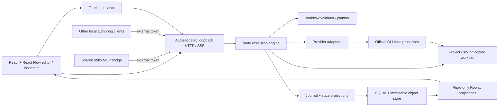

# Architecture

Version: 0.9  
Status: existing execution architecture plus implemented ADR-0001 authoring components; client verification is staged  
Updated: 2026-10-15

This document owns components and data flow. Behavioral contracts are linked from [the documentation index](README.md#rule-ownership-and-precedence).

The accepted external authoring architecture is specified in [ADR-0001](adr/0001-external-workflow-authoring-api-and-mcp.md): Codex, Claude Code, and Antigravity share one MCP bridge to the running runtime's HTTP API; other local applications use that API directly. API v3 implements discoverable schemas/templates, conditional saves and durable workflow changes. The editor subscribes to those changes. A staged confirmation policy keeps external runs disabled by default until the required pilot rerun. Client-specific isolation and live verification remain release gates; see the [implementation status](adr/0001-implementation-status.md).

## Components

| Component | Responsibility |
| --- | --- |
| Frontend | Palette, typed connections, draft editing, settings, inspectors, execution/history/navigation projections |
| Tauri | Runtime lifecycle and Windows Job ownership, native directory picker, local application root, external descriptor, first-party token kept in memory |
| MCP bridge | Provider-neutral stdio tools, descriptor/instance checks, external-token API forwarding, bounded reads and untrusted artifact provenance |
| Validator/planner | Schema and semantic checks; captured dependency graph; resources; later scopes/Cache cuts/task expansion |
| Engine | Commands, run/attempt lifecycle, inputs, processes, verified captures, durable events and projections |
| Provider adapters | Discovery/account/capabilities; explicit invocation; native session/event translation; policy errors; termination |
| Store | Hash-verified immutable records and transactional SQLite references |
| Replay projector | Captured event sequence → historical canvas/inspection state, with no execution |

React Flow state is presentation. The engine consumes saved/captured definitions, never a mutable UI graph. Reference workflows and roles are data/templates rather than provider-specific scheduler branches.

## Execution data flow

1. Save a structurally valid workflow and report semantic readiness.
2. Create a run pinning the exact workflow/settings/workspace binding.
3. Plan executable instances/scheduled attempts and run Context mappings; capture each attempt's inputs before dispatch.
4. Acquire resources, publish the invocation record, and launch a supervised CLI child.
5. Capture streaming evidence in bounded immutable batches; after termination, validate terminal outcome and outputs.
6. Commit records, journal, and projections transactionally, then publish SSE.
7. Inspect/replay those stored identities; never infer success from text alone.

Workflow authoring has a separate path: a client discovers the runtime contract and schemas, validates a candidate, then saves it with an expected ETag and stable request ID. The runtime commits the new revision, command receipt, Cache-node incarnation changes and workflow-change event together. The editor consumes durable changes and refreshes clean drafts; dirty drafts retain their local edits and base revision. External run requests use the existing workflow snapshot checks and can wait in the first-party approval queue.

M1 contracts: [workflow and catalogue](M1_CONTRACTS.md), [events](RUN_HISTORY_AND_REPLAY.md), [storage/DDL](STORAGE.md). M4/M5 introduce specification/task evidence through [Pipeline execution](PIPELINE_EXECUTION.md).

## Context and scope composition

Workflow Context definitions resolve to local native bindings. Binding identity is independent of canvas position and Agent node identity. The engine supplies explicit prompt inputs while the provider owns its native history.

M2 Loop expands the same captured body into numbered iterations. M4 nested scopes reserve resources through a hierarchy. M5 Map expands approved task definitions using pinned templates and materialized input snapshots. Each generated scope has stable parent/run/generation/task/iteration/attempt identities; UI navigation does not become another source of runtime state.

Specification bundle → documented map → map execution → task attempts/results → candidate/checks → final review subject forms a provenance chain. The map itself contains no provider session or progress state.

## Filesystem and trust boundary

Application evidence and disposable work directories are siblings as specified by [STORAGE.md](STORAGE.md#layout-and-ownership). The default agent access policy is Full Access; native account state can extend beyond application-supplied inputs. Resource locks serialize cooperative writers but are not an OS sandbox.

Immutable captured files are review identities. Assembly and runner copies are derived from them; mutable live task directories are never review subjects.

## Runtime implementation

M1–M6 and the reference Delivery Loop are implemented in `runtime/core/engine.mjs`, `runtime/core/store.mjs`, the workflow planners and `runtime/core/mapRuntime.mjs`. The editor and projection code live in `src/`; `runtime/runner.mjs` owns the loopback API, and `src-tauri/src/main.rs` supervises the runtime and applies Windows Job containment. `runtime/core/adapters.mjs` invokes the installed provider CLIs. The project [README](../README.md) lists current commands and prior milestone evidence.

ADR-0001 adds API v3 authoring, durable workflow revisions/events, the shared bridge at `mcp/bridge.mjs`, and first-party approval for external run requests. The code is present, while the ADR-specific client isolation and real-provider pilot rerun remain staged in the [implementation status](adr/0001-implementation-status.md).

## Delivery constraints

Node.js and official CLIs remain external dependencies. Persistent provider processes/app-server, remote workers, arbitrary scripts, and automatic Git worktrees are deferred. Missing provider capability blocks execution without substitution.

The milestone sequence and contract readiness are owned by [MILESTONES.md](MILESTONES.md). This documentation does not substitute for real adapter/cancellation/account verification during authorized implementation.
