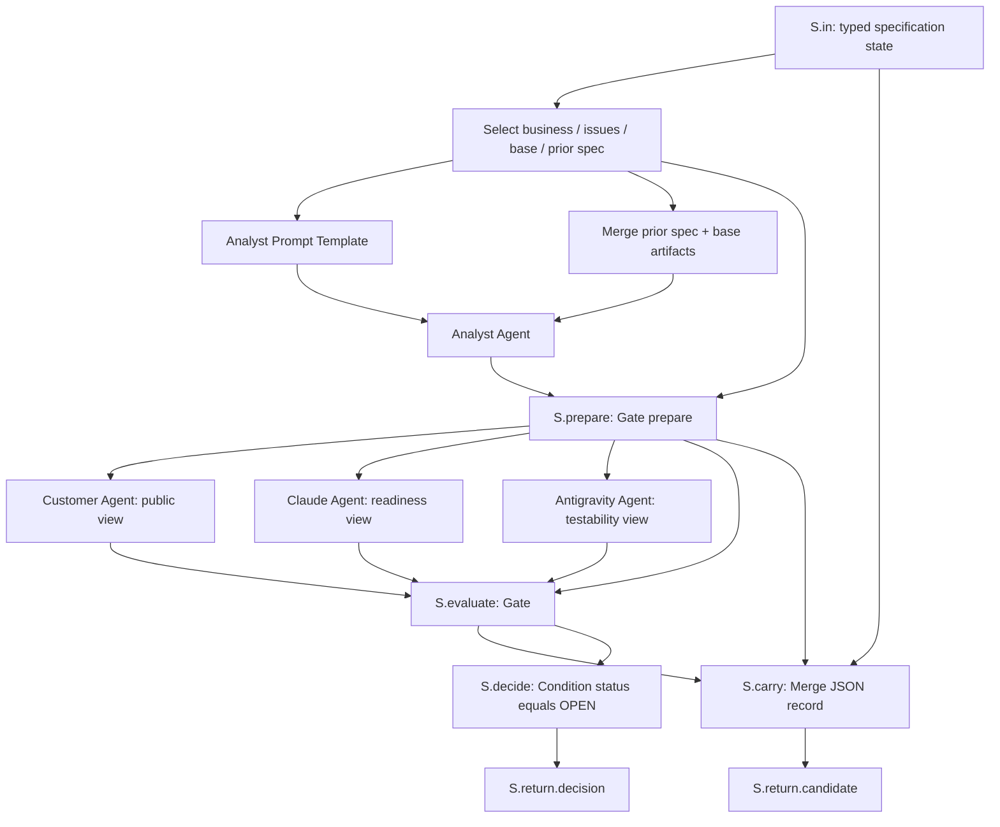
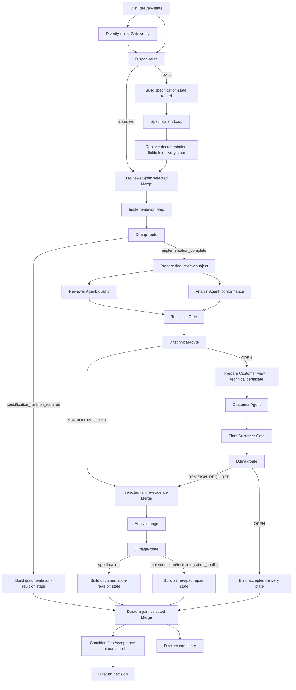
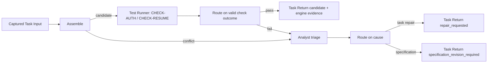

# Reference Pipeline: Documentation to Accepted Implementation

Version: 0.7  
Scenario: user-selected; mechanisms proposed  
Updated: 2026-10-13

Start with a business task. Codex Analyst improves its specification/map until Codex Customer, Claude readiness reviewer and Antigravity testability reviewer approve. Then execute documented code/test tasks with snapshot review, real checks, typed repair, final technical review and Customer acceptance.

This file owns the **scenario and wiring**, not generic execution rules. It is not a completed real run. M5 implements a conservative variant; M6 adds selective carry across document revisions. [Milestones](MILESTONES.md) lists schemas still required before those stages.

## Roles

| Role | Binding | Responsibility and Context |
| --- | --- | --- |
| analyst | Codex | Draft/revise, triage, final conformance; own pipeline Context |
| customer | Codex | Public business/API documentation and final outcome; own Context |
| implementation-readiness | Claude Code | Documentation completeness/decomposition; documentation Context |
| testability-reviewer | Antigravity | Observable behavior/criteria; documentation Context |
| implementer | Claude Code | Approved code task; per-task Context |
| test-author | Antigravity | Approved test task; per-task Context |
| reviewer | Codex | Test/code or final-quality snapshot; separate review-purpose Context |
| verification | Engine utility template | No own model/session; embeds Analyst triage through the declared Analyst pipeline Context |

Models and native profiles are explicit captured bindings. Documentation reviewers do not become implementers in their existing sessions. Sharing a provider does not share a Context; separate Contexts do not guarantee isolation from account-level memory/instructions.

## Success

Success is a stored final Customer APPROVED decision and engine certificate for the current specification/candidate/passing reports/technical approvals. A completed map or green check alone is insufficient. The accepted candidate can be inspected/exported; no deployment is performed.

## Structured carried records

Specification Loop uses `pipeline-state.schema.json#/$defs/specificationState`. Delivery Loop uses `#/$defs/deliveryState` from [the same schema](schemas/pipeline-state.schema.json). Both carry businessTask, immutable base, specification reference, structured identified issues and nullable documentation approval. Delivery additionally carries priorMapState, repair, candidate and finalAcceptance.

ArtifactSet/record references in these records must resolve to stored hash-verified engine records. A shape-valid reference supplied by an Agent does not establish provenance. IDs below are illustrative.

```json
{
  "schemaVersion": 1,
  "businessTask": "Let a reconnecting client inspect and resume its paused round.",
  "base": {
    "kind": "ArtifactSet",
    "subjectId": "BASE-ROUND-1",
    "manifest": {
      "artifactId": "00000000-0000-4000-8000-000000000001",
      "sha256": "aaaaaaaaaaaaaaaaaaaaaaaaaaaaaaaaaaaaaaaaaaaaaaaaaaaaaaaaaaaaaaaa"
    }
  },
  "specification": null,
  "issues": [],
  "documentationApproval": null,
  "priorMapState": null,
  "repair": null,
  "candidate": null,
  "finalAcceptance": null
}
```

The next feedback message may say “address blockers”, while the carried issues preserve IDs/owners/requirements and requested changes. JSON serialization is explicit through JSON Select; native history is not a replacement for this data.

## Specification Loop wiring

This is a primitive-level body specification for M4, **not a core-v1 workflow file**. The full M2/M4 serialized node configs/boundaries must be written before coding those milestones.



All IDs in the following table are body nodes or declared boundaries. Static role instructions are ordinary captured Text nodes; output schemas and Context links are captured configuration.

| Node / input binding | Exact source or configuration |
| --- | --- |
| S.business JSON Select | S.in.value; pointer `/businessTask`; Text raw-string |
| S.issues JSON Select | S.in.value; `/issues`; JsonValue |
| S.issue-text JSON Select | S.in.value; `/issues`; Text canonical-json |
| S.base / S.previous JSON Select | S.in.value; `/base` and `/specification`; ArtifactSet; previous null explicitly becomes empty set |
| S.analysis-files Merge | All-required ArtifactSet merge of S.base.value + S.previous.value |
| S.analysis-prompt Prompt Template | Slots business = S.business.value, issues = S.issue-text.value; literal instructions to draft/revise SPEC.md, spec-index.json and implementation-map.json |
| S.analyst Agent | prompt = S.analysis-prompt.text; files = S.analysis-files.value; analyst Context; capture declared bundle files |
| S.prepare Gate prepare | subject = S.analyst.files; base = S.base.value; issues = S.issues.value; validate bundle/index/map and produce immutable subject plus role views |
| S.customer / S.readiness / S.testability Agents | files = matching S.prepare named view; prompt = corresponding static Text instruction; separate role Context/model; strict ReviewDecision output |
| S.evaluate Gate evaluate | subject = S.prepare.subject; named customer/readiness/testability inputs = corresponding Agent.json; whole-subject required policy; slots customer→customer, readiness→implementation-readiness, testability→testability-reviewer |
| S.carry Merge record | Named inputs seed = S.in.value, subject = S.prepare.subject, report = S.evaluate.report. Fields: schemaVersion = literal 1; businessTask/base = seed fields; specification = subject typed reference; issues = report `/issues`; documentationApproval = report `/certificate` |
| S.decide Condition | value = S.evaluate.report; doneWhen `/status equals "OPEN"`; reason/feedback = raw-string `/reason` |
| S.return boundary | candidate = S.carry.value, validated specificationState; decision = S.decide.decision |

OPEN returns the approved candidate; REVISION_REQUIRED repeats with the new spec/issues. PENDING emits no Gate report, so Return cannot fire. CLI failure goes to operational recovery rather than returning false.

M4/M5 run all three reviewers after each authored revision. M6 inserts the [per-role review-needed Routes](PIPELINE_EXECUTION.md#selective-reviews-at-m6) between prepare and each reviewer, then joins live/stored decisions before evaluate. These Routes are part of the graph, not hidden scheduler skipping.

## Delivery Loop wiring

The Specification Loop is **inside** Delivery Loop, but an exact already-approved subject takes the bypass Route before entering it.



Nested bodies remain DAGs. The diagram's eventual repetition happens through Return, with the typed record, not backward data edges.

| Node / binding | Exact contract |
| --- | --- |
| D.select utilities | Select base/specification/documentationApproval/issue/prior-state/repair fields from D.in; explicit null handling per declared optional input |
| D.verify-docs Gate verify | Current spec/base/business input + certificate; verify exact subject/policy. Missing/stale approval → REVISION_REQUIRED; corrupt reference → operational error |
| D.spec-route Route | selector = verify report `/status`; value = D.in.value; OPEN → approved, REVISION_REQUIRED → revise |
| D.spec-seed Merge record | Only revise input; copy schemaVersion/businessTask/base/specification/issues/documentationApproval into specificationState |
| D.spec-loop | seed = D.spec-seed.value; use body above |
| D.after-spec Merge record | Copy delivery seed; replace the returned specification-state fields; clear repair/candidate/finalAcceptance. Prior map state remains a historical reference, reusable only under milestone policy |
| D.reviewed-join Merge selected | approved Route state OR D.after-spec.value; exact one active |
| D.map Map | Selected state's spec/approval/base/priorState/repair via JSON Select; pinned task templates/role registry |
| D.map-route Route | selector = Map.summary `/outcome`; value = Map.result ArtifactSet; specification_revision_required OR implementation_complete |
| D.map-revision Merge record | Requires map-route revision branch; copy base/business/specification from D.reviewed-join; take issues/state from Map.summary; set documentationApproval/repair/candidate/finalAcceptance null |
| D.final-prepare Gate prepare | Requires map-route complete branch; validate all map criteria and exact passing checks; subjectKind delivery; produce quality/conformance views |
| D.quality / D.conformance Agents | Matching prepared view + captured Text role prompt; distinct reviewer/analyst Contexts |
| D.technical Gate evaluate | Exact prepared subject and both named decisions; slots quality→reviewer, conformance→analyst |
| D.technical-route Route | selector = technical report `/status`; value = prepared subject ArtifactSet |
| D.customer-prepare Gate prepare | subject = technical-route OPEN output; priorApproval = technical certificate; customer public view |
| D.customer Agent / D.final Gate | Customer view + captured Text prompt → strict decision; evaluate against same subject and technical certificate |
| D.final-route Route | selector = final report `/status`; value = customer-prepared subject ArtifactSet |
| D.technical-failure / D.customer-failure Merge records | Each requires its REVISION_REQUIRED branch; record that subject reference and its corresponding Gate report |
| D.failure-join Merge selected | One failure record active → canonical-json Text + subject for triage; all alternatives inactive on success → Skipped/Inactive |
| D.triage Agent | failure envelope + captured approved spec; strict cause/target/issue output, engine provenance validation |
| D.triage-route Route | value = verified triage record; cases specification, implementation, tests, integration_conflict; explicit onUnmatched pause for unknown |
| D.spec-revision Merge record | Requires specification case; copy base/business/specification from D.reviewed-join and state from Map.summary, preserve identified triage issues, clear approval/repair/candidate/finalAcceptance |
| D.repair Merge record | Requires a task case; copy exact approved fields from D.reviewed-join; set validated triage repair/issues and Map.summary.state, clear candidate/finalAcceptance |
| D.accept Merge record | Requires final-route OPEN; copy approved fields from D.reviewed-join; set priorMapState = Map.summary.state, candidate = Map.summary.candidate, finalAcceptance = final Gate certificate, clear repair |
| D.return-join Merge selected | Map revision OR triaged spec revision OR task repair OR accepted state |
| D.decide Condition | value = return-join state; doneWhen `/finalAcceptance not-equals null`; literal reason “Continue until final acceptance is recorded”; feedback “Use the carried structured issue and repair records” |
| D.return | Candidate = validated deliveryState; decision = D.decide.decision |

State builders copy fields by fixed mappings and explicit literals; no scripting or interpreting Agent prose. Branch-dependent required inputs ensure Customer/final/repair nodes cannot run when their Route is inactive. Operational failures/unknown cause produce no Return decision.

Map's verification template performs Assemble/Test Runner/triage inside Map. The outer graph reuses its exact passing reports for final review; it does not run a duplicate integration suite.

## Verification task wiring inside Map

TASK-VERIFY inputs are the accepted four source TaskResults and base.



Conflict and failed-check branches use an explicit selected evidence join before triage; when all checks pass, both alternatives are inactive and the join/triage branch is Skipped. The join's structured evidence is rendered by JSON Select; Analyst triage is a declared embedded Agent invocation using the outer Analyst pipeline Context. Operational runner/assembly failures pause instead. Unknown triage pauses the cause Route. Engine Map applies repair targets, invalidates consumers, and re-expands ready attempts under [the Map verification-cycle bound](IMPLEMENTATION_MAP.md#verification-cycle-bound); changing target tasks does not reset its counter; TASK-VERIFY acceptance requires both actual checks. No backward task edge or premature acceptance is added.

## Worked round-recovery example

Use [SPEC.md](examples/round-recovery/SPEC.md), [spec-index.json](examples/round-recovery/spec-index.json), and [implementation-map.json](examples/round-recovery/implementation-map.json). The future toy base provides the HTTP adapter, fixtures/stores, clock/token factory, and harness. These files do not exist merely because this documentation names them.

1. **Revision 1 rejected.** Expiration/error precedence are ambiguous. Claude and Antigravity return identified issues; Customer's business approval alone cannot open Gate. Map remains a preview.
2. **Revision 2 approved.** Analyst writes the linked precise boundary, ownership and atomic-duplicate rules. All three documentation roles re-review at M4/M5. Four source tasks are potentially independent, although provider slots serialize same-provider work.
3. **Source acceptance.** Codex reviews captured code/tests. Test tasks also pass their syntax criteria. Antigravity can work on another task/B while Codex reviews saved A. Map shows 4/5 accepted when verification becomes ready.
4. **Boundary defect.** CHECK-AUTH runs on CANDIDATE-ROUND-4 and exits 1: `expiresAt === now` is wrongly accepted because the implementation used `<` instead of `<=`; expected HTTP 401, observed 200. This is valid failed-check evidence, not a broken reporting attempt.
5. **Targeted repair.** Analyst triage identifies implementation and TASK-AUTH-CODE under REQ-AUTH/CONTRACT-AUTH. Engine retracts that selection and stales TASK-VERIFY. Claude repairs using its own compatible task Context; scoped review verifies issue resolution. Other source selections remain valid within this same spec.
6. **New candidate/checks.** Assemble pins the repaired auth result with the other selections. Both suites pass on the new candidate; map reaches 5/5 and completes.
7. **Final reviews.** Quality and conformance approve that exact subject, then Customer receives the public business view and approves. Default single Codex capacity serializes these calls.
8. **Alternative Customer change.** If Customer requests `resumable` in GET, triage produces specification cause; Delivery Return clears docs approval and enters Specification Loop next iteration. M5 re-reviews/rebuilds the new spec. M6 may carry auth scopes/results only after proving independence; recovery/verification and final approvals become stale.

If a test expected the wrong expiration behavior, target the test task. If requirements did not define the boundary, reopen specification. A measured mismatch alone does not identify its cause.

## Acceptance exercises

| Exercise | Earliest complete milestone |
| --- | --- |
| Save/load Context chain, immutable inputs/outputs, root Stop/restart | M1 |
| Agent/deterministic structured Loop, limits, invalid decision and read-only iteration Replay | M2 |
| Frozen cuts versus native/After/file prerequisites; manual chat lock | M3 |
| Documentation rejection/revision/approval; public Customer view; all-role re-review; exact-approved bypass | M4 |
| Toy project with actual syntax/integration checks, failed-check triage, same-spec selective repair, Map verification limit and embedded-role bindings | M5 |
| Snapshot A review while B/other task is produced; candidate conflict detection; operational runner failure | M5 |
| Paused template edit remains pinned; explicit new-template generation invalidates affected results | M5 |
| New specification conservatively re-reviews/rebuilds at M5 | M5 |
| Unchanged scopes carry only verified approvals; per-role Routes skip live reviewers | M6 |
| Changed ownership/auth dependency invalidates all affected recovery scopes; unknown closure cannot carry | M6 |
| Accepted delivery and passing TASK-VERIFY propagate all-inactive failure joins without waiting | M4/M5 |
| Generated map/task generations and old acceptance/selection facts replay correctly | M6 |

Fixtures establish deterministic engine behavior first; prepared toy-project commands establish actual check provenance next. Real subscription CLIs are exercised later during authorized implementation verification. Documentation validation alone proves none of those runtime outcomes.
