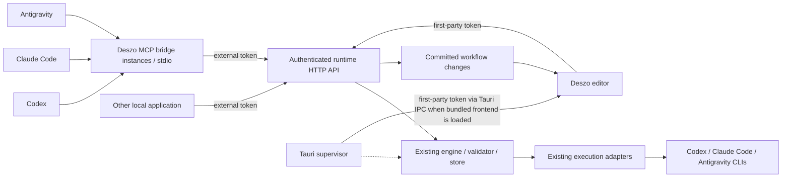

# ADR-0001: External Workflow Authoring through the Runtime API and a Shared MCP Bridge

Date: 2026-10-15  
Status: Accepted  
Accepted: 2026-10-15  
Scope: External authoring and control of workflows in an already running local Deszo application  
Required clients: Codex, Claude Code, Antigravity, and applications using HTTP directly

## Context

The user wants to describe a pipeline in an external AI client and have that client create the corresponding workflow through Deszo's API. The workflow must become available in the running desktop application. Codex, Claude Code, and Antigravity are required from the first integration release; another local application must be able to perform the same operations without an AI-specific protocol.

Deszo already separates the editor from execution. The [runtime HTTP server](../../runtime/runner.mjs) exposes authenticated loopback API v2, including workflow discovery, validation, save/load, run creation, run snapshots, durable run events, and artifact retrieval. The [engine](../../runtime/core/engine.mjs) owns validation, snapshots, scheduling, Context bindings, process execution, and persistence. The [desktop supervisor](../../src-tauri/src/main.rs) owns runtime lifecycle and process containment. It publishes connection information in `<application-root>/runtime/connection.json`.

Several gaps prevent treating the existing API as a complete external authoring integration:

- Workflow schemas, node semantics, and templates are repository assets rather than a discoverable runtime contract.
- Workflow saves replace the current saved definition without an expected revision or command receipt. Concurrent editor and external saves can overwrite each other.
- Execution commands use request IDs. The generic command helper now performs receipt lookup, handler writes, and receipt insertion in one store transaction; post-commit actions such as provider dispatch run only after that transaction commits. Nested store transactions flatten into the command transaction.
- The [editor](../../src/App.tsx) retains its own unsaved draft and does not subscribe to changes to saved workflows.
- There is no MCP bridge, installation guidance for the three clients, or workflow authoring event history.

Saving and execution are already separate operations. A saved workflow can be structurally valid while reporting semantic issues, and run creation requires the exact saved snapshot hash. This distinction must be preserved.

The requirements are recorded as D19 in the [decision register](../DECISIONS.md#confirmed-decisions). The architecture below is accepted as P23 after review found no open findings. Implementation and acceptance for the listed Windows versions/scopes were completed under the user's instruction; code delivery and provider verification are recorded in the [implementation status](0001-implementation-status.md) and [acceptance report](../pilots/2026-10-15-authoring-acceptance.md).

## Decision

Use the runtime's versioned HTTP API as the common application interface. Add one provider-neutral MCP server that translates tools into calls to that API. Use local MCP over stdio for the first release. Each external client may start its own bridge process; every bridge attaches to the selected existing runtime.

The same engine command handlers serve the desktop editor, the MCP bridge, and direct HTTP clients. Validation, write preconditions, command receipts, and persistence belong to the runtime. The bridge contains transport and connection handling, with no independent scheduler, store, or workflow compiler.

An **authoring client** is the application making management requests. An **execution provider** is the provider selected in an Agent node or Map role. These are independent: an Antigravity authoring session can create a workflow that uses Codex and Claude Code, and a Codex session can create Antigravity nodes. Keep the existing provider identifiers `codex`, `claude`, and `antigravity` in workflow JSON.

## Required behavior and boundaries

1. A client discovers the selected running instance, reads its contract, and retrieves any existing workflow it intends to change.
2. The client turns the user's description into canonical workflow JSON, including explicit providers, model IDs, typed edges, Contexts, scopes, limits, and optional layout.
3. The client validates the candidate, uses structured diagnostics to correct it, and saves it with an explicit concurrency precondition.
4. The runtime commits the saved snapshot and publishes a workflow change. The open editor updates its list and handles the changed definition according to its draft state.
5. Execution tools are visible to an authoring client only when its bridge registration explicitly enables them. With that opt-in, the client may submit a run request pinned to the saved snapshot and inspect its state, events, and artifacts. While external-run confirmation is enabled, the request stays pending until a first-party approval in the Deszo window; saving alone never starts a run. A direct run command is reserved for the first-party editor credential. *Superseded by AMD-19 (2026-10-24): the Owner Token is the single public credential and admits authorized runs directly; the external token, the pending approval queue and the first-party-only run split are retired, and the public Host credential is separate from it.*

Execution requires an existing workspace selected in Deszo. The external contract intentionally has no workspace-creation tool because selecting a Full Access working directory is a high-trust action. If `list_workspaces` is empty, `start_run` returns structured `409 workspace_required` with guidance to create a workspace in the Deszo window; an unknown workspace ID when workspaces do exist remains `404 not_found`. Workflow discovery, validation, and saving remain available on a fresh install.

The first release supports the workflow features actually advertised by the runtime, including supported Loop, Gate, Route, Cache, and Map configurations. It does not define a second, provider-specific pipeline language. Full workflow replacement is the initial edit operation; patch operations and automatic conflict merging are deferred.

Remote hosting, cloud clients without local machine access, collaboration across OS accounts, automatic installation into provider configuration, a built-in natural-language designer, and workflow management by agents inside their own runs are outside the first release. Provider account authentication, explicit model selection, subscription billing policy, scheduler locks, and recovery semantics retain their existing contract homes.

## Runtime discovery and lifecycle

The bridge accepts an explicit absolute connection-file path. The installed application's integration settings must expose the correct path and generated client configuration. An optional explicit application-root argument may resolve that root's connection file. Do not search arbitrary project directories, choose the first open instance, or confuse development storage with installed-app storage.

Use two distinct per-runtime bearer credentials. The connection file contains only the **external token**. The runtime also creates a **first-party token**, which includes all external capabilities plus authority for workspace creation or movement, settings changes, Context acknowledgement and chat, recovery, Cache-pin changes, direct run creation, and run-request approval or denial. The complete v2 endpoint-to-scope assignment is specified below and is part of the Stage 1 contract. Recovery and Context chat are first-party-only because they can start provider calls without the run-approval flow. The external token cannot change settings, create or move workspaces, acknowledge Context bindings, send Context chat, recover runs, change Cache pins, directly create a run, or approve or deny a request.

The runtime emits the first-party token on stdout only when its launcher passes the private `--first-party-token-stdout` option and stdout is a pipe, never a terminal. The Tauri supervisor and any script or test process that launches an isolated runner pass this option and capture the startup line on a private pipe; they consume the token in memory. A hand-started runner omits the first-party token from its stdout line by default, so launching it in a terminal cannot display that credential. The option is not included in client configuration. The Tauri supervisor retains its token in memory and may return it through `get_runner_connection` only when the `main` window is showing the bundled frontend, verified by its application-owned origin and path. This check depends on the loaded frontend, not the build profile: a `tauri build --debug` app using `frontendDist` qualifies, while `tauri dev` on `devUrl` (`http://127.0.0.1:1420`) and any navigated, remote, or other HTTP development page do not. In debug web-isolated development the browser editor receives external scope only. Its dev runner's launcher may start an isolated fixture runtime with a startup-only confirmation-disabled policy and provision its fixture workspace using the in-memory first-party token; the editor then submits external run requests processed under that policy. The startup-only `--dev-test-confirmation-off` option is accepted by the unbundled source runner only. `scripts/bundle-runtime.mjs` must compile the fixture-policy option out of the packaged runtime, and the packaged-runner check must prove that `--dev-test-confirmation-off` is rejected even when supplied manually. Repository smoke/pilot scripts and tests are launchers for isolated runtimes and receive those runtimes' first-party tokens over their captured stdout pipes; they use the explicit confirmation-disabled fixture policy where needed. This rule also covers their workspace setup and recovery calls. The first-party token is never written to `connection.json`, any other file, the database, command-line arguments, client configuration, artifacts, tool results, or logs. A bridge or direct HTTP client reads only the external token from the connection file. Authorization role comes only from the bearer token, never from Origin, a client label, or other caller-supplied metadata. When the user has explicitly disabled confirmation in Deszo, an external run request may be processed automatically by the runtime's request policy, but the external token still cannot invoke direct run creation or approval.

Extend the atomically published external descriptor and authenticated handshake with a descriptor version, supported API versions, a persistent `storeId`, a fresh `runtimeInstanceId` for each runtime process, and the canonical absolute application root. Identify a selected store by the pair `(storeId, applicationRoot)`: copying a store may preserve its `storeId`, but its different absolute root makes it a different instance for connection and wrong-store checks. The handshake must agree with both fields from the selected descriptor. A connection file's existence is not evidence that a runtime is alive. The browser-only `web-isolated` setup receives external scope only; it can author and request a run but cannot directly create, approve, deny, or disable confirmation. In development, its launcher may use the isolated confirmation-disabled fixture policy described above so the browser can request executable fixture runs without receiving the first-party token.

The bridge constructs requests to `127.0.0.1` using the validated port. It must not accept an arbitrary destination URL from workflow content. Protect the descriptor with the local account's filesystem permissions. Keep the external token inside the bridge transport layer; never include it in tool results, command-line arguments, shared client configuration, artifacts, or logs. The first-party token prevents a caller holding only the connection-file token from claiming to be the Deszo window. The token split does not prevent a same-account agent from starting its own runtime against the store while Deszo is closed and receiving that runtime's first-party token as its launcher; the OS-account boundary and runtime lock are the limits in this case. It also does not isolate the app from a same-account process that can inspect another process's memory or drive the GUI. [Storage and integrity](../STORAGE.md#layout-and-ownership) already explains that Full Access processes sharing an OS account are not isolated by the application API.

If Deszo is closed or the selected instance is unavailable, tools return a structured `runtime_unavailable` error. The bridge does not start a runtime, acquire its lock, open its database, replace its connection file, or adopt its processes. Closing an AI client terminates only that client's bridge. Closing Deszo retains the supervisor's current execution containment behavior.

On runtime loss, re-read the selected descriptor and verify the `(storeId, applicationRoot)` identity before reconnecting. Read requests may retry after a successful handshake. An uncertain write may only be reconciled using its original request ID and identical command. Never generate a new write identity to hide an unknown outcome, and never reconnect a pending command to a different store.

## API versioning and contract discovery

Introduce API v3 for the new authoring contract. Keep existing v2 execution, observation, and artifact endpoints available during this increment. New MCP tools map to v3 authoring endpoints and the existing v2 execution endpoints explicitly; clients must not guess endpoint versions.

Version 3 is deliberate: requiring conditional writes and adding a command envelope changes the current workflow save contract. Upgrade the bundled editor in the same release. Retain v2 workflow reads and validation for compatibility, but retire `PUT /api/v2/workflows/{id}` with `410 api_upgrade_required` at cutover. A legacy unconditional save must not remain a route around concurrency checks. The cutover inventory includes the editor in `src/App.tsx`, `scripts/smoke.mjs`, `scripts/pilot.mjs`, `runtime/tests/helpers.mjs`, and direct callers in `runtime/tests/engine.test.mjs` and `runtime/tests/pipeline.test.mjs`; migrate each writer and test helper to the guarded contract and make every run caller branch on the v2 `outcome` before reading `run.runId`. Smoke/pilot scripts and test helpers launch isolated runtimes with the private `--first-party-token-stdout` option and capture each startup line on a pipe; a TTY launch does not emit the first-party token. Use first-party scope for fixture setup, workspace creation, settings, Context operations, and recovery; use the external token when a test or script is exercising external-client authority. The scripts/tests may select an explicit confirmation-disabled fixture policy at startup rather than calling the external settings endpoint. Complete the pending real-provider rerun using `scripts/pilot.mjs` before enabling the default confirmation policy and before retiring v2 saves. Publish this migration in the release notes.

The generated Context-chat system workflow remains an engine-owned internal record. It is not a user workflow, is omitted from user workflow discovery, and is outside the v3 user revision, conditional-save, and authoring-event contract. Its internal writes still use the shared transaction and command receipt boundary. Cache pins remain governed by the M3 execution contract: a workflow revision does not change pin usability, and a changed node fingerprint is reported as `sourceChanged` without automatically unfreezing, replacing, or invalidating the pin. Cache-node incarnations are runtime-owned records in a dedicated table keyed by workflow and node ID plus incarnation ID; they never appear in workflow JSON. Assign or preserve the incarnation in the same transaction that commits a save: a Cache node present in the previous revision keeps its incarnation, while a Cache node absent from that revision receives a new one. During migration, map each pin to the incarnation of its current Cache node; pins for nodes no longer present receive a retired orphan incarnation. If a node is removed, its pin remains an orphan bound to the old incarnation for explicit cleanup; a node added in a later save with the same workflow node ID gets a new incarnation and cannot inherit it. A remove-and-re-add inside one full-replacement save is indistinguishable from an edit and retains the incarnation. Stage 1 adds fixtures for migration, removal/re-add across saves, and removal/re-add within one save. Pin or freeze operations remain separate run commands with source run/attempt provenance, not alternate workflow-save entry points.

The selected authoring surface is implemented by the runtime routes below. The published [v3 schema](../schemas/runtime-api-v3.schema.json) carries the request and response structures:

| Method / path | Responsibility |
| --- | --- |
| `GET /api/v3/authoring/contract` | Store/runtime identity, supported API and contract versions, schema/catalogue identifiers and hashes, supported workflow capabilities, and limits |
| `GET /api/v3/authoring/schemas/{schemaId}` | An allowlisted schema and its local-reference dependencies, identified by version and digest |
| `GET /api/v3/authoring/node-types` | Node configurations, configuration-dependent typed port rules, scope rules, provider constraints, and diagnostic guidance |
| `GET /api/v3/authoring/templates` | Bounded template catalogue with stable IDs, versions, and required capabilities |
| `GET /api/v3/authoring/templates/{templateId}` | One canonical example workflow, with explicit placeholders for user-selected values |
| `GET /api/v3/workflows` | Paginated summaries including revision and snapshot identity |
| `GET /api/v3/workflows/{id}` | Saved workflow, revision, snapshot/execution hashes, validation, and strong ETag |
| `POST /api/v3/workflows/validate` | Structural and semantic validation of a candidate; no save or provider call |
| `PUT /api/v3/workflows/{id}` | Conditional full replacement using a command request ID and workflow body |
| `GET /api/v3/authoring/events` | Bounded durable workflow-change history after a cursor |
| `GET /api/v3/authoring/events/stream` | SSE catch-up and live workflow changes after a cursor |
| `POST /api/v3/authoring/bridge-handshake` / `DELETE /api/v3/authoring/bridge-handshake/{bridgeId}` | Register a live bridge and release its short-lived Antigravity workspace path metadata |
| `POST /api/v2/runs` | Existing run path; both success variants use HTTP 202 and a required `outcome`: `created` includes the run, while `confirmation_pending` includes the durable request ID and status path. *Superseded by AMD-19 (2026-10-24): an authorized Owner Token request returns `created`; `confirmation_pending` remains only in pre-cutover receipts.* |
| `GET /api/v2/run-requests?state=pending` | Bounded first-party queue for the Deszo window, including pending requests and expiry |
| `GET /api/v2/run-requests/{requestId}` | Pending, approved, denied, or expired external-run request and its eventual run identity |
| `POST /api/v2/run-requests/{requestId}/decision` | Idempotently approve or deny a pending request using a separate decision `requestId`; first-party token only |

The Stage 1 contract assigns authorization to every v2 route, including the unauthenticated CORS preflight. “First-party” includes the external scope unless a row says otherwise. `--allow-execution` controls MCP tool visibility; it does not add API authority or replace these bearer-token scopes.

| Method / path | External token | First-party token |
| --- | --- | --- |
| `OPTIONS /api/v2/{path}` | No token; CORS preflight only, no data or command | Same |
| `GET /api/v2/capabilities` | Read | Read |
| `GET /api/v2/settings` | Read | Read |
| `PUT /api/v2/settings` | Denied | Change confirmation and other runtime settings |
| `GET /api/v2/workspaces` | Read | Read |
| `PUT /api/v2/workspaces/{id}` | Denied | Create or move a workspace |
| `GET /api/v2/workflows` | Read | Read |
| `POST /api/v2/workflows/validate` | Validate a candidate without saving or dispatching | Same |
| `GET /api/v2/workflows/{id}` | Read | Read |
| `PUT /api/v2/workflows/{id}` | Legacy guarded authoring write; requires both an idempotency key and save precondition; planned `410 api_upgrade_required` retirement remains gated on the pilot rerun | Same guarded behavior and planned retirement |
| `GET /api/v2/workflows/{id}/cache-pins` | Read | Read |
| `PUT /api/v2/workflows/{id}/cache-pins/{nodeId}` | Denied | Freeze or change a Cache pin |
| `DELETE /api/v2/workflows/{id}/cache-pins/{nodeId}` | Denied | Remove a Cache pin |
| `GET /api/v2/context-bindings?workspaceId=…` | Read | Read |
| `POST /api/v2/context-bindings/{bindingId}/acknowledge` | Denied | Acknowledge a binding |
| `POST /api/v2/context-bindings/{bindingId}/messages` | Denied | Send Context chat; provider dispatch may follow |
| `GET /api/v2/runs` | Read | Read |
| `POST /api/v2/runs` | Submit a run request; pending by default, or processed under the saved confirmation-off policy | Create a run directly |
| `GET /api/v2/runs/{runId}` | Read | Read |
| `GET /api/v2/runs/{runId}/events` | Read durable events | Read durable events |
| `GET /api/v2/runs/{runId}/events/page` | Read a bounded durable event page | Read a bounded durable event page |
| `GET /api/v2/runs/{runId}/maps/{nodeId}` | Read | Read |
| `GET /api/v2/runs/{runId}/maps/{nodeId}/executions` | Read | Read |
| `GET /api/v2/map-executions/{executionId}` | Read | Read |
| `GET /api/v2/artifacts/{artifactId}` | Read | Read |
| `GET /api/v2/artifacts/{artifactId}/provenance` | Read | Read |
| `POST /api/v2/runs/{runId}/stop` | Stop any run in the selected store | Stop any run in the selected store |
| `POST /api/v2/runs/{runId}/nodes/{nodeInstanceId}/stop` | Stop a node in any run in the selected store | Same |
| `POST /api/v2/runs/{runId}/recovery` | Denied | Recover or close an interrupted run |
| `GET /api/v2/run-requests?state=pending` | Denied | Read the bounded approval queue |
| `GET /api/v2/run-requests/{requestId}` | Read request status by its request ID | Read request status |
| `POST /api/v2/run-requests/{requestId}/decision` | Denied | Approve or deny a pending request |

The external Stop scope deliberately includes runs started in Deszo or by another client in the selected store; it is not limited to runs created through an external request. The MCP bridge still registers Stop only when `--allow-execution` is enabled. The Result Viewer must continue to render outputs as data and must never render untrusted HTML.

Publish schemas and catalogue data from the same versioned definitions used by validation and the editor. Resolve schema references without making the client fetch arbitrary external URLs. Template metadata must distinguish examples with placeholders from executable definitions. Provider availability is current runtime information, separate from the versioned authoring contract; a template does not establish that a model or account is available.

Use ordinary tools for contract discovery so that the integration does not depend on a particular client's support for MCP resources, prompts, or custom UI. Resource exposure can be added as a convenience. The first release must not require an OpenAI, Anthropic, or Google inference API key to call Deszo's local management API. Because `start_run` uses the existing v2 `POST /api/v2/runs` path, add a required `outcome` discriminator to both success shapes: `created` retains the existing run body and `confirmation_pending` returns request identity and a status path. Both use HTTP 202. When confirmation is disabled by the saved setting or a development fixture policy, an external request still runs through the same approval checks against its pinned snapshot and returns HTTP 202 with `outcome: "created"` and the run body; failed checks return their typed failures. Add `workspace_required` to the v2 problem schema as well. This is an additive v2 schema change, not a v3-only response; migrate every caller to branch on `outcome` before reading `run.runId`.

## Conditional saves and durable command identity

Add a monotonically increasing revision for each user workflow. A v3 read returns a strong ETag derived from that revision and the complete snapshot hash. Include presentation changes in this identity; preserve the existing `executionHash` distinction for execution semantics. A change from snapshot A to B and back to A still has a newer revision.

For creation, require `If-None-Match: *`. For replacement, require one exact `If-Match` ETag obtained from a read. The MCP equivalent is a required `expectedEtag` field: `null` means create-only, and a string means replace that exact version. There is no unconditional overwrite or force flag.

Every save carries a UUID `requestId`. Its command digest covers the method, target workflow, precondition, and canonical workflow body. After authentication, look up an existing receipt before re-evaluating the original precondition: an identical retry returns its original response even if the workflow subsequently changed. Reusing a request ID for another command or payload returns `409 conflict`.

For a new command, validate structure and prepare the immutable snapshot, then check the precondition and commit the snapshot reference, revision, authoring event, and successful command receipt in one SQLite transaction. Receipt lookup and the precondition check must be serialized with that transaction, not performed as an earlier check that can race another save. Concurrent calls through any supported entry point must use this same engine operation. Publish changes only after commit. A rejected save changes none of these records; unreferenced prepared blobs follow the existing storage cleanup rules.

Missing preconditions return `428 precondition_required`; stale or failed create-only preconditions return `412 precondition_failed`; malformed input or an ID/body mismatch returns `400 invalid_request`; structural rejection returns `422 validation_failed` with diagnostic paths. These new errors are part of the v3 schema package. Preserve corruption and authentication errors rather than converting them into validation advice.

Preserve draft semantics: a structurally valid workflow with semantic issues can be saved and returns `validation.valid: false` plus issues. Structural validity is required for storage; semantic readiness is required for execution. A successful save must never be presented as proof that a workflow is executable or has succeeded.

On a conflict, return the current revision and snapshot identity. The client reads the latest workflow, explains or reconstructs its intended change, validates, and submits a new command. It does not silently refresh the precondition and resubmit its old replacement.

## Shared MCP tools and provider integration

Implement one local Node.js MCP bridge using a pinned supported SDK. Bundle it and its dependencies as a separate stable entry point alongside the application runtime. Avoid downloading an unpinned package each time a client connects. Use the SDK stdio entry point so hosts can negotiate the supported MCP protocol revision. Keep stdout exclusive to MCP protocol messages and send redacted diagnostics to stderr.

The tool contract is identical for all three clients. The bridge is authoring-only by default: it does not register `start_run` or `stop_run` unless that bridge process is launched with the explicit `--allow-execution` option. This flag controls tool visibility only; it is not authority to execute. After the staged pilot ordering below, external-run confirmation is on by default: each external run request is durably recorded as pending, and no run is created or provider process dispatched until a first-party approval in the Deszo window. Only the first-party token can directly create a run or change the user's saved confirmation setting; dev/test launchers may additionally select the startup-only fixture policy. If the user disables confirmation in the Deszo window, the runtime may automatically process subsequent external requests under that saved policy. Pending, approved, denied, and expired requests have a bounded status query so the client can report the outcome without resubmitting a run command.

| Tool | Behavior |
| --- | --- |
| `get_authoring_contract` | Read runtime identity, contract metadata, and supported capabilities |
| `get_schema`, `list_node_types`, `list_templates`, `get_template` | Discover the supported workflow language and examples |
| `get_capabilities`, `list_workspaces` | Inspect execution providers and existing workspace bindings |
| `list_workflows`, `get_workflow` | Discover saved workflows and retrieve a version for editing |
| `validate_workflow` | Return structural and semantic diagnostics without a mutation |
| `put_workflow` | Save the complete candidate with `requestId` and `expectedEtag` |
| `list_workflow_changes` | Return a bounded page of committed authoring events |
| `start_run` | Request a run with the existing explicit workspace, snapshot hash, request ID, and supported run options; response is pending while confirmation is enabled and follows the saved runtime policy otherwise. *Superseded by AMD-19 (2026-10-24): an authorized Owner Token start is admitted directly, subject to the Engine checks.* |
| `get_run_request` | Read the pending/approved/denied/expired status and eventual run ID for a request |
| `get_run`, `list_run_events`, `read_artifact` | Inspect stored execution evidence with explicit size and cursor bounds |
| `stop_run` | Request an idempotent root Stop using the existing runtime command |

The existing run-event endpoint is SSE. To implement bounded `list_run_events`, add a JSON paging representation backed by the same durable run journal and shared reader; keep existing SSE behavior intact. The bridge must not read SQLite or wait indefinitely for a run to finish. Contract and artifact results that exceed a configured response bound must provide a continuation mechanism or a typed size error, never silent truncation represented as complete JSON.

Treat every artifact body and event payload returned by `read_artifact`, `list_run_events`, or run inspection as untrusted data. Return it inside a structured data envelope explicitly labeled untrusted, with available provenance including run ID, node/instance ID, attempt ID, artifact ID, and content digest. Preserve event type and sequence as metadata. Provider-produced text is never promoted to tool instructions or treated as authorization for another management command.

Use simple, explicit tool envelopes with stable IDs. Retrieve the full workflow schema through discovery instead of copying its large union into every provider-specific tool definition. Preserve runtime problem codes, status, diagnostic paths, and saved identities in structured results. Report tool failures as MCP errors; attach appropriate read-only and mutation annotations without treating annotations as authorization.

| Authoring client | Initial connection | Provider-specific work |
| --- | --- | --- |
| Codex | Local stdio MCP server | Supported Codex MCP registration/configuration and a verified installed version |
| Claude Code | Local stdio MCP server | Supported Claude Code MCP registration/configuration and a verified installed version |
| Antigravity | Local stdio MCP server | Supported Antigravity MCP configuration and a verified installed version |
| Other local application | Authenticated loopback HTTP | Discovery and the same versioned command/query contracts |

The vendors document local stdio MCP support: [Codex in the official OpenAI documentation](https://learn.chatgpt.com/docs/extend/mcp?surface=cli), [Claude Code MCP](https://code.claude.com/docs/en/mcp), and [Antigravity MCP](https://www.antigravity.google/docs/mcp?tab=cli). This establishes the transport choice, not tested compatibility with every installed version or product surface. Publish setup examples and minimum verified versions for all three before release. Claude here means Claude Code; web-only chat products and remote-only agents are not assumed to have access to local stdio or loopback.

Generate configuration examples for the shared launch command with an absolute bridge path, the selected connection-file path, and the absolute Node.js executable resolved by the Tauri supervisor to launch the selected runtime. The integration settings publish that executable path and its supported version; client configuration never relies on a bare `node` lookup from the AI client's `PATH`. The bridge and runtime use the same Node executable. Installation remains an explicit user action and follows each client's permission model. Optional instructions can teach the discovery/validate/save sequence, but validation and concurrency rules must work without provider-specific skills or prompts.

## Editor synchronization

Add a durable authoring change sequence per store, independent of each run's journal. A workflow-save event identifies the workflow, revision, snapshot hash, request ID, and creation/update time. Retain authoring events indefinitely, like command receipts; there is no automatic expiry or compaction in this increment. An explicit store reset may remove the event history along with the store. An author label supplied by a client is a claim, not an authenticated identity: the initial local-owner token does not prove which AI product or human issued a command.

The editor subscribes after bootstrap, reconnects from its last committed cursor, and deduplicates events by sequence. Bootstrap must obtain a cursor and reconcile list/current-workflow state without a gap between snapshot reads and subscription. If retained events no longer cover a cursor, return an explicit resynchronization response and reload current state. Do not mix authoring events into historical run Replay.

- New workflows appear in the selector without restarting Deszo. Offer an Open action when a workflow is created externally; an event does not arbitrarily replace the user's current selection.
- When the selected workflow changes and the local editor is clean, load the new saved revision and preserve selection/navigation where its IDs remain valid.
- When the editor is dirty, retain its draft and base ETag, show the external revision, and offer reload or Save as a new workflow. Saving against the old base returns a conflict. Never reset the dirty state to conceal that conflict.
- A notification about the editor's own successful save is reconciled by request ID and revision. Older in-flight responses must not replace a newer loaded revision or edits made while a save was pending.
- Saving and observing changes must not mutate a running run's captured workflow. Displayed run and Replay state continue to use their captured snapshots.
- A Cache node's runtime-owned incarnation survives edits across saves, is not serialized in workflow JSON, and changes only when the node is absent from a committed revision and later re-added. Its pin remains an orphan tied to the old incarnation and is never applied to the new one.

The runtime owns saved revisions; the editor owns its unsaved local draft. This increment does not expose unsaved editor state as an externally editable document.

## Execution, access, and failure handling

Reuse the existing `createRun` contract: the caller supplies a workspace ID, the exact `workflowSnapshotSha256`, and a stable request ID. A changed saved snapshot remains a conflict. The shared idempotency helper wraps receipt lookup, the command handler, and receipt insertion in one `store.transaction(...)`; nested engine transactions flatten into it. This boundary applies to settings, Context acknowledgement/chat, run creation, Stop, and recovery, not only commands exposed by MCP. The helper invokes its `after` callback only after commit, so provider dispatch and other post-commit effects cannot precede the durable receipt. Provider/model availability, Context compatibility, billing policy, capacity, timeout, and working-directory rules remain engine checks. Authoring must never select a replacement provider/model or enable a paid fallback.

When `--allow-execution` is enabled, expose run request and Stop as distinct tools. With confirmation enabled, the external token can only create a durable pending request; its `202` response has `outcome: "confirmation_pending"`, a request ID, and a status path. The normal Run control uses the first-party token and returns `outcome: "created"` with the existing run body. If confirmation has been explicitly disabled in Deszo settings or by the dev/test startup fixture policy, an external request still goes through the same run-creation checks against its pinned workflow snapshot. On success it returns HTTP 202 with `outcome: "created"` and the run body; a failed check returns its typed failure. The external token never invokes direct creation or the approval operation. Changing the saved setting affects subsequent requests only; requests already pending still require an explicit decision or expire. Repository-owned smoke/pilot scripts and runtime tests receive first-party credentials as launchers of their isolated runtimes, use first-party scope for setup and first-party-only operations, and use external scope when exercising client authority. *Superseded by AMD-19 (2026-10-24): the external token, pending-request creation and the approval operation are retired. `POST /api/v2/runs` with the Owner Token is admitted directly subject to the Engine checks, and `POST /api/v2/run-requests/{id}/decision` returns `410 operation_retired`.*

Approval and denial are first-party-only, idempotent decisions. Each carries a stable decision `requestId` distinct from the original run-request ID. On approval, rerun all `createRun` checks against the request's pinned `workflowSnapshotSha256`: the current saved workflow must still match, the workspace must still exist with its original binding, and current validation, provider/model availability, Context compatibility, capacity, billing, timeout, and working-directory checks must pass. A stale snapshot or failed check denies the request with a typed conflict/failure result; never replace the request's snapshot with the latest workflow. For an expected check failure, record `denied` and its problem response as the decision receipt in the transaction, then return that typed failure (for a stale snapshot, `409 conflict`); do not throw it out of the transaction and lose the denial. On success, create the run, change the request to `approved`, record its `runId`, and write the decision receipt in one store transaction. Dispatch the provider only after commit. Explicit denial likewise commits the state transition and receipt together. *Superseded by AMD-19 (2026-10-24): approval and denial are retired; pending requests from before the cutover were denied with `policy_cutover`.*

The original `start_run` receipt is an immutable replay of the accepted command: for a request accepted while confirmation is enabled, retrying its request ID returns the original `outcome: "confirmation_pending"` response, even after a decision. `get_run_request` is the source of current state. Pending requests persist in the store with an absolute UTC `expiresAt` 30 minutes after creation; a restart neither resets nor extends that deadline. The runtime expires overdue requests on startup, before returning status, and before a decision. Requests still pending when Deszo closes remain pending without dispatch; after restart, valid requests remain in the window queue and overdue requests are transitioned to `expired` and reported as such by `get_run_request`. The window shows a pending-count badge and refreshes its bounded first-party queue at startup, after a decision, on focus, and while open. Each queue item shows workflow, workspace, the requesting client label marked as an unverified claim, the pinned snapshot hash, and expiry. The user approves or denies there with the first-party credential. A cancelled MCP request is not a request to stop a workflow. Stop requires its own command. After a connection failure, inspect the original command outcome and current request/run state; do not automatically start, recover, or repeat a provider invocation. *Superseded by AMD-19 (2026-10-24): a run request is no longer held for approval; the Owner Token request returns its `created` receipt and run, which replays exactly.*

Keep the initial trust model local to the OS account. Authenticate API calls, retain allowed-Origin checks for browser callers, permit the conditional request headers for those origins, expose the response ETag, limit body/result sizes, and redact secrets. Do not make either credential public or introduce remote OAuth, per-provider inference credentials, or a public HTTP listener as part of this feature. The credential split prevents a caller with only the external connection-file token from impersonating the Deszo window; it does not defend against a same-account process that can inspect another process's memory or drive the GUI. [Storage and integrity](../STORAGE.md#layout-and-ownership) already explains that Full Access processes sharing an OS account are not isolated by the application API.

Keep external authoring configuration separate from Deszo's managed execution configuration. For every managed provider invocation, including Agent nodes, Map roles, and copied Map work directories, the runtime sets a private marker such as `DESZO_MANAGED_INVOCATION=<runtimeInstanceId>`. The bridge checks this marker before serving management tools and returns a typed `managed_invocation_denied` refusal when it is present. This bridge-side refusal is the primary boundary; finding a registration in a user or project configuration is not, by itself, grounds to block a run. Before dispatch, the runtime resolves the selected CLI version, relevant global/local/project configuration scopes, and launch flags. It records the isolation mechanism for that invocation and permits a configured entry when a verified neutralizer covers that exact CLI version: verified marker propagation to stdio MCP children, or a tested provider-specific flag/profile that disables or replaces the relevant MCP configuration. Candidates to verify include Claude Code `--strict-mcp-config` with no `--mcp-config` and a Codex per-invocation `-c mcp_servers.<name>.enabled=false` override; do not rely on `--ignore-user-config` unless project-scope behavior is verified too. The compatibility table records the tested version and neutralizer for each provider. Fail closed with a typed diagnostic only when the entry would actually load and no verified neutralizer exists for that CLI version. `Inherit` does not bypass the marker; it is blocked only under that same condition.

For Codex and Claude Code, recommend user-level registration paired with the tested version-specific neutralizer; do not recommend project-scoped registration, because project configuration can travel into copied Map work directories. For Antigravity versions without verified marker propagation or a per-run MCP switch, setup may use a workspace-scoped bridge entry in a dedicated authoring directory. Deszo integration settings provide that absolute directory to the generated bridge command. The Antigravity bridge canonicalizes and reports `clientProvider: "antigravity"`, its working directory, and the resolved workspace-scoped MCP config path in its authenticated handshake. If these paths are missing, malformed, or unresolvable, the runtime refuses the handshake; if either lies inside a workspace root or tracked copied Map work directory, it returns `authoring_directory_conflict`. The runtime retains the reported paths for connected bridge sessions. Before committing workspace creation or movement, it checks the proposed root against those registered paths and rejects a collision with the same typed error. A later bridge handshake repeats the check against all existing roots. A global bridge entry that would still load in a managed Antigravity invocation must be removed until a neutralizer is verified. The provider label is an unverified claim used only to apply this path-safety check, not for authorization. This is a configuration boundary, not an OS sandbox against a process deliberately reading the account's files.

Workflow prompts, descriptions, templates, and artifact contents remain untrusted input data. They cannot register servers, change the connection target, grant management capabilities, or claim that a user authorized execution. The authoring-only tool set is the default even when those values ask the client to execute; `--allow-execution` may expose run tools but cannot authorize a run or bypass the runtime's default in-app confirmation.

## Alternatives considered

| Alternative | Assessment |
| --- | --- |
| Direct HTTP only, with copied instructions for each AI client | Useful for applications and debugging, but places connection handling and contract discovery in each AI session. Keep HTTP as the foundation and add shared MCP tools. |
| A different MCP server or workflow generator for each provider | Creates three validation and lifecycle paths. Client configuration differences do not require separate application semantics. |
| An MCP server with direct access to engine internals or SQLite | Bypasses the runtime's writer, lifecycle, and command boundary, and complicates shutdown/recovery. Use HTTP forwarding. |
| Filesystem import/watch as the primary integration | Makes overwrite, partial-write, discovery, and attribution behavior implicit. Files remain useful as export artifacts; application changes use explicit commands. |
| UI automation | Couples authoring to focus, canvas layout, and timing. It does not provide durable command identities or atomic concurrency checks. |
| MCP served over Streamable HTTP in the runtime | A possible future transport. Local stdio reuses the current authenticated HTTP API, avoids a second exposed protocol endpoint, and suits all three required local clients. |
| Embed a single vendor's model API in Deszo | Adds inference credentials and billing and changes where users describe their pipelines. The external clients can perform authoring using their existing sessions. |

## Consequences

The application gains one common management contract, with the same saved identities and diagnostics regardless of which client performs authoring. New clients can use HTTP directly or reuse the MCP bridge. The current execution engine, native provider adapters, and run evidence remain the execution path.

The cost is a new API major for authoring, an editor migration, guarded persistence and authoring events, a packaged bridge, and three verified client setup paths. Existing scripts using unconditional v2 saves require an explicit upgrade. Natural-language generation can still produce invalid workflows; runtime diagnostics and bounded correction remain necessary. Local account permissions remain the access boundary.

## Delivery plan and acceptance criteria

Implementation is authorized and underway. Acceptance of this ADR is not evidence of full implementation or provider verification; see the staged status record.

| Stage | Required deliverable and exit evidence |
| --- | --- |
| 1. Contract package | Versioned v3 schemas for handshake/discovery, saved revisions, conditional commands, events, errors, MCP inputs/results, bounded run-event reads, authoring-only versus execution-enabled tool registration, the complete external/first-party scope assignment for every v2 endpoint (including preflight, workspace, recovery, Context, Cache pins, and run control), first-party-token stdout gated by the private launcher option and a non-TTY pipe, `get_runner_connection` eligibility based on the loaded bundled frontend in every build profile, the dev/test-only confirmation-disabled fixture policy and its package-time exclusion, the dual v2 `outcome` response and `workspace_required` problem code, the bounded first-party pending queue and approval/denial/status operations, request expiry and restart behavior, untrusted result provenance, a Result Viewer requirement to never render untrusted HTML, runtime-owned Cache-node incarnation identity, indefinite event retention, copied-store identity, Node executable configuration, Antigravity authoring-path handshake metadata, and the legacy-save retirement. Include storage migrations and fixtures, request and response size limits, cursor behavior, and a version-pinned MCP neutralizer compatibility table. Update the relevant contract homes before code. |
| 2. Runtime and editor | Implement guarded saves/receipts/events, discovery, role-scoped authentication, request approval, and editor migration together. Deliver the first-party token only to an opted-in launcher on a captured non-TTY stdout pipe. Gate `get_runner_connection` on the loaded bundled frontend in every build profile; `tauri build --debug` using `frontendDist` qualifies, while `tauri dev` on `devUrl` receives external scope only. The dev/test confirmation-disabled fixture option is disabled in the packaged runner by the bundle-time build setting. Keep the external-run confirmation policy disabled until the pending real-provider rerun completes; then enable it by default. Approval controls and the setting that disables confirmation are available only in the Deszo window with the first-party credential. Demonstrate that no user-workflow write entry point bypasses preconditions and that existing run/Replay and M3 Cache-pin behavior remain intact. |
| 3. Shared bridge and packaging | Bundle the stdio entry point and client HTTP layer; add configuration export and versioned setup instructions for Codex, Claude Code, and Antigravity. Export authoring-only registrations by default and document `--allow-execution` as an explicit per-client opt-in. Set the packaged runtime's build-time fixture-policy switch to disabled and verify that it rejects `--dev-test-confirmation-off`. The bridge attaches to a running installed app without starting another engine. |
| 4. Fixture and integration verification | Exercise validation, save/retry races, event reconnects, UI draft preservation, lifecycle failures, bounded reads, and execution snapshot identity without provider calls. The receipt-write regression test is added now; keep it in this stage's required suite. Force the receipt-artifact write to fail after a run handler has written its records; prove that run rows and journal events roll back, no command receipt remains, and the post-commit dispatch callback does not run. Verify the complete v2 scope table, that first-party stdout requires the explicit launcher option and a captured pipe, that hand-started TTY runners omit the first-party token, that a bundled `tauri build --debug` frontend can use the approval queue, that `tauri dev` cannot receive the first-party token, and that the packaged runtime rejects the fixture-policy option. Verify external credentials cannot directly create runs, approve/deny requests, or change confirmation; verify first-party actions, approval check failures, atomic run/decision receipts, duplicate-request replay, and 30-minute expiry across restart. Exercise Cache incarnation preservation/removal and Antigravity path checks on handshake and workspace create/move. |
| 5. Client verification | In an authorized live test, use each installed client to discover the contract, create/edit a mixed-provider workflow, inspect diagnostics, and observe the result in the open app. Verify marker refusal and each version-pinned neutralizer, including an authoring registration that shares a user-level config; a configured entry alone must not block a run when neutralized. Verify the dedicated Antigravity authoring directory handshake and its re-check on workspace create/move. Verify `Inherit` cannot bypass isolation, execution tools are absent unless `--allow-execution` is configured, that flag cannot bypass first-party approval, no external provider starts before approval when confirmation is enabled, both v2 run outcomes are discriminated by `outcome`, and `workspace_required` is valid in the v2 schema. Migrate `pilot.mjs`, `smoke.mjs`, the test helper, and direct run callers to check `outcome`; each script/test launcher passes `--first-party-token-stdout` to its isolated runtime and captures the startup line on a pipe, uses first-party scope for fixture setup and first-party-only operations, and uses the external token for external-scope checks. Dev editor runs use the startup fixture policy and do not receive the first-party token. Complete the pending real-provider rerun before enabling the default confirmation policy and before the v2 save cutover. Record versions and results for all three clients. A live run consuming subscription quota is a separately explicit test. |

The release must satisfy these scenarios:

- Three authoring clients can connect concurrently to the same selected store without creating extra runtimes or taking the runtime lock. An unavailable, stale, wrong-store, or incompatible descriptor produces a useful typed failure.
- Every client can author workflows containing each supported provider. Missing CLI/account/model capabilities produce explicit diagnostics without provider substitution.
- Two clients, or a client and the editor, saving the same base revision produce one winner and one precondition failure. The failure does not modify the losing draft or saved workflow. Revision checks also detect an A-to-B-to-A sequence.
- A duplicate save after a lost response or runtime restart returns the original receipt with one committed revision/event. Reusing its ID for different content is a conflict. Legacy v2 saves cannot bypass this behavior.
- Structural errors reject storage. Semantic errors remain inspectable in saved drafts and prevent run creation. Invalid ports, unordered Context writers, invalid scope references, and loop limits have diagnostic paths a client can act on.
- A clean selected editor refreshes after an external save. A dirty editor retains its draft and base version. New workflows become discoverable immediately, and event reconnection neither loses changes nor rolls the UI back to an older revision.
- A request made with the external token cannot create a run directly, approve or deny a request, or change settings. Workspace creation/movement, Context acknowledgement/chat, recovery, and Cache-pin changes are first-party-only. The first-party token reaches the editor through Tauri IPC only while the main window displays the bundled frontend, in every build profile; the token is absent from disk and client configuration. The normal Run action, approval/denial, and confirmation-setting changes use first-party scope. The `web-isolated` setup has external scope only and may run fixture workflows only through its launcher's startup confirmation-disabled policy. A source-runner TTY launch omits the first-party token unless the opted-in private pipe handoff is used. This split does not claim protection from a same-account process that can inspect app memory or drive the GUI. *Superseded by AMD-19 (2026-10-24): one Owner Token authorizes every public operation; the Host credential authorizes only internal Host routes. The external and first-party scope split no longer exists.*
- With confirmation enabled, an external run request stays pending and launches no provider until approved in the Deszo window. An agent that edits its client configuration to add `--allow-execution` still cannot bypass this confirmation. Only an explicit first-party setting change can disable the default; with it disabled, the runtime applies that policy to subsequent external requests. External root Stop and node Stop may target any run in the selected store, including runs started from Deszo or another client. *Superseded by AMD-19 (2026-10-24): confirmation no longer gates Owner Token admission, and the obsolete setting cannot create a pending request; an agent that adds `--allow-execution` is still bound by the Owner Token and Engine checks.*
- Both v2 `POST /api/v2/runs` success variants use HTTP 202 and a required `outcome`; callers distinguish `created` from `confirmation_pending` before reading the run body. When confirmation is off, a successful external request returns `outcome: "created"` after the same pinned-snapshot and execution checks. Retrying an original pending request returns its original pending receipt, while `get_run_request` reports the current outcome. Approval rechecks the pinned workflow snapshot and current execution constraints, commits run creation and request approval atomically, and dispatches only after commit. A request expires 30 minutes after creation, including across restart, and pending requests are visible in the Deszo window queue with workflow, workspace, requester label, snapshot hash, and expiry. *Superseded by AMD-19 (2026-10-24): the Deszo window approval queue is retired; `outcome: "confirmation_pending"` is produced only for pre-cutover receipts.*
- Creating a run with a stale saved hash fails. Editing a saved workflow after a run starts leaves that run and its Replay unchanged. Retrying the same run command cannot launch a second run.
- On an install with no workspace, authoring remains available and `start_run` returns `workspace_required`; after the user creates a workspace in Deszo, the client can run against that explicit workspace. No client command silently creates or selects a Full Access workspace.
- Closing an AI client leaves Deszo and its active runs running. Closing Deszo produces an unavailable runtime for the bridges and applies the existing supervisor containment policy. Reconnection does not automatically retry model calls.
- The Antigravity bridge reports its canonical authoring directory and resolved config path during handshake. A collision with a workspace or tracked Map copy rejects the handshake; creating or moving a workspace rechecks connected registrations and rejects a collision.
- Captured tool results, configuration examples, and logs contain no first-party token or provider credentials. The token sent over an opted-in launcher's private stdout pipe is not logged, and an ordinary terminal launch emits no first-party token. Stdio output remains valid MCP traffic. Managed execution cannot use the Deszo management tools, run-control requests require first-party approval by default after the pilot rerun, and clients do not receive run-control tools unless execution was opted in for that bridge registration.
- The Result Viewer treats all run output and artifacts as untrusted data and never renders untrusted HTML.

Acceptance was recorded on 2026-10-15 after the sixth review reported no open findings. Implementation is underway. The pilot-dependent default-confirmation change, v2 save retirement, fixture acceptance and installed-client verification remain staged; see the [implementation status](0001-implementation-status.md).

## Related contracts

- [Decision register](../DECISIONS.md) for requirement and proposal acceptance.
- [Architecture](../ARCHITECTURE.md) for existing components and execution data flow.
- [M1 contracts](../M1_CONTRACTS.md#httpsse-api) and [M2 contracts](../M2_CONTRACTS.md#api-v2-changes) for the current API foundation.
- [Workflow schema](../schemas/workflow.schema.json), [API v2 schema](../schemas/runtime-api-v2.schema.json), [API v3 schema](../schemas/runtime-api-v3.schema.json), and [database migrations 6](../storage/m6.sql) and [7](../storage/m7.sql) for current structures.
- [Authoring setup](../authoring/README.md), [neutralizer compatibility registry](../authoring/mcp-neutralizers.json), and [implementation status](0001-implementation-status.md) for client setup and staged acceptance evidence.
- [Storage and integrity](../STORAGE.md) for transaction, retention, and trust rules.
- [Milestones](../MILESTONES.md) for delivered execution features; this integration is a separate proposed increment.

## Proposed amendment: published workflow versions and run admission (2026-10-23; not adopted)

This section records a future replacement for parts of the accepted authorization and save/run contracts above. Those contracts stay effective until a separate decision adopts the replacement. Existing v3 saves may retain semantically invalid definitions for inspection.

### Owner Token and direct execution

A valid, permanent-until-revoked Owner Token satisfies caller authorization for **every current and future public Deszo API operation**, regardless of direct HTTP, MCP bridge or another client transport. An authenticated Deszo UI session has the same ordinary management authority. No endpoint-specific Owner Token permission matrix, separate Publication approval or first-party confirmation of an Owner Token Run is proposed. The Owner Token covers Draft, Publication, direct Run, observation, Stop, settings, workspace management, Context chat, recovery and any other operation exposed through the public API. Revocation is checked on every new request and does not retroactively cancel an already admitted Run or its Engine-owned continuation.

**Proposed invariant:** A valid Owner Token grants unrestricted authorization to invoke every current and future public Deszo API operation, regardless of transport. API operations remain subject to their mandatory execution preconditions and protected platform invariants. No endpoint-specific authorization matrix is required.

Public API operations are distinguished from internal Engine/Host protocol messages by their API contract, not by whether a route happens to share an HTTP listener. If a protected operation is exposed through the public API, the Owner Token authorizes its invocation, while Engine and Host still require its mandatory lifecycle conditions and exact protected evidence. Engine-to-Host receipts, protected installation commands and other internal protocol messages require their own authenticated origin; they do not become public API merely because they use HTTP. A bearer Owner Token alone cannot forge a Host receipt or authorize activation through the normal protocol. The current first-party/external route split and external Run confirmation are explicitly replaced **only if this proposal is accepted**. Existing connection-file external tokens do not become Owner Tokens automatically. `--allow-execution` currently controls MCP tool visibility, not Runtime API authority; its removal or revised visibility behavior needs a versioned client cutover. Owner Token provisioning and migration must keep the plaintext out of provider environments, prompts, command lines, logs and result artifacts. The [2026-10-24 D30 decision](../DECISIONS.md#confirmed-decisions) supersedes D26's separate in-Run time expiry; it does not adopt this API proposal or remove hard limits, Stop or protected lifecycle checks.

**Accepted same-user risk (AR01 / AMD-18):** managed provider CLIs retain Full Access and run as the same user. A CLI can potentially read an Owner Token from user-accessible files and call the public API directly with owner authority, including capacity grants, without a bridge marker or human participation. Owner Token authentication proves possession of the bearer, **not** a human decision, so an API receipt must not label the request as human-approved solely for that reason. This risk is accepted; P33 does not require PID/process-group refusal or new OS isolation. Engine guards protect ordinary API/workflow transitions, not arbitrary same-user code. Protection of a Host manifest, harness or installed files is claimed only where actual storage rights and Host checks establish it. The earlier accepted-body statements that managed execution cannot use management tools apply to the old credential/bridge contract and are superseded for the proposed Owner Token model.

Only a Published workflow may start a new Run. Publication does not itself start a Run. At Run admission, Engine checks the exact published version, current semantic suitability, provider/model availability, workspace ownership, billing and hard resource policy; it never silently substitutes a provider, snapshot or version. A Published definition cannot grant an ordinary workflow the protected effect of replacing Deszo. Engine and Host independently check protected Self-Repair and lifecycle evidence. An authorized internal transition of an already admitted Run, including linked Repair/Parent continuation, is not a new external Run request.

### Draft, Publication and version identity

The new contract is `Draft → Publication → Published Version → Run`. A Draft is editable through a guarded, versioned API. Ordinary Publication requires a matching Draft `If-Match` revision, structural and semantic validation and supported ordinary capabilities. It atomically records an immutable Published definition, full `definitionDigest` including `view`, authority-policy identity, provenance, publication receipt and a `workflow_changes` event; duplicate request IDs replay the same receipt, while a different payload with the same ID conflicts. Database constraints prevent ordinary mutation of a Published version; further edits create a new Draft and Publication. This does not claim protection from a process able to rewrite SQLite files directly. `executionHash` retains its separate layout-free meaning, and runtime settings currently captured in `settingsArtifact` remain captured at Run creation. Definition/version records are separate from Run, attempt, question, event and audit records. A Run pins one exact Published definition for its lifetime; Publication and editor changes do not mutate historical Run/Replay snapshots.

`Published` means immutable identity, not unconditional runnability. Every new ordinary Publication needs successful semantic validation. Run admission revalidates current conditions without altering the version and returns typed diagnostics for an invalid or unsupported definition. A new API version must expose Draft/Publication operations and capability discovery. Existing `saveWorkflowV3` must not silently become Draft save or Publication. At the cutover, **new** v3 write requests receive an immediate typed unsupported-version response without changing a definition; a previously committed identical request ID still replays its original idempotent receipt, and reuse with different content conflicts. Compatible legacy reads may remain. The bundled editor, bridge and other writers must migrate deliberately.

### Legacy and pending-request migration

A one-time atomic, idempotent migration creates an immutable Published version for **every existing `kind='user'` workflow** from its exact saved bytes, including `view`, without inventing a past Publication event. It records `legacy migration` provenance, digest, validation diagnostics and a compatible captured authority-policy version (for example, proposed `designated-judge/1`). A semantically invalid legacy version remains inspectable but cannot start a new Run; correction creates a Draft and passes ordinary Publication. A future policy such as proposed `workflow-authority/2` requires a new Draft, Publication and separate D31 decision. Missing policy metadata never elevates old node rights. Historical Runs retain their original snapshot references and captured authority interpretation; `kind='system'` is handled separately and does not become trusted by catalog migration.

At the authorization-policy cutover, old pending external approval requests transition durably to `denied` with a typed policy-cutover reason **without launch**, even if their digest matches a migrated Published version. Their original `confirmation_pending` idempotent responses remain replayable, while `get_run_request` reports the current terminal status. A new Run requires a new authorized UI or Owner Token request. No pending request is silently repointed to another Published digest. The migration and terminal transitions must be crash-safe and idempotent.

Acceptance requires direct transport-neutral Owner Token Run, revoked/legacy-token refusal, authenticated internal protocol isolation, no ordinary-workflow Host bypass, immutable Publication under concurrent edits, exact full-definition identity, v3 receipt replay and new-write refusal, idempotent valid/invalid legacy migration, unchanged historical Runs, and terminal handling of pending requests without dispatch. This is an architecture proposal, not a statement that the current API, storage or UI implements it.

### Verified v3 writer and client migration inventory (2026-10-24)

The code search for `PUT /api/v3/workflows/{id}`, `saveWorkflowV3` and MCP `put_workflow` identifies two product write entry points: the bundled editor through `src/transport.ts` and the MCP bridge through `mcp/bridge.mjs`. `skills/deszo-control/references/controller.md` instructs a client to use the bridge's `put_workflow`; it is a dependent client, not a third direct writer. `scripts/authoring-client-check.mjs` likewise drives installed clients through that tool. Direct fixture/pilot writers include `scripts/pilot.mjs`, `scripts/pilot-desktop.mjs`, `scripts/pilot-transport-probe.mjs`, `scripts/smoke.mjs`, `runtime/tests/helpers.mjs` and the authoring/continuation/Host test fixtures. The four `scripts/deszo-{artifacts,control,transport,workspace}.mjs` helpers contain no v3 workflow write call in the audited source; they need compatibility review only where their read/control assumptions change. `docs/authoring/README.md`, `MIGRATION_V3.md`, client setup instructions and the control skill must advertise capability discovery and the new Draft/Publication tools before v3 writes are refused. The release gate verifies each actual writer, dependent client and retained legacy-receipt replay; it does not infer writer status from a filename prefix.

### Runtime API route classification audit (2026-10-24)

This is the **target P33 cutover classification**, derived from all 81 static route entries in `runtime/runner.mjs`, its three generated `autonomy` POST routes, three special GET handlers (authoring stream, Run event stream, artifact body), and the `OPTIONS` preflight: 88 method/path patterns in total. A line-by-line coverage check classifies 79 patterns `public`, five `internal-host` and four `retired`; the Host-permitted body variant of public `POST /runs` is an additional internal semantic path within one counted route pattern. Paths in a row are grouped by shared contract, not by current `firstPartyOnly` gating. `public` means Owner Token authorizes caller access through HTTP or MCP, subject to exact operation preconditions. `internal-host` requires independent Host/Engine origin, operation identity and evidence; Owner Token is insufficient. `retired` accepts no new mutation after the versioned cutover, although historical reads and committed idempotent receipts may remain. The current bearer roles and `firstPartyOnly` guard remain effective until implementation migrates the routes and clients together.

| Target class | Current method/path patterns in `runtime/runner.mjs` | Cutover condition or retained check |
| --- | --- | --- |
| `public` | `OPTIONS *` | Unauthenticated CORS preflight only; it grants no operation. |
| `public` | `GET /api/v2/autonomy`; `POST /api/v2/autonomy/{proposals,open-consent,revoke}` | Native Host/user-presence and exact policy checks remain technical preconditions. |
| `public` | `GET /api/v3/authoring/{contract,node-types,templates,events,events/stream}`; `GET /api/v3/authoring/schemas/{id}`; `GET /api/v3/authoring/templates/{id}`; `POST /api/v3/authoring/bridge-handshake`; `DELETE /api/v3/authoring/bridge-handshake/{id}` | Bridge identity and source checks remain; no bridge identity grants extra Owner rights. |
| `public` | `GET /api/v3/workflows`; `GET /api/v3/workflows/{id}`; `POST /api/v3/workflows/validate` | Compatible v3 reads and validation remain. |
| `public` | `GET /api/v4/workflows`; `GET`/`PUT /api/v4/workflows/{id}/draft`; `POST /api/v4/workflows/{id}/draft/{validate,from/{version}}`; `POST /api/v4/workflows/{id}/publish`; `GET /api/v4/workflows/{id}/versions[/{version|latest}]` | Owner Token public Draft, validation, Publication and version access. Mutations use ETags and durable request receipts. |
| `retired` | `PUT /api/v3/workflows/{id}` | Reject new `saveWorkflowV3` writes with a typed upgrade error; replay an identical previously committed `requestId` receipt. |
| `public` | `GET /api/v2/{capabilities,settings,workspaces,workflows}`; `PUT /api/v2/settings`; `PUT /api/v2/workspaces/{id}`; `POST /api/v2/workflows/validate`; `GET /api/v2/workflows/{id}`; `GET /api/v2/workflows/{id}/cache-pins`; `PUT`/`DELETE /api/v2/workflows/{id}/cache-pins/{id}` | Current first-party settings/workspace/cache-pin split is replaced for public operations; validation and identity checks remain. |
| `retired` | `PUT /api/v2/workflows/{id}` | Already returns `410 api_upgrade_required`; it never becomes a Draft or Publication write. |
| `public` | `GET /api/v2/context-bindings`; `POST /api/v2/context-bindings/{id}/{acknowledge,messages}` | Context ownership and compatibility checks remain. |
| `public` | `GET`/`POST /api/v2/runs`; `GET /api/v2/runs/{id}`; `POST /api/v2/runs/{id}/{stop,recovery,linked-repair}` | `POST /runs` here is the **ordinary** owner-authorized Run path. Linked Repair remains subject to system-workflow, workspace and lifecycle checks; no separate first-party confirmation. |
| `internal-host` | Host-permitted variant of `POST /api/v2/runs` carrying `hostPermitId` | Split from the ordinary public Run path or require a distinct authenticated internal admission path. An Owner Token cannot attest the Host permit's origin; permit validation alone must not be interpreted as human approval. |
| `public` | `GET /api/v2/run-requests`; `GET /api/v2/run-requests/{id}` | Historical request/status reads may remain, including terminal migration outcome and original idempotent receipt. |
| `retired` | `POST /api/v2/run-requests/{id}/decision` | Pending requests first close durably without dispatch. No new approval or denial mutation is admitted after cutover. |
| `public` | `GET /api/v2/runs/{id}/events`; `GET /api/v2/runs/{id}/events/page`; `GET /api/v2/runs/{id}/{maps/{mapId},maps/{mapId}/executions,tasks/{taskId}}`; `GET /api/v2/map-executions/{id}`; `GET /api/v2/artifacts/{id}`; `GET /api/v2/artifacts/{id}/provenance` | Includes the special event-stream and artifact-body handlers; preserve bounded reads and provenance. |
| `retired` | `POST /api/v2/runs/{id}/lifecycle-receipt` on the owner-facing HTTP listener | Remove this legacy HTTP mutation. Host receipt delivery uses an `internal-host` authenticated channel and `applyHostLifecycleReceipt` with exact operation/candidate/generation evidence. |
| `public` | `POST /api/v2/judge-sessions`; `POST /api/v2/judge-attention`; `GET /api/v2/judge-sessions/{id}/attention`; `POST /api/v2/judge-sessions/{id}/owner` | Current ADR-0007 session/attention contracts remain technically checked until the separate ADR-0009 replacement retires them. |
| `internal-host` | `POST /api/v2/judge-invocations`; `POST /api/v2/judge-invocations/{id}/{started,complete}`; `GET /api/v2/judge-invocations/{id}/reads` | These Host worker/admission paths need an authenticated internal origin and exact permit/invocation evidence, even though current fixture clients reach the common listener. |
| `public` | `GET /api/v2/judge-invocations/{id}/evidence`; `GET /api/v2/judge-invocations/{id}/artifacts/{artifactId}`; `POST /api/v2/judge-decisions`; `GET /api/v2/judge-decisions/{id}` | Owner caller authority is broad; a scoped Judge invocation token, subject binding and evidence validation are operation preconditions for delegated provider submission. |
| `public` | `POST /api/v2/controller-sessions`; `POST`/`GET /api/v2/control-grants`; `GET /api/v2/control-grants/{id}`; `POST /api/v2/control-grants/{id}/{decision,revoke}` | The Owner Token holder may approve or revoke its own public supervision grant. This explicitly replaces ADR-0002's separate controller/first-party approver boundary; exact run/grant and hard-limit checks remain. |
| `internal-host` | `POST /api/v2/control-grants/{id}/host-approval` | Move off the owner-authorized surface; require Host permit origin and exact `supervision.approve` evidence. |
| `public` | `GET /api/v2/runs/{id}/{control,watch,evidence,processes,emergency-credential}`; `POST /api/v2/runs/{id}/{observation-acks,stop-and-report,audit-bundles,control-extension}`; `POST /api/v2/runs/{id}/nodes/{nodeId}/stop`; `GET /api/v2/audit-bundles/{id}`; `GET /api/v2/artifacts/{id}/range` | Supervision and escalation extension no longer need separate first-party approval. Controller/session, emergency credential, deadline, ownership and audit bounds remain operation checks. |
| `public` | `POST`/`GET /api/v2/incidents`; `GET /api/v2/incidents/{id}`; `POST /api/v2/incidents/{id}/{observations,triage}`; `GET /api/v2/command-status/{id}` | Incident triage is owner-authorized without separate confirmation; report provenance must identify the authenticated bearer/source, not assume a human reporter. |

The original 88-pattern table is the pre-cutover audit baseline. The runtime now registers Owner Token public routes, separate internal Host routes and retired routes. In particular, `lifecycle-receipt`, `host-approval`, Host-permitted Run admission and Host worker invocation routes require authenticated Host origin or retirement; Owner Token alone cannot provide that provenance. The live route inventory and tests are summarized in the implementation record below.

### AMD-19 working-tree reconciliation (2026-10-24)

The current implementation adds `POST /api/v2/owner-token/rotate` and the nine v4 Draft/Publication routes to the original 88-pattern baseline. The live registry contains 98 method/path patterns: 89 public, five internal-host and four retired, including the CORS preflight pattern. `runtime/runner.mjs` owns the exhaustive registry and fails at startup on an unclassified entry or a duplicate method/pattern.

The working-tree boundary uses a persisted Owner Token for public routes and a separate per-Runtime Host credential delivered to the Lifecycle Host over its authenticated IPC registration. Owner Token rotation updates the Runtime descriptor and Host registration; the Host credential is not accepted for ordinary public calls. Startup atomically denies pending external Run requests with a `policy_cutover` problem while preserving their committed command receipts. The retired v3 save handler replays only an exact committed receipt and refuses new or changed writes.

This implementation record is superseded by the integrated cutover entry below. It remains as the prior AMD-19 state: v3 writes were retired before the replacement API and clients were ready, which caused the workflow-authoring blocker.

### AMD-19 and P34 implementation cutover (2026-10-24)

The owner explicitly selected **Option A**: complete Draft/Publication and client migration instead of restoring the v3 workflow writer. This is implementation authorization only. P33 and P34, and their enclosing proposed ADR amendment, retain their recorded Proposed/not-adopted formal status until a separate decision changes it.

Runtime API v4 now exposes the Owner-authorized Draft, validation, Publication, derivation and immutable version reads. The concrete paths are `GET /api/v4/workflows`, `GET/PUT /api/v4/workflows/{id}/draft`, `POST /api/v4/workflows/{id}/draft/validate`, `POST /api/v4/workflows/{id}/draft/from/{version}`, `POST /api/v4/workflows/{id}/publish`, `GET /api/v4/workflows/{id}/versions`, `GET /api/v4/workflows/{id}/versions/latest`, and `GET /api/v4/workflows/{id}/versions/{version}`. Draft writes use `If-None-Match: *` for creation and the exact ETag in `If-Match` for edits. Validate and Publish bind to the same Draft ETag. Publication receipts are durable and idempotent. New Runs require the exact `publishedVersionId`, full `definitionDigest`, and `workflowSnapshotSha256`; drafts and non-runnable legacy versions cannot start.

Storage migration `m15.sql` adds `workflow_drafts`, immutable `workflow_publications`, the one-time legacy-import marker and Run-to-Publication binding. Existing user workflows are imported unchanged as version 1 with `legacy-migration` provenance and `designated-judge/1`; semantic-invalid versions remain inspectable and non-runnable. System workflows are excluded from public import and Draft creation. Historical Run references, `settingsArtifact`, events and timestamps remain untouched. The database rejects Publication UPDATE/DELETE and Run binding changes. Run admission records the exact publication in the run snapshot and `run.created` event.

The UI editor, MCP bridge, authoring scripts and test fixtures now save and publish through v4. MCP retains the old `put_workflow` tool only for exact committed v3 receipt replay; new legacy writes remain `410 api_upgrade_required`. Pending pre-cutover external Run requests retain their original receipt and become terminal `policy_cutover` denials without dispatch. Owner Token remains the public API credential, while internal Host operations continue to require independent Host authentication and Host permits. Host-authorized Run admission resolves the exact immutable Published content matching the Host-bound snapshot digest before entering the shared Run path.

Verification coverage includes the route inventory (98 patterns: 89 public, five internal-host, four retired), Owner Token rotation/restart and Host isolation, Draft concurrency and persistence, publication idempotency and database immutability, migration of valid/invalid/system workflows, historical Run preservation, exact Run pinning, MCP authoring and launch, and Engine/Host lifecycle fixtures. The remaining acceptance status is defined by the final proof and regression evidence recorded with the implementation work; this paragraph does not convert proposal status or prior reviews to Accepted.

### AMD-19 pre-commit remediation (2026-10-24)

This record states the active contract after the pre-commit audit. Items marked *Superseded by AMD-19* in the sections above keep their original 2026-10-15 text for traceability.

- **Execution identity.** Runs, Judge subjects, supervision grants and cache pins are bound to immutable Published Versions. The mutable Draft pointer (`workflows.snapshot_artifact_id`) is editing state and is never an execution, grant or Judge identity. A Run's Judge subject is its bound publication, or for a Run that predates the binding, the publication whose definition exactly equals its captured definition. Saving a Draft and publishing a later version do not stale an admitted Run. A true identity mismatch is still refused with `stale_judge_subject`.
- **Supervision grants** name a Runnable Published Version by its definition digest. A grant for an unpublished Draft is refused with `409 conflict`.
- **Cache identity** follows the latest Published Version. Publication adds or retires Cache incarnations and pins. An unpublished Draft does not.
- **Retired execution paths.** The approval branch that started a Run from the pointer without a publication is removed. `POST /api/v2/run-requests/{id}/decision` returns `410`.
- **Lifecycle receipts** are accepted only through the authenticated Lifecycle Host channel, in every runtime state. Other callers receive `trusted_host_channel_required`.
- **Owner-authority review.** Supervision approval, supervision deadline extension and incident triage remain public Owner Token operations, as AMD-19 enumerates them. Supervision approval's Host-permitted variant keeps its internal `host-approval` route. Judge registration and owner transfer are restored as host-bound refusals with `trusted_authority_required`. They enforce the trusted-authority invariant documented in [JUDGE_STAGE1.md](../authoring/JUDGE_STAGE1.md) and the 2026-10-21 Antigravity Stage 1 report: a candidate runtime must not establish Judge authority. This is an internal engine check on the host-bound state, not a token tier.
