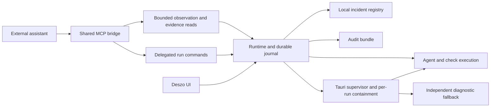

# ADR-0002: Execution Audit, Supervised Run Control, and Incident Reporting

Date: 2026-10-16  
Status: Accepted  
Accepted: 2026-10-16  
Requirements: Confirmed in D20–D22; architecture accepted, implementation contracts remain staged  
Implementation: Stages 1–4 implemented and locally verified; live client verification, real-provider probes and the pilot remain gated. See [implementation status](0002-implementation-status.md)  
Scope: Detailed execution evidence and external supervision of a selected local run  
Primary acceptance scenario: The shadcn/ui migration pilot, started and supervised through the user's external assistant  

## Context

The user wants as much information as Deszo can obtain about how a development pipeline executed. The external assistant must be able to start the shadcn/ui pilot, observe it, inspect intermediate evidence, stop the whole run when it detects a Deszo defect, and record that defect in Deszo. A final answer or a status label alone is insufficient.

[ADR-0001](0001-external-workflow-authoring-api-and-mcp.md) established runtime-owned HTTP commands and a shared MCP bridge. The engine already captures immutable workflow/input/invocation/output artifacts, Agent stdout/stderr, journal events, review decisions, task selections, checks and Context bindings. [History and Replay](../RUN_HISTORY_AND_REPLAY.md) and [storage](../STORAGE.md) retain their current contract ownership.

Source inspection on 2026-10-16 identified these gaps:

| Area | Observed implementation | Consequence |
| --- | --- | --- |
| Check logs | [Map checks](../../runtime/core/mapRuntime.mjs) buffer approximately 1 MiB per stdout/stderr stream and discard later chunks. Stop, timeout, signal and invalid-source branches return before creating the ordinary CheckReport. | Output can disappear when diagnosis is most important. |
| Provider events | [Adapters](../../runtime/core/adapters.mjs) normalize selected text/session/model events; [Agent capture](../../runtime/core/engine.mjs) retains original stdout. | Tool activity and available reasoning summaries need structured inspection; empty thinking events do not establish readable reasoning. |
| Temporary files | Check directories are removed after execution; only declared captured outputs are durable. | Screenshots, reports and partial work can disappear even if their paths appeared in logs. |
| Observation | The [bridge](../../mcp/bridge.mjs) has snapshots, bounded journal pages and whole-artifact reads; HTTP also has SSE. | No bounded watch with supervision health, range reads for large artifacts, or complete audit bundle. |
| Control | Opt-in MCP execution exposes start and root Stop. Recovery and Context acknowledgement are first-party-only. | The external assistant cannot yet perform a complete, explicitly delegated operational workflow. |
| Containment | [Node](../../runtime/core/processes.mjs) terminates process trees; [Tauri](../../src-tauri/src/main.rs) owns an application-wide Windows Job as a crash backstop. | Per-run Stop needs positive proof about descendants without treating shutdown of the whole app as ordinary control. |
| Product bugs | Pipeline issues represent specification/task review; there is no persistent product-incident registry/API. | Orchestration defects have no dedicated evidence-linked record in Deszo. |

These are current observations, not implementation claims about this proposal. The [pilot](../pilots/shadcn-ui-brief.md) is not started by this ADR.

## Decision

Extend the existing runtime and shared bridge with three capabilities:

1. Lossless, explicitly qualified execution audit for Agents, checks, runtime, supervisor and relevant renderer diagnostics.
2. Externally supervised runs with bounded observation, delegated run-specific control and a runtime-configured, supervisor-enforced watchdog.
3. Persistent local product incidents, including Stop-and-report with preserved evidence.

The runtime remains the source of execution facts and command authorization. The assistant interprets evidence and requests actions. The supervisor enforces containment independently of the assistant, renderer and journal. Do not introduce a second scheduler or direct bridge access to SQLite.

The intended controller workflow is prepare → obtain run approval and a supervision grant → arm observation → start → watch and inspect → stop and report on a suspected Deszo defect → verify termination → export evidence. A later user instruction to launch the pilot authorizes that execution; this document only specifies the design.

## 1. Execution evidence and completeness

### Capture inventory

Capture these facts when available to Deszo:

| Evidence | Required content |
| --- | --- |
| Run/environment | Store/runtime identity, Deszo build/source revision when known, schema/adapter versions, platform, Node/CLI versions, captured workflow/settings, workspace identity, limits and controller grant. |
| Inputs/invocations | Resolved prompt and sources, attachments/hashes, provider/role, requested and observed model/effort where reported, reasoning controls classified by behavioral effect, rendering-only display request when supported, effective native configuration, executable/arguments/cwd, start/end/exit/signal/termination reason and process ownership. |
| Provider activity | Original stdout/stderr bytes, raw event types/references, available messages/reasoning summaries, tool calls/arguments/results, command/file-change events, native child-agent relationships and usage. Unknown events remain retrievable. |
| Pipeline causality | Parent run/Loop/Map/task/attempt/role, dependencies and pinned inputs, queue/lock waits, retries, gate decisions, issues, selected/superseded results, invalidation/carry/cache facts, checks and assembly conflicts. |
| Files/checks | Base, captured operations, candidate, hashes/diffs and declared outputs; actual approved command and source; output on every outcome; reports/screenshots and integrity/capture verdicts. |
| Application health | Scheduler/capture/bridge/supervisor failures, reconnects, renderer errors and relevant failed API requests, request correlation, Stop progression, containment proof and observation gaps. Renderer failure must be visible without a functioning renderer. |
| Metrics | Queue/execution/review durations, time to first provider event, captured bytes and capture/observation lag, reported usage/cache statistics; optional bounded CPU/RSS samples. |

Keep observed facts, provider claims and assistant conclusions distinguishable. Never infer exact models, token counts, tool actions or successful checks from prose. Unknown values remain unknown. Record whether usage includes native child agents to prevent double counting; parallel duration is not the sum of task durations. Any future price estimate needs a dated source and remains separate from measured usage.

Full audit means the complete evidence Deszo can capture, with declared gaps. It does not promise provider-internal state, every operating-system action, or reconstruction of undisclosed native instructions. Deszo-supplied prompts and any unobservable provider-native prompt/configuration are recorded separately.

### Common durable streams

Use one stream-capture implementation for Agents, checks and correlated diagnostics. Persist bounded immutable chunks incrementally, preserving raw bytes and per-stream order. Spill to disk before applying backpressure; pause reads only while the disk writer is behind. A paused child pipe can stall the child and cause its own execution timeout. Record that as a child timeout with the associated capture lag, rather than misreporting it as capture failure. If capture cannot continue or a configured hard disk bound is reached, stop with an explicit capture failure; never silently discard bytes. UI previews and model-facing summaries can be shortened only with visible continuation references.

Each stream records identity, chunk index/byte offsets, received/committed byte counts when known, completion marker, ending reason and integrity/completeness. Flush before the terminal outcome. After a crash, the last durable byte is known but uncommitted loss may be unknown; mark the stream partial rather than inventing completeness.

Capture check command/input manifests before spawn. Produce execution evidence for passed, failed, canceled, timed-out, interrupted, spawn-failed, invalid-source and capture-failed outcomes. Preserve accumulated output even when no valid CheckReport can prove acceptance. Operational failures keep their existing distinction from a normal failed verification cycle.

Configured disk budgets warn early and stop execution with an explicit capture-limit failure at a hard bound. No rotation silently removes referenced evidence. Publish defaults/quotas in the implementation contract; existing retention and immutable-object rules continue to apply.

### Reasoning and provider availability

Reasoning effort and reasoning capture are distinct only when the provider exposes a rendering-only control. Record the requested setting, its effective provider behavior and the evidence for that classification in the invocation manifest; parse readable reasoning/thinking separately from ordinary messages. Exclude a setting from Context `configurationHash`, reviewer fingerprints and task fingerprints only when a tested provider/model/version matrix shows that it changes rendering alone. If the setting enables reasoning or changes its amount or budget, include it in those identities alongside reasoning effort because it changes model behavior. Parser-only collector changes use a capture-format version and do not bump the `ADAPTER_VERSION` that gates binding compatibility. Do not mix reasoning into the final-answer output port.

Record availability with evidence: text available, explicitly omitted, empty/unknown, not observed, unsupported, or capture failed. Empty thinking deltas and reasoning-token counts do not prove that readable text was available. Do not decrypt provider signatures or manufacture hidden reasoning. Verify each provider/version before making guarantees.

The official [Codex configuration reference](https://learn.chatgpt.com/docs/config-file/config-reference), [Codex JSON event documentation](https://learn.chatgpt.com/docs/non-interactive-mode), and [Claude thinking documentation](https://platform.claude.com/docs/en/build-with-claude/thinking) describe the mechanisms. A generic stream flag alone does not establish availability.

### Reports and partial work

Define diagnostic attachments for checks/tasks: normalized allowlisted relative paths, media types, per-file/total bounds, symlink protection, source identity and capture outcome. Capture them before directory cleanup on success or failure. Diagnostic attachments are not automatically implementation deliverables or trusted passing checks.

On interruption/incident, retain declared partial outputs/diffs and a bounded diagnostic snapshot when readable. Label them unaccepted and never select them automatically. Do not promise a complete filesystem history or retain all of node_modules. Cleanup follows evidence publication or a recorded capture failure. Retaining an exact failed directory is an optional visible local diagnostic choice.

Native CLI transcripts require an explicitly enabled, version-supported collector for the run's own recorded session. They are optional evidence with provenance, not a replacement for raw streams or authority to reuse a session.

## 2. Live observation and supervision

Add bounded `watch_run` over the same durable journal as SSE and Replay. Return on a meaningful event, health/containment change, terminal outcome or bounded timeout. Include consumed cursor, snapshot/last durable sequences, capture health, controller/lease status, active owned work, critical incidents and verbose-log references. Stage 1 selects and publishes the exact maximum wait from measurements of supported clients: it must be strictly shorter than each client's configured MCP tool-call timeout. The bridge's per-call HTTP timeout must be longer than the selected maximum wait, with margin. The measured client matrix and these timeout inequalities are contract evidence; the ADR does not fix a numeric default.

Declare filters, byte/event limits, skipped ranges, continuation and backlog. A cursor does not imply the assistant read hidden raw log bytes. Semantic supervision can acknowledge state/decision/health events while retaining references for full offline analysis. Critical events cannot be buried behind stdout backlog; event arrival wakes observation without waiting for check completion.

Add bounded range/stream reads: immutable artifact identity, full digest/size, byte range, chunk digest, encoding and next offset. Preserve UTF-8 boundaries through byte-safe encoding or incremental decoding. Do not load an arbitrary object into one model response. Add run discovery and Map/process inspection for reconnection without an ID remembered from an earlier tool response.

Separate bridge transport liveness from assistant attention. A bridge heartbeat does not prove the assistant read a warning. The assistant acknowledges its latest semantic observation cursor after processing it; store acknowledgement time and lag.

For supervised runs, watchdog policy belongs to the runtime and is enforced independently by the native supervisor. Stage 1 selects and publishes an initial semantic-acknowledgement deadline and a separate, longer escalation deadline from measured client turn, tool-call and compaction behavior; the ADR fixes neither value. When the first deadline expires, pause new dispatch and raise a `controller_unresponsive` incident with a Deszo-window notice. Existing work may finish or continue under its own execution timeouts. A fresh semantic acknowledgement clears the pause and permits dispatch to resume if no other pause applies. If the controller remains unresponsive through the second deadline, the supervisor stops the run unless a first-party user extends that deadline from the Deszo window. The window sends a first-party extension command through the runtime; the runtime records it and updates the supervisor's monotonic deadline, and reports success only after the supervisor confirms the new deadline. Record each extension and its authenticated session. The window must make the pending incident, remaining escalation time, active work and extend/stop actions visible. Approval-pending requests have no active lease. No run launches before observation is armed. A healthy bridge alone cannot renew the deadline; a no-event period can be acknowledged through a fresh health snapshot.

Runtime hard failures stop immediately, independent of controller acknowledgement: unrecoverable capture/storage failure, loss of containment proof, or scheduler/persistence invariant failure. User Stop and grant revocation also stop immediately. These paths are distinct from a missed assistant acknowledgement and are recorded with their own reason.

The supervisor separately observes runtime liveness. Expired runtime health or an unanswered Stop escalation cannot depend on another Node timer. Use a monotonic native deadline; a wall-clock adjustment must not extend a lease. Distinguish healthy long provider work from absent controller acknowledgements and from an unresponsive runtime.

This is bounded-latency supervision, not continuous or hard real-time model judgement. Deterministic runtime invariants can stop work immediately; semantic detection happens at observation boundaries. A chat/host/tool failure first pauses dispatch and starts the explicit escalation window; it does not immediately discard in-flight work. The longer deadline and first-party extension path bound unattended execution. Reconnection reports the gap and never restarts stopped work automatically.

## 3. Delegated control and ADR-0001 compatibility

Preserve normal external/first-party credential boundaries. Add an opt-in controller session and a first-party-approved grant for an exact run request/workflow snapshot/workspace identity. Bind it to an authenticated session, not merely a caller-provided label or bridge ID. Keep any additional short-lived controller credential in bridge memory; never expose tokens to the model, workflow, connection descriptor, logs or exports.

Run approval can include requested actions, observation deadline and bounded retries in one reviewable grant. Existing confirmation policy remains authoritative. Do not implement supervision by disabling confirmation globally, forwarding the first-party token, reading private application memory or driving UI controls to bypass missing API permissions.

| Action | Proposed boundary |
| --- | --- |
| Discover/read/watch/evidence | Bounded read-only capabilities with provenance. |
| Start | Existing exact-snapshot request and approval policy; observer armed before launch. |
| Root Stop and Stop-and-report | Immediate authorized-controller actions; existing external root Stop stays compatible. Human Stop always wins. |
| Scoped Stop, retry and legal recovery | Explicit run grant, existing engine validation, pinned inputs, Context compatibility and captured budgets. |
| Raise limits, change snapshot/workspace/model, acknowledge uncertain Context | Outside the default grant; require separately recorded authority. No silent budget expansion or fresh-session fallback. |
| Settings/workspaces/credentials, other runs, merge/release or external publication | Not granted by supervision of this run. |

Mutations retain stable request IDs, idempotent receipts, relevant concurrency preconditions and outcome reconciliation. Add command-status inspection so connection loss cannot cause duplicate starts/recovery/incidents. Runtime restart invalidates live grants and interrupts work; reconnect explicitly reconciles identity and authority.

One controller owns a supervised run at a time; the desktop can revoke/transfer control. Managed provider invocations remain unable to use authoring/control tools, including with a leaked grant ID in their inputs. Provider output and incident text remain untrusted evidence.

This proposal extends ADR-0001's first-party-only recovery boundary solely through explicit scoped delegation. Existing restrictions stay in force until acceptance and implementation. Root-canceled runs are not resumed by rewriting history: continuation requires a newly authorized linked run and normal input/Context checks.

## 4. Verified root Stop

Verified Stop is available for every run under the Tauri supervisor on supported Windows, whether or not the run has a supervision grant. Elsewhere, Stop is best effort unless an equivalent native containment path is implemented; report `termination_unconfirmed` when termination cannot be proven.

“Stop everything” means this root run, including parallel Agents, checks, native descendants, Loops, Maps and pending dispatch. It does not silently stop unrelated workflows or close Deszo. Stop does not undo files or external effects; partial work stays unaccepted.

1. Establish a dispatch barrier before acknowledgement, covering in-flight spawn reservations.
2. Record the termination request/reason and terminate every owned tree. Preserve buffers and declared attachments without letting capture delay termination.
3. Verify native containment has zero live members for this run. Direct CLI exit is insufficient. Reconcile I/O/capture and pending attempts.
4. Publish the outcome and termination proof: requested/observed times, ownership generation, remaining/unknown members, capture status and escalation. Distinguish stopping, confirmed stopped and termination unconfirmed.

Use a native launch shim for every run started under the Tauri supervisor on supported Windows versions (Windows 8 and later), including the user's unsupervised runs. The supervisor creates and owns a per-run Job nested as a child of the application Job. Node starts the shipped shim with the CLI arguments and stdio handles; the shim creates the real CLI process suspended, assigns it to the per-run Job, and only then resumes it. The CLI inherits the Node-owned capture pipes unchanged, so stream capture remains in Node. The supervisor verifies Job membership and active members. The shim must fail closed if assignment or verification fails; provider/check code must never run before assignment. The per-run Job contains only that run, and unrelated runs remain outside it. `controlMode` describes the grant and watchdog; using the shim for an unsupervised Tauri run still provides per-run containment and verified Stop.

Stage 1 uses `DuplicateHandle` to give the exact shim process a non-inheritable per-run Job handle with only `JOB_OBJECT_ASSIGN_PROCESS` rights. An authenticated supervisor rendezvous binds the duplication to the shim PID and run ownership generation; do not use a named Job object. Stage 2 packages the native binary with runtime resources and defines its lifecycle: the shim remains alive as the waiting parent until the CLI exits, returns the CLI exit code to Node, and reports supervisor termination through the structured run result. The shim itself stays outside the per-run Job, so termination proofs count run work rather than the waiting shim; the supervisor tracks the shim separately and requires its exit before reporting a completed Stop. If the shim exits unexpectedly before reporting the CLI result, the supervisor terminates the per-run Job and records a shim failure. A missing, blocked or failed shim returns typed `spawn_failed`; there is never a direct-spawn fallback.

Supervised runs are supported only where this native containment path is implemented and tested. Until equivalent containment exists on non-Windows platforms or older unsupported Windows versions, a request for a supervision grant returns typed `supervision_unavailable`. A runtime without the Tauri supervisor, including `npm run runner`, fixture runners and standalone scripts, also refuses supervision grants. It may execute ordinary runs in explicitly unsupervised mode, but every run record, response and control snapshot must carry `controlMode: "unsupervised"`; it must not claim a native watchdog, per-run Job, emergency channel or supervised status. On these unsupported/headless paths, Stop is best effort and reports `termination_unconfirmed` whenever native containment cannot prove termination. The shadcn/ui acceptance pilot requires `controlMode: "supervised"`.

Termination must work with an unwritable journal, dead renderer or unresponsive runtime. Add a narrowly authenticated supervisor control channel that a granted bridge can reach without the Node HTTP event loop. It permits emergency Stop and containment-health reads only for the granted run; it grants no first-party settings/workspace/start authority. Its registration, credential lifetime, ownership generations and receipt reconciliation require the same explicit contract as ordinary delegated control. Keep credentials in process memory, not public discovery metadata or model-visible results.

The supervisor owns the independent liveness/termination path and bounded diagnostic fallback. A configured termination deadline triggers escalation and an incident, never fabricated success. Any app-wide emergency shutdown must explicitly identify its effect on other runs.

## 5. Product incidents and Stop-and-report

Add a runtime-owned local incident registry, a Bugs/Incidents view and scoped HTTP/MCP commands. Preserve the distinction between a Deszo product defect and a normal specification/test/implementation issue. A suspected scheduling, persistence, capture, synchronization or containment bug triggers root Stop under the pilot's supervision policy; ordinary task rejection can follow its approved repair loop.

An incident has an immutable initial observation and append-only updates: incident ID, title/component/category/severity/confidence, expected/actual behavior, reproduction steps, app/runtime/CLI versions, source revision when known, run/node/attempt IDs, event ranges, artifacts, controller/command IDs, Stop result, capture gaps and triage status. Distinguish suspected from confirmed cause. Duplicates retain individual occurrences/run links. Conclusions reference exact evidence.

`stop_and_report` is one orchestration command with independent outcomes for termination, evidence capture and incident persistence. With healthy storage, commit the barrier and initial incident together. If persistence fails, Stop takes priority. A successful Stop must not imply that the report was saved.

If the store fails, preserve a minimal emergency receipt/report in an independent supervisor spool when possible and return its status. The spool is separate from SQLite/object publication; it cannot guarantee persistence on an exhausted/failed disk. Reconcile it after recovery with the same occurrence identity. If all persistence fails, report that explicitly while still attempting termination.

If the runtime is unavailable, the bridge can retain a bounded pending incident receipt and obtain supervisor termination evidence through the emergency channel. On reconnect it reconciles the report into Deszo instead of claiming the registry was already updated. This fallback never opens the runtime database or starts a replacement runtime, and it records whether evidence survived the loss of the bridge/supervisor itself.

Reporting stays local to Deszo. No GitHub issue, message, email or other external publication is created. An incident never automatically changes requirements, selects results, acknowledges a Context or invokes a provider.

## 6. Audit export and inspection

Create an immutable offline-readable bundle for one run and pinned sequence: workflow/settings/build metadata, ordered journal, stream manifests/chunks, input/invocation/output artifacts, task/check/review/incident records, candidate provenance/diffs, declared visual evidence and generated timeline/summary. Include every member's size/hash, reference closure, completeness verdict and known omissions.

An active-run bundle is explicitly partial through its declared sequence. Finalization waits for capture closure or records why it is incomplete. Include failed/unselected/Stop evidence rather than only successful selected outputs. Pin evidence referenced by incidents or bundles against cleanup.

Provide a private local-audit profile and a shareable derived profile with documented redactions/omissions. Exclude runtime/controller credentials in both. Do not promise arbitrary provider text is free of sensitive data. Never rewrite immutable originals when redacting; derived exports have separate hashes and a redaction manifest. No automatic uploads. Ordinary portable workflow export keeps existing behavior.

MCP returns export-job status and an artifact/download reference, not a complete archive embedded in a message. Include an offline human-readable index and JSON/JSONL for analysis. The live UI shows capture health, process ownership, observation lag and incident links; assistant access must not depend on an open renderer tab.

## 7. Proposed API/MCP surface and compatibility

Advertise additive API capabilities separately from workflow-language capabilities. Draft names: `run-audit-v1`, `run-control-v1`, `incidents-v1`; do not add them to legacy workflow JSON capability arrays. Keep existing routes/tools compatible. These operation names are proposals, not currently callable tools or published schemas.

| Operations | Purpose |
| --- | --- |
| `list_runs`, `get_run_control`, `get_run_processes`, `get_run_map` | Discover execution, ownership, live state and control health. |
| `watch_run`, `ack_run_observation` | Bounded observation and explicit acknowledgement, with cursor/backlog semantics. |
| `read_log_stream`, `read_artifact_range` | Bounded lossless retrieval of large captured evidence. |
| `request_run_control`, `recover_run`, scoped Stop | Request a reviewed grant; execute only permitted engine commands. |
| `stop_and_report`, `report_incident`, `list_incidents`, `get_incident`, `update_incident` | Stop, preserve evidence and manage product incidents. Filing an incident or appending an observation is allowed with the external token or an active scoped run grant. Triage changes, cause confirmation and closure are first-party-only. Every write records the authenticated session and authority basis. |
| `create_audit_bundle`, `get_audit_bundle`, `get_command_status` | Export a pinned audit and reconcile uncertain writes. |

Before implementation, publish schemas/migrations/events for stream completeness, generalized check/process outcomes, acknowledgements/gaps, grants/receipts, termination proofs, incidents and exports. Stage 1 also extends ADR-0001's route-to-token scope matrix for incident filing, observation append, triage, cause confirmation and closure; tests prove external/grant writes cannot perform first-party triage. Correlate run-journal, incident-history and command sequence domains without pretending they are one stream. Provider normalization links back to original raw bytes.

Version new records/events where necessary. Old records lacking completeness fields get a legacy/unknown verdict, never retrospective completeness. Existing immutable snapshots, Gate certificates, selections, Replay and bindings retain their original meaning. Do not invent lost historical check output or reasoning.

## 8. Delivery order and acceptance

| Stage | Deliverable | Required evidence |
| --- | --- | --- |
| 1. Contracts | Schemas, events, API, migration, grants and Stop/lease state machine. Decide `supervision_unavailable` and `controlMode` behavior; define incident authority; select exact watch, acknowledgement and escalation deadlines from measured client behavior; specify restricted Job-handle duplication and its authenticated PID/generation rendezvous. | Old/new compatibility, permissions, idempotency, cursors, partial-capture fixtures, behavioral-versus-rendering-only reasoning identity fixtures, and a client timeout matrix proving that `maxWatchWait` is strictly below every supported MCP tool timeout and that the bridge HTTP timeout is strictly greater than `maxWatchWait`. Generated client configurations pin each supported per-server MCP tool timeout above `maxWatchWait`; setup guidance warns that lowering it breaks `watch_run`. Publish exact timeout values and per-client evidence. Update ADR-0001's scope matrix before implementing incident routes. |
| 2. Capture/containment | Shared streams, all check outcomes, attachments, diagnostics and per-run termination proof. On supported Windows, use the native launch shim for every Tauri run, supervised or unsupervised: Node starts the shim; the supervisor owns a per-run Job nested under the application Job and duplicates a restricted handle into the shim; the shim creates each real CLI suspended in that Job, then resumes it and passes its stdio handles through unchanged for Node capture. Package the shim with runtime resources and specify its wait/exit-code/termination-report lifecycle. Missing or blocked shims return typed `spawn_failed` and never fall back to direct process creation. | More than 1 MiB in each stream; split UTF-8; Stop/timeout/crash/store failure; a surviving native descendant; proof that assignment precedes resume; verified Stop for supervised and unsupervised Tauri runs; missing/blocked shim failures; shim kill kills the CLI tree and records its exit; termination proof reports the shim separately; unrelated run unaffected. Unsupported platforms and headless runners have no supervised grants and report best-effort Stop as unconfirmed when they lack containment proof. |
| 3. Supervision/incidents | Watch/range tools, scoped recovery, native-enforced acknowledgement/watchdog, emergency Stop channel, Stop-and-report and incident UI. | Disconnect/host stall/renderer crash, runtime hang, backlog, restart/wrong-store, lost responses and spawn/Stop races. |
| 4. Export/inspection | Audit bundles, timeline, structured provider activity and reasoning availability. | Offline hash/reference verification, interrupted runs, redaction manifest, large-artifact continuation. |
| 5. Controlled acceptance | Stable installed controller, isolated preview and separately authorized real-provider probes. | End-to-end case below, supported CLI/model/effort/display matrix, desktop smoke and limitations. |

The end-to-end fixture starts concurrent Agent/check work, emits long logs/reports/screenshots and injects a recognizable orchestration defect. The external controller receives the event and calls Stop-and-report. Dispatch closes; native proof shows zero remaining run members; the incident is visible in Deszo; the bundle contains pre-defect events, Stop progression, partial outputs and diagnostics. Another run stays unaffected. Simulate an assistant pause beyond the first acknowledgement deadline: dispatch pauses, a `controller_unresponsive` incident and window notice appear, and existing work remains governed by its own timeouts. Verify a first-party window extension prevents escalation, while no extension through the second deadline stops the run with native proof. Also verify hard runtime failures stop immediately. Repeat with a lost response, dead renderer, dead controller but live bridge, runtime hang/crash and unwritable store. Exercise the emergency channel and pending-incident reconciliation explicitly. No case claims complete evidence when capture failed.

Measure capture/event visibility lag, assistant observation lag, watchdog latency, acknowledgement-to-termination latency and export verification. A proposed fixture target is delivery of a committed critical event to an active waiting observer within one second on the test machine, not an end-to-end model-response guarantee. Publish accepted termination deadlines after native tests.

Gate the shadcn/ui pilot on implemented/verified capabilities, a valid supervision grant and actual access to its requested models/efforts. Keep the controlling Deszo build outside build output changed by the pilot, with separate preview data roots. Refresh the prepared workflow/base snapshot after these improvements; do not reuse the old preparation manifest against changed source. Apply only the accepted candidate to its feature branch, then perform the independent desktop smoke from the pilot brief.

## Alternatives and consequences

More console logging leaves check loss, missing causality, controller gaps and uncertain termination unresolved. Raising buffer ceilings still loses bounded data and interruption evidence. Assistant-only polling cannot respond independently to chat failure. Giving the external token every first-party permission removes the existing authority boundary. Using the single app-wide Job for ordinary Stop affects unrelated work. This proposal rejects those alternatives.

The design adds storage volume, stream/attachment lifecycle work, native containment, grant/command state, UI views and compatibility tests. It makes missing evidence explicit and gives the assistant and user the same inspectable execution facts. Available reasoning summaries improve the record, but are neither required for a valid run nor proof of every internal model computation.

Architecture acceptance, implementation authorization and live-provider acceptance remain separate. ADR2-07 through ADR2-10 are required Stage 1/2 contract and verification items. Acceptance does not authorize implementation, client configuration changes, live-provider calls or the shadcn/ui pilot.
