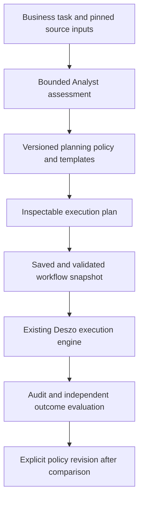

# ADR-0003: Task Assessment, Workflow Planning, and Evaluation

- Date: 2026-10-16
- Status: Accepted
- Requirements: D23 in the [decision register](../DECISIONS.md#confirmed-decisions)
- Implementation: Bounded managed-task engine integration and fixtures are implemented; see [current status](0003-implementation-status.md) and [compiler contract](../MANAGED_TASKS.md). Automatic parallel Map decomposition and Stage 4 real-provider evaluation are outside this increment.
- Scope: A general development workflow, explainable task-based planning, and repeatable evaluation across different task classes
- Related: [ADR-0004](0004-agent-communication-and-context-contracts.md) defines communication and context contracts; [ADR-0005](0005-verified-feature-branch-delivery.md) defines verified branch delivery; [ADR-0002](0002-execution-audit-and-supervised-control.md) owns audit and supervision

## Context

The user wants an effective general development workflow that can be tested and improved on different business tasks. The shadcn/ui migration is one possible later test case. It does not define the architecture or the evaluation corpus.

A fixed comprehensive workflow can repeat expensive preparation for small changes. A workflow selected only by change size can omit necessary checks for a small but critical change. Task difficulty, consequences of failure, uncertainty and the ability to verify an outcome need separate treatment.

Deszo already provides workflow snapshots, distinct roles and Contexts, Gates, documented Implementation Maps, dependency-aware task execution, checks, bounded repair and version-sensitive carry. The relevant homes are [pipeline execution](../PIPELINE_EXECUTION.md), [Implementation Map](../IMPLEMENTATION_MAP.md), [M5 contracts](../M5_CONTRACTS.md) and [M6 contracts](../M6_CONTRACTS.md).

The current [map schema](../schemas/implementation-map.schema.json) does not define assessment or execution-profile fields. The existing [planner](../../runtime/core/planning.mjs) plans captured workflows; it does not implement the assessment and selection mechanism proposed here. This ADR describes a future capability and a reference workflow, not a change to current serialized contracts.

## Proposed decision

Introduce a preparation layer with three durable outputs:

1. An Analyst-authored task assessment, including evidence and unknowns.
2. A runtime-validated execution plan selected using a versioned policy and workflow templates.
3. An evaluation record comparing the planned process with observed execution and independently checked results.

Start with one reference development workflow and explicit rules for omitting or adding stages. Treat compact, standard and extended profiles as optional named policy presets. The number of profiles, scoring weights and thresholds are not accepted defaults in this ADR.

The Analyst proposes semantic judgements. Deterministic policy rules select permitted stages and minimum verification requirements. The runtime validates and executes the resulting snapshot. Neither the authoring client nor a planning agent becomes a second scheduler.

Assessment generation may be nondeterministic. Once the assessment and all planning inputs are captured, planning selection MUST produce the same semantic plan for identical captured inputs, without model calls or reads of uncaptured state. Capture the source facts, policy/template/compiler versions, capabilities, role bindings, Context policies and limits used by selection. Missing decision inputs require explicit reassessment or a planning diagnostic, not an unrecorded live lookup.

Use stable rule ordering, tie-breaking and semantic identifiers. Timestamps, receipt IDs and presentation layout do not change the semantic plan fingerprint. Validation at launch may detect drift from captured preconditions; it must not silently select a different plan.

## 1. Assessment and source identity

The assessment is a bounded preparation step with an already selected Analyst binding and template. It runs as a managed run of a fixed, versioned assessment workflow inside Deszo, or as an external-client artifact with recorded provenance. It cannot require the future generated workflow to exist, expand its own budget, or silently launch implementation. The preparation lifecycle explicitly links three durable identities: the assessment run (`assessmentRunId`), the compiled plan revision (`planRevisionId`), and the downstream execution run (`executionRunId`). Preparation work (attempts, duration, and token usage) is recorded in preparation accounting and charged against the plan's aggregate budget.

The runtime inspects the captured source snapshot independently to derive objective source facts before plan selection against project-configured policy rules (such as declared critical area patterns, public schema contracts, and dependency fan-out). These derived facts form deterministic risk floors that cannot be lowered by the Analyst's subjective judgement.

Record the following proposed logical fields. These are requirements for future schemas, not additional properties accepted by current workflow or map schemas.

| Item | Required meaning |
| --- | --- |
| Identity | Assessment version, original business-request reference, assessment author/role, source snapshot, linked `assessmentRunId`, and preparation-attempt references when available. |
| Business contract | Intended outcome, constraints, explicit exclusions, stable requirement IDs and acceptance criteria. |
| Scope | Affected components, interfaces, data, execution environments and anticipated dependencies. |
| Source-derived facts | Objectively extracted critical paths, schema/interface modifications, and dependency fan-out metrics derived by the runtime from project policy data. |
| Assessment axes | Separate judgements about scope/coupling, technical difficulty, failure impact, uncertainty and verifiability. |
| Grounds | Source and requirement references for each judgement, assumptions, confidence expressed with reasons, and unresolved questions. |
| Verification | Required evidence for each acceptance criterion, the producer of that evidence and conditions that make it current. |
| Planning advice | Suggested decomposition, discovery work, ownership boundaries, necessary stages and reasons for each recommendation. |

Do not reduce the assessment to an unsupported numeric complexity score. A critical risk establishes a minimum verification requirement even when the other axes are low. Material uncertainty selects bounded discovery and reassessment; it does not count as evidence of low risk.

Capture an immutable manifest of selected source inputs, including relevant modified and untracked files. Record exclusions. A Git revision, when available, supplements the content identity; it does not replace it. Uncaptured environment or provider-native inputs remain explicit availability gaps under ADR-0002.

Maintain assessment at two levels: the business task and individual Implementation Map tasks. Local task checks can be narrow while the assembled result still requires integration and business acceptance. Do not repeat the whole business workflow for every map task.

## 2. Reference development workflow

The initial reference is for a nontrivial behavior change. A policy may remove unnecessary stages only under the documented conditions in section 3.

| Stage | Owner and output |
| --- | --- |
| Define | Analyst receives the business task first and produces the contract, assessment, verification plan and initial decomposition. |
| Review readiness | Code reviewer checks feasibility, interfaces, constraints and implementation readiness. Test reviewer independently checks testability, scenarios and evidence requirements. Their findings are separate. If the proposed plan omits any reference stage, readiness review includes mandatory confirmation of the assessment's scope and risk grounds. |
| Prepare implementation | Establish task dependencies, ownership and stable interfaces. Test author defines scenarios from the contract. An Implementation Map is used when decomposition or dependency tracking is needed. |
| Implement and test | Developer writes production code; test author writes tests. They may work in parallel after interfaces and file ownership are agreed. |
| Assemble and check | Runtime captures the candidate and runs the applicable deterministic checks against that exact candidate. The runtime also re-evaluates the policy's deterministic risk floors against the actual candidate diff; if the diff touches critical paths or public contracts not accounted for in the plan, the plan is revised to escalate to the required reference stages before delivery review. Failed checks route to the responsible work before final review. |
| Review delivery | Separate code and test reviewers examine the current candidate, their declared scopes and check evidence. Both required approvals must be current. |
| Accept business outcome | By default, the same Analyst uses a fresh purpose-specific Context to compare the result with the original business task, contract and criterion-to-evidence record. Policy can require an independent Business Accepter. |

Junior Analyst is conditional. It repairs document structure, links and other nonsemantic defects. A change to requirements or acceptance meaning returns to the Analyst.

Role identity is distinct from provider/model identity. Code and test reviewers remain separate roles even when both use the same model. Preserve the user's selected provider, model and explicit effort for every invoked role; this ADR does not replace the current bindings with global model defaults. Unsupported requested bindings fail explicitly. No cost-, quota- or retry-driven model substitution is introduced.

Use separate Contexts for code and test reviewers. The proposed reference starts final technical reviews and business acceptance in fresh purpose-specific Contexts with the required artifacts and unresolved findings. This is a proposed policy choice to evaluate, not a claim that current workflows already do so. Context contents and their inclusion in compatibility fingerprints are governed by ADR-0004.

### Business acceptance independence

The default is the same configured Analyst with a fresh acceptance Context. Policy can require a distinct Business Accepter for high uncertainty, high consequences or disputed semantics, with explicit triggers captured in the planning policy. The additional role must have its own explicit provider/model/effort binding and fresh Context. If required but unconfigured, the plan is not ready for execution; do not silently reuse the originating Analyst's identity or choose another model.

An independent accepter must not have authored the task's requirements, implementation or tests. Record participation through role/attempt provenance. Give it the original business request, approved requirements, current evidence and unresolved limitations. Earlier interpretations or verdicts are not a substitute for checking the original request. A different Context or model alone does not establish independence or guarantee a different interpretation.

Acceptance uses the typed criterion-to-evidence contract proposed in ADR-0004. Unresolved semantic disagreement returns to requirement clarification; majority voting cannot close it. Seek a user decision only when the business intent cannot be resolved from the supplied task and evidence. Any clarification changes the applicable requirement revision and invalidates affected acceptance.

### Delivery boundary

Before starting, declare the delivery boundary: for example, an accepted candidate or a verified branch. Business acceptance of a candidate does not establish that applying, merging or releasing it occurred. If the requested boundary includes further actions, name their checks, outputs and existing authorization conditions in the plan.

Delivery boundary is independent of complexity/risk classification. Both a small fix and a large feature may request a verified branch, using different applicable checks. ADR-0005 specifies the optional branch stage and its exact-candidate, commit and readiness evidence. Candidate-level acceptance evaluates candidate criteria; delivery-specific criteria remain pending until that later boundary is actually verified.

## 3. Explainable adaptation rules

| Observed task property | Proposed planning rule |
| --- | --- |
| Requirements or technical approach have material unknowns | Add a bounded discovery task, state what it must resolve, then revise the assessment. |
| Shared interfaces or cross-component invariants change | Require contract and testability review before implementation and checks covering affected consumers. |
| Multiple separable implementation units exist | Generate a Map with explicit dependencies and ownership; enable parallelism only for compatible scopes. |
| Failure affects persistent data, security, process control or another critical behavior | Require evidence specific to that risk, including negative and failure-path checks where relevant. |
| A local change has clear criteria and limited consequences | Permit concise requirements and omission of redundant intermediate reviews or Map decomposition; retain applicable final verification and independent reviews. |
| Only nonsemantic document formatting or links change | Route to Junior Analyst and document checks, with review appropriate to the changed material. Production-code and test-authoring roles need not be invoked. |
| Existing behavior lacks a credible verification method | Add work to establish evidence or identify the unresolved acceptance limitation before implementation is treated as ready. |

### Deterministic source-derived risk floors

To prevent an underestimated assessment from dropping necessary safeguards, the runtime evaluates deterministic policy floors directly from captured source facts. These floors cannot be lowered by the Analyst's subjective judgement.

Critical area glob patterns, interface schemas, and fan-out thresholds are **per-project policy configuration**. (In Deszo's own configuration, these include paths such as `docs/storage/m*.sql`, `launch_shim.rs`, `supervisor.rs`, and `docs/schemas/*.json`). If a project provides **no declaration** of critical areas, policy MUST fail closed and fall back to the **full reference stages by default**, never defaulting to zero floors or permitting uninspected stage omissions.

| Source-derived condition | Minimum policy floor |
| --- | --- |
| Touched paths match declared project critical areas (e.g. storage/database migrations, auth/security, process containment/supervision, persistence engines) | Enforce full reference stages, critical risk verification, negative path checks, and independent readiness and delivery reviews. |
| Changed public interfaces, schemas, or exported API/MCP contracts | Require shared-contract review and testability checks covering affected consumers before implementation. |
| Dependency-graph fan-out exceeds configured threshold | Require Implementation Map decomposition with explicit ownership and dependency ordering. |

The plan records both the Analyst's classification and the derived floor; the stricter one wins during plan selection. A subjective low-risk rating cannot bypass a derived critical floor.

### Pre-implementation and assembly-time floor enforcement

Risk floors are enforced at two distinct lifecycle boundaries:

1. **Pre-implementation boundary (Plan Selection):** The runtime evaluates the Analyst's stated scope and known requested changes against the project's policy floors.
2. **Post-implementation boundary (Assemble and check, before Delivery Review):** Before implementation, the runtime has only the unchanged source, so which files will be modified is only an estimate. If the Analyst classifies a task as a local change but the Developer edits undeclared critical paths or changes public contracts, a pre-implementation check alone would not catch the defect. Therefore, at the assembly stage, the runtime inspects the **actual candidate diff** against the base. If the diff exceeds the plan's current floors, execution CANNOT proceed to delivery review under the compact plan. Instead, the runtime automatically triggers a plan revision to escalate the workflow, adding the missing reference stages (contract/testability reviews, critical negative checks, or Map integration) and invalidating skipped approvals.

### Assessment confirmation when omitting stages

If the selected plan omits any stage of the reference workflow (such as intermediate reviews or Map decomposition for a local change), the readiness reviewers (or designated Code Reviewer) must explicitly confirm the assessment's scope and risk grounds before implementation can proceed. Their confirmation record joins the captured plan inputs and execution prerequisites. If confirmation is refused, execution pauses or the plan reverts to the full reference workflow.

Policy selection records each matched rule, its evidence and the stages/checks it adds or omits. A low aggregate score cannot cancel a critical requirement. An agent cannot lower required checks merely because a check failed or the budget is nearly exhausted.

The execution plan pins assessment/source hashes, policy/template versions, selected stages and edges, role bindings, explicit efforts, Context policies, required checks, delivery boundary and budgets. Show the plan and reasons before launch. Plan visibility does not introduce a second approval flow: saving and execution retain ADR-0001's existing authorization and confirmation rules.

A user override creates a new plan revision with a reason. A hard policy minimum changes only through an explicit policy revision. The decision and its author are preserved in history.

## 4. Repair, budgets and revisions

Route implementation defects to Developer, test defects to Test Author, semantic requirement defects to Analyst, and nonsemantic documentation defects to Junior Analyst. Route operational or Deszo defects through the existing run/incident mechanisms. Do not convert a provider failure into a fabricated code-review finding.

Reopen affected work and dependent approvals using existing subject/scope fingerprints and dependency rules. A repair does not automatically repeat every earlier stage. A changed shared contract can invalidate multiple tasks and reviews; a passing local check does not waive that invalidation.

The runtime compiles the execution plan and workflow templates into workflow JSON. Saving that workflow JSON must go through ADR-0001's v3 conditional save with an ETag (`If-Match` condition against the captured store revision), ensuring that neither an external client nor an agent compiles or injects unvalidated execution graphs directly.

Every saved plan requires an aggregate attempt bound and elapsed-time bound in addition to local limits. Count managed assessment, discovery, formatting repair, code/test repair, triage, verification, and branch delivery work (including delivery attempts and smoke runs under ADR-0005). Link preparation accounting to the plan using the durable `assessmentRunId`, `planRevisionId`, and `executionRunId` bindings; any unobserved external preparation remains a reported gap rather than zero work. Nested loops must consume the shared budget rather than multiply independent retry allowances. Record consumed and remaining bounds. Exhaustion produces an explicit incomplete outcome with diagnostics; it cannot produce approval or silent model escalation.

Material new facts cause an explicit assessment/plan revision. Changes to the executable graph require a new saved workflow snapshot and run under current authoring rules. Specification/task revisions supported inside an already captured Map continue to use the existing revision mechanism. Link old/new plan and run identities and record why prior results were carried or invalidated. Never rewrite the captured execution graph in place.

## 5. Evaluation method

Effectiveness requires independently verified quality before comparing speed or resource use. Analyst acceptance is an outcome of the workflow; it is not sufficient as the only evaluation oracle for that workflow.

Prepare a versioned corpus covering at least these classes: local bug fix, behavior change in one module, shared-contract change, parallel multi-component work, ambiguous request, nonsemantic documentation change, and a small change with critical consequences. Include a dependency outside the obvious changed files and a case where superficial green tests miss a stated criterion.

For every case, pin source inputs, request, acceptance criteria, allowed actions and limits, plus an independent verification procedure. Extra evaluation probes may check stated requirements; hidden new requirements must not be used to penalize the workflow.

Compare one policy change at a time, using the same recorded bindings, explicit efforts and case inputs. Repeat cases sufficiently to expose variation and report sample counts. Record CLI/model versions when available, order, cache/Context reuse conditions and environmental changes. Do not imply that repeated provider runs are deterministic.

| Measure | Required interpretation |
| --- | --- |
| Quality | Independent acceptance results, escaped defects, false approvals, and severity; hard case criteria must pass before declaring a successful result. |
| Time | Wall time to an accepted result, queue time and stage time; parallel task durations are not summed as wall time. |
| Work | Invocations, repair cycles, repeated reviews, discovery, document normalization and redundant/invalidated work, including preparation. |
| Diagnosis | Where a defect was introduced and detected, where missing context caused rework, and which stage failed to detect a stated criterion. Attribution can remain uncertain. |
| Resources | Provider-reported usage and its availability/aggregation semantics, as defined in ADR-0004 and ADR-0002. |
| Prediction | Planned scope/stages/effort versus observed work, with reasons for each revision. |

Stopped, failed and budget-exhausted runs remain in the comparison. Preserve raw results rather than selecting only successful examples. Publish the case matrix, policy versions, quality guardrails, measured results and known limitations. A small campaign supports the tested boundary, not a universal efficiency claim.

Policy changes are explicit and versioned after evaluation. Automatic online policy learning, autonomous role/model escalation and silently reducing quality gates are outside the first increment.

### Evaluation corpus planning estimate

Running the comparative corpus consumes substantial provider quota. Stage 4 evaluation with real providers requires explicit prior user authorization based on this planning estimate:

- Matrix: 7 case classes × 3 policy variants (reference baseline, compact/role-specific packages, controlled prose) × 3 repeated runs (to observe variance and measure non-determinism) = ~63 execution runs.
- Invocations basis: The reference workflow has at least 8 invoked steps (Define, Code Review Readiness, Test Review Readiness, Prepare, Developer, Test Author, Code Review Delivery, Test Review Delivery, Accept Business Outcome), plus the assessment run, possible Implementation Map decompositions, triage, and bounded repairs. Invocations range from 10 to 40 per run across case classes: ~5–8 for nonsemantic documentation changes, ~10–15 for local bug fix / small changes, ~12–18 for single-module behavior changes, ~15–25 for ambiguous requests / reassessment, ~20–30 for shared-contract changes, ~20–35 for small changes with critical consequences, and ~25–40 for parallel multi-component work.
- Total volume: Across the 63 execution runs, this represents an aggregate planning estimate of approximately **630–2,500 managed provider invocations**.
- Prioritization: If quota is constrained, run comparisons in this sequence: (1) shared-contract change and small change with critical consequences (verifying source-derived floors and avoiding false approvals or escaped defects); (2) local bug fix and behavior change in one module (measuring baseline efficiency versus compact profile overhead); (3) ambiguous request (reassessment lifecycle) and parallel multi-component work.

Stage 4 remains unauthorized until this specific quota budget is formally reviewed and authorized by the user.

## 6. Implementation stages and verification

1. Define versioned assessment, policy, plan and evaluation contracts; specify aggregate budgets and compatibility fingerprints. Publish the capability through the existing authoring contract before clients use it.
2. Implement assessment capture, deterministic selection from fixed templates, inspectable reasons and immutable plan/workflow binding. Keep existing workflows readable and executable without these optional records.
3. Verify policy selection, budget accounting, revisions and invalidation with deterministic fixtures, including deliberately underestimated critical changes, candidates whose diff exceeds the plan's floors triggering plan revision and stage escalation before delivery review, and missing dependencies.
4. Under separate execution authorization, run the comparative corpus with real providers and an independent oracle. Use observations to revise rules and consider named presets.

| Criterion | Required evidence |
| --- | --- |
| ADR3-01 | An assessment records source identity, separate axes, grounds and unknowns; lifecycle identities (`assessmentRunId`, `planRevisionId`, `executionRunId`) link preparation to execution; an unsupported numeric score cannot choose a plan alone. |
| ADR3-02 | Identical captured planning inputs produce the same semantic plan without model calls or uncaptured reads; the runtime compiles the plan and saves workflow JSON through ADR-0001's v3 conditional save with an ETag; technical IDs/layout do not affect its fingerprint and launch drift cannot silently replan it. |
| ADR3-03 | Critical risk floors derived from per-project policy configuration (falling back to full reference stages when undeclared) survive an underestimated Analyst assessment; candidate diffs exceeding plan floors trigger plan revision and stage escalation before delivery review; omitting reference stages requires independent reviewer confirmation; material uncertainty triggers bounded discovery or an explicit unresolved limitation. |
| ADR3-04 | Invoked roles have explicit bindings and efforts; code/test reviewers are distinct and no automatic provider/model substitution occurs. |
| ADR3-05 | Candidate, branch and release boundaries remain distinguishable and no extra action is implied by candidate acceptance. |
| ADR3-06 | Aggregate limits include nested preparation/assessment, repair and delivery work; exhaustion cannot approve incomplete work. |
| ADR3-07 | Scope changes create traceable revisions and correctly carry or invalidate dependent results without mutating a captured graph. |
| ADR3-08 | Narrow task checks coexist with mandatory integration/business acceptance of the assembled result. |
| ADR3-09 | The corpus has an authorized planning estimate (~63 runs / ~630–2,500 provider calls across 10–40 invocations per run), per-class basis, priority sequence, independent outcome checks, repeated comparisons and retained failed/stopped runs; measured efficiency is reported only within tested quality bounds. |
| ADR3-10 | Existing workflows and authorization remain compatible; saving or evaluating a plan never silently invokes providers or starts implementation. |
| ADR3-11 | Same-Analyst/fresh-Context acceptance is the default; policy-required independent acceptance validates explicit bindings, participation separation, original-request inputs and unresolved semantic disagreement. |
| ADR3-12 | The selected delivery boundary is independent of task complexity; criterion-to-evidence coverage distinguishes candidate acceptance from completion of branch delivery. |

## Consequences and alternatives

This adds preparation and contract maintenance. It should make stage selection and rework explainable; the net efficiency benefit remains an evaluation question. Poor assessments and incomplete dependency discovery remain risks, mitigated by evidence, explicit unknowns, risk floors and independent checks.

A single comprehensive workflow remains useful as the comparison baseline. Immediate fixed LOW/MEDIUM/HIGH score thresholds are deferred until observations justify them. Unrestricted agent-authored graph changes during execution are rejected because they break captured-plan provenance and predictable authorization. Reducing effort or substituting models is a separate user policy decision.

Acceptance of this ADR would approve this architecture only. This documentation request does not authorize runtime/schema implementation, changing the saved pilot, provider invocations, comparative runs, applying code or releasing a result.
