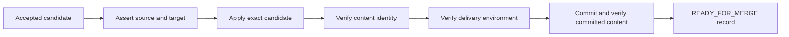

# ADR-0005: Verified Feature Branch Delivery

- Date: 2026-10-16
- Status: Accepted
- Requirements: D25 in the [decision register](../DECISIONS.md#confirmed-decisions)
- Implementation: Managed local branch delivery, run-owned command capture/Stop, aggregate accounting and durable reconciliation are wired; see [current status](0005-implementation-status.md). Real-project/provider runs and remote publication remain separate actions.
- Scope: An optional local delivery stage that turns an accepted candidate into a verified feature-branch commit
- Related: [ADR-0003](0003-task-assessment-and-workflow-planning.md) owns planning/boundaries, [ADR-0004](0004-agent-communication-and-context-contracts.md) owns acceptance evidence, [ADR-0002](0002-execution-audit-and-supervised-control.md) owns audit/supervision, and [ADR-0001](0001-external-workflow-authoring-api-and-mcp.md) owns external authorization

## Context

The existing [reference pipeline](../PIPELINE_EXECUTION.md) produces accepted immutable delivery artifacts. That establishes candidate acceptance, but does not prove that the candidate was applied to a Git branch, verified in its delivery environment or committed.

The user agreed to document a separate reference stage for tasks whose requested result is a verified feature branch. This stage must preserve the identity of the reviewed candidate and produce evidence about the actual committed content. It must also preserve unrelated local work and distinguish readiness from push, merge and release.

Current strict workflow/API schemas do not define this delivery contract. This ADR proposes an extension beyond the existing candidate boundary; it does not redefine what existing runs have delivered.

## Proposed decision

Add an optional runtime-managed branch delivery stage:

Selecting `verified branch` as the delivery boundary requires this stage. Complexity/risk policy determines applicable checks; it does not determine whether a branch was requested. The default candidate-only workflow remains available.

The stage is a runtime utility using captured inputs, approved commands, existing scheduling/locks and audit. It is not an Agent's free-form claim that Git operations succeeded, a second scheduler, or a new top-level run lifecycle. Its phases and `READY_FOR_MERGE` belong to a future delivery record and capability.

## 1. Input contract

Define a versioned branch delivery plan with these logical inputs before execution:

| Item | Required meaning |
| --- | --- |
| Ownership | Store/run/workflow/plan identities, request ID, delivery operation ID and selected workspace/repository. |
| Candidate | Immutable candidate and source manifests, approved operations/preimages, specification, technical approvals and candidate-level acceptance evaluation. |
| Git base | Repository identity, captured base commit and reproducible source content, expected parent, and expected target-ref value or absence. |
| Destination | Exact local feature-branch ref and managed delivery clone/index, with creation/update permissions and ownership. |
| Content policy | Permitted paths/file types/modes, canonical content manifest, Git transformation rules and explicit excluded build artifacts. |
| Verification | Required checks/smoke, execution environment/configuration identities, accepted exit/report conditions, captured outputs and branch-boundary criteria. |
| Commit policy | Explicit author/committer configuration, message source, hook/signing policy and required commit evidence. |
| Limits/control | Execution/attempt limits, aggregate plan budget linkage (ADR-0003), repository/ref locks, run ownership and existing authorization/supervision conditions. |

Candidate acceptance applies to candidate-level criteria. Branch-only criteria remain pending until there is branch delivery evidence; requiring them before applying the candidate would create a dependency cycle. The final boundary evaluation references both current candidate evidence and actual branch evidence under ADR-0004.

Delivery attempts, environment smoke, and reconciliation count toward ADR-0003's aggregate attempt and elapsed-time bounds. Delivery repair does not form an unbounded secondary loop; exhaustion terminates with an explicit incomplete delivery outcome and diagnostics.

The candidate must be reproducible from the declared Git base and approved operations. If relevant uncommitted/untracked inputs cannot be reconciled with that base, record a source prerequisite and recapture/review the affected candidate. Do not silently commit unrelated local work to make the branch match.

## 2. Source assertion and managed checkout

Use a separate runtime-owned delivery clone registered with the delivery operation, rather than a `git worktree`. A `git worktree` shares refs and hooks directly with the host repository, writes metadata into `.git/worktrees`, and cannot check out a branch that is already checked out in the caller's working tree. A separate clone completely isolates the delivery working tree, index, staging area, and hooks from the caller's repository.

To avoid the object-pruning hazard of a `--shared` clone (where concurrent `git gc` or prune in the host repository during delivery could remove borrowed objects that the delivery clone still references via alternates), create the clone as a hardlinked local clone on filesystems supporting hardlinks, or using `--reference <repo> --dissociate`. This decouples the delivery clone's object store immediately while remaining fast and storage-efficient.

Because a fresh clone contains only default `.sample` hooks and never inherits the host's `.git/hooks`, hooks do not run implicitly. The delivery plan must explicitly declare its hook policy: either project hooks are explicitly installed into the isolated clone's `.git/hooks` (or set via `core.hooksPath` to a captured hook directory) under captured policy, or the delivery record explicitly journals that no hooks ran (`hooks: none`). The caller's repository is touched only at the final ref update step under an expected-old-value condition. Verify its resolved repository/path identity and ownership before mutation or cleanup. This separation limits accidental interference; it is not an OS sandbox under Full Access.

The caller's existing working tree may contain unrelated work and must remain untouched. Do not use its index as the delivery index. Import only captured, approved candidate operations and selected prerequisites; broad staging of the caller's directory is not a delivery protocol.

Acquire the applicable repository/ref and clone locks through existing scheduling. Record the expected base, branch ref and destination state. Recheck critical preconditions before apply, staging and ref changes. App-owned locks do not prevent external Git or same-account filesystem changes, so verify state again rather than treating a lock as proof of unchanged content.

Reject source drift, unexpected existing files, ambiguous/colliding paths, incompatible preimages or a moved target ref. Preserve diagnostics and request explicit reconciliation through a new plan/candidate as needed. Do not silently rebase, merge, overwrite a different branch or choose a different base.

An existing branch may be advanced only under a captured expected-ref/parent condition. Creating a new branch requires the recorded absence condition. For example, if delivering to `codex/shadcn-ui` (which already exists and carries earlier infrastructure commits such as ADR-0002), the plan captures that specific commit as the expected parent/base; if delivering to a clean branch branched from `main`, the plan asserts the target ref does not yet exist. A conflicting external ref update must fail the precondition rather than be overwritten.

## 3. Exact application and content identity

Apply the approved operations from immutable objects. Validate paths, file types, preimages, additions and deletions. Candidate operations cannot write Git metadata. Any supported symlink, mode, submodule or external-object behavior needs an explicit verified policy; unsupported cases return a delivery diagnostic.

Build a canonical manifest for the expected delivered source content and verify the materialized result against it. State explicitly how paths, modes and bytes are represented. Artifact SHA-256, Git blob/tree object IDs and platform working-tree bytes are different identities; never equate them by name alone.

Capture the effective Git transformations, including relevant attributes, line-ending conversions and clean/smudge filters. Verify their relationship to candidate content and staged/committed blobs. A required transformation must be declared before acceptance and covered by verification. An unexpected conversion cannot silently change the accepted candidate: fail delivery or create a new captured candidate and reopen affected checks/reviews.

The first increment supports only repository/file configurations whose checkout, staging and commit content can be reproduced and verified. Publish that capability boundary. A passing file-count check, patch exit code or clean status alone does not prove exact candidate content.

## 4. Environment verification

Run the plan's applicable checks and environment smoke against the actual applied delivery source. Reuse earlier candidate evidence only when its source/configuration/environment prerequisites remain valid and policy explicitly permits it.

Smoke is project-specific: for example, import/startup for a library/service or a desktop/browser flow for an application. The plan states what is exercised, expected observations, commands, limits and artifacts. No universal desktop-smoke requirement is added to documentation-only tasks.

Bind each report to the candidate, canonical delivered manifest, environment/configuration and actual execution. Store raw logs and declared outputs on all outcomes under ADR-0002. Agent prose that a preview worked cannot substitute for recorded execution and required observations.

Build/check outputs must remain within declared output/exclusion rules. Recompute source identity after verification. Unexpected tracked or untracked source changes, including formatter/generated-code changes, require a new candidate and affected verification. Declared excluded build products are not staged as source merely because smoke created them.

For Deszo development, a delivery preview must use an appropriate separate environment; replacing the controller's running application is not an implicit smoke action. All managed child processes belong to the selected run and retain its Stop/containment rules.

## 5. Commit and readiness

Stage only the exact approved content and verify the staged tree against the expected canonical manifest. Record its tree/blob identities and expected parent. Execute commit under the captured author/committer/hook/signing policy. Because a fresh clone does not inherit host hooks, project hooks must be explicitly installed into the clone under captured policy, or the commit record must explicitly journal that no hooks were configured (`hooks: none`). Missing configuration is a diagnostic; do not alter global Git settings or silently disable required hooks/signing.

After commit, verify its repository/ref, commit ID, parent and tree, the relationship to the approved manifest, and the delivery clone state. Hooks or other processes can change files during commit; a successful commit exit code is insufficient. Unexpected content changes or a ref that no longer matches prevent readiness and require reconciliation. Readiness is published only after all post-commit assertions and boundary criteria pass.

Use an expected-old-value condition for the final target-ref update into the caller's repository, in addition to app-owned locks. A commit created before a failed ref update is preserved as evidence, not reported as the requested branch result. Do not force-update the ref to hide a race.

Publish an immutable delivery result containing at least:

- Delivery/plan/run identity and exact source/candidate/specification references.
- Repository, branch, base/parent and verified commit/tree identities.
- Canonical delivered manifest and captured transformation policy.
- Required checks/smoke, environment identities, current approvals and boundary acceptance evaluation.
- Hook execution evidence (identifying installed hooks and receipts, or an explicit record of `hooks: none`), command/evidence references, completeness limits, completion time and readiness decision.

`READY_FOR_MERGE` means this exact local commit meets the selected plan's branch-delivery criteria. It does not assert that a push, pull request, remote CI, merge or release happened. Those actions require their own declared stage and existing authorization. Any required external check must be present before its criterion is marked satisfied.

The immutable result remains historical. A current readiness view rechecks that the named branch still points to the recorded commit and that policy-required prerequisites remain current. A moved branch or changed integration base can make current readiness stale. Readiness is not a guarantee about a future merge against a different target state.

## 6. Failure, Stop and recovery

Git/filesystem writes and SQLite journal commits are not one atomic transaction. Persist intent and expected identities before side effects, then record the observed result. Use stable request/delivery IDs and phase receipts. After an uncertain outcome, reconcile the same operation against actual objects/refs/content; do not generate a new identity and repeat commit blindly.

A correlation marker can aid commit discovery but is not proof by itself. Recovery validates repository, parent, tree, ref and captured command evidence. If identity cannot be established, retain an explicit uncertain delivery result with diagnostics and no readiness.

On Stop, timeout or product incident, apply ADR-0002's run-owned process termination and evidence capture. A Git operation may already have created an object or updated a ref; report what is known and reconcile uncertain state. A stopped run cannot publish a new successful readiness result as if delivery completed normally.

Preserve failed/partial checkout and commit evidence under retention policy. Do not automatically reset the caller's tree, delete unrelated files, amend/rewrite existing commits or remove a branch that the operation cannot prove it owns. Hooks run inside the isolated clone only when explicitly installed under policy, or the commit evidence records that none ran (`hooks: none`), rather than running arbitrary caller hooks under Full Access. Cleanup of runtime-owned resources verifies resolved paths and current ownership, removing the clone directory without leaving lingering worktree metadata in the caller's `.git`. Delivery attempts and smoke runs count against the aggregate budget from ADR-0003; exhaustion stops delivery with an incomplete outcome and diagnostics. A repair that changes source content creates a new candidate/delivery revision and reopens affected acceptance.

## 7. Authorization, compatibility and audit

The selected delivery plan makes local apply/branch/commit scope explicit before execution. Saving this plan does not execute it. Existing ADR-0001 authorization/confirmation and ADR-0002 run-specific delegation continue to apply; no extra per-phase approval is required when the approved execution scope already includes those actions.

The run grant and command handler validate repository/workspace, snapshot and permitted delivery operations. A candidate or Agent output cannot expand that scope, select an arbitrary repository or request remote publication implicitly. Expose future commands/results through the runtime's versioned authoring contract and shared bridge, not direct client writes to Git/store state.

Journal phase transitions, locks/preconditions, command arguments/cwd/configuration, exits/termination, content/ref assertions, check outputs, commit identities, recovery decisions and acceptance evidence. Preserve actual output and availability gaps under ADR-0002. Replay displays recorded delivery; it never reapplies files or creates commits.

Existing candidate-only workflows, run statuses, schemas and reference-pipeline output remain unchanged until a separately accepted and implemented capability adds this stage.

## 8. Implementation stages and verification

1. Define delivery-plan/result/phase schemas, authorization scope, content normalization, locking, idempotency and recovery contracts. Publish the exact supported Git/file/environment boundary.
2. Implement read-only preflight and fixture-repository checks, then exact apply and source/environment verification in owned checkouts. No provider is needed to test deterministic delivery mechanics.
3. Implement commit/ref verification, readiness projection, Stop/recovery and audit. Test interrupted writes and uncertain receipts with isolated repositories before live project use.
4. Under separate execution authorization, add branch-delivery cases to ADR-0003's corpus, including context/acceptance evidence from ADR-0004. Compare completion and overhead within the declared delivery boundary.

| Criterion | Required evidence |
| --- | --- |
| ADR5-01 | Candidate acceptance alone cannot produce branch readiness; delivery is explicitly selected independently of complexity; delivery attempts and smoke runs count against ADR-0003 aggregate limits. |
| ADR5-02 | Source/base/ref drift, preimage conflicts and destination collisions fail before incompatible writes; the delivery stage operates in an isolated separate clone (hardlinked or `--reference --dissociate`, avoiding `--shared` gc hazards); hooks are explicitly installed under policy or recorded as `hooks: none`; caller working tree/index and unrelated work remain unchanged; final ref update requires expected-old-value match. |
| ADR5-03 | Materialized, staged and committed content map to the exact approved manifest under captured transformation rules; unexpected conversion or unsupported file behavior cannot pass. |
| ADR5-04 | Actual environment smoke/checks are bound to current source/configuration, with outputs retained on failure and no implicit controller replacement. |
| ADR5-05 | Post-check and post-commit mutation is detected; the recorded commit/tree/parent/ref match what was verified before readiness. |
| ADR5-06 | Concurrent target-ref movement is detected through expected-value checks; no forced overwrite or silent rebase/merge occurs. |
| ADR5-07 | Readiness covers every branch-boundary criterion through current typed evidence, while preserving candidate-level acceptance without a dependency cycle. |
| ADR5-08 | Retried/uncertain operations reconcile the same delivery identity without duplicate commits; unresolvable outcomes remain non-ready. |
| ADR5-09 | Stop/timeout/incident preserves evidence and verified run-owned termination, with no fabricated completion or destructive rollback of unrelated work. |
| ADR5-10 | Readiness names one exact local commit and becomes stale when relevant refs/prerequisites change; push/PR/CI/merge/release are not inferred. |
| ADR5-11 | Scope enforcement, capability discovery and Replay preserve existing authoring/supervision boundaries; saving/replaying never performs Git side effects. |

## Consequences and alternatives

This closes the evidence gap between an accepted candidate and a usable feature branch. It adds Git ownership, content normalization, environment verification and recovery work. Candidate-only delivery remains useful when branch delivery was not requested or its prerequisites cannot be established.

An Agent-authored statement that a branch is ready is insufficient. Directly applying into a user's active dirty checkout, broad staging, automatic rebasing and force updates are outside the first increment. Remote publication and release remain separate possible extensions.

Acceptance of this ADR would approve this architecture only. The present instruction authorizes drafting/refining ADRs and navigation; it does not authorize implementing Git delivery, creating a branch/commit, changing a saved workflow, running providers or launching the pilot.
