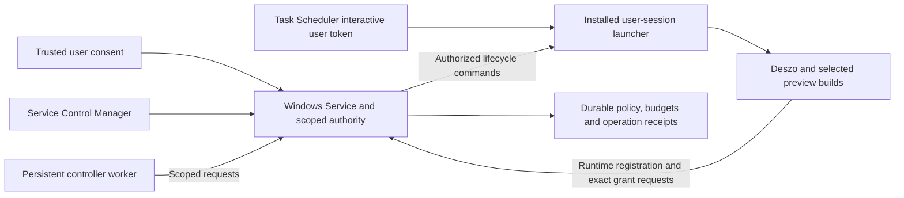

# ADR-0006: Time-Bounded Autonomy and Application Lifecycle Control

- Date: 2026-10-20
- Status: Proposed
- Windows architectural direction: Accepted, subject to implementation verification; see P29 in the [decision register](../DECISIONS.md#accepted-proposals)
- Requirements: D26–D28 in the [decision register](../DECISIONS.md#confirmed-decisions)
- Implementation: the protected Windows service, launcher, consent broker, native containment and a diagnostic application lifecycle are demonstrated on the installed host. The criteria remain open, production autonomy stays disabled, and no criterion is closed. Executable completion plan: [completion plan](0006-completion-plan.md). Dispositions: [acceptance matrix](0006-acceptance-matrix.md). Details and gates: [implementation status](0006-implementation-status.md).
- Scope: A user-authorized autonomous development session, including persistent automatic operational approvals, tests, builds, application restarts and bounded continuation
- Related: [ADR-0001](0001-external-workflow-authoring-api-and-mcp.md) owns external authorization; [ADR-0002](0002-execution-audit-and-supervised-control.md) owns supervision, Stop and incidents; [ADR-0003](0003-task-assessment-and-workflow-planning.md) owns planning and aggregate limits; [ADR-0004](0004-agent-communication-and-context-contracts.md) owns review/acceptance evidence; [ADR-0005](0005-verified-feature-branch-delivery.md) owns verified local delivery

## Context

The real development pilot requires repeated operational confirmations and manual application launches. Updating the application under test also interrupts the runtime that exposes its MCP tools. A controller cannot complete a rebuild/restart/check cycle through an endpoint that disappears with the application unless an independent component can complete and reconcile that operation.

The user requests a checkbox allowing automatic approval for a bounded period, for example twelve hours, and unattended testing and restart of the rebuilt application. The user explicitly requires automatic approval itself to survive restart. Closing Deszo, replacing its build and starting it again must not require another approval within the original authorized scope and remaining time.

Existing external-run confirmation settings and run-specific supervision grants do not form this session contract. Disabling confirmation alone neither creates supervision authority nor defines expiry, restart continuity or application ownership. Reconnecting a transport also does not establish that a new build is running or restore an interrupted run's authority.

The two capabilities belong together: persistent approval removes manual authorization pauses, while an independent lifecycle controller makes the authorized actions executable while Deszo is down. Neither capability establishes workflow quality or resolves an inefficient Analyst step by itself.

## Proposed decision

Introduce a first-party-authorized **autonomous development session** with a durable, time-bounded authorization policy. An independent **trusted Local Control Host** enforces its outer authority, and a separately installed **user-session launcher** performs authorized desktop lifecycle actions. A persistent controller worker requests these capabilities to carry an authorized task through checks, rebuilds, restart and verification.

The host independently enforces scope, expiry, revocation, controller/runtime identity, allowed operations and aggregate budgets for host-mediated privileged actions. The Deszo engine retains workflow-specific validation, exact run grants, supervision, Context compatibility and review/acceptance. Effective autonomous authority requires both a valid host decision and the engine's applicable validation; the runtime cannot widen the host's decision. The host does not schedule workflow roles or decide business acceptance.

### Accepted Windows architectural direction

For the Windows development pilot, the host SHALL be a Windows Service running as `NT AUTHORITY\LocalService` with a dedicated service SID, started and managed by the Windows Service Control Manager (SCM). A separately installed launcher SHALL start independently of Deszo through Windows Task Scheduler with an interactive user token. The launcher performs desktop launch/session access and holds neither authoritative policy nor unrestricted first-party authority.

The user accepted this Windows direction on 2026-10-20, subject to implementation verification. The complete ADR remains Proposed. The contracts below define required enforcement and failure behavior; the status record identifies concrete mechanisms still to specify and test.

## 1. User experience and delegated scope

Deszo may offer **Request autonomous development for 12 hours**, display status and provide **Revoke and Stop**. Its window SHALL NOT itself create, extend or widen policy. Activation requires fresh user verification through the protected trusted consent procedure in section 2, independent of the replaceable candidate. The trusted surface displays the exact controller, workspace/repository/data profile, allowed operations/workflow revisions, budgets, issue time and expiry before approval. An ordinary click, including synthetic input in another process's window, is insufficient evidence of consent.

The proposed standard development scope includes run approval, supervision approval, observation, Stop-and-report, bounded retry/recovery, approved tests, builds, application shutdown/startup and verification. Source repairs and verified local branch delivery must be included when the authorized development task needs them. Push, merge, release, publication, provider substitution and billing fallback are outside this profile.

The window displays remaining time, current work and recent automatic decisions. An independent host surface provides status and revocation while Deszo is closed or cannot start. New policy, extension or widening needs fresh verified first-party consent; eligible runs, supervision grants and application/service restart within the original valid same-boot policy do not need another human confirmation. Revoke and Stop retain their authenticated scope but require no additional user verification that could obstruct termination. The controller cannot renew itself.

Permitted workflow revisions must be an explicit policy, rather than arbitrary future content under the same workflow ID. Each revision is compared with its authorized baseline. The standard profile preserves task scope, role separation, providers, models, explicit effort, mandatory review/acceptance stages and captured limits. Any permitted prompt/source-reference changes remain versioned and auditable. An incompatible change waits for a user decision with the precise reason.

## 2. Durable automatic approval and restart continuity

Define a versioned authorization record before implementation:

| Field group | Required meaning |
| --- | --- |
| Identity | Session/policy ID, policy revision, issuing trusted consent identity, registered controller/host identities and authorization receipt. |
| Consent evidence | Exact proposed-decision digest/version, single-use challenge, trusted credential/enrollment reference, verified result, protected display binding and consumed authorization receipt; no private keys, PIN or biometric material. |
| Scope | Store/data profile, canonical workspace/repository identities, workflow/revision rules, operations, authorized desktop user/session, application/build destinations, trusted baseline and delivery boundary. |
| Lifetime | Original issue time, fixed absolute expiry, OS boot identity, available monotonic anchors, time-source assumptions and revocation state. |
| Limits | Aggregate attempts, provider invocations, operation/restart/repair limits, duration and allowed commands. |
| Continuity | Authenticated controller registrations, application/runtime generations and linked operation/run receipts. |

Persist the record outside disposable build folders and the replaceable application process. Policy/history remain durable across full Deszo shutdown, rebuild, runtime/bridge/host restart and OS reboot. Automatic use of the original policy survives supported restarts within the same OS boot, subject to validity and reconciliation; initial Windows behavior after reboot is explicitly blocked as defined below. A restart never resets the original twelve-hour period, clears counters or silently changes the authorized controller.

For example, approval at 10:00 expires at 22:00. Restarting a rebuilt Deszo at 13:00 preserves automatic approval until 22:00, subject to the remaining scope and budgets. Time spent building, offline or restarting counts against the same interval.

### Authority identities and scoped bootstrap

Manual first-party consent and policy-derived autonomous authority SHALL have separate enforcement contracts. The existing runtime-generated first-party token is not a trusted authorization boundary for an autonomous candidate. A candidate cannot obtain unrestricted authority by generating, receiving, retaining or replaying such a token. Policy creation/extension, supervision bypass, protected-limit changes and privileged access grants require the trusted boundary outside the replaceable candidate, regardless of which HTTP, MCP, Tauri or legacy first-party route is used.

| Identity or record | Authority and boundary |
| --- | --- |
| Trusted first-party consent | Fresh verified user decision bound to the exact proposed policy through a protected consent broker/surface independent of the candidate; ordinary synthetic desktop input or a candidate/worker receipt cannot supply it. |
| Trusted service identity | Protected installation/service SID and authenticated IPC endpoint; enforces an existing policy and retains its authoritative records. No unrestricted legacy runtime token is needed. |
| Controller identity | Registered external worker/controller authenticated through a restricted bridge contract; cannot impersonate user consent, the service or another controller. |
| Launcher identity | Protected installed executable, task and authenticated user-session connection; receives only bounded lifecycle commands. |
| Runtime identity | Expected OS process creation/executable identity, selected build/profile and authenticated generation; receives scoped runtime registration, not consent authority. |
| Session policy | Durable first-party authorization with original expiry, revocation and aggregate limits; an ID alone grants nothing. |
| Run approval/grant | Exact snapshot/workspace/controller/runtime binding derived from a host decision and engine validation; cannot exceed the session policy. |

The bootstrap contract SHALL establish this sequence:

1. A separately authorized installation protects the service, launcher, Scheduled Task and consent broker/trust anchors outside the candidate workspace/build outputs. The trusted consent procedure below verifies the user and exact scope; the service atomically persists the scoped decision and authority receipt.
2. SCM starts the service and the registered task starts the launcher in the authorized existing interactive user session, independently of Deszo. Startup/recovery must complete the reconciliation contract before new privileged dispatch.
3. A controller authenticates a fresh restricted connection under its registered identity. Keep authentication material in protected host-managed storage or the trusted bridge as appropriate, never in model inputs, discovery descriptors, command arguments or audit exports.
4. The service admits a bounded launch and sends the authenticated launcher an operation-bound command. The launcher starts the selected desktop/runtime chain with containment established before candidate execution passes the launch boundary. Calling this chain Tauri does not confer authority.
5. The new runtime and service mutually authenticate over local IPC. The service independently binds registration to the actual process, build, store/profile, user/session and runtime generation. Specify the credential/proof issuer, custody, audience, permitted messages, expiry and revocation in the versioned IPC contract before implementation. Runtime registration cannot be upgraded to first-party consent or another runtime/controller identity.
6. Each eligible automatic approval has a host decision/receipt bound to the policy revision, exact request, snapshot, workspace, controller and registered runtime. The engine applies its own workflow validation and issues/binds its exact run grant within that decision. Admission requires the host-backed authority; alternative direct-run, recovery, settings or approval routes cannot bypass it.
7. Supported same-boot application/service restart invalidates affected live registrations/credentials/grants and requires fresh authentication and eligible grants under the unchanged valid policy. Initial OS-reboot behavior instead requires new verified first-party authorization as specified below. Expired/revoked policies, stale credentials and historical IDs/approvals cannot bootstrap live authority.

Audit [the current runner bootstrap](../../runtime/runner.mjs), its private stdout handoff and Tauri IPC against this contract. Reconcile ADR-0001's route-to-credential matrix explicitly before enabling replacement. Merely withholding a token emitted to the launcher is insufficient when the candidate can generate that token itself. If the legacy unrestricted first-party path cannot be separated from autonomous authority, controller replacement remains disabled. Manual approval remains available through the trusted consent path; neither the candidate nor controller may mint an equivalent decision.

### Trusted consent and user verification

For every policy creation, extension or widening, the service constructs the exact immutable proposed decision and issues a fresh, expiring, single-use challenge cryptographically bound to its versioned content. A protected installed consent broker presents those same controller/workspace/operation/budget/issue/expiry parameters and obtains fresh user verification. The service independently verifies the result, challenge and unchanged decision, then atomically consumes the challenge and persists the decision/receipt. Reject replay, expiry, substituted fields, wrong audience/controller/workspace and lost-response retries that attempt another authorization instead of receipt reconciliation.

Ordinary UI automation, candidate self-confirmation, broker identity alone or a returned success enum cannot establish fresh user consent. Windows Hello/WebAuthn with required user verification is the preferred mechanism candidate, not an implemented or proven guarantee. Before selecting an API, verify the local Win32/service-broker use case, cryptographic decision binding, resistance to the actual worker/adapter's synthetic input, fallback behavior, protected broker identity and independent service validation. An ordinary UAC elevation prompt is not a universal autonomous-policy confirmation mechanism.

For a WebAuthn design, define trusted credential enrollment and replacement as well as assertion verification. Candidate/worker-controlled key registration cannot create a trusted credential. The service validates the authorized credential/public key, signature, challenge/decision binding, expected relying-party/audience/client context and actual user-verification result. PIN/alternative authenticator paths must meet the selected threat model; API success alone does not prove that input was non-synthetic. Mechanism references: [Windows Win32 WebAuthn](https://learn.microsoft.com/en-us/windows/win32/webauthn/-webauthn-portal), [assertion verification](https://www.w3.org/TR/webauthn-3/#sctn-verifying-assertion).

Cryptographic authentication does not by itself prove that the user saw or understood the policy. Protected display of the exact decision and its integrity are separate obligations; do not claim proof of human comprehension. Missing/unverified broker or authenticator, cancellation and locked/unavailable desktop leave policy creation/extension/widening blocked, with no ordinary-button fallback. Existing safe Stop/revocation remains available under its current authority. No selected consent mechanism is claimed verified by this ADR.

### Time and expiry

Within one OS boot, enforce elapsed time using a monotonic source with documented suspend/resume semantics. Bind persisted anchors to that boot identity. Application, bridge and host restart within the same boot must retain the original deadline and counters without another user approval. Sleep/offline time counts against permission; an implementation that pauses its timer during sleep must reconcile that interval before dispatch resumes.

For the initial Windows implementation, OS reboot SHALL block autonomous dispatch under the previous policy. Do not compare old monotonic anchors with the new boot's counter or accept a last-observed wall clock as proof of remaining lifetime. Until a trusted-time recovery mechanism is explicitly specified, implemented and verified through a later contract change, continuation after reboot requires fresh first-party authorization through the trusted consent procedure. The old policy, original expiry, counters, revocation and audit remain durable and unchanged; SCM/task startup cannot automatically renew them.

The fresh decision is recorded as a new explicit authorization linked to the earlier session/task, not a rewritten original period. Consumed budgets for that development task carry forward; any budget increase must be part of the exact newly presented/verified decision. Same-boot Deszo or service restart preserves valid original authority after reconciliation without new consent. Sleep, suspension and hibernation consume the original lifetime; classify recovery using verified boot/time identity, and block when continuity is uncertain. Trusted-time assumptions and any future post-reboot recovery remain explicit implementation/acceptance gates.

A system-clock rollback, controller reconnect or state restoration must never increase the original authorized interval. Both native supervisor domains receive an enforcement deadline capped by the remaining authorized lifetime and the applicable task limits. Enforce expiry independently of the renderer, model and runtime/host event loops. Test suspend/resume, reboot, clock changes and expiry while the host is unavailable. Platform time-source guidance: [Windows time-interval measurement](https://learn.microsoft.com/en-us/windows/win32/sysinfo/acquiring-high-resolution-time-stamps).

### Authorization, revocation and admission

The trusted service SHALL serialize policy validity, exact scope/controller/runtime checks, expiry/revocation checks, shared-budget reservation and its durable authorization decision. The transaction's commit is the decision's linearization point; its receipt records the policy revision, revocation generation, operation identity and reservation. No new authorization may be issued after committed revocation. The engine's additional validation may refuse work but cannot override a host refusal or reservation bound.

An authorization receipt is a bounded permission to request execution, not an indefinite right to execute later. Actual admission to an external effect must participate in the same revocation protocol. Use a native admission barrier and policy-generation fencing for both ownership domains: stale permits cannot pass the barrier, and admission is ordered against revoke/Stop. A final check followed by an unguarded spawn is insufficient. For processes, register pending launches and establish containment before allowing candidate code to execute; Stop covers pending launches as well as running children.

Revocation records its intent, closes the relevant native admission barriers and invalidates pending permits before reporting a committed revocation. Persistence or barrier failure leaves dispatch blocked and requires reconciliation; it is never reported as successful revocation or verified Stop without the corresponding evidence. If admission preceded revocation, the operation belongs to the native Stop protocol, including an effect that is not yet fully visible to the host. Publish the ordering points and bounded Stop guarantees; do not claim that permission persistence and every OS effect form one atomic transaction.

Before admitting delayed or recovered work, revalidate authority, time, scope, generation and its budget reservation. Return a reservation only with evidence that its chargeable effect did not occur; retain unresolved accounting conservatively. A restart cannot turn a previously reserved or ambiguously consumed permit into an additional free attempt.

Expiry or revocation prevents new dispatch and stops active work owned by the session through native containment. Fail-closed behavior still permits emergency Stop, evidence preservation, incident capture and read-only reconciliation under their existing authority. It does not authorize a recovery that starts new work. New runs, retries, builds and application launches require valid authority; expiry does not permit an automatic rollback launch. Unrelated work remains outside this Stop scope. Revocation is durable across every subsequent restart, and restoring application data must not roll back host policy, revocation, counters or operation receipts.

## 3. Operational approval, quality and attention

Automatic approval may authorize starting a run and its supervision. It must not invent a successful review, approve a candidate, satisfy an acceptance criterion, acknowledge uncertain native Context, raise limits or mark a failed check successful.

Code Reviewer, Test Reviewer, Analyst and other saved roles continue to execute their prescribed work with their configured providers, models and explicit effort. Review carry follows the compatibility rules of ADR-0004; a rebuild or fresh grant cannot preserve an approval whose subject changed.

The twelve-hour authorization lifetime is separate from the short observation/attention deadlines of ADR-0002. The controller worker acknowledges only semantic events and health snapshots it actually processed. Host heartbeats, timers and automatic run approvals cannot advance the acknowledged cursor. The existing pause/escalation behavior still applies if the worker is stalled, disconnected or unable to inspect events.

Hard capture, persistence or containment failures retain immediate Stop semantics. Automatic permission is not permission to continue through an unresolved engine invariant failure.

## 4. Independent control host and persistent worker

### Protected Windows service and deployment

The LocalService service maintains the authoritative policy, revocation, shared budgets and lifecycle records in storage protected by explicit Windows ACLs. Its binary, dependencies, configuration, consent trust anchors and authorization state SHALL remain outside candidate workspaces and replaceable outputs. Configure and test the dedicated service SID, directory/file/service-object permissions and installation/update rights. Ordinary candidate, launcher and source-repair processes cannot write protected authority or replace the trusted installation. Default ACLs, another directory or per-user encryption alone are not an isolation mechanism.

SCM starts/manages the service independently of the replaceable Deszo and its Jobs. The registered Scheduled Task starts the installed launcher using the target user's interactive token; protect and document its principal, triggers and recovery/startup policy. The service, launcher and task have a separately authorized installation, update and removal procedure. They are not installed/upgraded by normal autonomous source repair. The service's stable endpoint, status and revocation path remain available while Deszo is closed. Loss of an interactive session blocks required desktop work; it never causes the service to acquire unrestricted user credentials or bypass OS authentication.

The protected service is an authorization/lifecycle boundary, not a general sandbox for arbitrary candidate code. Repository content, build hooks, artifacts and candidate responses are untrusted inputs and cannot widen commands, directories, profiles or authority. Build/test code executes in its approved user/worker domain without inheriting service identity or secrets. The current [Full Access storage limitation](../STORAGE.md#layout-and-ownership) remains relevant outside protected host-mediated operations. The design assumes trustworthy OS enforcement and protected installation; it does not resist administrator-level compromise or arbitrary unrestricted same-user code outside those operations. If required guarantees cannot be met under the supported threat model, controller replacement stays disabled; any stronger isolation or reduced threat model must be explicit.

### Security-critical changes and promotion

The trusted computing base (TCB) includes the service/launcher installation and the relevant authorization/grant routes, scope matcher, policy/budget enforcement, credential bootstrap, supervision/Stop/containment, host interaction and trust-update mechanisms. Capture a trusted baseline and derive impact from actual changed content, imports/dependencies, configuration, build inputs and manifest-covered artifacts. Path names alone or a candidate's own classification are insufficient. The host uses trusted validation of that captured closure before promotion; unknown impact fails closed.

The standard autonomous profile SHALL NOT automatically promote changes capable of weakening these mechanisms into the active controlling runtime, even if a build hash matches or ordinary review passes. Such widening needs a separate freshly verified first-party decision under section 2. Authorized investigation/build/tests may still use an isolated preview without obtaining controlling authority. Host policy, trusted configuration, service/launcher binaries and consent anchors cannot change through ordinary source repair. A manifest establishes identity, not semantic safety.

### Trusted user-session launcher

The launcher is part of the TCB. Protect its executable/dependencies, configuration/service trust anchor, registration material and the Scheduled Task definition, including path, arguments, principal and triggers. Its protected installation is independent of candidate builds and Jobs; it has no policy-creation/extension or unrestricted first-party rights.

It accepts lifecycle commands only from an authenticated service connection. Each command binds a durable operation ID, selected manifest/artifact identity, authorized workspace/profile, target user/session, expected process/runtime generation and lifecycle phase, service authorization and remaining budgets. No unrestricted shell, arbitrary executable path or caller-declared scope is accepted. The service independently validates requests and OS results; a launcher success reply is not proof of launch, ownership or termination.

### Native ownership and Stop

LocalService does not automatically provide access to another user's processes/Jobs. Specify security descriptors, minimal handle rights and ownership transitions for the real launch procedure. The service SHALL retain independently usable rights to verify process identity/state, query owned Jobs/processes, Stop session-owned work, confirm termination and reconcile after launcher failure. This includes `JOB_OBJECT_QUERY` and `JOB_OBJECT_TERMINATE` plus the minimum process/assignment rights actually required. The launcher gets only the temporary process/assignment rights required by the selected procedure; they must not defeat service-owned fail-stop.

Candidate execution cannot pass the authorized launch boundary until containment ownership is established and acknowledged. Missing/unverifiable ownership refuses launch. Keep the service outside candidate containment; prove compatibility with existing Deszo per-run/application containment and nested Jobs. Build/test/lifecycle utility children also need registered native containment, capture and timeouts. Session Stop reaches both ownership domains and pending launches without touching unrelated work. Use process creation/executable identity, not PID alone.

The Windows pilot SHALL use fail-stop containment: a service-owned outer Job for each autonomous containment domain, configured with `JOB_OBJECT_LIMIT_KILL_ON_JOB_CLOSE` and verified against Deszo's existing nested Jobs. Only registered session-owned work belongs to these domains. The service is the sole process retaining the outer Job's handles while work is admitted; launcher, worker and candidate cannot retain/inherit duplicates, including query-only duplicates that would keep the Job open. Candidate execution remains blocked until native ownership and the required handle distribution are confirmed. Pending launches must not resume after service loss and require bounded native cleanup; the chosen assignment/acknowledgement procedure must prove this crash window safe.

Service process failure closes its handles and natively terminates admitted session-owned work. The launcher and consent infrastructure are not automatically session workload. A stable controlling Deszo in separate-preview mode remains outside the session's fail-stop scope, while its session-owned attempts and previews must still terminate. An explicitly replaced controlling Deszo admitted into the session's containment may terminate with it. The actual Job topology must demonstrate these distinctions without affecting unrelated processes; otherwise the affected mode is unsupported.

Kill-on-close depends on closing the last Job handle. A deliberately preserved outside duplicate cannot be assumed to permit automatic termination when the service dies. A leak/inheritance test must detect and refuse unsafe admission or fail the verification/enablement gate; it cannot count surviving work as a pass. Required native ownership/handle semantics that cannot be proved keep controller replacement disabled. Platform basis: [Windows Job lifetime](https://learn.microsoft.com/en-us/windows/win32/procthread/job-objects).

Recovery never assumes that handles/processes survived or blindly adopts a matching PID. The service must independently initiate/verify Stop without a functioning launcher, renderer or candidate. Native tests prove both directions: candidate Job termination leaves the service alive, and service failure terminates exactly its owned work. Neither failure is successful workflow completion; interrupted/canceled operations retain their actual history and evidence gaps.

### Persistent worker and least privilege

A persistent worker executes observe/decide/request turns without an active chat. Its configured CLI/provider/model/effort and account/billing policy remain explicit. It receives neither unrestricted first-party authority nor direct host secrets/policy-storage access. Its supported tool/configuration profile must exclude general shell/file/process capabilities that bypass scoped operations; merely instructing the model to avoid them is insufficient. All privileged requests pass independently validated host/bridge contracts for commands, paths, working directories, destinations and resource limits.

Workflow outputs remain untrusted data, including instructions to change policy, tools, provider or budgets. Source repair is performed by existing workflow roles under review/acceptance, not by unrecorded worker writes. Tool restriction is one layer: document and test residual same-user access, client configuration/extensions and OS permissions under the supported threat model. If the adapter/profile cannot meet a required boundary, unattended execution for it is unsupported. The host is not a workflow scheduler and cannot substitute heartbeats for processed model observations.

### Service recovery and durable reconciliation

SCM recovery restores service availability, not authority to execute. On every startup/recovery the service SHALL, before new privileged dispatch:

1. Load policy, original expiry, revocation and authorization history, and validate integrity and the trusted controller identity.
2. Verify boot/time identity and remaining authority, recover budgets/reservations/operations, and apply the initial no-automatic-resume-after-reboot rule.
3. Reconcile durable intents with actual OS process/build/profile/runtime state; invalidate stale connections/registrations. Verify that former session-owned work terminated or contain unresolved work according to the fail-stop contract.
4. Persist actual interrupted/failed outcomes, termination evidence and explicit capture gaps. Missing handles/receipts are not proof of completion or safe survival.
5. Permit new operations only through the engine's legal recovery/new-run path after all checks pass, under valid original same-boot authority or a fresh post-reboot authorization. Never resurrect a terminated run or continue its old processes blindly. Otherwise remain blocked/reconciling with safe Stop available.

The service SHALL NOT issue a new twelve-hour term, reset limits, restore expired/revoked permission, blindly repeat an unknown operation, infer completion from an SCM restart or launch rollback without remaining authority. Incident evidence, Stop reconciliation and authorized read-only diagnostics remain available. Worker loss additionally follows ADR-0002 attention/Stop rules.

Distinguish three facts: a durable intent exists; an external effect occurred; and its verified result was persisted. Queue/checkpoint state alone proves neither execution nor non-execution.

Before retry after a crash, timeout or lost reply, reconcile the intent/receipts, saved lifecycle phase, actual OS processes and ownership, creation identity, build/profile, runtime generation, authority and budget reservation. Unknown mutation outcomes remain reconciling or blocked until evidence establishes a safe next action. A missing PID or missing receipt does not authorize repetition. The guarantee is prevention of inadmissible duplicate effects through admission and reconciliation, not generic exactly-once execution of external OS operations.

Reusing the current chat alone is insufficient for the unattended requirement: chat availability is not a durable queue or a process supervisor. The manual-controller path remains usable alongside the persistent worker.

## 5. Tests, builds and application replacement

Capture the verification plan before execution: applicable tests, documentation/schema checks, runtime/shim packaging, application build, environment smoke and UI checks. Commands, working directories, timeouts and expected outcomes are selected inputs. Record each invocation and its raw result, including failed or interrupted attempts.

Build into a new owned version directory. Publish it for launch only after successful packaging and a complete build manifest. The manifest binds source commit plus any dirty-source content digest, dependency/build inputs, frontend/runtime/shim/application artifacts and relevant protocol/schema versions. Do not overwrite a running executable or identify a build only by its filename.

Verify the switch through a chain of evidence: registered manifest and captured source inputs → actual artifact digests → OS-observed process creation/executable identity → the authenticated runtime generation → the selected data/store profile and compatible protocol/schema. The host or external test harness obtains process/executable observations independently of candidate self-report and binds them to the operation receipt. Runtime-reported identity remains a cross-check, not the sole proof.

The launch contract must preserve artifact identity between hashing, process creation and verification, including manifest-covered runtime resources. Select and test an immutability/access-control or equivalent platform mechanism under the chosen trust profile. Hashing a mutable pathname and launching it later does not satisfy the contract. A replaced file, reused PID, unbound generation or unverifiable executable blocks successful switch verification. These checks establish identity within the documented threat model, not hardware attestation or proof of arbitrary program behavior.

Separate preview with isolated data remains the default under ADR-0005. Switching the actual controlling Deszo is supported when needed for the authorized task and covered by a distinct lifecycle scope. Capture that necessity, selected profile and authority basis in the session/operation record; an eligible switch inside an existing valid policy does not require another manual approval. Preview evidence never proves that the controlling application was switched. A controlling switch retains every host-independence, policy, Stop and reconciliation requirement. Preserve the last verified build together with an operation/profile-specific compatible snapshot or verified restore strategy.

An application restart is a durable operation with these phases:

1. Assert the authorized workspace/profile, switch rationale, expected current generation, trusted-closure/promotion policy, selected build identity and remaining budgets; record an operation intent, continuation checkpoint and data recovery strategy.
2. Quiesce dispatch, stop affected runs and the old application, and obtain native proof that its owned processes have terminated. Unknown ownership or unconfirmed termination blocks a new launch.
3. Admit the exact registered build through the service/launcher authorization and native ownership barrier, preserving verified artifact identity, selected data/user/session and bounded startup deadline. Preserve startup/stdout/stderr/native logs while the application endpoint is unavailable.
4. Obtain OS process/executable evidence, authenticate the new runtime and bind its new generation to that evidence. Verify manifest/source/store/profile identities and protocol capabilities. A reused port, responsive window or self-reported build ID alone is insufficient.
5. Perform required health, environment and UI checks against that running generation. Record screenshots or native UI evidence where required; a frontend-only check cannot stand in for a native desktop check.
6. Complete scoped runtime registration, reconcile the checkpoint and derive fresh eligible host decisions/engine grants under the original policy. Continue through a linked run/attempt only after input, Context, evidence and shared-budget checks succeed.

An interrupted or canceled workflow run remains interrupted or canceled; restarting the application does not rewrite its outcome. Continuation uses the engine's legal recovery/new-run path. Revalidate source references and semantic fingerprints before carrying results forward.

If startup or verification fails, capture an incident and use a bounded rollback to the last verified build when still authorized. A database migration requires a tested compatibility/restore plan bound to the build, data profile and switch operation; opening an older executable against a newer incompatible store is not rollback. An existing pre-migration backup is not a universal restore source. Account for schema incompatibility and writes made after a snapshot: preserve newer data or block automatic restore rather than silently discard it. Preserve failed-build/data evidence and avoid restart loops. Application-data restore never restores host policy, expired authority or old budget counters.

Native UI testing requires a supported accessible desktop session and the configured adapter. Limit input/inspection to the authorized application and Windows user/session; access to unrelated applications is outside scope. Capture the allowed interactive/focus-input mode, and bind required UI evidence to the OS-observed process and authenticated runtime generation. An unavailable/locked or unauthorized desktop produces a verification blocker; never bypass OS authentication or substitute a preview/HTML-only pass for required native evidence.

Use distinct logical operation outcomes, to be formalized in the future schema: reconciling for an unknown effect/result; blocked with a reason and required next action; failed for an established failure; and verified only when all required evidence is complete. Reasons distinguish unverified authority/time, unconfirmed termination, unverified build/store identity, incompatible or damaged data and unavailable UI evidence. These are operation semantics, not new existing run-state enums or review verdicts. None permits a new launch without valid authority, confirmed shutdown and a verified compatible profile. A fresh grant alone restores neither old authority nor acceptance evidence.

## 6. Bounded continuation and incident handling

The service's authoritative aggregate ledger covers linked runs, controller model calls/turns, preparation, repair, checks, builds, restart and rollback. Record worker-model usage separately from workflow-role usage, with provenance and no double counting; reserve/count those calls even when they produce no workflow artifact. The engine retains its step/task limits inside the host's ceiling. A new process, runtime generation, service recovery or approval grant never resets bounds. Twelve hours is a permission ceiling, not an unlimited retry allowance.

On a suspected Deszo bug, first stop affected work, verify termination, preserve evidence and register the local incident. Service failure triggers native fail-stop before recovered software can act; recovery records the incident/interrupted lineage rather than reporting success. Diagnosis/repair/rebuild can continue unattended only under the applicable same-boot policy and remaining budgets, or fresh post-reboot consent. Otherwise expose a durable blocker and wait for the required decision.

A retry records its justification and the changed input or diagnosed transient condition. Repeating an unchanged timed-out Analyst invocation until the permission expires is not a recovery policy. Model substitution, effort changes, weakened review and larger budgets are never implicit repairs.

## 7. Proposed API/MCP boundary

The following are capability groups, not currently implemented tool names. Publish strict schemas, authorization routes, events and migrations before adding them to the supported catalog.

### Mutually authenticated local IPC

Service-to-launcher and service-to-runtime communication SHALL use local named pipes with explicit security descriptors and minimal rights; do not rely on default DACLs. Restrict remote clients and prevent or detect unauthorized pipe-instance creation/endpoint impersonation. Both peers verify the actual connected process, relevant OS token identity and Windows session, then bind it to the expected protected installed executable or authorized candidate build. Clients verify service identity against a protected installation trust anchor, not an endpoint name supplied by workflow content.

Bind messages/replies to the authenticated connection, durable operation ID, policy decision and runtime registration. Reject stale connections/registrations, replayed authorization, wrong audience/session/build and mismatched process creation identity. Policy IDs, PIDs, session IDs, generation IDs and operation IDs are identifiers, not bearer credentials. Identity verification failure blocks privileged registration/admission; the service cannot authorize based only on launcher/runtime/worker assertions.

Specify credential/proof custody, peer-verification steps, connection/service-generation handling, replay prevention and revocation before implementation. Document limits on distinguishing same-user processes. Where those limits invalidate a required guarantee, explicitly select stronger OS isolation or a reduced supported threat model; until then the affected autonomous capability stays disabled.

| Surface | Authority and behavior |
| --- | --- |
| Request consent/create/extend/revoke policy | Deszo may request consent. Creation/extension/widening requires fresh user verification bound to the exact immutable decision through the trusted broker; ordinary UI input or launcher/runtime/controller registration cannot supply it. Revoke/Stop keeps its existing authenticated scope without extra verification. |
| Session/policy status and decision receipts | Read remaining validity, budgets, matching scope, pending blockers and automatic approvals across application generations. |
| Register controller/launcher/runtime and derive exact approvals | Mutually authenticated scoped registration and host decisions; the engine retains exact run-grant/workflow validation. No conversion into unrestricted first-party authority. |
| Submit/inspect verification and build operations | Captured commands and versioned artifacts, durable progress and terminal evidence. |
| Inspect/start/stop/restart selected application | Service-authorized, launcher-executed operations with exact build/profile/user/session/generation preconditions and independently verified containment. |
| Resume/reconcile development session | Recover queue/checkpoints, obtain fresh authenticated runtime sessions and request eligible per-run grants. |
| Emergency Stop and local incident capture | Available through the host while the application is down, with later reconciliation into Deszo history. |

All mutations use stable request/operation IDs and queryable receipts. A dropped connection after submission must be reconciled before retry. Read operations do not launch or restart anything. Concurrent controllers cannot both own or publish the same lifecycle operation.

Managed role CLIs do not receive the external host's authority. Host APIs never authorize a candidate build to widen policy, modify trust configuration or replace the service/launcher TCB through an ordinary development operation. Protection against direct process/filesystem modification requires the installed OS boundary in section 4, not API restrictions alone. Host/launcher upgrades require their separate trusted authorization and compatibility procedure.

## 8. Audit and compatibility

Provide one development-session index linking policy decisions, workflow snapshots, runs/attempts, controller observations, operations, build manifests, runtime generations, process proofs, test/UI evidence, incidents and rollback results. Keep this history readable after the candidate application fails to start.

Record why each request was automatically approved, denied or left pending, including the authorizing policy revision and remaining limits. Preserve event-sequence domains and restart gaps explicitly; a session index does not turn separate journals into a falsely uninterrupted stream. Apply the audit/redaction rules of ADR-0002 and do not claim access to unavailable model reasoning.

This ADR explicitly extends ADR-0001/ADR-0002's first-party and process-ownership boundaries for Windows autonomy: trusted consent establishes a service-owned policy; each autonomous operation requires independently enforced host authority plus engine-specific validation. Ordinary/manual modes outside an autonomous candidate context retain existing behavior; a caller's manual label within that context does not establish trusted consent or bypass host enforcement. Before enabling autonomy, publish the revised route/credential and native-ownership contracts so legacy settings, direct-run, approval, recovery and Context paths cannot bypass the host's applicable limits. The accepted Windows direction does not make the current bootstrap safe by declaration. No unrestricted first-party credential is forwarded to the worker/host or supplied to a candidate as a shortcut, and global confirmation is not disabled. Existing pending requests/grants acquire no new authority until explicitly covered and evaluated.

Protected service/launcher installation and state are a scoped OS-boundary extension to the ordinary Full Access storage model, not a claim that all workflow code is sandboxed. ADR-0003 through ADR-0005 remain Accepted with their existing implementation/status limits; see the linked status records in this ADR's implementation status. This document does not mark real-provider evaluation or installed native verification complete.

ADR-0005's separation of the controlling application and delivery preview remains the default. The lifecycle capability adds a separately authorized, independently supervised application switch. A successful switch does not itself establish candidate acceptance, a verified branch commit or `READY_FOR_MERGE`.

## 9. Implementation order and verification

The [implementation status](0006-implementation-status.md) owns temporary branch/repository context, the remaining mechanism decisions and their enablement blockers. Accepting these contracts installs nothing and starts no autonomous session, application switch or provider invocation. The later 2026-10-20 implementation request and its scope are recorded in the implementation status.

| Stage | Deliverable | Required evidence |
| --- | --- | --- |
| 1. Windows authority and contracts | Protected LocalService/service-SID installation/state, fresh verified consent/enrollment, scoped bootstrap/route matrix, IPC, same-boot timing, explicit post-reboot block, budgets and admission/revocation. | Synthetic input/self-confirmation, challenge/key/scope replay/substitution and unavailable verifier refuse authority; alternate-route, ACL, clock/revoke races and systematic transition checks. |
| 2. Launcher and lifecycle | Protected interactive task/launcher, service-owned fail-stop Jobs, minimal handles, exact-build identity, restart/reconciliation and compatible data recovery. | Service crash terminates exactly owned work; stable preview controller survives while its owned attempts stop. Test pending-launch/receipt windows, leaked handles, wrong peer/profile/artifact, protected-installation tampering and lost replies. |
| 3. Persistent controller | Restricted worker/bridge tools and configuration, durable queue, processed observations, shared accounting including worker model calls, incident/role-managed repair cycle. | Injected output cannot cause arbitrary commands, credential access, TCB edits, provider/budget substitution or review bypass; worker loss and bounded failures without provider quota. |
| 4. Real development pilot | One explicitly authorized session completing repeated runs, checks, rebuild, full application restart, native UI checks and verified local delivery. | Actual build/process/data identity, policy-derived fresh grants, complete qualified audit and measured manual interventions. No push, merge or release. |

Acceptance criteria:

| ID | Criterion |
| --- | --- |
| ADR6-01 | Creation/extension/widening requires fresh verified user consent bound to the exact policy; synthetic input, self-confirmation, substituted credentials/scope and replay cannot supply it. That authorization enables eligible exact run/supervision approvals without repeated consent, subject to host and engine checks; alternate routes cannot bypass either boundary. |
| ADR6-02 | Supported same-boot shutdown/startup of rebuilt controlling Deszo preserves original expiry/counters and automatic approval without renewed consent or inherited unrestricted credentials. Initial OS-reboot behavior blocks the previous policy; future trusted-time continuity requires a separate verified contract change. |
| ADR6-03 | Runtime/bridge/launcher/service restart requires fresh authenticated scoped connections and authority/process reconciliation before dispatch. Fake/stale/wrong-audience/session/process/build registrations are refused. Service restart is not old-run resumption; after reboot the initial profile requires a new verified first-party decision. |
| ADR6-04 | Sleep/hibernation, downtime, clock rollback, boot changes and revoke/dispatch races never extend original authority. Test same-boot recovery, expiry/revocation and the post-reboot block. New explicit consent cannot silently reset consumed task budgets; Stop/evidence remains available when dispatch is blocked. |
| ADR6-05 | Disallowed controller/store/workspace/workflow/model/effort/budget changes are refused. Tests reject unauthorized TCB changes and promotion of authority-critical changes determined from actual content/dependencies. Protected service/launcher/task/state cannot be modified by ordinary candidate/repair operations; threat-model limits are explicit. |
| ADR6-06 | A least-privilege worker continues while chat is inactive, uses only validated scoped operations and charges its own model calls to shared limits. Injected outputs cannot grant commands, credentials, TCB changes, larger budgets or provider substitution. Only processed observations satisfy attention deadlines; stalled workers follow ADR-0002. |
| ADR6-07 | Independent review, acceptance and Context compatibility checks still block a run when their evidence is absent or invalid. |
| ADR6-08 | Independent SCM service/task launcher perform authorized rebuild, contained exact-build replacement and checks without manual launch. OS/artifact evidence binds manifest/source/profile/generation and guards hash-to-launch identity. Service survives candidate Job termination; switched controlling Deszo is admitted only with independently confirmed ownership. |
| ADR6-09 | Native service crash causes fail-stop of its session-owned processes, including owned attempts under a stable preview controller; that controller and unrelated work survive. Tests prove nested topology, service-only outer handles, pending-launch cleanup, minimal rights, PID identity and Stop after launcher failure. An explicitly switched controller may terminate with its session. |
| ADR6-10 | Inject service/launcher crashes, lost receipts/replies, stale permits and handle leaks before/after critical boundaries. Unknown effects reconcile without duplicate/uncontrolled work. An outside Job-handle duplicate refuses admission or fails the enablement gate, never establishes a false kill-on-close guarantee. No generic exactly-once claim. |
| ADR6-11 | Wrong/unverified build/store/protocol/user/session, unavailable or locked desktop and missing required native UI evidence block continuation. UI operations stay inside authorized app/session and evidence identifies the actual generation; preview results cannot prove controlling switch. |
| ADR6-12 | Rollback requires valid authority and an operation/build/profile-specific compatible restore strategy preserving newer data. Expiry, unconfirmed Stop, schema/data incompatibility or failed restore refuses launch with evidence. Restoring an old backup cannot silently discard newer writes or restore host permission/counters. |
| ADR6-13 | All linked attempts and lifecycle operations consume shared limits; unchanged deterministic failures cannot generate unlimited retries. |
| ADR6-14 | Reconstruct exact displayed/verified consent and enrollment basis, challenge consumption, host decisions/registrations, time/boot/service generations, retained task budgets, native fail-stop, interrupted outcomes and recovery lineage with independent Windows/build/store/UI evidence and qualified gaps. Candidate audit/success alone is insufficient. |
| ADR6-15 | One original valid same-boot session reaches the verified local feature branch after controlling-Deszo replacement without intermediate first-party approval for eligible operations. Preview remains default but cannot substitute for actual restart continuity; native identity and the accepted commit bind readiness. |

Measure manual interventions, successful authorized continuation after restart, time spent on checks/build/recovery, provider invocations and quality outcomes separately. Reduced approval latency must not be presented as improved model reasoning or lower workflow cost without measurements.

### Verification evidence and falsification

For every critical guarantee, retain the chain **Requirement → Invariant → Enforcement mechanism → Failure test → Independent evidence**. The evidence mapping below refines ADR6-01 through ADR6-15 without introducing another product acceptance namespace.

| Requirement / criteria | Invariant and enforcement | Failure test and independent evidence |
| --- | --- | --- |
| Persistent bounded permission; ADR6-02–04 | Original interval/counters survive same-boot restart; initial post-reboot dispatch is blocked and needs a new verified decision. | Restart Deszo/service, reboot before/after expiry with normal/changed clocks, sleep/hibernate and uncertain time; compare original and new receipts, unchanged consumed task budgets and native refusal/termination. |
| Revocation and budget bounds; ADR6-01, 04–05, 13 | Ordered durable decision and fenced admission reject stale authority; pending launches remain inside Stop scope. | Race revoke/expiry against reserve/commit/admit/resume, including host crash; inspect decision order, reservations, native barrier receipts and OS children. |
| Host authority; ADR6-01–03, 05, 09 | LocalService/service-SID state, trusted consent and protected launcher enforce scoped authority outside candidate bootstrap. | Try locally minted first-party tokens, alternate routes, policy/credential/receipt/binary/task modification, authority-critical promotion and stronger-identity inheritance; independently inspect actual access/decision/Windows results. |
| Recoverable effects; ADR6-09–10, 12–13 | Intent, external effect and verified result are separate; reconciliation precedes any replay. | Inject failure before/after intent, decision, admission, process creation/assignment/resume, Stop proof, new startup and result persistence; independently inspect processes, operation phase, profile and retained accounting. |
| Exact application switch; ADR6-08, 11–12 | Manifest, protected artifact identity, OS process identity, runtime generation and compatible profile agree. | Replace artifacts, reuse PID/port, return false runtime identity, select a wrong profile, fail migration/restore or remove UI access; inspect actual files/processes/profile and required UI evidence outside candidate self-report. |
| Qualified session history; ADR6-06–07, 14–15 | Only processed observations and valid criterion evidence advance control/quality; receipts preserve causal links and explicit gaps. | Stall the worker, omit evidence, interrupt receipt persistence and corrupt/replay records; compare raw external/native observations with reconstructed history and the declared integrity boundary. |
| Fresh consent; ADR6-01, 04, 14 | Independently verified user action and protected display bind one immutable decision; challenge consumption and authorization persistence are atomic. | Synthetic SendInput/UI Automation, candidate self-confirmation, replay/lost reply, scope/controller/workspace/expiry substitution, untrusted enrollment/key replacement, absent/false broker, cancellation and unavailable/locked verifier; independent signature/credential/decision/receipt checks must show no unauthorized policy change. |
| Host failure; ADR6-08–10, 14 | Service-only outer Job handles make admitted work fail-stop; pending launches cannot escape and stable infrastructure remains outside owned-work domains. | Kill service during active work or before receipt, crash launcher after creation, inject inherited/leaked Job handle, mix owned/unrelated/stable-controller processes and recover under expired/revoked policy; verify native membership, last-handle conditions, actual termination and interrupted lineage. |

The following negative tests are mandatory before autonomous controller replacement is enabled, in addition to the concurrency/time/data tests above:

| Contract | Failure injection and required outcome |
| --- | --- |
| First-party authority | A candidate generates/replays a local first-party token or calls an alternative route to exceed policy: independent host refusal, no unauthorized effect and an attributable decision receipt. |
| Trusted consent | Worker/native UI adapter attempts to click policy creation/extension; candidate self-confirms, substitutes scope/key/controller/workspace/expiry or replays a receipt. Without a fresh valid decision-bound verification no authority changes; absent/unverified broker and cancellation/locked desktop have no ordinary-button fallback. |
| Trusted launcher | Modify the executable/dependency, task path/arguments/principal/triggers, configuration or launch command: protection denies the change or verification rejects the peer/command; no unauthorized launch. |
| Native ownership | Crash launcher after creation/before acknowledgement and kill service during execution/before receipt. Pending work never escapes; admitted owned work terminates natively, stable preview controller/unrelated processes survive, and no unknown effect is replayed. A live duplicate outer Job handle must be rejected/detected or fail the gate; do not claim last-handle termination while it persists. |
| Mutual IPC | Fake host/launcher/runtime, wrong session, stale connection/registration, replay or spoofed pipe instance: authentication/admission fails closed with independent peer/process evidence. |
| Service recovery | SCM restarts during authorization, partial launch or Stop: prove fail-stop/interrupted outcomes and reconcile integrity/time/budgets/processes before legal new work. No new term, revived permission, duplicate effect, fabricated success or unauthorized rollback. Test expired/revoked policy and actual OS reboot, which remains blocked pending fresh verified consent in the initial profile. |

Model the critical authorization/revocation/admission/reconciliation transitions formally or through equivalent systematic bounded state/transition exploration. State the explored interleavings, crash points, assumptions and bounds; a happy-path test or a narrative assertion is not equivalent. Deterministic fault injection must exercise the actual implementation at the identified boundaries. The model does not replace native tests, and a successful end-to-end pilot does not establish correctness for all other interleavings.

Each critical test records initial state, injection point/schedule, actual actions, raw outputs/logs, observed process/storage state, pass and falsification conditions, and links to the invariant and receipt. Independent evidence means observations obtained by the trusted host/native supervisor or a test harness outside candidate self-report; another agent repeating the candidate's claim is insufficient. Verify receipt completeness, digests, ordering and crash-recovery linkage, and state whether the selected storage/OS boundary protects against tampering. Hashes in a same-user writable store alone provide no adversarial authenticity guarantee.

Resolve and record the remaining IPC/bootstrap, ACL/handle, time and artifact/data mechanisms before enabling the affected capability. These correctness checks are mandatory implementation/use gates, not optional evidence work deferred until after the pilot. Passing docs:check or ordinary smoke tests cannot substitute for the independent Windows negative tests. No criterion is satisfied solely because an agent or the component under test reported success.

### Documentation and resolution boundaries

This ADR remains the normative home for trust boundaries, authority invariants, expiry/revocation, host fail-stop and ADR6-01 through ADR6-15. During Stage 1, put verified low-level details into linked implementation specifications for (1) Windows IPC/identities/ACLs, (2) Job/handle ownership and lifecycle/failure handling, and (3) consent verification and the independent test method. These refine the existing components; do not create speculative placeholder specifications before concrete details are established or move architecture/acceptance out of the ADR.

Preserve both historical reviews and the existing first-review addendum. New dispositions belong to a separate resolution record linked to the findings, including the factual clarification that the current application Job explicitly contains the spawned Node runtime, not every process Tauri might start. The [second-review resolution](../reviews/2026-10-20-adr-0006-second-review-resolution.md) records S01–S04 without rewriting either review or claiming native verification.

## Consequences and alternatives

This design adds a protected Windows service, an independently installed interactive launcher and durable controller operations. Their installation/maintenance is distinct from routine application builds. Application replacement no longer depends on a chat turn asking the user to close/open a window, and bounded user consent remains usable across replacement without granting the candidate authority over its own policy.

A permanent global confirmation switch has no session expiry or scoped supervision continuity. Automated clicks depend on the current window and obscure the authority basis. Restart logic hosted solely inside the application loses its executor when that application exits. These alternatives do not satisfy both requested capabilities.

The new host must remain narrower than Deszo: lifecycle, authorization, ownership and durable dispatch are its responsibility; workflow execution, role configuration and acceptance remain with the existing engine and contracts.
