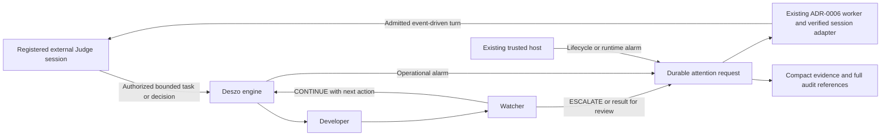

# ADR-0007: Event-Driven Judge Attention and Compact Evidence

- Date: 2026-10-21
- Status: Proposed
- Requirements: D29 in the [decision register](../DECISIONS.md#confirmed-decisions)
- Review: ADR7-R01–R05 and the final amendments following the [second review](../reviews/2026-10-21-adr-0007-second-review.md) incorporated; see the [first resolution](../reviews/2026-10-21-adr-0007-review-resolution.md) and [final resolution](../reviews/2026-10-21-adr-0007-second-review-resolution.md)
- Implementation: Not implemented or verified. This record authorizes no workflow revision, provider invocation, permission change or run. Bounded technical PoCs were conducted on 2026-10-21: an initial Codex App Server exploration and a multi-provider verification across OpenAI Codex, Google Antigravity, and Anthropic Claude Code; see the [multi-provider report](../reviews/2026-10-21-multi-provider-judge-poc-report.md) and [capabilities matrix](../reviews/2026-10-21-judge-provider-capabilities.md).
- Scope: Event-driven requests to an external Judge, durable delivery, bounded decision waiting and compact evidence without reducing the execution audit
- Related: [ADR-0002](0002-execution-audit-and-supervised-control.md) owns audit, supervision, Stop and incidents; [ADR-0004](0004-agent-communication-and-context-contracts.md) owns context and acceptance evidence; [ADR-0006](0006-time-bounded-autonomy-and-application-lifecycle.md) owns trusted authority, lifecycle and recovery; the [Fixer reference workflow](../pilots/fixer-workflow.md) owns its saved roles and graph

## Context

The Fixer has two workflow roles: a Developer performs bounded work and a Watcher assesses the report. The Judge is a **registered external controller session**, independent of any single provider. It assigns tasks, resolves escalations, checks final results and asks the user for intervention when necessary. It is not an Agent node. Codex was the initial reference adapter explored; any provider (including Google Antigravity, OpenAI Codex, or Anthropic Claude Code) requires an independently verified capability and billing adapter, not a different role or architecture.

Routine continuation already belongs to the Developer/Watcher loop. However, external supervision currently requires periodic semantic observations and acknowledgements even when neither role needs the Judge. Chronological observation pages also contain many repetitive log notifications. The first Fixer run recorded 781 journal events, including 689 `attempt.log_chunk` events (88.2%), and 21 saved observation batches. These counts are a baseline, not an exact model-call count or measured Judge token usage. The [baseline evidence receipt](../reviews/evidence/2026-10-21-adr-0007-baseline.json), [original journal export](../reviews/evidence/2026-10-21-adr-0007-source-journal.json) and [saved-observation index](../reviews/evidence/2026-10-21-adr-0007-saved-observations.json) make them reproducible. The [control review](../reviews/2026-10-21-deszo-control-review.md) supports the qualitative overhead finding, not the numeric counts.

The receipt pins store `93322f30-eefc-4a74-8023-b805f69e2018`, run `bed47786-bb0b-4550-add6-ec83a64af8ba`, frontier 781, source hashes and the exact grouping method. A batch is one distinct saved `observationId`, including the initial start observation; 21 saved batches cover the journal prefix through sequence 602 and do not establish 21 model calls or 21 ACKs. The [historical grant](../reviews/evidence/2026-10-21-adr-0007-legacy-grant.json) establishes the comparison's **180,000 ms (180 s) legacy attention interval** and 900,000 ms escalation interval. It is not current authority. Reproduce the counts with `node docs/reviews/evidence/2026-10-21-adr-0007-baseline.mjs`; the [read-only verifier](../reviews/evidence/2026-10-21-adr-0007-baseline.mjs) also offers an optional original-observation file check.

Reducing each response does not remove unnecessary Judge turns. The primary change is to request Judge attention only for a decision or actionable event. Compact evidence is the content of that request. Full execution information remains available for later analysis.

## Proposed decision

Introduce an explicit, opt-in **event-driven Judge supervision mode**. Deszo continues authorized routine work without invoking the Judge model. The Watcher requests a decision through a structured result; the engine persists the request and delivers it to the registered external chat. The engine and existing trusted host independently raise operational alarms when a workflow role cannot do so.

The existing **ADR-0006 persistent worker is the preferred delivery candidate**. Its deterministic transport path waits on the durable outbox, reconciles delivery and requests one admitted turn in the registered external controller session when needed. Reuse its restricted host-side bootstrap, queue and aggregate ledger; the trusted service still enforces authority and lifecycle rather than scheduling models. The worker's suitability for this session-resume contract is unverified. It must satisfy section 3 before enabling the mode. A verified client-native resume path is an alternative behind the same contracts.

Support two registered ownership configurations: **Dedicated Judge Session**, preferred for the first implementation, and **Interactive Judge Session**, requiring verified client exclusion of conflicting user turns. Neither configuration is enabled by this document. Registering a dedicated session or transferring ownership is an explicit action; the worker cannot silently replace the user's current chat or create another Judge role.

Add no Judge Agent, monitoring model, workflow scheduler or polling service. Worker/bridge waiting and reconnection require no model inference and cannot stand in for Judge attention. A model-backed worker turn is itself an invocation requiring admission and budget accounting; it cannot be disguised as transport.

Arrows describe responsibilities, not new shared authority or one database for engine and host records. Host-originated requests retain their own durable identity while the runtime is unavailable.

## 1. Responsibility and attention triggers

| Producer / outcome | Required behavior |
| --- | --- |
| Watcher: `CONTINUE` | Supply one concrete next action and expected evidence to the Developer through the existing loop. Do not invoke the Judge. |
| Watcher: `ESCALATE` | Persist the problem, attempted approaches, evidence and exact decision needed. Block dependent work and request the Judge. |
| Watcher: `READY_FOR_REVIEW` | Deliver the final handoff for Judge inspection; retain pending external acceptance. |
| Watcher: `BLOCKED` | Persist the external prerequisite and request Judge/user intervention. Do not repeatedly retry an unchanged prerequisite. |
| Engine or host: actionable operational event | Persist a typed request independently of the Watcher. Apply the required pause or Stop before waiting for a model. |
| Engine: deterministic `no_progress` | Apply the captured progress policy before another repeat/repair dispatch. Block the affected run and request the Judge even if the Watcher keeps returning `CONTINUE`. |
| Engine: `budget_checkpoint` | Record a captured allowance threshold crossing. Continue or escalate according to the saved policy; budget consumption alone is not stagnation or a mandatory Judge turn. |
| Routine log, progress or successful intermediate check | Retain it in the audit and update the compact state. Do not invoke the Judge solely because it arrived. |

Operational events include invalid role output, exhausted attempts/budgets, provider or check timeout requiring intervention, runtime loss, failed containment/capture/persistence, unresolved recovery and authorization expiry/revocation. Not every stderr line or recoverable tool error is a terminal failure. Engine facts and Watcher interpretations must remain distinguishable.

The Watcher executes at its configured workflow points; it is not a continuously running process monitor. Native/runtime watchdogs retain that responsibility. Hard invariant failures, Stop and revocation do not wait for the Watcher or Judge. When durable storage itself fails, enforce Stop and use the surviving supervisor/host diagnostic path; do not claim the failed store persisted a request.

The mode does not guarantee that the Judge notices arbitrary semantic defects in raw output in real time. Detection comes from engine invariants, configured checks, Watcher assessment and requested Judge inspection. A task requiring continuous model inspection must explicitly select and budget that different supervision behavior.

### Deterministic no-progress admission

Capture a versioned `no_progress` policy with the task before the first dispatch: measurement sources, canonicalization/signature rules, thresholds, observation windows and reset conditions. The proposed initial Fixer profile uses the following explicit defaults; they are requirements for the future profile, not changes to the saved workflow:

| Trigger | Proposed initial threshold and measurement |
| --- | --- |
| Repeated failing check | Two consecutive completed iterations with the same engine-derived check/failure signature. Bind check/command version, criterion and normalized outcome; retain candidate digests as separate provenance rather than making each candidate version a different failure. Normalize only declared volatile fields. A prose assertion that a check changed cannot reset it. |
| Unchanged work product | Two consecutive completed iterations with no change in the engine-captured candidate tree, or with the same cumulative diff against the pinned base. Read-only tasks instead use a declared set of new engine-verified evidence records tied to task criteria. Changing timestamps, report prose or output IDs alone is not progress. |
| Repeated next action | Two consecutive `CONTINUE` outcomes with the same canonical action descriptor and no new verified progress checkpoint. For a prose-only action, use its exact LF-normalized, trimmed text; do not infer semantic equivalence with a model. |

Counters derive from committed attempts, checks, manifests and captured Watcher output. They survive recovery and linked continuations of the same task; rerouting a retry, restarting or rephrasing a brief cannot reset the task lineage. Progress-counter resets require the policy's independently verifiable condition; any threshold increase or detector exemption needs explicit authorized policy revision. A task with no valid progress measure is `progress_unverifiable` and blocks dispatch rather than disabling the detector. These proxies do not prove semantic progress or replace acceptance.

Evaluate detectors on relevant commits and atomically with admission before every repeated Developer/repair/recovery dispatch. An iteration threshold applies after that iteration completes; an exhausted hard limit is never overrun to obtain another Watcher verdict. A trigger establishes a dispatch barrier and one durable `no_progress` request with the measured values, signatures, thresholds and evidence. `CONTINUE` cannot override it. No periodic Judge invocation or new monitoring process is required.

### Budget checkpoints are separate from stagnation

Capture budget denominators, threshold fractions and reactions independently. In the proposed initial Fixer profile, crossing 50% of an iteration, active-time or aggregate invocation allowance records one diagnostic `budget_checkpoint` per threshold. Its default reaction is to continue within existing limits when no other barrier applies. Include controller calls and outstanding reservations under the shared ledger; restarts and linked continuations cannot reset denominators or consumed allowances.

Saved policy may explicitly require Judge escalation at a budget checkpoint. Such a request is classified and measured as `budget_checkpoint`, not `no_progress`. With three iterations, the checkpoint at `ceil(3 * 0.5) = 2` completed iterations does not unconditionally wake the Judge: two productive, unfinished iterations may proceed to the third. Existing engine ticks can record time-based threshold crossings without inference. Hard-limit exhaustion still refuses dispatch regardless of progress or Watcher verdict; a checkpoint never increases a limit.

## 2. Durable attention and decision contracts

Specify versioned attention-request, delivery, evidence-package and decision-receipt schemas before implementation. A request must include:

| Field group | Required meaning |
| --- | --- |
| Identity and routing | Stable request ID, originating engine/host and sequence domain, authenticated external-controller binding and its revision. Bind the engine controller session, ownership mode/owner generation, provider/account, external conversation/resume target, session generation and tool-profile fingerprint; a chat title or copied ID is insufficient. IDs are not credentials. |
| Subject | Store/profile, workflow snapshot, run/task, attempt or lifecycle operation, applicable runtime generation, source/candidate identity and prior checkpoint. |
| Trigger | Typed reason, severity, timestamp, engine-enforced pause/Stop state and whether a decision, acceptance check or human action is needed. |
| Decision context | Exact question, relevant constraints, role report, attempts already made, known unknowns and current verification results. |
| Evidence | Immutable compact-package identity/digest, journal coverage and full artifact references with availability/completeness. |
| Bounds | Applicable authority, remaining aggregate budgets, fixed response/escalation deadlines and permitted next actions. No secrets or authentication tokens. |

Commit a workflow-produced request and its dispatch barrier with the corresponding workflow transition. Use durable outbox delivery from the originating authority; reuse existing queue/reconciliation mechanisms where suitable. A transient callback or visible chat message is not the authoritative request record.

Transport delivery is at least once. Stable request/delivery IDs and idempotent decision receipts prevent duplicate application, not a claim of exactly-once transport or model invocation. Transport receipt, actual turn start, explicit semantic acknowledgement and resolution are separate facts. Reconnect or redelivery must not reset deadlines, clear counters, repeat completed commands or initiate duplicate model turns through a known completed delivery. Reconcile ambiguous delivery before retrying; never infer a decision from a missing reply.

Record these lifecycle milestones separately, as confirmed facts rather than inferring a later milestone from an earlier ACK:

| Milestone | Required evidence |
| --- | --- |
| `request_persisted` | Origin committed the exact request and applicable barrier. |
| `adapter_received` | The existing worker/client adapter acknowledged the exact package and registered destination; no Judge invocation is implied. |
| `turn_admitted` | Atomic admission verified session ownership/exclusion, tools, current authority and budget reservation for a unique invocation intent. |
| `turn_started` | Authoritative external-client evidence identifies the actual started turn in that registered session; a process launch or transport ACK is insufficient. |
| `decision_received` | A reply was captured as untrusted input awaiting authentication and current-state validation. |
| `decision_applied` | The valid named-request decision was committed idempotently. Resulting commands still need their normal current authority/preconditions; this milestone does not assert their completion. |

Track `session_busy`, unknown delivery and timeout/staleness independently of these milestones. `session_busy` is a bounded deferral reason, not transport failure or successful Judge delivery. The captured initial policy waits without inference until the original delivery deadline; a policy may instead request immediate manual intervention. Neither choice resets clocks or grants authority.

### Competing requests and uncertain delivery

Use the existing durable queue with at most one admitted autonomous Judge turn per registered external session, across all its runs. This is command admission and delivery serialization, not another workflow scheduler. Prioritize safety/authority alarms, then operational failure/`no_progress`, then semantic escalation/final review; use the existing destination queue's durable admission order within a class. Preserve origin sequence domains rather than comparing unrelated journals as one global sequence. Stop/revocation barriers take effect independently of that queue. Prevent lower-priority starvation within captured deadlines; expiration remains visible rather than resetting a request's place or clock.

Coalesce duplicate causes for the same subject only with an explicit immutable list of member request IDs and evidence references. Keep every original request, deadline and resolution obligation. Different subjects or incompatible decisions cannot share an implicit approval. Each reply resolves named members individually with current preconditions; dispatch resumes only after all applicable barriers are cleared. A higher-priority request cannot erase a pending lower-priority request or permit a stale answer to restart work. If urgent evidence arrives during a turn, enforce the barrier immediately and use verified client interruption/update support or retain it for the next serialized turn. Never start a concurrent turn to bypass the session lock.

Protective restrictions are monotonic while applicable: a late `CONTINUE`, Judge reply or lower-priority request cannot undo Stop, revocation, a hard invariant failure or an independent barrier. Supersession requires an explicit causal/current-subject record, preserves the old request and excludes its stale reply; it does not resolve other pending requests or revive terminal work. Revalidate request ID, subject/revision, owner generation, state, authority and budgets atomically when accepting a decision and again when admitting its action.

Before invoking the model, persist an invocation intent, unique delivery/idempotency key, session preconditions and budget reservation. Repeating transport delivery of that same request does not authorize another `turn/start`. If connection is lost after sending `turn/start`, including after the actual turn began but before acknowledgement, classify the outcome as **unknown** and reconcile with the external client by stable request/turn ID and ledger. Reattach to a proven existing turn. Retry model initiation only after positive proof that no turn was admitted, using the same logical intent and its reservation. A missing receipt/PID or an empty local queue is not proof of non-execution. If the client cannot determine the result, retain the reservation and request in a visible blocked state for user reconciliation; do not blindly start another model turn. Deterministic read-only reconciliation may retry without inference within the delivery/deadline bounds. Guarantee idempotent decision application; claim exactly-once invocation only if the client's independently verified contract actually provides it.

An authenticated Judge decision binds the exact pending request and subject, with expected revision/state preconditions. Reject stale, cross-run, superseded, substituted or conflicting replies. A received/read acknowledgement does not resolve the question or resume work. Only a valid decision plus current engine/host authorization can enable a next action.

If the underlying run already ended with a Fixer handoff, the decision creates an authorized linked continuation through existing revision/start contracts. Do not resume a terminal run by rewriting history. Changed inputs require a new compatible request/package and normal Context/evidence checks. A proposed solution cannot widen authority, raise budgets, change models or satisfy acceptance by itself.

### Amendment T01: serialized Judge turns and the queue-wait bound

This amendment resolves ADR7-T01 from the [third review](../reviews/2026-10-21-adr-0007-third-review.md). It applies when a request arrives while another autonomous turn is active in the same registered session. It changes no other requirement.

1. **Durable waiting state.** A request that cannot be dispatched because a turn is active is persisted as `queued_behind_active_turn` with an immutable `queuedAt`. This is a durable waiting condition. It is not `adapter_received`, `turn_admitted` or `turn_started`, it is not successful delivery, and it is not a transport failure. `session_busy` keeps its existing meaning: a bounded deferral caused by user activity in an interactive session.
2. **The adapter serializes; the server does not.** The adapter sends `turn/start` only when its own durable state records that no turn is active on that thread, and it re-reads the thread state immediately before sending. The App Server does not serialize: POC-04 arm 1 showed that a `turn/start` sent while a turn is active returned the active turn's identifier, emitted no `turn/started` and did not record its input as a separate item. Such a request is merged, not admitted, and is never counted as delivered.
3. **Deadlines captured at the milestone.** `responseDeadlineMs = t0 + 900,000` is fixed at creation and is never reset. A request dispatchable at creation keeps `deliveryDeadlineMs = t0 + 30,000`. A request that enters `queued_behind_active_turn` at `queuedAt` receives `deliveryDeadlineMs = min(queuedAt + queueWaitBoundMs, t0 + 900,000)`, once. The switch from the 30 s clock to the queue clock happens only at that durable queue record.
4. **Default `queueWaitBoundMs = 600,000 ms`, justified.** The bound equals `activeTurnBoundMs = 600,000 ms`, the maximum time one autonomous Judge turn may run. The adapter enforces that maximum with `turn/interrupt`, which produced a terminal `interrupted` status 57 ms after the request on this machine (POC-04 arm 3). A predecessor admitted before the queued request therefore ends by `queuedAt + 600,000` in a healthy session, so the bound expires only when the session is stuck or settlement fails. The bound leaves 300,000 ms of the 900,000 ms window for the queued turn to start and respond. The value is a design constant to be recalibrated with authenticated turn durations before enablement; the PoC turns lasted about 33 s and are not representative of model turns.
5. **Admission of a queued request.** When the predecessor reaches `turn/completed`, the queued request is treated as a new admission. Authority, owner generation, session state, budget reservation, its own expiry and its own state are checked again at that moment. A failed check is recorded with its named reason (`refused_at_admission`) and is never dropped silently. A request whose delivery deadline has passed is not admitted later; it becomes `attention_delivery_timeout` with cause `queue_wait_expired`. A timed-out request is never reissued with fresh deadlines.
6. **Outcomes.** If the queue-wait bound expires before `turn_started`, the run quiesces under its captured policy and enters the existing `waiting_for_user` state after settlement, with no implicit approval. If the response deadline comes first, the outcome is `attention_response_timeout` and the queued entry is withdrawn with that outcome recorded. A confirmed `turn_started` satisfies the delivery deadline; the response deadline still applies until `decision_applied`.
7. **Options considered.** The third review's option of counting inclusion in the active turn as wake-up is rejected. A request merged into a turn has no separate identity, so its decision could not be bound to that exact request, and POC-04 showed its content is not recorded as its own item. The option of stating the pause as intended is kept only as the fallback when the adapter cannot establish the active turn's state.
8. **Native queue is an alternative, not the default.** The installed App Server's `thread/queue/*` serialized a queued request correctly: the request started about 31 s after it was queued, when the predecessor ended (POC-04 arm 2). It requires the `experimentalApi` capability, which widens the protocol surface. It may replace the adapter queue only after a separate review of that capability, and then it must meet items 3 to 6 unchanged.
9. **Acceptance scenario** (added to ADR7-16). Two independent Fixer tasks escalate close together. Request A starts a long turn. Request B arrives while A is active and is durably `queued_behind_active_turn` without a concurrent turn. B does not expire merely because 30 s have passed. When A completes, B is admitted only if authority, owner generation, state and budget still permit it, and it stays under the original 900 s deadline. If the queue-wait bound expires, the captured fallback in item 6 occurs.

## 3. Actual delivery to the external chat

An MCP result, SSE event, protocol notification or desktop notice does not by itself prove that a client starts a Judge turn. Prefer the ADR-0006 persistent worker's deterministic delivery path; verify it against the actual registered session with no operator message prompting the turn. Do not assume that a CLI `resume` target is the same controller, history or tool environment as an open desktop chat.

### Session ownership configurations

| Configuration | Ownership and admission requirement |
| --- | --- |
| Dedicated Judge Session | Preferred first implementation. One authorized worker owns automatic turns in an explicitly registered persistent external session; other clients are observers until explicit takeover. Enforce single-writer admission across every supported writing client/process, including crash recovery. It does not require detecting typing in an unrelated client because concurrent writing to this session is not permitted. A process-local mutex alone is insufficient if another path can append independently. Structural custody, admission fencing, clone detection and takeover are required by [Amendment T02](#amendment-t02-dedicated-session-custody-fencing-and-takeover); a separate `CODEX_HOME` alone is not sufficient. |
| Interactive Judge Session | The user and automation use the same registered session. Require client-supported atomic reservation against active/queued user turns and conflicting composition. User input takes priority; defer or safely preempt through verified client support. If exclusivity is unavailable, automatic execution in this configuration is unsupported; manual operation remains possible. |

Takeover is an explicit recorded ownership transfer. Block new automatic admission, finish or interrupt the known turn under captured policy, and reconcile uncertain starts before transferring. Advance the owner generation and invalidate the former owner's admission and delayed-result rights. Preserve pending requests, original deadlines and aggregate reservations/counters. A crash or expired local lock alone does not prove it is safe to transfer. Takeover cannot expand scope, mint consent or inherit another controller's grant; changed bindings follow normal registration/authorization. Switching this chat to a dedicated session requires explicit registration/transfer, not a silent fallback.

The mode remains disabled unless all these properties are independently demonstrated for the exact provider/client version and selected profile:

1. **Session continuity:** resume exactly the authenticated registered external-controller session, account, conversation and allowed generation, preserving compatible history and controller-session ownership. Detect substitutions, cloned sessions and unexpected fresh-session fallback. A transfer/re-registration must be explicit and reconcile pending requests and authority.
2. **Usable tools:** the resumed session can read the exact evidence and use the required scoped MCP control/decision/Stop tools under the intended tool-profile fingerprint. Revalidate after runtime/tool/profile changes. Successful text generation alone is insufficient.
3. **Exclusive turn admission:** prove the chosen ownership configuration's single-writer/exclusion guarantee atomically across clients/processes and recovery. A dedicated session proves exclusive ownership and safe takeover; an interactive session additionally proves user-turn/composition exclusion. A check followed by an unguarded CLI launch is insufficient. Never simulate keystrokes, kill unrelated user work or append concurrently to the same history. If the selected configuration's guarantee cannot be proved, automatic resume is unsupported for it.
4. **Invocation accounting:** reserve each model-backed Judge/controller invocation against the approved ADR-0003/ADR-0006 aggregate ledger before launch. Charge started, failed, timed-out, interrupted and recovery/retry invocations; account for additional model turns used for detail reads. Retain uncertain reservations until reconciled. Publish provider/model/explicit effort and any separate controller sublimit; no free controller-call category or quota/billing fallback is allowed. Budget exhaustion blocks the launch and exposes the request for the user.
5. **Independent restricted bootstrap:** use the already-authorized host-side worker/controller path with scoped tools and credentials. Ordinary engine provider invocations remain marked `DESZO_MANAGED_INVOCATION` and refused by the control bridge. Removing/spoofing that marker or exposing unrestricted credentials is forbidden. The runtime emits requests; it does not launch an unrestricted Judge or add an Agent node.

The bridge/worker may listen, poll a durable queue or reconnect locally without invoking any model. Delivery targets only the registered session; it cannot create replacement chats or message unrelated sessions. The trusted service remains the authorization/lifecycle boundary. A verified client-native resume mechanism may replace the worker's client adapter only if it meets the same identity, tool, concurrency, accounting and recovery tests.

Event-driven execution cannot be enabled until the selected adapter and ownership configuration prove actual turn start, reconnect, safe admission, invocation accounting and failure detection. Publish client/version/configuration support and timing evidence; success for a dedicated session does not certify an interactive session, or vice versa. If capability is absent, offer the existing periodic-attention mode or visible manual waiting. Do not silently claim automatic wake-up or fall back to periodic paid/model polling.

If a previously supported channel becomes unavailable, preserve pending requests and expose them in Deszo. Apply the captured pause/escalation policy. A desktop notification is a useful fallback for the user, but it is not successful Judge delivery. Retrieval and decision submission through MCP remain available after authorized reconnection.

### Amendment T02: Dedicated session custody, fencing and takeover

This amendment resolves ADR7-T02 from the [third review](../reviews/2026-10-21-adr-0007-third-review.md). A separate `CODEX_HOME` stores the session outside the user's normal client store, but the PoC shows it does not, by itself, make single-writer ownership structural against a process running as the same operating-system user:

- In the same home, a second writer is refused while the owner is alive, by a native per-thread writer lock (POC-05 S1). The lock belongs to that home, so it protects nothing else.
- A superseded owner that is still alive keeps writing. Codex has no owner generation (POC-05 S2).
- A copy of the rollout file, placed in another home, resumed as the same session identity and accepted writes while the owner was alive (POC-05 S3c). Storage separation does not stop a copy.
- A rollout file moved out of the owner's home while the owner was alive was accepted, and the owner's next write landed in the moved file (POC-06). A move is not a fence.
- Resuming by path from another home was refused without the experimental capability, and with it was refused because that home's session index does not contain the thread (POC-05 S3a, S3b). That refusal is not an ownership guarantee and does not stop the copy above.

The Dedicated configuration therefore requires the following, in place of an isolation-only statement:

1. **Custody.** The dedicated home and its rollout directory are owned and writable only by the worker's protected principal (the ADR-0006 service boundary), not by the interactive user's account or the desktop application. Interactive clients receive read-only exports or evidence only. Custody is the only structural defence against same-user copies and moves identified by the PoC. It is **not verified**: the PoC could not test an ACL owned by another principal without an elevated installation. Until custody is verified, the Dedicated configuration is unsupported for automatic enablement.
2. **Admission fence.** Before each autonomous `turn/start`, the adapter verifies the current owner generation in the host ledger, the live process that holds the session, and the session fingerprint recorded at the last admission. Any mismatch refuses admission.
3. **Fence before handover.** Takeover terminates the previous owner and confirms its exit before any file is moved. A live owner is never treated as harmless because its file was moved.
4. **Clone detection.** The host records the session identity and a rollout fingerprint at each admission and at takeover. A copied rollout with the same thread identifier is refused at the next admission. This detection is **not verified** by any experiment yet.
5. **Durable creation.** A dedicated session is reported as created only after its first persisted write. A session with no items did not survive a kill immediately after creation; one seed item made it durable (POC-06).
6. **Takeover.** A host-performed, recorded transfer: fence the owner (item 3), move the rollout under host custody rather than through the user's client, advance the owner generation, and require explicit re-registration before any automatic admission. A user client holding a copy receives no authority from it.
7. **In-flight reconciliation.** A kill after `turn/started` leaves the turn visible by its identifier, with status `interrupted`, and a restart started no duplicate turn on its own (POC-06). The adapter reattaches to a proven turn by identifier and never starts a second turn merely to test whether the first started.

The Interactive configuration is unchanged by this amendment. It was not tested by the PoC and still requires client-supported exclusion.

### Amendment P01: Multi-Provider Judge Adapters, Subscription Verification, and Non-Portability

This amendment establishes the provider-independent external Judge architecture and resolves subscription-mode enforcement following the multi-provider verification PoC ([report](../reviews/2026-10-21-multi-provider-judge-poc-report.md), [capabilities matrix](../reviews/2026-10-21-judge-provider-capabilities.md)). It defines the adapter interface, mandatory capability declarations, fail-closed subscription policy, and session non-portability rules without altering Developer/Watcher loop responsibilities or weakening trusted-host authority boundaries.

1. **Provider-Independent Controller Architecture.** The Judge remains an external registered controller session, not an Agent node, scheduler, or internal model. Providers are integrated strictly through a registered capability adapter implementing the logical lifecycle contract:
   - `inspectCapabilities()`: Disclose exact client version, binary availability, auth modes, billing modes, dedicated session feasibility, turn lifecycle notifications, tool/MCP support, single-writer fencing mechanisms, usage telemetry precision, and known unsupported capabilities.
   - `validateAuthentication()`: Verify credentials without exposing secrets.
   - `verifyBillingMode(requestedPolicy)`: Fail-closed verification against requested policy (`subscription_only` by default).
   - `registerSession({ sessionId, cwd, tools })` & `resumeSession({ sessionId, cwd })`: Session lifecycle binding.
   - `admitTurn({ sessionId, ownerGeneration, requestId, budgetReservation })`: Atomic single-writer admission and fencing check.
   - `startTurn({ sessionId, turnId, input, outputContract })` & `observeTurn({ sessionId, turnId, onEvent })`: Bounded turn execution and milestone streaming.
   - `submitDecision({ sessionId, requestId, decision })`: Idempotent decision capture and correlation.
   - `interruptTurn({ sessionId, turnId })`: Enforce active turn bounds.
   - `reconcileUncertainTurn({ sessionId, requestId, turnId })`: Reattach or block on lost start acknowledgement.
   - `releaseSession({ sessionId })`: Clean session termination.

2. **Strict Subscription-Only Policy (`subscription_only`).** Deszo must use the user's existing AI subscription allowances whenever officially supported. Five dimensions are strictly distinguished: (a) provider authentication, (b) subscription plan eligibility, (c) actual billing source (subscription allowance vs. pay-per-token API key vs. purchased credit overage), (d) Deszo aggregate budgets, and (e) tool/model authorization.
   - When configured with `subscription_only`, the adapter verifies that the active session consumes only supported subscription allowances.
   - **Fail-Closed Enforcement:** If subscription credentials or plan eligibility cannot be authoritatively confirmed, or if the provider configuration permits automatic transition to separately billed API keys (e.g. `OPENAI_API_KEY`, `ANTHROPIC_API_KEY`, or GCP `quotaProject`), or automatic credit consumption (e.g. Antigravity `useG1Credits: true`), the adapter MUST refuse dispatch and report `BLOCKED` or `POLICY_BLOCKED`.
   - Metered API billing is NEVER an implicit or silent fallback. An unused Deszo internal budget never authorizes exceeding provider subscription limits, and provider limits never authorize exceeding Deszo budgets.

3. **Session Non-Portability and Context Integrity.** External controller sessions are strictly provider-specific and non-interchangeable.
   - A session created in Google Antigravity cannot be resumed or interpreted by OpenAI Codex or Claude Code.
   - Changing the Judge provider requires an explicit new controller registration in Deszo, retiring the previous controller generation, advancing the owner generation, and establishing a new context/evidence boundary.
   - Unresolved attention requests remain durable on the host outbox and are re-dispatched to the newly registered controller under their immutable request IDs, with original response deadlines anchored to `t0`.

4. **Diagnostic Verification of Headless Tool Execution.**
   - In headless non-interactive mode, a process exit code of 0 or a generic status of `SUCCESS` does not prove that requested Judge tools executed.
   - Headless runtimes (such as Antigravity CLI) auto-deny unapproved command tools and report `"denied_actions"` alongside an empty response.
   - The Judge adapter must inspect structured completion payloads for permission-denial diagnostics and empty responses, treating auto-denied actions as execution failures rather than valid decisions. Unrestricted execution flags (e.g. `--dangerously-skip-permissions`) are forbidden.

5. **Preservation of Core Supervision and Ownership Guarantees (T01 & T02).**
   - The provider abstraction strictly preserves Amendment T01: bounded serialized queue waiting (`queued_behind_active_turn`), fixed 900s absolute response deadline from `t0`, and 30s wake-up bound for dispatchable turns.
   - It strictly preserves Amendment T02: dedicated-session custody, host-level owner-generation fencing, single-writer admission, and clone detection. Neither the provider abstraction nor any provider-specific feature may weaken Deszo's trusted-host boundaries, monotonic Stop precedence, or execution audit.

## 4. Supervision without periodic Judge turns

The mode must distinguish three independent conditions:

| Condition | Enforcement |
| --- | --- |
| Runtime, containment and controller transport health | Deterministic heartbeat/watchdog and actual process checks; no model required. Missing health pauses dispatch and escalates within captured bounds. Hard failures retain immediate Stop. |
| Healthy routine work, with no attention request | Continue only within the approved workflow, role, operation and aggregate limits. No semantic Judge timer or model invocation is required merely to renew attention. |
| Pending attention request | Block work dependent on its decision immediately. Enforce the separate fixed delivery and response deadlines below; missing delivery or decision cannot leave a run indefinitely running or automatically launch another model turn. |

**Quiesce** means stop new dispatch for the affected root run and settle already admitted work according to captured policy. The proposed default permits in-flight operations to finish within their original attempt/aggregate bounds; a captured policy may require their termination through existing containment instead. Attention timeout alone does not invent a root Stop or kill unrelated work. Hard Stop, revocation and hard invariant failure override normal finishing. Do not report a quiescent `waiting_for_user` state while owned work remains live or unconfirmed; retain the applicable legal active/stopping state with the barrier and timeout reason until bounded settlement. No new grace period, attempt or budget is created while settling.

Policy defines any dependency-independent dispatch explicitly; the default remains no new dispatch for the affected root run while its blocking request is pending. Waiting does not extend policy expiry or erase consumed budgets. Active processes remain subject to their original timeouts and native termination bounds.

Heartbeat, transport delivery and quiet log periods cannot fabricate semantic ACKs. An explicit Judge acknowledgement refers only to the immutable package actually processed. A decision wait is not cleared by a technical receipt, a fresh health snapshot or another Watcher `CONTINUE`. Duplicate alerts or reconnects do not restart the response deadline. No pending request must be silently superseded by unrelated progress.

Changing from periodic semantic supervision requires a versioned capability, an explicit supervision mode and applicable approval covering the exact workflow/controller and response policy. Existing grants acquire no new meaning. The mode does not change ADR-0006 scope, expiry, revocation, original budgets, trusted consent or Windows Hello requirements. An unattended application replacement still requires the separate verified ADR-0006 topology.

### Delivery and response deadline outcomes

The proposed initial profile captures `deliveryDeadlineMs = 30,000` and `responseDeadlineMs = 900,000`, both anchored to original request creation time `t0`. The delivery deadline is satisfied **only by confirmed `turn_started`** for this request in the registered session, making it the bound for actual Judge wake-up. `adapter_received` and `turn_admitted` are intermediate facts, never successful wake-up. Response requires a valid subject-bound decision committed as `decision_applied`; receipt of unvalidated text is insufficient. Measure transport, admission, start and model response separately. Reconnect, busy sessions, duplicate transport, takeover and compaction never reset either clock. Persist deadlines using ADR-0006 time/reconciliation rules; the earliest authority expiry, deadline or hard safety limit wins. Different values need a captured authorized profile.

| Condition at the first applicable deadline | Required outcome |
| --- | --- |
| No confirmed `turn_started` by the request's delivery deadline: `t0 + 30,000 ms` when dispatchable, or the queue bound from `queuedAt` when queued ([Amendment T01](#amendment-t01-serialized-judge-turns-and-the-queue-wait-bound)) | Expire delivery and preserve its cause: transport failure, `session_busy` or unknown start are distinct. Expose `attention_delivery_timeout`. For a nonterminal run, retain the barrier and quiesce under captured policy, then enter existing `waiting_for_user` after settlement. A busy user is not a transport failure. Do not start another turn to test whether the first started. |
| Turn started, but no `decision_applied` by `t0 + 900,000 ms` | Mark the request stale with `attention_response_timeout`. For a nonterminal run, quiesce and enter existing `waiting_for_user` after settlement. No implicit approval, indefinite running wait or new grace period. |
| Originating run already terminal, including a `succeeded` Fixer escalation/review handoff | Deadlines govern the attention record only: expire delivery or mark the request stale and show required user action. Preserve the run's terminal state, outputs and history. A late reply needs a fresh request against current state and, if work is authorized, a linked new run. |
| Authority expiry/revocation, hard invariant failure or user Stop | Enforce ADR-0002/ADR-0006 Stop and reconciliation independently of delivery. Any resulting terminal outcome wins over an attention wait. A late decision cannot revive permission or the run. |

Settlement requires verified completion or termination according to captured policy, not an assumption from timeout or missing PID. Keep unconfirmed outcomes and incident evidence explicit. Timed-out/stale requests cannot be silently reissued with fresh deadlines. A possibly live Judge turn remains subject to its owned timeout/budget and reconciliation; late output cannot resolve the expired request. Resumption needs an explicit legal recovery/current-state request under remaining authority, never a conflicting or late decision alone.

## 5. Compact evidence as the attention payload

Build a deterministic, versioned projection from authoritative records, typed role results and the full journal. Do not invoke another model to summarize logs routinely. The initial envelope must contain the actionable trigger/question, current subject and control state, Watcher report where applicable, relevant failures/check outcomes, remaining bounds and exact references for deeper inspection. Preserve uncertainty and distinguish engine facts from model claims.

All evidence content, including provider output, Watcher rationale, filenames, source text and quoted commands, is **untrusted data**. A content hash proves identity, not truth or authority. The trusted envelope separates engine-owned routing/control facts from quoted evidence; evidence cannot set the destination session, select tools, change policy, request secret reads or issue commands. Render text inertly and treat embedded instructions as material to inspect, not instructions for the Judge/worker. The Judge's explicit authenticated decision remains subject to normal engine/host checks.

Distinguish authenticated engine facts, model claims and external-source content. Structured packaging, redaction or escaping does not eliminate prompt injection or prove that a model will ignore malicious instructions. Enforce operation scope, current state, authority and budgets outside the model regardless of what evidence says; retain provenance, integrity checks and the full audit.

Use a published payload bound and bounded artifact range reads. A large record must not force the Judge to drain an unrelated stdout backlog before seeing an alarm. Progressive detail reads remain available; unavailable/partial evidence is explicit and cannot support acceptance as complete evidence. Compactness must not remove required review criteria or their evidence links under ADR-0004.

Group repetitive log-chunk notifications by attempt/stream into counts, byte ranges, capture health and immutable manifest/artifact references. Preserve the complete raw streams, journal and qualified provider information under ADR-0002. Redaction and credential isolation apply to both the package and referenced reads. This design does not promise access to private model reasoning unavailable from the CLI.

Every projection receipt pins its journal frontier and accounts for every covered event: included as a semantic event, or classified under a declared versioned rule as grouped retained-log metadata. Publish ranges, counts and digests sufficient to verify coverage. Unknown event types are included conservatively or require attention; they are never discarded as presumed noise. Gaps, corrupt references or incomplete required coverage block a complete semantic receipt.

Urgent events must be visible independently of chronological log backlog. They may be delivered before full contiguous coverage is assembled, with their own sequence/subject reference. That visibility does not authorize an ACK cursor to jump over unknown or unaccounted events. Replaying the same receipt returns the same pinned content; newer state/health is separately timestamped. Opening the raw audit remains possible without changing request identity or a previous decision's subject.

### Incremental projection and measurable urgent delivery

Maintain projection indexes and log groups incrementally as each stream chunk/event commits, with replayable checkpoints per origin/stream. A request reads a pinned projection and its deltas, not the complete journal. Hashing, manifest traversal and recovery replay must meet measured responsiveness bounds; a cold/incomplete projection exposes its limitation and still emits the minimal urgent envelope. It cannot block runtime heartbeats or postpone Stop while reconstructing coverage. Specific scheduling slice sizes, worker threads and implementation languages are implementation choices, not architectural requirements.

The proposed initial supported-load profile sets these maximum bounds, to be measured before enablement rather than claimed as current results:

| Measurement | Maximum and boundary |
| --- | --- |
| Committed critical event to an already waiting engine/worker observer | 1,000 ms, retaining ADR-0002's active-observer fixture target. |
| Critical event commit `tEvent` to durable minimal urgent package readiness | 1,000 ms; include the alarm, subject, current barrier/Stop fact and available evidence refs without scanning the raw log. Record detection-to-commit and request creation `t0` separately; these clocks cannot be replaced by later delivery-attempt timestamps. |
| `tEvent` to `adapter_received` for the urgent package | 5,000 ms with a healthy connected supported adapter and authenticated destination binding. This is transport receipt, not Judge wake-up. Record `session_busy` separately even if the package arrived; actual `turn_started` remains subject to the 30 s bound from `t0`. |
| Projection impact on runtime event-loop delay | Maximum observed event-loop delay at most 100 ms in predefined supported-load scenarios. Choose implementation techniques to meet this bound; the existing 15 s runtime-liveness Stop threshold is not a work budget. |

A missed package/transport bound immediately records a visible `attention_latency_exceeded` operational fact and retains the dispatch barrier; the 30 s wake-up deadline governs fallback above. No safety action waits for these bounds. Publish load scenarios and limits before measurement: backlog size, event rates, concurrent streams, a 64 MiB retained artifact, cold/recovered projections and busy/unavailable sessions. Report machine/client versions, clock/method and worst observed values, not only averages. Unsupported overload must fail visibly/closed under existing capture and dispatch bounds. Increasing maxima requires a captured reviewed profile. An incomplete urgent package cannot establish complete evidence coverage or acceptance.

## 6. Minimal Judge work and audit

The Judge handles the bounded task, a decision or final verification. It does not repeat repository discovery, re-run unchanged checks or read healthy raw streams merely to keep the loop alive. Developer and Watcher providers, models, explicit efforts, Context policies and limits remain those of the saved workflow. This ADR neither adds a role nor replaces mandatory independent review or business acceptance.

Record request creation, package version/digest, classified coverage, dispatch barrier, delivery attempts/status, session reservation and binding, invocation intent/reservation/turn identity, actual or unknown invocation outcome, semantic ACK, decision and resulting authorized command receipts. Invocation admission/accounting is mandatory even if provider token telemetry is unavailable. Link lifecycle-originated records across runtime generations without inventing one continuous journal. After an operational defect, retain the required Stop proof, evidence and incident registration state; an outbox entry is not a registered incident.

A `succeeded` Fixer execution may only mean it produced a handoff, including an escalation. `READY_FOR_REVIEW` and a delivered package do not mean accepted code, ADR closure, a commit or `READY_FOR_MERGE`. ADR-0003 through ADR-0005 retain their verification and exact-candidate boundaries. Push, merge and release are outside this decision.

Measure response/package bytes, grouped log metadata, detail reads, actual Judge invocations, duplicate transport and event-to-request/adapter/admission/start/decision latency separately. Classify Judge turns per task/run: Watcher escalation/final review, deterministic stagnation, explicitly escalated `budget_checkpoint`, technical alarm, or routine log/clock polling. Report false `no_progress` triggers against independent outcome assessment; do not hide budget-triggered calls as stagnation or count planned decisions as routine polling. The target is zero routine log/clock polling turns, not zero required decisions. Publish usage only with trustworthy telemetry; event/byte/saved-batch counts are not token or billing measurements.

## 7. Compatibility and implementation order

This proposal narrowly replaces periodic external semantic-attention requirements in ADR-0002 section 2 and ADR-0006 sections 3 and 4 for explicitly authorized event-driven runs. It does not weaken audit, native watchdogs, Stop, grant validation, trusted authority or quality gates. Their current behavior remains authoritative until this proposal is accepted, implemented and independently verified. Advertise the supported mode and contract versions; reject unsupported combinations rather than reinterpret old grants.

1. Before implementing the main event-driven machinery, perform a bounded technical PoC on the exact current Codex version (performed 2026-10-21 on 0.163.0-alpha.10.2 in unauthenticated isolated homes; its results and limits are in the [PoC report](../reviews/2026-10-21-adr-0007-poc-report.md), and POC-03 remains blocked until a signed-in session exists) and chosen registered ownership configuration: resume continuity, scoped MCP tools, exclusive admission/takeover, post-start acknowledgement loss, crash reconciliation and aggregate accounting. Use the existing ADR-0006 worker/bridge. PoC invocation requires its own applicable authority/budget; this documentation request does not launch it. Stage 1 publishes attention-request, delivery, decision-receipt and timing-policy schemas as separate versioned contracts, including progress/checkpoint policy and the supported-load profile. Keep architecture/boundaries in this ADR and reuse the unchanged baseline.
2. Implement durable requests, barriers, idempotent decisions and deterministic compact evidence in the existing engine/bridge. Add the negotiated supervision mode and native/host fault paths without changing saved role bindings.
3. Integrate the supported adapter into the existing ADR-0006 worker/bridge, not a new scheduler. Verify the selected ownership mode, session tools, takeover/user exclusion, accounting, competing requests, delivery uncertainty and latency. Unsupported configurations remain disabled.
4. Run bounded Fixer scenarios and the actual external-chat pilot. Compare current and proposed behavior on equivalent captured inputs, with identical roles, checks and limits. Report unresolved gates separately; do not infer ADR-0006 or ADR-0003–0005 closure.

Architecture acceptance is a separate recorded user decision and may precede the PoC. Enabling a configuration requires the successful PoC and applicable integration acceptance evidence; `Accepted` alone does not authorize dispatch. This extension changes only the explicitly selected Judge-attention mechanism, not the authority, budget, Stop, review or lifecycle boundaries of ADR-0002 through ADR-0006.

## 8. Acceptance criteria

| ID | Required evidence |
| --- | --- |
| ADR7-01 | Real Developer/Watcher continuation requires no Judge model turn or synthetic semantic ACK over at least 360,000 ms, crossing twice the historical 180,000 ms attention interval in the pinned baseline grant. Separate technical polling from actual model invocations and publish the test's captured authority/timings. |
| ADR7-02 | A Watcher escalation blocks dependent work and starts a real turn in the exact registered dedicated or interactive Judge session through the supported adapter, without an operator message. Prove history, owner/account identity, scoped evidence/decision/Stop tools and distinct admission/start receipts. A newly registered dedicated session is valid; silently substituting it for the current chat is not. |
| ADR7-03 | `READY_FOR_REVIEW` and `BLOCKED` reach pending-Judge handling; neither delivery nor technical ACK establishes acceptance or resolves a prerequisite. |
| ADR7-04 | Inject a Watcher crash/invalid result, runtime loss and containment/capture failure. Correct engine/host alarms and pause/Stop occur independently of Watcher/Judge availability, with qualified persistence/termination evidence. |
| ADR7-05 | Under load scenarios defined before testing, prove the 1,000 ms visibility/package and 5,000 ms adapter-receipt bounds and at-most-100 ms event-loop delay with floods, a 64 MiB artifact and recovery. Report actual turn-start latency separately. Incomplete urgent projections cannot satisfy acceptance; native liveness/Stop and full audit/coverage still work. |
| ADR7-06 | Unknown events, gaps, partial/corrupt evidence, mixed generations and unread required details cannot be silently skipped, marked complete or accepted. Out-of-order urgent delivery cannot advance an unjustified cursor. |
| ADR7-07 | Crash between persistence, transport, `turn/start`, actual turn start, acknowledgement, decision commit and command reply. In particular, lose acknowledgement after the turn began: reconcile by stable external request/turn ID or remain visibly unknown with reservation retained. Transport redelivery never authorizes blind model restart; decision application remains idempotent without an unsupported exactly-once invocation claim. |
| ADR7-08 | Race Watcher, Engine and Trusted Host requests. Refuse wrong-session/stale/cross-run/superseded/conflicting decisions against current revision/owner/state/authority/budget. A late resolution of `ESCALATE` after higher-priority Stop or revocation cannot restart work; one reply cannot clear other barriers. |
| ADR7-09 | Exercise `session_busy` independently of transport failure, both captured busy reactions, immutable deadlines and quiesce policies allowing finish versus requiring termination. No new dispatch or unbounded grace; busy/received/admitted is not started. Expiry/revocation/hard Stop overrides waiting, with no terminal-history rewrite or fabricated semantic ACK. |
| ADR7-10 | Reconnect/restart preserves request state, fixed deadlines, scope and consumed budgets. A terminal Fixer handoff continues only as a correctly authorized linked run. ADR-0006 replacement/reboot restrictions remain enforced. |
| ADR7-11 | Unsupported clients and existing periodic-attention grants retain explicit legacy/manual behavior. Prove the actual event-to-turn path for each supported provider adapter independently (Codex, Antigravity, Claude) separately from local fixtures or MCP notification delivery. Unsupported capabilities or restricted subscription policies disable automated execution rather than weaken guarantees. |
| ADR7-12 | Compare equivalent scenarios and decision quality with per-task/run turn counts separated by workflow escalation/review, actual/false stagnation, budget checkpoint, technical alarm and routine polling. Prove zero routine log/clock polling turns without hiding intentional calls, retained evidence coverage and no invented token savings. Record client/native/provider limits. |
| ADR7-13 | A stagnant always-`CONTINUE` Watcher triggers each captured engine detector before another repeated dispatch, including restart/linked-run reset attempts and admission races. Separately, two productive unfinished iterations of a three-iteration task cross a diagnostic 50% checkpoint and proceed without Judge inference under default policy; explicitly escalated checkpoints are classified as budget events. Hard exhaustion still blocks. |
| ADR7-14 | Verify each claimed ownership configuration separately. Dedicated: exclusive worker ownership across clients/processes, duplicate-worker crash recovery and explicit takeover fencing late owners/results, without dependence on typing detection in another client. Interactive: race user composition/queued turns against native atomic reservation and prove user priority. Both serialize competing requests and refuse unsupported admission. Dedicated under Amendment T02 additionally requires: custody by the protected principal, with a same-user copy and a move of a live owner's rollout each refused (both are demonstrated to succeed today); fencing that terminates the previous owner before any move and refuses admission on owner-generation or session-fingerprint mismatch; clone detection at the next admission; and durable creation after a seed write. |
| ADR7-15 | Reserve and charge every admitted Judge/controller invocation, including errors, interruption, additional detail turns and retries, against shared limits. Exhaustion prevents launch; uncertain effects retain reservations. Simulate delivery accepted but reply lost: reattach or visibly block without a blind second model turn. |
| ADR7-16 | Inject no confirmed `turn_started` at 30 s and no `decision_applied` at 900 s from creation. Adapter/admission ACKs alone cannot pass the wake-up deadline. Verify bounded policy-specific in-flight settlement before `waiting_for_user`, Stop precedence, unchanged terminal handoff states and refusal of late results; retries/busy/takeover cannot reset clocks. Add the T01 scenario: a second request arriving during a long active turn is durably `queued_behind_active_turn` without a concurrent turn, is admitted only after the predecessor completes and every admission check passes, keeps its 900 s response deadline, and on expiry of the queue-wait bound takes the captured fallback (`queue_wait_expired`). |
| ADR7-17 | Reproduce the unchanged baseline from exact-hash sources. Inject malicious instructions in source, logs, reports, filenames and artifacts: independently verify that controls enforce request/state/scope/budget checks. Packaging/escaping alone must not be claimed as complete prompt-injection prevention. |
| ADR7-18 | Prove real model completion under confirmed subscription billing without unapproved API key fallback or automatic credit consumption. Verify structured JSON completion, conversation resume across turns, exact token telemetry, and explicit inspection of permission-denial diagnostics (ensuring auto-denied tools in headless mode are detected as failures rather than false-positive successes). Enforce fail-closed blocking when subscription terms restrict automated orchestration (Claude Code) or when credentials are absent in isolated profiles (Codex). |

## 9. Review traceability

The [original review](../reviews/2026-10-21-adr-0007-review.md) and [second review](../reviews/2026-10-21-adr-0007-second-review.md) remain historical. The [first resolution](../reviews/2026-10-21-adr-0007-review-resolution.md) records ADR7-R01–R05; the [final resolution](../reviews/2026-10-21-adr-0007-second-review-resolution.md) identifies the precise refinements to ownership, budget checkpoints, delivery milestones, deadlines and performance. Baseline artifacts remain unchanged. These are documentation resolutions, not proof of a functioning adapter. The [third review](../reviews/2026-10-21-adr-0007-third-review.md) raised ADR7-T01 and ADR7-T02; Amendments T01, T02 and P01 above resolve them in the record. The initial [PoC report](../reviews/2026-10-21-adr-0007-poc-report.md) and the [multi-provider verification report](../reviews/2026-10-21-multi-provider-judge-poc-report.md) with its [capability matrix](../reviews/2026-10-21-judge-provider-capabilities.md) record what was and was not demonstrated across Codex, Antigravity, and Claude Code. The ADR remains Proposed pending a separate acceptance decision by the user.

## Consequences and alternatives

The Judge spends attention on decisions and verified outcomes. Most log traffic remains in Deszo; routine workflow work stays with its assigned roles. This requires durable event delivery and a supported client wake-up path, rather than only a shorter log format.

Compact pages alone retain unnecessary Judge turns. Timer-based model polling consumes attention during healthy work. Automatic semantic ACKs misrepresent inspection. Giving the Watcher Judge credentials collapses role and authority boundaries. Adding a third monitoring model or a new scheduler increases complexity without solving durable delivery. These alternatives are not selected.

Event-driven Judge attention changes which semantic events a model examines live. Its bounded detection and delivery limits must be visible, tested and accepted; full retained audit remains available for investigation and independent verification.
