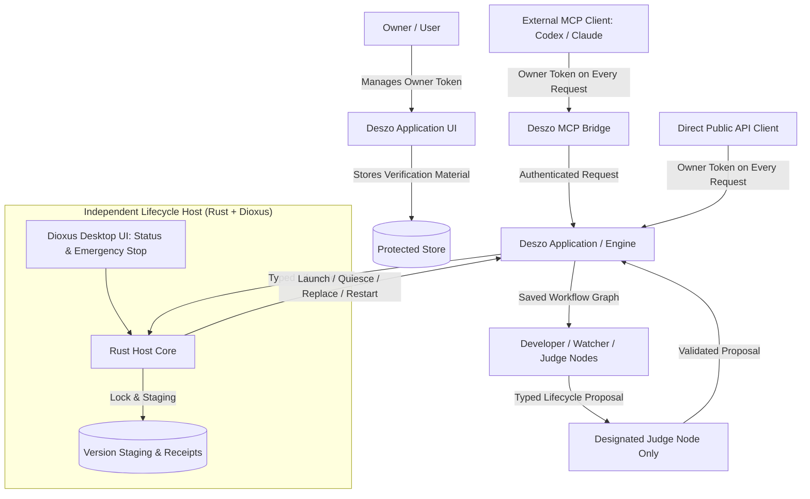
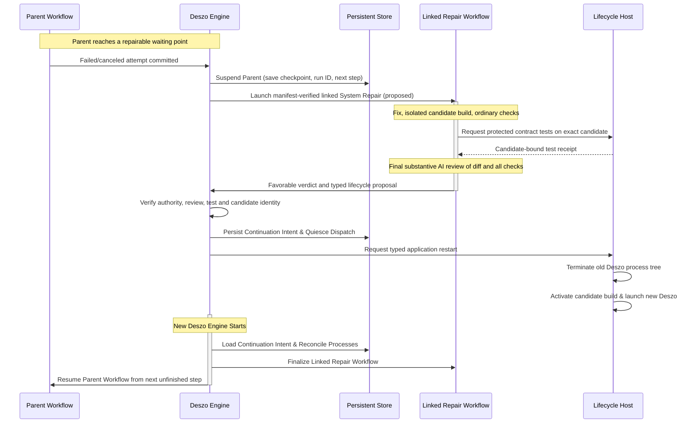

# ADR-0008: Portable Lifecycle Host and Workflow Continuation (Rust + Dioxus)

- **Date:** 2026-10-22
- **Status:** Proposed
- **Supersedes:** [ADR-0006](0006-time-bounded-autonomy-and-application-lifecycle.md) **if and only if ADR-0008 is accepted**. Until then, ADR-0006 and its separately accepted Windows architectural direction (P29) retain their recorded status; this record does not silently revoke them.
- **Depends on:** [ADR-0001](0001-external-workflow-authoring-api-and-mcp.md), [ADR-0002](0002-execution-audit-and-supervised-control.md), [ADR-0003](0003-task-assessment-and-workflow-planning.md), [ADR-0004](0004-agent-communication-and-context-contracts.md), [ADR-0005](0005-verified-feature-branch-delivery.md).
- **Scope:** Local, user-initiated autonomous development workflows; portable Deszo application build, replacement, restart, and workflow continuation across restarts. No cloud-hosted or multi-tenant security claim.
- **Implementation status:** Architectural proposal with partial local implementation evidence. [Engine-native continuation](../reviews/2026-10-22-engine-native-continuation-implementation.md) proved linked Repair and in-place Parent continuation; [Rust Host Proof A](../reviews/2026-10-22-rust-host-lifecycle-integration.md) exercised Host → Node runner → Engine; [Desktop Proof B](../reviews/2026-10-23-desktop-host-proof-b.md) exercised a compiled Rust Host replacing real Tauri Build A with Build B. Proof B terminated provider descendants and does not establish live CLI preservation, protected System Self-Repair or Dioxus UI delivery. Existing ADR-0006 Windows Host/Launcher code is not thereby removed or replaced. Within that broader proposal, PDE-R10 canonical physical workspace-root isolation is implemented in the current working tree and was independently reviewed as `PDE-R10 VERIFIED WITH LIMITATIONS`; the focused requirement mapping and fresh-Engine recovery regression are in [the isolation test suite](../../runtime/tests/linked-repair-isolation.test.mjs). This status does not change ADR-0008's Proposed status or itself declare PDE-R10 formally closed.

---

## 1. Context and problem

Deszo must be capable of developing and repairing its own code, rebuilding a candidate application, restarting its application/runtime through an independent Lifecycle Host, and continuing the original unfinished work without repeating completed agent operations.

The previous [ADR-0006](0006-time-bounded-autonomy-and-application-lifecycle.md) design modeled a heavy platform-specific Trusted Computing Base (TCB): a protected Windows LocalService, an interactive Task Scheduler launcher, Windows Hello / WebAuthn hardware-bound consent, and DPAPI-protected policy stores. This required extensive Windows-specific infrastructure that cannot run on macOS or Linux and introduced substantial deployment friction.

An earlier draft of ADR-0008 sought to simplify this by introducing an ephemeral in-RAM 12-hour authorization grant. However, tying autonomous execution to in-memory Host leases created artificial lease-expiry loops, required complex heartbeat protocols between Engine and Host, and conflated MCP access authorization with process lifecycle supervision.

The revised product decision establishes two clear principles:

1. **Workflow state is durable; public API access is governed by a permanent, revocable Owner Token; and application lifecycle supervision is strictly typed and decoupled from model scheduling.**
2. **Deszo must continue unfinished work after interruption, not reconstruct or replay its previous execution.**

---

## 2. Decision overview

Implement a small, independently running **Deszo Lifecycle Host** in **Rust**, with its local user-facing control surface built in **Dioxus Desktop**.



The Host:

1. Survives termination and replacement of the Deszo application it launches.
2. Manages staged application versions and verifies candidate launch manifests.
3. Enforces exclusive lifecycle ownership over a selected Deszo installation/profile.
4. Executes a narrow set of typed lifecycle operations: status, prepare, quiesce, activate candidate, restart, and emergency stop.
5. Does **not** schedule workflow nodes, invoke AI providers, poll models, manage external questions, or act as a general command executor.
6. Does **not** upgrade its own installed Host binary during ordinary Deszo self-repair.

The Deszo Engine owns workflow graph execution, model invocations, checkpoints, context packages, node attempt budgets, and legal workflow transitions.

---

## 3. Host technology and component boundaries

### 3.1 Rust core and Dioxus UI separation

The Host is structured into two decoupled layers within a single binary:

- **Rust Host core:** Owns lifecycle state machines, version staging, executable launch/monitoring, process termination, store locks, and typed IPC handling. It has **no dependency** on GUI libraries, windowing backends, or webviews, enabling headless integration testing in CI without a display.
- **Dioxus UI:** A lightweight desktop interface providing visual status: active application generation, current staged versions, recent lifecycle receipts, and owner-facing actions (Emergency Stop, manual restart). Closing or hiding the window does not terminate Host core background supervision unless explicitly closed with exit intent.

### 3.2 Technology choice: Dioxus Desktop versus Tauri

The main Deszo application uses Tauri 2.0 (Rust backend with React frontend). The Lifecycle Host deliberately uses **Rust + Dioxus Desktop** as a conscious architectural separation:

1. **Toolchain and runtime decoupling:** The Host must supervise and replace the Deszo application. If the Host shared the application's Tauri/Vite/Node frontend bundle, a defect in Deszo's UI dependencies or node modules could break the Host itself. Dioxus Desktop compiles to a native Rust executable with embedded UI components, ensuring the supervisor remains operational even when Deszo's web application is broken.
2. **Minimal attack surface:** The Host UI requires no Node.js runtime, no npm dependencies, and no local web server.
3. **Cross-platform baseline:** Uses standard Rust process (`std::process`), filesystem (`std::fs`), and portable loopback networking, avoiding mandatory OS daemons or platform-specific services.

---

## 4. Owner access and authorization model

The previous model of 12-hour RAM-only autonomous authorization leases is **removed**. It is replaced by the Owner Token model.

### 4.1 Owner Token for public API access

The proposed ADR-0001 amendment gives a permanent-until-revoked **Owner Token** full caller authorization for every current and future public Deszo API operation through HTTP, MCP or another transport. It does not attest internal Engine/Host origin or satisfy protected lifecycle evidence. The current first-party/external credential split remains effective until that amendment is separately adopted:

1. **Creation and management:** Created and managed exclusively through the first-party Deszo application UI by the user.
2. **Revocation:** The user can revoke or rotate the token at any time in the UI.
3. **Persistence:** Tokens survive Deszo application and Host restarts.
4. **Storage protection:** Deszo stores only protected token verification material (e.g., SHA-256 hash or secure KDF derivation). The plaintext token is displayed **only once** upon creation.
5. **Request verification:** Token revocation and validity are verified on **every new incoming public client API request**, regardless of transport.
6. **No retroactive cancellation:** Token revocation prevents new requests from being accepted. It does **not** mandate cancelling, aborting, or rolling back workflow operations that were already accepted and are executing inside the Engine.
7. **Secret hygiene:** Plaintext Owner Tokens must never appear in LLM prompts, workflow artifacts, execution journals, logs, or model process environments.

### 4.2 Internal workflow execution

Once an authenticated public client API request creates or starts an authorized workflow, the Deszo Engine schedules and executes the workflow under its own graph rules, attempt budgets, Stop controls, and scope contracts.

- The executing workflow does **not** require periodic public API reauthorization or recurring lease renewals.
- D30 supersedes D26's separate time expiry for automatic permissions inside an already admitted Run. Revoking the Owner Token denies new public API requests but does not by itself stop that Run or its lawful Engine continuation; saved hard limits, user Stop and protected lifecycle checks still apply. Existing legacy grants retain their captured expiry until an explicit migration handles them.
- The Engine enforces execution boundaries (ADR-0002 root Stop, task attempt budgets, and node timeouts) independently.

### 4.3 Host access boundary

The Lifecycle Host exposes a strictly typed, authenticated local loopback interface (HTTP or domain socket/named pipe) for lifecycle commands.

- The Host does **not** receive Deszo's Owner Token or the UI first-party credential.
- Communication between Deszo Engine and Host uses a dedicated, instance-scoped Host lifecycle secret generated at Host startup.
- **Handoff hygiene:** The secret is delivered to the launched Deszo process via a non-logged local handoff (e.g., standard input inheritance at process spawn or a restricted-permission file readable only by the user). It must **not** be passed via command-line arguments (visible in OS process listings) or general environment variables inherited by child provider CLI processes.

---

## 5. Exclusive Judge lifecycle authority

Within autonomous workflows, only the **designated Judge node** may propose managed Deszo lifecycle operations that initiate:

- Managed rebuild of the installed Deszo application.
- Activation of a replacement candidate build.
- Managed restart for self-repair.
- Returning from the lifecycle stage of a linked repair workflow.

### 5.1 Ordinary builds versus managed lifecycle replacement

| Capability | Developer / Worker Roles | Watcher Roles | Designated Judge |
| --- | :---: | :---: | :---: |
| Edit source files in workspace | Yes | No | No |
| Compile candidate binaries & run test suites | Yes | Yes (read-only verification) | No |
| Stage candidate artifacts in staging directory | Yes | No | No |
| Propose managed Deszo application restart/activation | **No** | **No** | **Yes** |
| Execute OS application restart / replacement | **No** | **No** | Host only |

Developer and Watcher roles cannot invoke lifecycle operations directly. Any lifecycle request originating from a non-Judge role is rejected by the Engine as an immediate role contract violation.

### 5.2 Typed proposal and Engine gate

The Judge does not execute Host commands directly. It outputs a typed proposal in its structured role result:
```json
{
  "outcome": "REQUEST_LIFECYCLE_ACTION",
  "action": "application.activate_candidate",
  "candidate_digest": "aaaaaaaaaaaaaaaaaaaaaaaaaaaaaaaaaaaaaaaaaaaaaaaaaaaaaaaaaaaaaaaa",
  "target_version": "0.2.1-repair.1",
  "reason": "Fix defect in runtime graph scheduling",
  "continuation_checkpoint_id": "chk-9876"
}
```

The Engine validates:

1. Designated Judge role identity.
2. Workflow and node identity against the saved graph revision.
3. Permitted decision point in the workflow.
4. Exact candidate digest and manifest integrity.
5. Non-replayed operation identity.
6. Compliance with active run constraints and budgets.

Only after successful validation does the Engine issue a typed request to the Host.

---

## 6. Judge protects the Judge-only lifecycle invariant

Self-repair workflows modify Deszo's own codebase, including potentially the Engine, schemas, or lifecycle bridges. Therefore, the system must protect the fundamental invariant:

> **A8-I01 (Judge-Only Lifecycle Invariant):** Within an autonomous workflow, no role other than the designated Judge can initiate managed Deszo rebuild, restart, or candidate activation.

This invariant is protected through two complementary, non-overlapping mechanisms:

### 6.1 Judge semantic code review

Before proposing activation, the Judge node reviews the candidate diff, commit history, and test evidence. It must explicitly verify that the candidate does not:

- Grant lifecycle initiation capabilities to Developer, Watcher, or utility nodes.
- Bypass Engine gate validation.
- Introduce unauthenticated lifecycle endpoints.

### 6.2 Mandatory independent contract tests

Semantic model review alone is insufficient. Before any candidate build can be activated, a fixed, trusted **lifecycle contract test suite** must be executed against the candidate artifact:

1. **Developer rejection:** Attempting a lifecycle proposal from Developer returns a contract rejection.
2. **Watcher rejection:** Attempting a lifecycle proposal from Watcher returns a contract rejection.
3. **Invalid Judge identity:** Proposals citing an incorrect or non-designated Judge node are rejected.
4. **Stale revision:** Proposals referencing superseded graph revisions are rejected.
5. **Replay rejection:** Replaying a previously applied lifecycle proposal receipt is rejected.
6. **Valid Judge acceptance:** A valid designated Judge proposal within scope succeeds.
7. **Public API bypass protection:** Neither an Owner Token nor an unauthenticated client request can trigger lifecycle activation without exact protected Engine/Host evidence.

**Test boundary independence:** The contract test suite resides in a protected, stable verification harness maintained outside the candidate build's editable workspace files. If the contract tests fail:

- Automatic activation is **refused**.
- Failure evidence and test output are durably persisted in the store.
- The Judge produces `EXTERNAL_INPUT_REQUIRED` if operational.
- If the Judge itself cannot operate, the Engine records a technical blocker and halts the repair sequence without activating the broken candidate.

---

## 7. Workflow continuation through self-repair

The proposed protected path follows **Suspend → Linked Repair Workflow → Managed Restart → Resume**. The currently implemented link is initiated by a first-party request after Parent is already waiting; autonomous defect detection and the protected system Repair definition are future additions.



### Step A: Suspend
When a repairable Deszo defect or blocker is identified:

- The Engine pauses new dispatch on the parent workflow. **Current implementation:** the parent has already reached `waiting_for_user` after a failed/canceled attempt; a first-party `linked-repair` request validates that failed node, then atomically creates a separate repair Run and a `run_links` row with a checkpoint artifact. The checkpoint records `reason: linked_repair`; there is no `runs.pause_reason` column and no implemented autonomous defect-to-Repair trigger.
- **Proposed protected extension:** an authorized workflow decision may request this link after Engine validates the exact repairable defect and physical source isolation. It must not invent a second Parent Run or release the Parent's workspace ownership merely because the run waits.

### Step B: Repair

- **Current implementation:** the first-party link selects a saved `kind='user'` repair workflow with exactly one `role='judge'`. Before capturing its separate Repair Run, the Engine resolves both existing workspace roots through filesystem real paths and rejects identical, nested or resolved alias roots, regardless of workspace IDs. It revalidates isolation at admission, scheduler dispatch, process launch, startup recovery/continuation reconciliation, verified lifecycle-gate release and Parent resume. Missing or unresolvable roots fail closed; an unsafe stored link fails without resuming the Parent. Independent review verified this supported contract with documented limitations.
- **Verified limitation:** the reviewer reproduced a post-launch time-of-check/time-of-use case: after a managed provider starts with disjoint roots, a same-user filesystem operation can replace a workspace directory with a junction into the other root. The running process can access the redirected physical directory; the Engine detects the overlap afterward and prevents unsafe continuation. The operational assumption is that **the effective filesystem topology of linked Parent and Repair workspace roots remains stable while associated managed processes execute**. The supported workspace-rebind API refuses certain changes while a Run is active, but it does not prevent arbitrary same-user filesystem changes. Canonical-root validation is not an OS-level filesystem sandbox and does not atomically bind validation to process execution. The project accepts this same-user Full Access limitation under AR01; the Engine does not guarantee prevention of writes after redirection.
- **Proposed protected extension:** the Engine selects only the manifest-verified System Self-Repair definition, with a genuinely isolated branch/worktree and fixed review prompt. Build, ordinary checks and Host-controlled protected tests precede the final candidate-bound AI review. The designated Judge proposal under the current authority policy must cite the favorable final verdict; a future authority policy requires separate D31 acceptance.

### Step C: Restart

- The Engine persists a durable lifecycle continuation intent.
- It quiesces active dispatch, drains or safely interrupts running provider processes, and marks in-flight operations with known boundaries or explicitly as `reconciling`.
- The Engine signals the Host and terminates.
- The Host verifies the candidate manifest, ensures old application termination, switches the active version pointer, and starts the new Deszo application generation.

### Step D: Resume

- The new Engine starts and reads `runner.lock` and persistent continuation records from SQLite.
- It reconciles provider processes: operations marked `reconciling` are resolved before repeating any side-effecting action.
- The verified Host receipt releases the Repair's lifecycle gate. The Repair completes its remaining work and reaches a terminal success; only then does Engine compare-and-set the `run_links` claim and resume the **same original Parent Run** at its failed node/next unfinished logical operation. A failed or interrupted Repair leaves Parent suspended for explicit resolution.
- **Zero redundant replay:** Completed Parent nodes are **not** re-executed. Recovery interprets the saved link and checkpoint; it does not create a substitute Parent Run or repeat an uncertain provider effect.

---

## 8. Rejected alternatives

The following mechanisms were explicitly evaluated and rejected for the baseline architecture:

1. **Global model response cache:** Caching LLM completions by prompt hash is fragile, creates hidden dependencies, and fails when workspace files change. Retain immutable evidence artifacts instead.
2. **Generalized step invalidation frameworks:** Complex dependency invalidators (e.g., Make-like DAG recalculation) introduce unpredictable re-execution in non-deterministic agent workflows.
3. **Mandatory automatic rollback:** Blindly rolling back code and database state upon any startup failure risks corrupting data and destroying diagnostic evidence. If a candidate fails startup checks, the system remains stopped in a clean, observable failure state requiring owner intervention.
4. **Replay of completed workflow steps:** Re-running completed steps to reconstruct in-memory state wastes quota and risks repeating side effects (e.g., git commits, external writes). Continuation must proceed from durable stored facts.
5. **A separate ADR-0010:** All self-repair and continuation requirements are completely integrated into ADR-0008 and ADR-0009; no additional ADR is created.

---

## 9. Minimal lifecycle correctness guarantees

### 9.1 Exclusive lifecycle ownership

- **Host instance lock:** Only one Host instance may supervise a given Deszo installation/profile root at any time. An exclusive file lock (`host.lock`) and generation UUID prevent split-brain control.
- **Store runtime lock:** The Deszo Engine acquires `runner.lock` on the store root upon startup. A new generation cannot start while an older generation holds the store lock.
- **Legacy service exclusion:** If a legacy ADR-0006 Windows service is detected running against the same profile, Host startup aborts with a fatal configuration conflict.

### 9.2 Provider-process reconciliation
The Engine owns provider CLI processes (`codex`, `claude`, `agy`). During application replacement:

- The Engine initiates a graceful termination of child provider processes.
- Any process that does not exit within a bounded timeout is forcibly terminated before the Engine yields.
- If the new Engine discovers an active workspace lock held by an unknown PID, it marks the state `reconciling` and blocks conflicting writes until resolved.

This is the current replacement path demonstrated in Proof B: provider descendants were terminated before replacement. Keeping an active CLI alive while Engine is unavailable would require a separately accepted Process Custody contract and ADR-0002 process-ownership/capture amendment; a new workspace ID alone does not prove physical source isolation.

### 9.3 Durable lifecycle receipts and recovery ownership

The stores have different owners and vocabularies. [M14](../storage/m14.sql) records `lifecycle_operations.state` as `intent` (Engine accepted a Judge proposal) or `verified` (Engine committed the correlated Host receipt), alongside `run_links`. It does not store every Host phase. The Host's protected `operations.ndjson` and Host state record the replacement sequence: operation phases such as `accepted`, `shutdown_requested`, `old_process_stopped`, `starting`, `verified` or `failed`, with journal events including `activation_accepted`, `managed_process_tree_stopped`, `candidate_activated` and `activation_failed`. The logical architecture's request, quiesce, stop, activate, start and confirmation steps map across these records; they are not identically named SQLite states.

Engine recovery reconciles `intent` against Host operation identity, candidate digest, installation/profile, generation and readiness before committing `verified`. A crash before shutdown must not activate a candidate by inference; a crash after stop or pointer switch uses the Host's durable phase and active-build digest to determine whether to continue startup or report failure. A crash after Host confirmation but before Engine receipt acknowledgement redelivers the same correlated receipt idempotently. Unknown provider effects remain interrupted/reconciling, never blindly relaunched. ADR8-07 requires failure-injection evidence at each phase; the current Proof A/B establish only their tested boundaries.

---

## 10. Cross-ADR consistency and dependencies

- **ADR-0001 (Authoring API & MCP):** The proposed Owner Token authorizes every current and future public Deszo API operation regardless of HTTP/MCP transport. Internal Engine/Host protocols retain their distinct authenticated origin and protected evidence; Host does not receive the Owner Token.
- **ADR-0002 (Supervision & Stop):** Host respects Engine root Stop and emergency controls. Stop commands do not depend on model cooperation.
- **ADR-0003–0005 (Workflow, Context, Delivery):** All planning rules, context packages, and feature-branch delivery gates remain fully enforced within the linked repair workflow.
- **ADR-0006 (Time-Bounded Autonomy):** Superseded by ADR-0008 upon acceptance. Windows-specific LocalService and Task Scheduler components are retired from the baseline.
- **ADR-0009 (Workflow-Native Judge):** ADR-0008 independently defines Host lifecycle mechanics and continuation contracts. ADR-0009 defines the Judge authority that references these contracts. There is no circular dependency.

---

## 11. Acceptance criteria

- **ADR8-01 (Normal self-repair continuation):** An autonomous workflow encounters a defect, suspends, executes a linked repair workflow, rebuilds Deszo, restarts via Host, and continues unfinished parent work without replaying completed nodes (Scenario A).
- **ADR8-02 (Judge-only enforcement):** Direct lifecycle restart/replacement requests from Developer, Watcher, or non-designated nodes are rejected by Engine (Scenario B).
- **ADR8-03 (Candidate breaks invariant):** A candidate build modifying lifecycle authorization to allow non-Judge activation fails the mandatory independent contract tests; automatic activation is refused and evidence is persisted (Scenario C).
- **ADR8-04 (Interrupted provider reconciliation):** When the application is interrupted during an active model CLI turn, the new generation marks the effect `reconciling` and does not blindly duplicate side-effecting operations (Scenario D).
- **ADR8-05 (Owner Token lifecycle):** Owner Token authenticates public API requests over HTTP, MCP or another transport; upon revocation in the UI, subsequent requests are rejected while already admitted workflow execution may continue under Engine rules (Scenario G).
- **ADR8-06 (Exclusive Host ownership):** Attempting to launch a second Host against an active profile root fails on `host.lock`. Legacy Windows service and Host cannot run simultaneously (Scenario H).
- **ADR8-07 (Restart crash recovery):** Terminating the Host or Engine at each restart phase leaves durable receipts enabling safe recovery or clean failure reporting without duplicate activation (Scenario I).
- **ADR8-08 (Data compatibility failure):** Launching a candidate with an incompatible database schema halts continuation cleanly with a visible technical error; no blind rollback is executed (Scenario J).
- **ADR8-09 (Rust core headless testing):** All Host core state machine, version staging, and process management tests compile and pass without Dioxus desktop UI dependencies in headless environments.
- **ADR8-10 (No self-update of Host):** Standard Deszo self-repair workflows cannot overwrite or replace the installed Host binary itself.

## Proposed amendment: protected System Self-Repair and lifecycle admission (2026-10-23; not adopted)

The Self-Repair workflow would be a fixed protected `kind='system'` definition with a protected prompt/definition digest and first-party provenance. Ordinary Draft/Publication authority in ADR-0001 cannot edit, publish over, impersonate or activate it. An installation-owned manifest outside the candidate's editable source binds the system workflow ID, definition digest, embedded review-prompt digest, authority-policy version, protected harness identity/version and Host/Engine activation authority. The exact definition is checked against this manifest before System Repair starts. Updates and verified rollback of these protected assets use an explicit first-party installation path with versioned receipts; a self-repair candidate cannot modify its own trust root, Host binary or protected tests **through ordinary workflow and API operations** to authorize itself. A legacy system workflow is not trusted solely because migration gives it a Published identity. Current linked Repair instead selects a `kind='user'` workflow; protected System Self-Repair is not implemented.

Self-Repair fixes the issue in an isolated branch, builds a candidate locally, runs ordinary checks and the protected lifecycle suite, then performs mandatory final AI review of the exact fix, commit, candidate and **all** evidence. Host executes or authenticates the protected suite outside candidate-editable source; the candidate's own test harness is insufficient. A preliminary review may authorize a local rebuild but cannot replace this final review. The fixed system review prompt requires the reviewer to inspect branch/commit/source identity, defect fit, existing contracts, authorization/lifecycle bypass risk, completeness, regression risk and check evidence. Proposed final typed verdicts are `APPROVE_ACTIVATION`, `REQUEST_CHANGES`, `REJECT_ACTIVATION` and `INSUFFICIENT_EVIDENCE`; these are future review contract names, not current enums or direct Host commands. The verdict binds branch, commit, source tree and candidate digest. Under the current designated-Judge authority policy, the Judge's subsequent `REQUEST_LIFECYCLE_ACTION` proposal cites that favorable final verdict; they may be represented in one validated result only if the versioned schema defines both fields. A changed candidate or material evidence after review requires a new verdict.

Before activation, Engine verifies the favorable review, build-to-reviewed-commit provenance, candidate digest, protected contract suite on that exact candidate, lifecycle operation intent, linked Repair/Parent identity and Host compatibility. Host independently verifies its typed authorization, manifest and protected-test receipt before replacement. A positive preliminary AI review may authorize local rebuilding; even a favorable **final** review never by itself grants activation or Host/system-workflow modification. Missing, stale, failed or mismatched evidence refuses activation. After restart Engine continues the linked Repair and original Parent without replaying completed operations. Physical source ownership must be proved for the parent and linked Repair, not inferred from separate workspace IDs.

A future versioned Decision Authority may allow one Judge, several experts, a quorum, veto or arbiter. A Decision Gate may be represented as an optional graph node; the **Engine's privileged-action admission check is mandatory regardless of graph shape**. A model result or prompt cannot directly call Host. The current A8-I01 single-designated-Judge rule and ADR8-02/ADR8-03 remain this proposed ADR's authority contract until a separate D31 replacement decision changes them together with schema, Engine and protected harness. Previously saved single-Judge workflows retain their captured authority policy. Process Custody remains a separate PoC candidate and does not change the provider reconciliation path above.

Acceptance of this amendment requires ordinary-publication bypass tests, fixed-manifest update/rollback receipts, exact candidate-bound substantive review and protected tests, rejection of forged/stale/replayed authority, physical source isolation, and legacy-policy compatibility. The [monitoring and decision-authority proposal](../reviews/2026-10-23-universal-agent-monitoring-and-decision-authority-proposal.md) supplies the detailed future admission and test matrix; this section does not enact its D31 replacement.

The protected harness and authority policy must change together through the first-party installation path. Until a separate D31 replacement is accepted, legacy designated-Judge tests remain in force. A future policy's protected suite checks advertised capability support, ordinary-Publication bypass, prompt/manifest integrity, substantive review and test receipts bound to the exact candidate, stale/replayed proposals, and the legacy policy in its captured mode. No activation window may weaken the old checks before the new ones apply. D30 now supersedes D26's separate expiry for automatic permissions inside an admitted Run; this does not accept Stage 1B or remove existing hard limits. AR01 accepts that a same-user Full Access CLI may obtain an Owner Token and act through public API. Manifest/harness integrity against arbitrary same-user file writes must be stated only to the extent the installation's actual file rights and Host verification establish it; this ADR does not claim a new OS sandbox or human provenance from bearer authentication. The [ADR-0001 route audit](0001-external-workflow-authoring-api-and-mcp.md#runtime-api-route-classification-audit-2026-10-24) keeps Host receipts and permit operations out of the owner-authorized public API after migration. Linked Repair's canonical physical workspace isolation (PDE-R10) is implemented and independently reviewed with limitations as described in Step B; PDE-R10 formal closure remains separate from ADR-0008 acceptance. Protected `kind='system'` selection and an autonomous repair trigger remain separate unimplemented work.
