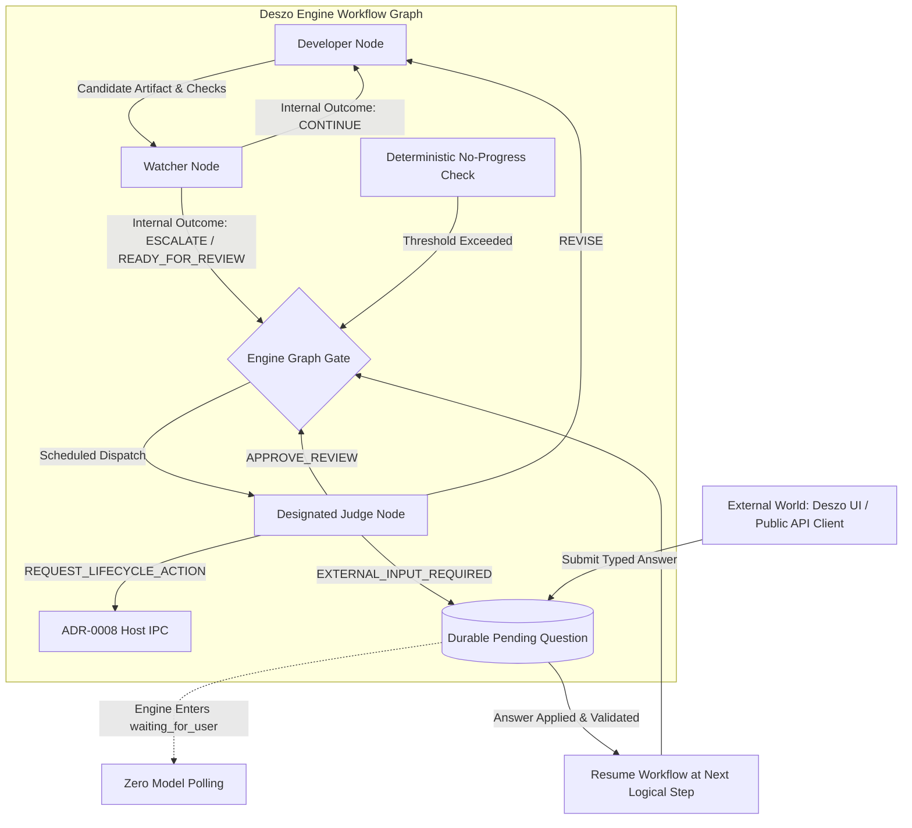
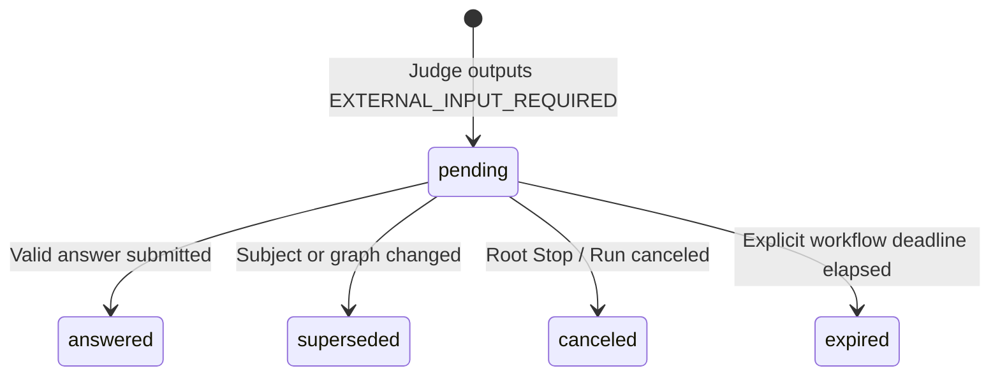

# ADR-0009: Workflow-Native Judge and Exclusive External Input

- **Date:** 2026-10-22
- **Status:** Proposed
- **Supersedes:** [ADR-0007](0007-event-driven-judge-attention-and-compact-evidence.md) **if and only if ADR-0009 is accepted**. Until then, ADR-0007 remains a proposed historical design; this record does not silently revoke recorded decisions.
- **Depends on:** [ADR-0001](0001-external-workflow-authoring-api-and-mcp.md), [ADR-0002](0002-execution-audit-and-supervised-control.md), [ADR-0003](0003-task-assessment-and-workflow-planning.md), [ADR-0004](0004-agent-communication-and-context-contracts.md), [ADR-0005](0005-verified-feature-branch-delivery.md), [ADR-0008](0008-portable-ephemeral-lifecycle-host.md).
- **Scope:** Workflow-native Judge role, agent routing boundaries, external input boundary, durable wait/resume, deterministic stagnation protection, and resolution of ADR-0002 supervision contracts.
- **Implementation status:** Architectural proposal.

---

## 1. Context and problem

[ADR-0007](0007-event-driven-judge-attention-and-compact-evidence.md) modeled the Judge as an **external controller session** (Codex or Antigravity) running outside the workflow graph, awakened asynchronously through a durable attention queue and background worker. While valuable for compact evidence prototyping, this approach introduced significant architectural overhead:

- Dedicated session locking and custody management.
- Tight wake-up deadlines (30s) conflicting with multi-minute model turns and serialized queues.
- Deadlocks with the `DESZO_MANAGED_INVOCATION` security boundary (which prevents managed processes from calling authoring MCP tools).
- Ambiguity over who "supervises the supervisor".

The product decision establishes a simpler, coherent model:

1. **Judge is an ordinary, configurable workflow node scheduled exclusively by the Deszo Engine.**
2. **External Input is an execution boundary, not a human communication or notification service.**
3. **The Judge is the exclusive role permitted to request external input or propose application lifecycle actions.**
4. **Waiting for external input consumes zero model turns, zero background polling, and zero watcher tokens.**

---

## 2. Decision overview

Make the Judge a normal, provider-configurable, workflow-native model role scheduled exclusively by the Deszo Engine.



### Core Invariants

- **A9-I01 (Single designated Judge authority):** For the autonomous multi-agent development profile, every saved workflow graph SHALL declare exactly one designated Judge role per root workflow.
- **A9-I02 (Exclusive external input escalation):** Only the designated Judge role may return `EXTERNAL_INPUT_REQUIRED`. Developer, Watcher, and utility roles are strictly prohibited from soliciting external input.
- **A9-I03 (Structured internal outcomes):** Worker roles communicate solely through structured internal facts (`BLOCKED`, `FAILED`, `NEEDS_REVIEW`, `READY_FOR_REVIEW`, progress, evidence). These are data for the Engine, not permission to notify outside actors or bypass graph edges.
- **A9-I04 (Engine graph exclusivity):** Only the Engine schedules node execution according to saved graph edges and deterministic rules. Roles possess no direct `call_judge()` capability.
- **A9-I05 (Zero-token wait state):** While waiting for external input, no model inference (Judge, Developer, Watcher, or Codex) is scheduled to poll for completion.
- **A9-I06 (Single pending question per root run):** By default, at most one unresolved external input question may be active per root workflow.
- **A9-I07 (Independent deterministic safety):** Hard budget exhaustion, storage corruption, process crashes, and operational Stop are enforced independently by the Engine without requiring Judge model turns.

---

## 3. Role capabilities and boundaries

| Capability | Developer / Worker | Watcher | Designated Judge | Engine |
| --- | :---: | :---: | :---: | :---: |
| Execute assigned prompt / code task | Yes | Yes | Yes | Dispatches |
| Return internal structured outcome | Yes | Yes | Yes | Validates & records |
| Directly invoke another graph node | **No** | **No** | **No** | Controls all routing |
| Propose `EXTERNAL_INPUT_REQUIRED` | **No** | **No** | **Yes** | Enforces & persists |
| Propose managed lifecycle action | **No** | **No** | **Yes** | Validates & forwards to Host |
| Direct external communication / notification | **No** | **No** | **No** | Exposes via state/MCP |
| Authoritative acceptance / merge / release | **No** | **No** | Review verdict only | ADR-0003–0005 gates apply |

Worker roles that need clarification must report `BLOCKED` with an explanation in their structured result. The Engine determines whether that blocker routes to the Judge, attempts an internal retry, or pauses execution.

---

## 4. The External Input Boundary (`EXTERNAL_INPUT_REQUIRED`)

### 4.1 Concept: Execution boundary, not human communication
`EXTERNAL_INPUT_REQUIRED` is an **execution boundary**:
> The current workflow execution segment cannot proceed until specified information or a decision is provided from outside the workflow.

Deszo does **not** own:

- Discovering or identifying a specific human respondent.
- Contacting or alerting users via external channels (Slack, email, SMS).
- Waking up an external AI chat session (e.g., Codex or Claude).
- Maintaining a background attention worker or polling loop.
- Classifying whether an arriving answer was authored by a human or an automated tool.

The Engine persists the question, correlation ID, and subject reference, halts dependent dispatch, and exposes the pending request through its standard inspection interfaces (UI and MCP).

### 4.2 Structured question contract
The Judge outputs a structured proposal:
```json
{
  "outcome": "EXTERNAL_INPUT_REQUIRED",
  "question": "Should the updated authentication module retain backward compatibility with v1 sessions?",
  "reason_code": "SPECIFICATION_AMBIGUITY",
  "options": ["Yes", "No"],
  "evidence_refs": ["artifact-auth-spec-456"],
  "blocking_scope": "current_root_workflow"
}
```

The Engine assigns a stable `questionId`, pins the exact graph revision and subject digest, and commits the record atomically.

---

## 5. Engine state reuse: `waiting_for_user`

The Deszo Engine already implements the active run state `waiting_for_user` (`engine.mjs`, used across recovery pauses, Stop, and M2 contracts).

To prevent state-machine duplication, ADR-0009 **reuses `waiting_for_user`** rather than introducing `waiting_for_input`:

- When a Judge returns `EXTERNAL_INPUT_REQUIRED`, the run transitions to `waiting_for_user` with a typed pause reason: `external_input`.
- The run record references the active `questionId`.
- Existing inspectors and recovery handlers may reuse the run state, but typed pause reason, question reference and answer lifecycle require new versioned storage/API/schema support; current `runs` has no `pause_reason` column.

### 5.1 Durable question lifecycle
The pending question progresses through a minimal, robust state machine:

- `pending`: Awaiting external response.
- `answered`: Valid external answer received and applied.
- `superseded`: A subsequent workflow transition or cancellation invalidated the question.
- `canceled`: Run stopped or canceled by operator.
- `expired`: Optional state only if the workflow explicitly defined a deadline (no compulsory 24-hour expiration).



### 5.2 Anti-spam and deduplication

- **Single active question:** Only one unresolved semantic question is permitted per root workflow by default.
- **Fingerprint deduplication:** Near-duplicate questions within the same subject share a deduplication hash; duplicate requests update timestamps without spawning duplicate alerts.
- **Atomic retirement:** When a question is superseded or answered, its blocking barrier is released atomically.
- **Stale submission refusal:** Answers targeting superseded or already answered questions are rejected with an explicit conflict code (`409 conflict`).

---

## 6. Judge in the self-repair workflow

Under [ADR-0008](0008-portable-ephemeral-lifecycle-host.md), self-repair follows **Suspend → Linked Repair Workflow → Managed Restart → Resume**. The Judge node plays a specific, restricted role in this process:

1. **Review repair candidate:** Judge evaluates candidate diffs, tests, and Watcher evidence.
2. **Review invariant preservation:** Judge inspects code changes to ensure the Judge-only lifecycle invariant (A8-I01) is preserved.
3. **Verify contract tests:** Engine executes independent lifecycle contract tests outside the candidate. Judge receives the test receipt.
4. **Propose lifecycle action:** If all checks pass, Judge outputs `REQUEST_LIFECYCLE_ACTION` (`application.activate_candidate`).
5. **Post-restart completion:** Following application restart via Host, the linked repair workflow completes its final node. The Engine marks the repair workflow finished and resumes the suspended parent workflow.

The Judge does not restart the application directly; the Engine validates the proposal, and the Host executes the process restart.

---

## 7. Deterministic no-progress protection

To prevent infinite loops when models fail to make progress, the Engine enforces deterministic, factual intervention rules that **override** model output.

A deterministic no-progress barrier triggers when:

1. **Unchanged check failures:** The identical check or test fails with the same failure signature across $N$ consecutive iterations (default $N=3$).
2. **Unchanged candidate diff:** An iteration produces an identical diff or no file changes.
3. **Repeated next actions:** Watcher repeats the identical `suggested_next_action` without code progress.
4. **Repeated revision loops:** Judge returns `REVISE` $K$ consecutive times for the same candidate without intervening test improvements (default $K=3$).
5. **Attempt exhaustion:** The configured node attempt budget is reached.

### Enforcement

- When a threshold is met, the Engine **refuses** another routine Developer/Watcher dispatch, regardless of whether Watcher returned `CONTINUE`.
- If a route to Judge exists, Engine schedules Judge with a synthetic `STAGNATION_DETECTED` fact package.
- If Judge cannot resolve the stagnation or has exhausted its own review budget, the Engine transitions the run to `waiting_for_user` with reason `stagnation_blocked`.

---

## 8. Workflow continuation after external input

When an external answer is submitted:

1. **Validation:** Engine verifies `questionId`, correlation ID, expected graph revision, and that the question is currently `pending`.
2. **Application:** The answer is durably recorded in SQLite. The question transitions to `answered`.
3. **Turn boundary:** The previous Judge attempt that produced `EXTERNAL_INPUT_REQUIRED` is **terminated and committed**. It is not held open.
4. **Next logical step:** The Engine resumes execution from the preserved logical continuation point:
   - If the saved graph routes the answer to Judge for semantic evaluation, a **new Judge turn** is scheduled.
   - This evaluation turn is accounted as a distinct attempt against the workflow's configured review budget; it does not retroactively consume the retry allowances of the worker nodes.

5. **Budget preservation:** An answer provides data; it does **not** silently grant additional budget or prolong authorized timeouts.

---

## 9. Resolution of ADR-0002 supervision conflict

ADR-0002 defined supervised execution using `control_grants`, `observation_deadline_ms`, and `last_ack_at`. Under ADR-0002, if an external controller fails to send a semantic acknowledgement within the deadline, the Engine pauses or terminates the run.

In a workflow-native architecture, healthy autonomous execution must not be interrupted simply because an external chat didn't send periodic heartbeats.

ADR-0009 resolves this by defining an explicit supervision mode:

### `workflow_native_supervision`
For autonomous workflows under ADR-0009:

1. **Engine-managed supervision:** The Engine acts as the primary supervisor, enforcing graph rules, budgets, process timeouts, and the designated Judge.
2. **No external semantic ACK deadlines:** Mandatory periodic external acknowledgements (`observation_deadline_ms` / `last_ack_at`) are **deactivated**. Healthy internal loops (Developer → Watcher → Developer) proceed without external interruption.
3. **No fake heartbeats:** The system does not manufacture fake Host heartbeats to satisfy legacy checks.
4. **Audit and Stop retained:** Lossless qualified audit journals, artifact hashing, incident spooling, and the verified ADR-0002 root Stop API remain fully operational. An operator can inspect or Stop the run at any moment.
5. **Legacy preservation:** Workflows explicitly configured with legacy external controller grants retain their ADR-0002 deadline checks until migrated.

---

## 10. Resolution of ADR-0001 alignment

ADR-0001 governs external MCP authoring and tool execution:

- **Owner Token:** External clients submit answers or inspect workflow progress through the public API, directly or via MCP, authenticated with the permanent, revocable Owner Token (ADR-0001/0008 proposed amendment).
- **Execution autonomy:** Once an authorized workflow is started, internal node execution proceeds under Engine authority without requiring per-node MCP token validation.
- **Revocation boundary:** Revoking the Owner Token immediately denies new public API requests (e.g., submitting an answer or launching a new run), but does not retroactively abort or invalidate healthy running workflows.

---

## 11. Database migration strategy

Schema migration 13 ([m13.sql](../storage/m13.sql)) introduced tables for ADR-0007's external controller sessions (`judge_sessions`, `judge_attention`, `judge_invocations`).

Under ADR-0009:

1. **Preservation:** Existing `m13.sql` tables are retained without destructive alterations to ensure historical runs and existing test fixtures remain inspectable.
2. **Actual migration 14 ([m14.sql](../storage/m14.sql)):** Adds `run_links` and `lifecycle_operations` for linked Repair and activation. It does **not** add `workflow_questions`, `workflow_answers` or `runs.pause_reason`.
3. **Future question migration:** Add versioned question/answer records, correlation and deduplication fields, a typed pause-reason reference, and `workflow_answers.responder_source` in a subsequent migration/API revision. Record the authenticated source of any additional diagnostic capacity grant separately. Define recovery and atomic answer application before advertising this capability. The existing `waiting_for_user` state can be reused, but the proposed `external_input` reason cannot be recorded in the current `runs` schema as written here.

---

## 12. Acceptance criteria

- **ADR9-01 (Single Judge invariant):** Autonomous multi-agent workflows enforce exactly one designated Judge node in the versioned graph (Scenario A, B).
- **ADR9-02 (Exclusive external input):** Developer and Watcher attempts to emit `EXTERNAL_INPUT_REQUIRED` are rejected by the Engine as role violations (Scenario B).
- **ADR9-03 (Zero-polling wait state):** When a Judge outputs `EXTERNAL_INPUT_REQUIRED`, the run enters `waiting_for_user`, no model turns are scheduled, and the question persists across Deszo application restart (Scenario E).
- **ADR9-04 (Continuation on answer):** Submitting a valid answer transitions the question to `answered` and resumes the workflow at the next logical step without replaying completed operations (Scenario E).
- **ADR9-05 (Superseded question):** Changing the workflow subject or canceling a run marks pending questions `superseded`; stale responses targeting superseded questions are rejected (Scenario F).
- **ADR9-06 (Deterministic no-progress barrier):** Reaching $N$ identical test failures or $K$ identical Judge revisions halts dispatch and routes to Judge or blocks; Watcher `CONTINUE` cannot override the barrier (Scenario K).
- **ADR9-07 (Workflow-native supervision):** A workflow in `workflow_native_supervision` mode runs healthy loops across multiple hours without external semantic ACK timeouts, while ADR-0002 root Stop remains immediately responsive (Scenario L).
- **ADR9-08 (Judge in self-repair):** Judge reviews repair diffs and contract test receipts, and proposes `application.activate_candidate` exclusively within authorized repair workflows (Scenario A, C).
- **ADR9-09 (Compact evidence fidelity):** Judge input packages provide immutable, bounded evidence projections with verified sha256 digests; raw log streams remain intact in storage.
- **ADR9-10 (Operator neutrality):** Answers submitted via Deszo UI or an Owner Token authenticated public API client, directly or via MCP, are validated and applied identically according to the question schema.
- **ADR9-11 (Budget accounting):** Answering an external question initiates a new Judge evaluation attempt without resetting or exceeding overall workflow budgets.
- **ADR9-12 (Legacy data compatibility):** Migration-13 tables and legacy external-judge test suites remain functional and non-destructively preserved.

## Proposed amendment: configurable decision authority and live external decisions (2026-10-23; not adopted)

Generic Agent roles may use ordinary capabilities already supported by the Agent Runtime through configuration, in any valid number and combination. Role names or prompt text never confer authority. A new privileged effect, protected information boundary, result type or authorization rule needs a versioned Engine/API/schema contract. Each Published Version pins its authority-policy identity; migrated legacy workflows use their compatible designated-Judge policy rather than acquiring new rights, and historical Runs retain their captured interpretation. Under a future Decision Authority policy, each privileged lifecycle or external-input action must have exactly one verifiable result from the authorized process captured in that version. That process may involve one Judge, several experts, sequential review, a quorum, veto or arbiter. Engine checks participants, exact subject/candidate digest, graph and policy version, provenance, budgets, authority and replay state. An optional graph-level Decision Gate can organize that process; Engine's deterministic privileged-action admission is mandatory in every graph. Ordinary workflow configuration cannot grant protected Deszo lifecycle effects, change the System Self-Repair definition or modify Host authorization. Model text cannot grant itself an effect or submit a Host command.

Diagnostic AI review and subsequent automatic interventions use separate finite root-lineage allowances as specified in the proposed ADR-0003 amendment. Every diagnostic or stagnation-routed AI invocation, including each composed-review member, charges `diagnosticReviewsUsed` at successful durable review admission; every Engine-issued automatic-action grant from either route charges `automaticInterventionsUsed` at successful durable grant admission. Per-episode **action-admission** allowances and current aggregate limits additionally apply. A committed charge is never refunded by success, failure, later grant invalidation, restart or an uncertain outcome; an idempotent replay does not charge again. A failed admission that commits no review intent or grant charges nothing. Engine grants are single use and consumed atomically with a closed typed action without a second charge; no result text is an executable command. The closed initial automatic set is bounded technical re-observation, diagnostic revision, strategy/plan revision and one validated next attempt. It excludes automatic Stop of an active CLI absent a separately versioned, owner-authorized action contract; hard-limit and user Stop remain independent. A failed or unavailable Judge is monitored like any other invocation and need not diagnose itself. If the policy's semantic route is unavailable or exhausted, Engine records a visible **technical blocker** and owner resolution path; it does not fabricate `EXTERNAL_INPUT_REQUIRED` or a Judge verdict.

A quantitative stagnation threshold is a checkpoint, not a proof that work is unsolvable: Engine refuses routine Developer/Watcher dispatch and records a `stagnationEpisodeId` before routing the authorized decision process. A future `AUTHORIZE_NEXT_ACTION` is a **new** closed, versioned result type. Its proposal identifies one typed action, exact run/node/revision target, hypothesis, committed evidence references, expected evidence, preconditions and the Engine-issued episode. Engine verifies identity, freshness, graph and hard limits, then durably creates a single-use `grantId` and permanently charges one intervention and episode action admission. It consumes that grant atomically with at most one exact action; replay admits nothing and charges nothing again. An unused grant becomes invalid on subject/revision/precondition/authority change, Stop or hard-cap exhaustion without refund; D30 adds no independent wall-clock expiry to an automatic in-Run permission. Invalidation of a consumed grant does not kill a lawfully running CLI, while its captured hard limits still apply. The finite episode allowance counts admitted actions, including those later successful; only objective progress against criteria fixed before the action can begin a new episode. Renaming a hypothesis or run cannot do so. On exhaustion, route permitted external input or terminal decision without another automatic Judge/Developer turn. These episode limits compose with the root-lineage allowances and current aggregate caps.

When automatic escalation is exhausted while a CLI is still active, the proposed default preserves observation and Stop only if hard limits, containment, capture health and physical workspace ownership remain enforceable. Engine records an external-decision-pending condition separately from the invocation's active state, blocks conflicting dispatch/repair/source writes, and schedules no AI polling. Owner options include waiting, Stop, a specified additional allowance or permitted recovery. An explicit capacity grant through authenticated UI or public Owner Token API records the principal/source and lineage; it is a new owner command, not an AI review result or automatic budget reset. CLI completion commits the original attempt once and then re-evaluates each pending question's predicate: a question about stopping or waiting for that CLI becomes `superseded`, while a question about retry or recovery may remain relevant or be replaced with a versioned successor retaining history. This transition is coordinated with the terminal receipt and never relaunches the CLI merely because it finished. The question's blocking scope remains until Engine resolves it or applies an authorized answer.

Current recovery interrupts active attempts; live CLI survival across Engine/desktop replacement is not promised. Separate Process Custody adoption and ADR-0002 amendment are necessary for that claim. Existing saved single-Judge workflows retain their captured policy; missing new fields grant no new authority. The A9-I01/A9-I02 and ADR9-01/ADR9-02 single-Judge/exclusive-input requirements remain this ADR's proposed contract unless a separate decision explicitly revises D31 with coordinated Engine, schema and protected lifecycle tests. Stage 1B deadline-free execution also remains a separate resource-policy decision.

Acceptance requires configured multi-participant authority to reject worker bypass, stale/mismatched review or candidate, replay and exhausted grants; legacy Judge workflows to preserve their interpretation; active CLI and pending question to remain distinct; completion to supersede only predicates that became false; and no automatic relaunch or conflicting write after a terminal outcome. The [detailed monitoring proposal](../reviews/2026-10-23-universal-agent-monitoring-and-decision-authority-proposal.md) records additional future scenarios.
