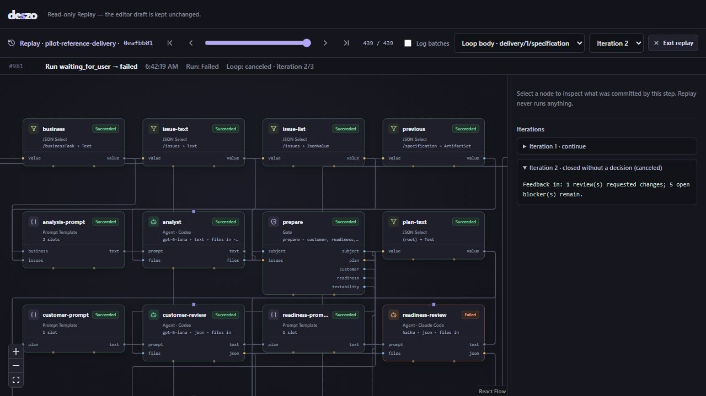

# Pilot rerun after the 2026-10-14 fixes

Date: 2026-10-14  
Previous results: [initial pilot](2026-10-14-pilot-validation.md), [code resolution](2026-10-14-pilot-resolution.md)

**Verdict: partial pass; the complete reference pipeline is still blocked.** Installed-app startup/containment, original-journal Replay and the requested 30-minute fixture soak passed. The real-provider pipeline reached task review, repair and a specification revision, then exposed **RERUN-04: Map-issued blockers have no authorized resolution path in the specification Gate**. It did not reach final Customer acceptance.

Subsequent status: the [RERUN-04 resolution](2026-10-14-pilot-rerun-resolution.md) and [live follow-up](2026-10-14-after-rerun04-validation.md) record the later correction and a delivery accepted by Customer, with 28 exported tests and 21 independent business checks passing. This report retains the original rerun's evidence and verdict.

## Scope and environment

The user authorized continuing the pilot, real subscription calls on the lightest models, isolated package testing, and a 30-minute fixture-only soak. No additional approval is required for these checks. Real calls use the production adapters and subscription authentication guards; no fixture answers, prompt-only schema fallback or fabricated approval/check record are used in the production runs.

| Provider | CLI version | Requested model |
| --- | --- | --- |
| Codex | `0.162.0-alpha.17.2` | `gpt-6-luna` |
| Claude Code | `2.1.292` | `haiku` |
| Antigravity | `1.3.5` | `gemini-3.8-flash-low` |

The runtime uses Node.js `22.20.0` on the existing Windows host. The desktop package was built with an isolated identifier, `local.deszo.pilot20261014fixed`, and installed under `.deszo/pilots/after-fixes-desktop/installed`. The existing development server and production application store are left untouched. The package test establishes behavior on this host with Node and WebView2 already installed. The temporary installation was removed after verification; its data, evidence and installer are preserved.

The [portable real-run summary](evidence/2026-10-14-rerun-real-summary.json) records 49 live invocations across the full-run attempts and two small transport probes: 21 Codex, 15 Claude and 13 Antigravity. The desktop work adds three Codex calls, for **52 live invocations in this rerun**. CLI availability/authentication checks and fixture calls are not counted as model invocations.

## Additional compatibility fixes found during the rerun

The first rerun got past the original Codex/Claude root-schema rejection, then exposed three further Antigravity transport details. Each failed run and its raw journal are preserved under a separate root.

| Observation | Production change | Evidence |
| --- | --- | --- |
| The function-parameter schema rejected numeric `enum: [1]` for `schemaVersion` with `enum[0]: cannot be empty`. | Only string enums are sent natively. Other enum/const constraints are kept in the complete contract and enforced after decoding. | `after-fixes`; regression for integer/Boolean restrictions and string enums. |
| AGY concatenated a JSON answer and a finish-tool echo carrying `toolAction`/`toolSummary`. The two representations otherwise agreed. | A codec accepts a complete sequence of strict JSON objects only when the CLI reports the requested native schema and every decoded object agrees with its structured result. Only undeclared string protocol fields are removed. Prose, duplicate keys, conflicting payloads and schema mismatches still fail. | `after-fixes-gemini`; positive and adversarial codec regressions. |
| Nullable type arrays did not reliably survive the function-schema conversion. After an explicit null alternative fixed that, the task model still added a non-null `reason` from the other TaskReturn branch. | Nullable fields use a nested `anyOf` with an explicit null branch. The prompt requires fields absent/forbidden in the selected contract shape to be null, and the same encoded value in the final response and finish tool. Non-null extra reasons/issues are never discarded. | `after-fixes-native-echo`, `after-fixes-nullable`; successful [nullable probe](evidence/2026-10-14-rerun-nullable-probe.json) and [real TaskReturn probe](evidence/2026-10-14-rerun-task-return-probe.json). |

The first observation concerns AGY's function schema, rather than all Gemini structured-output APIs. The upstream [function-calling schema reference](https://docs.cloud.google.com/gemini-enterprise-agent-platform/reference/models/function-calling) also describes string-valued enums. The nullable conversion limitation is an inference from the observed CLI output; the rerun directly tests the replacement encoding.

The full output contract remains authoritative. The engine continues to reject stale or ambiguous structured outputs as `output_contract`; no JSON is extracted from prose and no invalid candidate is repaired by silently deleting non-null fields. The changes are in [transport.mjs](../../runtime/core/transport.mjs), [adapters.mjs](../../runtime/core/adapters.mjs), [pilot.test.mjs](../../runtime/tests/pilot.test.mjs) and the [M1 transport contract](../M1_CONTRACTS.md#native-structured-output-transport).

## Production Delivery Loop

The final run used `.deszo/pilots/after-fixes-encoding`, run `8a34d37b-e278-4b46-a30e-83914da73f79`, with a 60-minute wall bound and the documented iteration/per-call limits. Its initial specification, `SPEC-875DA21B3A70`, was authored by Codex and approved by all three live reviewers; the engine issued `CERT-B15AD8F8BDC0` before the Map started.

Claude implemented authentication/recovery code and Antigravity wrote both test suites. Live task reviews caused actual repairs, including credential validation and the round's `owner` field. The test-author then returned `specification_revision_required` because its isolated test task lacked the implementation modules it wanted to execute against. The Map produced the blocker `ISS-MAP-E52E72D8BB`; the Delivery Loop moved to iteration 2 and Codex revised the specification/map. Whether the reviewer should have required the full test command at that task stage is separate from the engine defect: the supported Map revision path must be able to resolve such an imported blocker.

Antigravity's next review of `SPEC-6063DE4E60CA` attempted to resolve that Map issue. `delivery/2/specification/1/evaluate` failed with `output_contract`: "Slot testability: ISS-MAP-E52E72D8BB was raised by another reviewer and can only be resolved there." The engine drained, entered `waiting_for_user`, and the controller explicitly closed the confirmed blocked run as `failed`. It ended after 1,010.811 seconds, 23 live invocations and 1,660 journal events; SQLite integrity is `ok`. No provider invocation failed in this final run; the failed operation is the engine Gate evaluation.

### RERUN-04 — specification revision cannot close Map-issued issues (blocking)

[mapRuntime.mjs](../../runtime/core/mapRuntime.mjs) creates issue IDs in the `ISS-MAP-*` namespace. [gate.mjs](../../runtime/core/gate.mjs) accepts a resolution only when the ID starts with the current slot's `ISS-<SLOT>-` prefix. The reference specification policy has `customer`, `readiness` and `testability` slots, so none can resolve `ISS-MAP-*`. `ownerRole: analyst` identifies the repair role and does not satisfy that prefix check.

The [read-only reproduction](../../scripts/pilot-issue-resolution-probe.mjs) uses the actual captured plan, subject, policy and issue. It first confirms the recorded Gate error, then isolates the structural defect with counterfactual decisions held only in memory:

- With all three verdicts set to APPROVED and no resolution claim, the Gate returns REVISION_REQUIRED and retains the Map blocker.
- With any one of the three slots claiming that blocker, the Gate throws `output_contract` for resolving another reviewer's issue.

The [probe result](evidence/2026-10-14-rerun-issue-resolution.json) records the original verdicts separately; it does **not** claim that all reviewers of the revised bundle actually approved. No synthetic decision, approval, certificate or journal row was written to the source store. Exit code 1 identifies the confirmed block.

The remaining fix needs an explicit ownership/provenance transition for issues imported from a Map or a final review into the specification Gate. It must preserve source issue identity/evidence, give an authorized live reviewer or defined review consensus a closure path, and retain the protection against closing an unrelated reviewer's blocker. The required regression is **executor/triage → Map specification revision → revised bundle → valid issue resolution → OPEN Gate → next Map → delivery acceptance**. Current reference tests cover final-Customer rejection/specification triage, whose issue already uses the `customer` namespace; they do not cover this Map-origin path.

Earlier roots are preserved: `after-fixes`, `after-fixes-gemini`, `after-fixes-native-echo`, `after-fixes-nullable`, `nullable-probe` and `task-return-probe`. The first, second and fourth full runs were explicitly closed after their protocol failures. The third remained waiting and was canceled by its 60-minute harness bound. None of these is counted as an accepted delivery.

## Installed application and live descendants

The [desktop evidence](evidence/2026-10-14-rerun-desktop.json) records startup from the installed NSIS package with authenticated API access and `tauri-job` containment. Both crash cases used a real Codex CLI, which launched the prepared Node child and grandchild. Their executable paths and start times were checked before termination to avoid stopping unrelated processes.

| Case | Result |
| --- | --- |
| Runtime Node process is killed while the CLI and both descendants are alive. | The Rust supervisor drains the old process group. The frontend obtains a replacement connection on its own in 4,748 ms; the saved run becomes `interrupted` and its Context binding `needs_review`. All old descendants are gone. |
| Installed app is killed with another live CLI and both descendants. | Job closure terminates the runtime, CLI and descendants. Restart restores the run as `interrupted`; SQLite integrity is `ok`. |

An initial evidence-collector attempt completed the actual runtime drain/reconnection but its PowerShell helper returned exit code 1 for a process that was correctly absent. The collector was corrected and both cases were repeated successfully. The unsuccessful collection record is preserved; the successful result records two real CLI invocations. Including the initial collector attempt, this desktop work made three live calls.

These containment runs preceded the later JSON transport refinements. The native supervisor code is unchanged and the crash workflows use plain-text output. The last adapter version was then rebuilt, installed and [started successfully](evidence/2026-10-14-rerun-desktop-startup-final.json), with authenticated API access, `tauri-job`, integrity `ok` and zero additional model calls. The [installed runner hash](evidence/2026-10-14-rerun-package.json) matches the final runtime bundle. Reproduction is in [pilot-desktop.mjs](../../scripts/pilot-desktop.mjs); `--startup-only` checks startup without overwriting the earlier crash evidence.

The [isolated uninstallation](evidence/2026-10-14-rerun-uninstall.json) completed with exit code 0 and preserved the exact SQLite file hash. The ordinary `local.deszo.app` release executable was rebuilt afterward, restoring the default build configuration.

## Thirty-minute fixture soak

The user selected 30 minutes. [Soak evidence](evidence/2026-10-14-rerun-soak.json) records:

| Measurement | Result |
| --- | --- |
| Completed runs / workspaces | 4,764 / 6 |
| Elapsed time, including drain and restart checks | 1,811.111 seconds |
| Peak concurrent calls | 3 overall; 1 per provider |
| Journal events / artifacts | 137,475 / 52,448 |
| SQLite size | 145,833,984 bytes |
| Sampled RSS range | 106,192,896–139,005,952 bytes |
| Integrity / history after restart | `ok`; all runs and journal counts preserved |

The workload combines slow local calls and noisy output, asserting contiguous journal sequences, exact stdout reconstruction, Replay prefixes, capacity limits and paginated history after restart. It consumes no subscription quota. It ran before the final JSON codec changes and uses text output, so it covers the same core storage/scheduler paths but does not certify those JSON changes. The result establishes this bounded workload; it does not establish stability over days or the behavior of real providers under prolonged load. Reproduction: [pilot-load.mjs](../../scripts/pilot-load.mjs) with `--minutes 30 --root <fresh-root>`.

## Replay of the original failing pilot journal

The original run `0eafbb01-d127-4bcc-afa3-0fbb94d31b1f` and all 981 journal events were inspected with the new projector. Both projected loops now match SQLite as `canceled`, with no pause reason. Their undecided terminal iterations retain `continue: null` and outcome `canceled`; the earlier completed specification iteration retains its real `continue` decision. There are zero lifecycle mismatches in the [projection evidence](evidence/2026-10-14-rerun-replay.json).

The React Replay view was also opened against this saved journal using an isolated fixture runtime for read-only history access. It visibly shows the canceled specification loop and "closed without a decision (canceled)" for iteration 2. The fixture adapter was not used to produce this journal or run any agents during the UI check. [DOM evidence](evidence/2026-10-14-rerun-replay.txt) and the screenshot below confirm the presentation. The temporary preview and its browser tab were closed afterward.

## Automated checks

The final full suite passed after the prompt clarification: **342 tests, 0 failures**, in 255.169 seconds. Four native Rust tests passed. The runtime bundle, frontend type check/build, isolated NSIS package, final installed startup and default release build passed. The frontend still emits its existing large-chunk optimization warning; it does not fail the build.

The final `docs:check` passed: 15 schemas, 141 positive schema cases, 82 negative schema cases, 42 negative semantic cases, 38 Markdown files, 471 local links and no errors. The [check/source evidence](evidence/2026-10-14-rerun-checks.json) includes log digests and source hashes: only `adapters.mjs`, `transport.mjs` and `pilot.test.mjs` changed among the 67 baseline files. Gate, Map and native supervision code are unchanged. A green fixture suite did not detect RERUN-04; the read-only issue-resolution probe is an additional failing pilot check, rather than a passing end-to-end acceptance test.

## Remaining scope

Final Customer acceptance and the independent 21-case acceptance probe over an exported accepted delivery were **not reached**, because RERUN-04 blocked the run before a final candidate was verified. Real-provider selective task/approval carry-over after that revision was therefore not verified. The original PILOT-02 and PILOT-03 are closed by installed-app and original-journal evidence. PILOT-01's transport refinements are verified by the last run's successful agent calls and the two real output probes, but full reference-pipeline acceptance remains blocked by the new issue-ledger defect.

The successful bounded checks do not certify large coding projects, multi-day load, every CLI update or a clean Windows installation. The next production pilot should repeat the Map-origin revision path through Customer acceptance after the issue-resolution contract and implementation are corrected.
