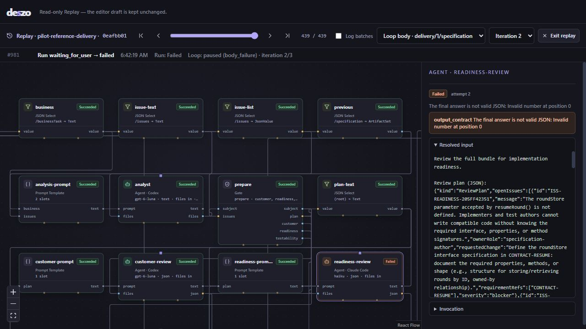
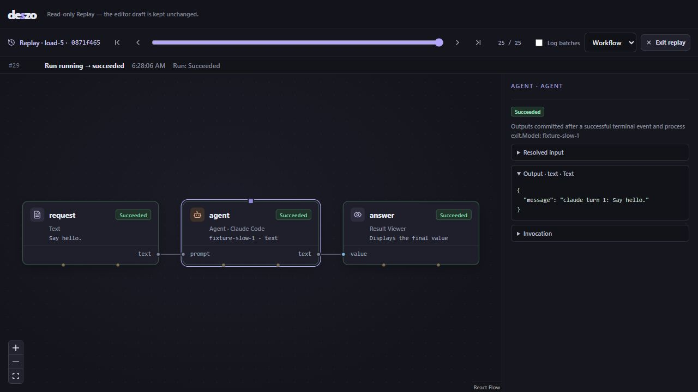

# Pilot validation — 2026-10-14

**Verdict: the current implementation does not pass the pilot. Two release-blocking integration defects and one Replay-state defect were reproduced.** The real reference workflow stops during specification review, and the installed desktop application cannot start its runtime. Local scheduling, journal/history recovery and basic Replay navigation passed the bounded checks below.

Production source was not patched. Diagnostic adapter changes exist only in the new [pilot harness](../../scripts/pilot.mjs) and are explicitly distinguished from production execution. The earlier fixture-based [review closure](../reviews/2026-10-13-m1-m6-review-closure.md) remains valid within its stated scope; it did not certify these provider or packaged-desktop scenarios.

## Scope and environment

The business case is the documented [reference Delivery Loop](../examples/reference-delivery/workflow.json): author and approve a round-recovery specification, execute its Implementation Map, check the assembled candidate, obtain technical approval and final Customer acceptance.

Every run used a separate managed scratch workspace and store under `.deszo/pilots/`. The pilot workflow pins explicit models, retains the three-iteration limits and uses a 60-minute wall/active-time ceiling. Its Analyst receives the example documents, schemas, prepared API/fixtures and role contracts. A later diagnostic variant also supplies a read-only document validator. These are prepared inputs; no model approval, implementation result or passing check was fabricated.

| Provider | Requested model | CLI observed in actual invocations | Model reported by CLI |
| --- | --- | --- | --- |
| Codex | `gpt-6-luna` | `0.162.0-alpha.17.2` | Not present in the captured init events; the invocation pins the requested model |
| Claude Code | `haiku` | `2.1.292` | `claude-haiku-4-5-20251001` |
| Antigravity | `gemini-3.8-flash-low` | `1.3.5` | `gemini-3.8-flash-low` |

Initial Antigravity discovery returned 1.3.4; the later invocation manifest records 1.3.5. Node was 22.20.0 on Windows. Subscription authentication/guards remained enabled. There was no API-key mode, paid-credit mode or substitution of models.

[The portable summary](evidence/2026-10-14-real-summary.json) records **15 real CLI invocations: 10 Codex, 4 Claude, 1 Antigravity**. This is a process-invocation count, not a count of billable completions: it includes schema-rejected calls and one aborted initial harness attempt. No further real call was made after the bounded retry failed.

## PILOT-01 — native structured-output schemas are incompatible (blocking)

Production run `4cbb22ea-ec89-444d-a38d-46bd08a67bf6` successfully authored the documents, then Codex rejected the Customer review before returning a decision:

```text
Invalid schema for response_format 'codex_output_schema': schema must have
type 'object' and not have 'oneOf'/'anyOf'/'allOf'/'enum'/'not' at the top level.
Found 'allOf'.
```

With only Codex's native schema flag replaced by explicit prompt guidance in a diagnostic run, the Customer review succeeded. Claude then rejected its unchanged native schema:

```text
API Error: 400 tools.11.custom.input_schema: input_schema does not support
oneOf, allOf, or anyOf at the top level
```

The [adapter](../../runtime/core/adapters.mjs) passes the full application schema directly to `--output-schema` / `--json-schema`. [ReviewDecision](../schemas/review-decision.schema.json) contains a root `allOf`; Map [output contracts](../../runtime/core/map.mjs) also include root unions/conditional constraints. Validity as Draft 2020-12 does not establish native-provider compatibility. OpenAI documents a restricted Structured Outputs schema subset, including unsupported composition/conditional keywords. [Official Structured Outputs guide](https://developers.openai.com/api/docs/guides/structured-outputs).

**Impact:** the production reference pipeline cannot reach implementation. This is a deterministic adapter/contract defect, not a model-quality rejection or lack of account authorization. Antigravity's native acceptance of these schemas was not established: its successful review used the diagnostic prompt mode.

**Required correction:** define and pin the native transport schema separately from the engine's complete validation schema. Use a documented provider-compatible representation, retain full engine validation, and preflight unsupported contracts before issuing a model request. Cover ReviewDecision, TaskReturn, TaskReview and TriageDecision, including new and resumed sessions. Do not silently retry in a weaker output mode or extract an approval from arbitrary prose.

### What the diagnostic run established

Run `0eafbb01-d127-4bcc-afa3-0fbb94d31b1f` explicitly omitted native schema flags for all providers and included the original schemas in their prompts. The engine continued to validate the original complete contracts.

- All three providers produced at least one accepted JSON review response. Customer and Antigravity approved the first specification; Claude returned five concrete blockers.
- The engine distinguished that valid rejection from a CLI failure, continued the specification Loop and resumed the same Codex Analyst conversation. The Analyst clarified the round-store shape, token factory, clock injection and synchronous atomicity.
- Claude's second review returned explanatory prose plus fenced JSON. The engine rejected it as `output_contract`, published no decision and paused the run. One explicit retry of that exact review failed the same way; the run was then closed deliberately.
- An earlier diagnostic Analyst produced string/check-section entries in task `dependsOn`. The Gate rejected that invalid map before implementation. Adding a read-only authoring validator allowed the next document bundle to pass schema and semantic checks.

Prompt-only generation is therefore useful for diagnosis but is not a reliable production fix on these models. No implementation task, candidate verification or final delivery acceptance was reached in a real-provider run. [The independent acceptance probe](../../scripts/pilot-acceptance.mjs) was prepared for an exported candidate and **was not executed**, because no accepted candidate exists.

The first harness attempt contained a SQL-column mistake in its statistics query. It was corrected in the harness; that attempted run and its subsequent interrupted-run recovery remain recorded. This was not classified as a production defect or a successful pilot.

## PILOT-02 — the installed desktop cannot launch Node (blocking)

The NSIS package built successfully, installed with exit 0 into an isolated directory and contained the executable, bundled runner and all five SQL migrations. A temporary config used product name `Deszo Pilot` and identifier `local.deszo.pilot20261014`, keeping its storage separate from the user's application.

On launching the installed executable, the runtime exited before creating a connection file:

```text
Error: EISDIR: illegal operation on a directory, lstat 'C:'
Node.js v22.20.0
```

The [captured startup log](evidence/2026-10-14-desktop-startup.log) contains the stack. Running `node --check` against the installed runner succeeded with its ordinary drive path and reproduced the same error with the `\\?\` Windows path prefix. Importing the same packaged runner through an ordinary path started its API, applied migrations 1–5 and returned SQLite integrity `ok`; see [bundle API evidence](evidence/2026-10-14-bundle-api.json).

The [native launcher](../../src-tauri/src/main.rs) normalizes the storage path but directly passes `resource_dir().join("runtime/runner.mjs")` to Node. The observed failure and path probe identify its unnormalized resource/script path as the cause.

**Impact:** installer construction succeeds, but the installed product is unusable on the tested machine. A packaged crash with live CLI descendants and frontend reconnection cannot be validated until startup works.

**Required correction:** normalize the script/resource path for Node before spawning, with deliberate handling of drive paths, UNC paths and spaces. Add an installed-app startup check that waits for the authenticated API and a crash/reconnection probe over owned runtime/CLI descendants. The passing direct Job Object test is narrower evidence and must not be presented as that packaged-app check.

The isolated test installation was removed successfully; the executable disappeared and no pilot desktop process was left running. [Installer hash](evidence/2026-10-14-installer-hash.json), [uninstall evidence](evidence/2026-10-14-uninstall.json). The installer remains under `.deszo/pilots/2026-10-14-desktop/installer/` for reproduction. The ordinary release executable was rebuilt using the project's original config afterwards.

## PILOT-03 — closed loops still appear paused/in progress in Replay

At the last event (`#981`) of real diagnostic run `0eafbb01-d127-4bcc-afa3-0fbb94d31b1f`, the run correctly displays Failed and the review's `output_contract` error is inspectable. However, Replay still displays `Loop: paused (body_failure)` and labels iteration 2 `in progress`. The database records both loops and that iteration as `canceled`, with an end time matching run closure.

[The state comparison](evidence/2026-10-14-loop-replay.json) reproduces the discrepancy without the browser: the shared [Replay projector](../../shared/replay.mjs) retains the paused loop record even after the loop attempt is canceled. [cancelLoops](../../runtime/core/engine.mjs) updates database lifecycle records and journals attempt cancellation; the projector does not apply that transition to its separate Loop projection. The [iteration label](../../src/Replay.tsx) treats a missing decision as still in progress even after closure.

**Impact:** the saved workspace gives an inaccurate terminal progress state. This does not cause additional provider calls or falsely accept a delivery, so it is lower priority than PILOT-01/02.

**Required correction:** derive cancellation/interruption in the Loop and iteration projection from lifecycle events, or add explicit lifecycle events if the contract requires them. Preserve the fact that no LoopDecision was returned; do not invent a finish decision. Check Replay immediately before and after stop/close/interruption, including nested loops.

[Real-run Replay DOM evidence](evidence/2026-10-14-real-replay.txt) and the screenshot below show the failed review retained in its original Loop iteration.



## Checks that passed

[The load probe](../../scripts/pilot-load.mjs) used fixture CLIs only, with six concurrent workspace workers and 30 runs per worker. It verifies success, contiguous journal sequences, byte-batch reconstruction, SSE cursor replay, concurrency limits, restart history and SQLite integrity.

| Check | Observed result |
| --- | --- |
| Local load | 180/180 successful runs in 100.19 seconds |
| Capacity | Peak 3 globally; peak 1 for each provider |
| Journal / artifacts | 5,175 journal events; 2,021 artifacts |
| Restart | All 180 runs and journal counts preserved; paginated history matched the complete run set |
| Storage | SQLite integrity `ok`; database 5,722,112 bytes |
| Probe-process RSS | Approximately 107.6–132.0 MiB during this short run; not a leak/long-soak result |
| Browser History / Replay | Restored run opened; Previous and Next changed the selected event; committed Agent output was inspectable |
| Native Job unit test | 1 passed; descendant drained after its parent exited |
| Documentation checks | Passed: 15 schemas, 141 positive / 82 negative schema cases, 39 semantic cases, 50 decision cases, 67 SQL cases |
| Frontend, runtime bundle, release build | Passed; existing Vite chunk-size optimization warning remains |

[Load evidence](evidence/2026-10-14-load-result.json), [Replay DOM evidence](evidence/2026-10-14-replay.txt).



The UI probe used a separate browser/fixture server on port 1431. The existing development server on port 1420 was left alone. The complete 330-test suite had already passed during the preceding closure review; it was not rerun here because production source was unchanged. This pilot instead exercised the previously missing integrations and bounded local load.

## Acceptance boundary and next validation

The engine's refusal to manufacture results is supported by the real failures. Scheduling, short-run capture, saved history and Replay have additional positive evidence. **Full M4–M6 behavior with real implementation/testing agents remains unverified**, as do packaged crash/reconnection, clean-machine installation and prolonged load.

Fix PILOT-01 and PILOT-02, correct the Replay lifecycle projection in PILOT-03, then repeat the same isolated production-adapter workflow through candidate verification and Customer acceptance. Afterwards execute the independent business probe and packaged runtime/app crash cases. A longer soak should be planned separately; this 100-second fixture probe does not certify hours of sustained use.

## Reproduction tools

The new [summary tool](../../scripts/pilot-summarize.mjs) reads stores without modifying them and verifies captured artifact hashes. Portable evidence excludes runtime bearer tokens. Full SQLite stores, immutable objects, captured workflows and prompts remain in `.deszo/pilots/` for detailed inspection and Replay.

```powershell
# Real subscription calls; use a NEW root to preserve earlier evidence.
node --disable-warning=ExperimentalWarning scripts/pilot.mjs --root .deszo/pilots/new-production-pilot --minutes 60

# Diagnostic only: native schema flags omitted; original engine validation retained.
node --disable-warning=ExperimentalWarning scripts/pilot.mjs --root .deszo/pilots/new-diagnostic-pilot --minutes 60 --diagnostic-schema-prompt

# Local fixtures only. Use a new root to avoid mixing probe histories.
node --disable-warning=ExperimentalWarning scripts/pilot-load.mjs .deszo/pilots/new-load-probe
```

The real harness remains online when a run needs a recovery decision, so its local status/journal can be inspected and the documented recovery API used. It stops at its wall limit. A paused run is a failure to meet the pilot objective, not permission to fabricate or manually approve its outputs.
