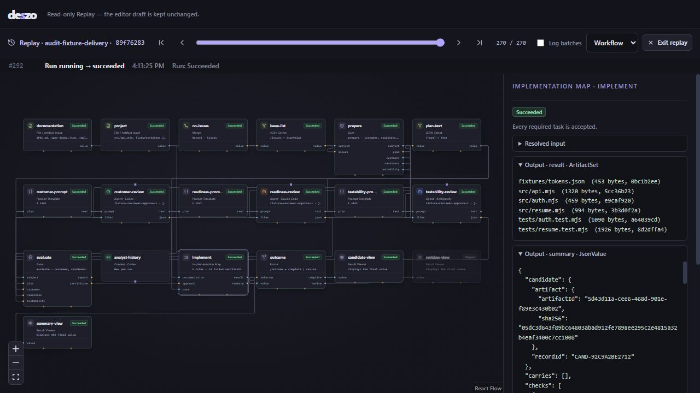

# M1–M6 implementation review

Date: 2026-10-13  
Scope: the current local implementation, its contracts, examples, automated checks, browser UI, Windows release build, and installed subscription CLIs.  
Verdict: **a substantial working prototype, but M1–M6 cannot yet be accepted as fully delivered.**

The engine and editor are real implementations. The existing suite passes, the Windows executable builds, and real Codex/Claude calls work. However, approval reuse can bypass changed instructions, Antigravity can publish a previous response, a capture failure crashes the runtime, and the complete reference delivery/acceptance pipeline is missing. These are material correctness and completion issues.

No production source or existing documentation was changed during this review. Only this report and the audit artifacts in [reproducers](reproducers/2026-10-13-runtime-probes.mjs) were added. SHA-256 comparisons of the 141 baseline files found no changes.

## Verification performed

| Check | Observed result |
| --- | --- |
| `npm.cmd run docs:check` before adding this report | Pass: 15 schemas, 138 positive schema cases, 77 negative schema cases, 38 negative semantic cases, 322 local links, 50 decision cases, 67 SQL cases; 19 tables after migration 5 |
| `npm.cmd run docs:check` with this report | Pass: 31 Markdown files, 353 local links; schema/decision/SQL counts unchanged |
| `npm.cmd test` | 310 passed, 0 failed, 0 skipped; approximately 141 seconds. This includes 253 fixture cases, one strict JSON/JCS test and 56 other registered tests. Six fixture tests perform no assertions; see R8 |
| `npm.cmd run build` | Pass: TypeScript and Vite production build |
| `cargo check --locked` in `src-tauri` | Pass |
| `npm.cmd run runtime:bundle` | Pass |
| `npm.cmd run desktop:build` | Pass: optimized Windows executable at `src-tauri/target/release/deszo.exe`; Rust release compilation approximately 4m 25s |
| Additional deterministic audit probes | Reproduced R1, R3, R5, R6 and R7; [results](reproducers/2026-10-13-runtime-probe-results.json) |
| Browser UI against a separate fixture store | Created a workspace, loaded and ran the M5 example, inspected Map/task criteria, opened Replay and exercised First/Next/Last/Previous |
| Real subscription CLIs | Codex → Claude → Codex succeeded; Claude new/continue succeeded; Antigravity new/continue launched successfully but exposed R5 |

The original suite meaningfully exercises draining healthy sibling calls, application-wide capacity, Context compatibility and recovery, root/scoped Stop, Loop limits and retries, Cache cuts and refresh, Run Branch/Node, manual chat, Route inactivity, Gate review validation, copied task directories, actual toy-project `node --test` checks, targeted repair, bounded verification, snapshot A review while B is produced, and selective task/review carry.

The fixture agents generate deterministic answers and prepared code. Their passing scenarios establish orchestration behavior, not the ability of real lightweight models to complete the entire coding/review pipeline.

## Findings

### R1 — P1: approval reuse ignores upstream instructions and the native profile

Location: [engine.mjs](../../runtime/core/engine.mjs), lines 987–992; [gate.mjs](../../runtime/core/gate.mjs), lines 150–162.

`reviewerFingerprint` hashes the Agent config and the immediate static Text/Prompt Template config. It does not hash Text or other values feeding template slots, or `workflow.settings.nativeConfiguration`.

**Reproduction:** approve a specification using a template with an `instructions` slot. On the next run retain the same specification/template/Agent and prior certificate, but change the upstream Text from “Review policy A” to “Review policy B: reject this specification.” Both reviewers are marked Skipped and the old certificate is accepted. Separately, changing `restricted` to `inherit` also skips both reviews.

These are observable inputs to the reviewer, so the previous approval does not prove acceptance under the new instructions/configuration. [Pipeline execution](../PIPELINE_EXECUTION.md#selective-reviews-at-m6) requires unchanged instructions/configuration and invalidation after native-profile changes. The narrower definition in [M6 contracts](../M6_CONTRACTS.md#section-and-scope-fingerprints) reproduces the implementation defect rather than satisfying that requirement.

**Required correction:** fingerprint the relevant input dependency closure and native execution profile; fail closed where an instruction/configuration input cannot be established. Add tests for changes through template slots and settings, rather than only edits to the immediate template. Apply the same execution-profile rule to Map task carry: [map.mjs](../../runtime/core/map.mjs), lines 260–274, currently hashes role definitions but not the workflow native profile.

Evidence: `changed-upstream-instructions` and `changed-native-profile` in the [audit results](reproducers/2026-10-13-runtime-probe-results.json).

### R2 — P1: the delivered examples and Gate contract stop before final acceptance

Location: [reference pipeline](../TEST_PIPELINE.md#delivery-loop-wiring), especially its final preparation/technical/Customer steps; [M5 example](../examples/m5-delivery/workflow.json); [M6 example](../examples/m6-selective-delivery/workflow.json); [gate.mjs](../../runtime/core/gate.mjs), lines 119–124 and 169–180; [workflow Gate schema](../schemas/workflow.schema.json), lines 1299–1397.

The reference scenario defines success as an engine certificate for the **current specification, candidate, passing reports, technical approvals and final Customer approval**. It explicitly says a completed Map or green checks are insufficient.

The implemented M5/M6 examples perform documentation reviews, execute the Map, then send `implementation_complete` to result viewers. They do not execute final quality/conformance reviews, final Customer acceptance, or the outer delivery rejection → triage → specification/task repair cycle. The M4 nested Loop example covers specification review/bypass; it is not this complete delivery scenario. The M6 tests create separate revision runs through the API instead of proving the entire reference loop.

This is also a contract gap. Gate prepare is a specification-bundle operation: it reads `spec-index.json` and creates full/public documentation views. Its config exposes mode/policy/carry, with no delivery-subject contract. There is no implemented final preparation rule that verifies exact engine-issued passing CheckReports and candidate/technical approval correspondence as required by the reference wiring. A generic additional review of files alone does not establish that correspondence.

**Required correction:** implement and validate the final delivery subject and acceptance prerequisites, provide a complete runnable reference workflow, and exercise both accepted delivery and final Customer rejection paths. Until then, narrow the “every planned milestone is delivered” claim in [README](../../README.md) and the M6 acceptance claim in [milestones](../MILESTONES.md).

This finding is about the agreed end-to-end outcome. The existing Map execution and documentation review primitives do work.

### R3 — P1: a log-storage failure escapes process callbacks and crashes the runtime

Location: [engine.mjs](../../runtime/core/engine.mjs), lines 1432–1458 and 1648–1672.

CLI data callbacks and the LogBatch timer call storage/SQLite operations without handling exceptions. These callbacks execute outside the surrounding awaited Agent operation's error path.

**Reproduction:** in an isolated subprocess, inject an `ENOSPC` error into `store.putBytes` for raw log bytes and run `fixture-noisy`. The Node process exits with code 1; the stack goes through `LogBatch.flush → LogBatch.add → Socket data`. It does not return a controlled capture failure.

This affects every active workspace owned by that runtime and combines with R4: a Node crash may leave CLI descendants running in desktop mode.

**Required correction:** contain capture errors in callbacks and timer/final flush paths, stop the affected owned invocation safely, and surface capture/storage failure distinctly from provider timeout or model failure. When storage cannot be written, use controlled shutdown/recovery rather than pretending a durable terminal event was recorded.

Evidence: `capture-write-failure` in the [audit results](reproducers/2026-10-13-runtime-probe-results.json). The injection changes only an isolated test Store instance; it does not fill the user's disk.

### R4 — P1: Rust does not observe unexpected Node exit while the window remains open

Location: [main.rs](../../src-tauri/src/main.rs), lines 109–141, 159–168 and 249–263; [App.tsx](../../src/App.tsx), lines 67–79 and 237–255.

Rust retains the Windows Job handle inside `RuntimeState`. Cleanup after unexpected Node exit occurs only when `get_runner_connection` is invoked again, or when Runner is dropped at window destruction. There is no ongoing child-exit watcher. The frontend obtains the connection during mount and reports a failed event stream without requesting a replacement connection.

Consequently, if Node dies after launching a long CLI and Tauri remains alive, KILL_ON_JOB_CLOSE does not help immediately: Rust still holds the Job handle. The descendants can continue until later IPC or app closure. This contradicts [the process containment contract](../M1_CONTRACTS.md#process-containment).

**Required correction:** supervise child exit independently of UI calls, terminate and drain the owned Job, then mark/discover the lost generation safely. Treat Job query/termination errors as uncertainty: `active_processes` currently converts query failure to zero and `contain_exit` discards the termination result.

**Evidence level:** source-confirmed control-flow defect. Rust check/release compilation passed, but a native Tauri crash-with-descendant experiment was not performed. The Node containment handshake itself is valid; replacing it with suspended launch is not necessary to fix this finding.

### R5 — P1: Antigravity text resume publishes old structured output instead of the new response

Location: [adapters.mjs](../../runtime/core/adapters.mjs), lines 147–173; [engine.mjs](../../runtime/core/engine.mjs), line 1424.

The parser always prefers `result.structured_output` to `result.response`, regardless of the current Agent output format. An installed Antigravity CLI can include a previous structured result when a later resumed turn returns plain text.

**Real reproduction:** use `gemini-3.8-flash-low` to start/continue a conversation with JSON output, then resume the same binding with `output.format = text` and ask for only the remembered control word. The CLI's final event contains:

- current `response: "ORBIT\n"`;
- `structured_output: {"message":"{\"message\":\"ORBIT\"}"}` retained from the earlier structured turn.

The runtime marks the run Succeeded but commits `{"message":"{\"message\":\"ORBIT\"}"}` as the text output. The correct new response is present in the raw log and is discarded by normalization.

A separate quota-free fixture proves the same selection error: current response `ORBIT\n`, old structured message `STALE FROM PREVIOUS TURN`, committed output `{"message":"STALE FROM PREVIOUS TURN"}`.

**Required correction:** make normalization aware of the current output contract. For Text use the current textual response; for JSON establish that structured output belongs to the current contract/turn, and reject stale/ambiguous values instead of publishing them.

Evidence: `antigravity-text-prefers-old-structured-output` in the [fixture results](reproducers/2026-10-13-runtime-probe-results.json) and the text-resume record in [real CLI results](reproducers/2026-10-13-real-cli-results.json).

### R6 — P2: stream decoding silently corrupts split UTF-8 characters

Location: [engine.mjs](../../runtime/core/engine.mjs), lines 1448–1454.

Every stdout chunk is independently decoded with `chunk.toString('utf8')`. The line remainder joins strings, so it cannot repair a multibyte character split between chunks. The raw bytes are captured, but the normalized answer can already be damaged.

**Reproduction:** a valid fixture event contains `Hello, 🌍` and writes the emoji's first byte separately from its remaining bytes. The run succeeds and commits `Hello, ����`. JSON parsing still succeeds, so downstream nodes receive corrupted content without an error. Non-ASCII text, including Russian, is affected.

**Required correction:** use a streaming UTF-8 decoder/StringDecoder and flush it at EOF. Verify output equality under deliberate byte-boundary splits.

Evidence: `split-utf8` in the [audit results](reproducers/2026-10-13-runtime-probe-results.json).

### R7 — P2: migration DDL and its applied-version record are not atomic

Location: [store.mjs](../../runtime/core/store.mjs), lines 40–58; [m2.sql](../storage/m2.sql), line 67; the same pattern applies to subsequent migration scripts.

Each migration script commits its DDL before `Store.migrate` inserts its version record. A process exit between those two steps leaves the database schema newer than `schema_migrations`. Restart retries a non-idempotent migration.

**Reproduction:** create the M1 database/version record, execute M2 SQL through COMMIT, omit the version-2 insert, then open it through Store. Restart fails with `table loop_executions already exists`.

The pre-migration backup is useful, but the runtime has no automatic reconciliation for this state; a backup created on the subsequent restart can already contain the mismatched schema.

**Required correction:** commit schema changes and the applied-version record in one SQLite transaction. Add crash-boundary tests around every migration and verify that startup either completes or safely refuses with a recoverable original store.

Evidence: `migration-commit-before-version` in the [audit results](reproducers/2026-10-13-runtime-probe-results.json).

### R8 — P2: six semantic fixture tests pass without an assertion

Location: [contracts.test.mjs](../../runtime/tests/contracts.test.mjs), lines 32–54.

The supported semantic validators are only workflow/capabilities. For a negative semantic fixture of type `map` or `sections`, execution falls through without asserting structural validity or semantic rejection, and Node reports a passing test.

Affected cases:

- `missing-test-cases-check-auth`;
- `missing-test-cases-check-resume`;
- `candidate-with-agent`;
- `cyclic-task-deps`;
- `missing-section-reference`;
- `section-cycle`.

Valid map/section fixtures also receive only structural checking here. The separate docs checker validates these semantics, but it does not replace exercising the actual runtime validators.

**Required correction:** route these cases to the runtime map/section validators, assert every expected rejection, and fail when an unsupported semantic fixture is registered. This is a test assurance defect, not proof that all six runtime rules are broken.

## Milestone assessment

| Milestone | Confirmed implementation | Acceptance assessment |
| --- | --- | --- |
| M1 | Save/load, typed DAG, real CLI chain, native Context mappings, locking/capacity, journal/history, Stop and startup recovery | Functionally implemented; crash containment, output integrity and durable migration defects prevent acceptance as reliable |
| M2 | Structured Loops, agent/Condition decisions, limits, scoped recovery, file/data utilities and Replay | Implemented and exercised on fixtures; browser Replay also checked |
| M3 | Cache freeze/refresh, Branch/Node planning and native manual chat | Implemented and exercised on fixtures; profile-aware reuse needs the same scrutiny as R1 |
| M4 | Gate, Route, selected Merge, nested specification loop, rejection/revision and exact approval bypass | The specification phase works; it is not the complete delivery phase |
| M5 | Task expansion, copied workdirs, immutable review snapshots, real checks, repair/triage, bounds and navigator | The Map works, including browser 5/5 completion; final delivery subject/reviews/Customer acceptance are missing |
| M6 | Scope/task fingerprints, selective review Routes, provenance, dependent invalidation and generation/Replay history | Partly implemented; R1 makes reuse unsafe, and the promised complete reference scenario is not covered |

## Real CLI observations

Model IDs were chosen from installed CLI/account metadata rather than assumed API availability: Codex `gpt-6-luna`, Claude `haiku`, Antigravity `gemini-3.8-flash-low`. Versions observed were Codex `0.162.0-alpha.17.2`, Claude `2.1.292` and Antigravity `1.3.3`.

- The documented Codex → Claude → Codex smoke run `8ff62fa8-abd1-46c3-89ef-b53b01e2543e` succeeded with all three Agent calls. I read the final Agent artifact: its sentence contains the remembered word ORBIT. The smoke script itself only checks run success and reports a Viewer output manifest, so this additional artifact check matters.
- Claude new and explicit cross-run Continue both returned `{"message":"ORBIT"}` under JSON Schema. An earlier separate Claude attempt produced a non-JSON final answer and correctly entered output-contract recovery; no answer was silently substituted.
- Antigravity new/Continue reused the native conversation and emitted terminal SUCCESS. The first JSON answers were structurally valid but nested JSON inside `message`, showing that schema validity alone does not prove prompt semantics. The later plain-text resume returned the correct word at CLI level and exposed R5 in the engine.

The real CLI harness is [real-cli-probes.mjs](reproducers/2026-10-13-real-cli-probes.mjs). Its normal invocation consumes quota; `--antigravity-text-resume` appends the text probe to its saved conversation. The original smoke artifacts remain in `.deszo/smoke`; other audit stores are isolated under `.deszo/tests`.

No real-provider full M4–M6 coding pipeline was executed. Full native desktop crash/Job draining, installation/distribution and long-running load remain unverified. The executable build used the project's `--no-bundle` script; this is not an installer test.

## UI evidence

The isolated M5 fixture run `89f76283` reached Succeeded with 292 durable journal events. The navigator showed five accepted tasks, zero failed verification cycles, and engine-issued passing CHECK-AUTH/CHECK-RESUME records. Replay presented 270 steps with log batches hidden; First/Next/Last/Previous changed the visible journal position and historical run state. Selecting the Map showed the captured inputs, candidate files, summary and generated acceptance records.

The palette, saved workflow selection, run journal, Map navigator and Replay are usable. Browser automation briefly stalled around discarding the initial unsaved draft; a fresh tab loaded the chosen workflow and subsequent verification succeeded. This was not classified as an application defect without a reliable independent reproduction.

## Follow-up order

1. Correct approval fingerprints and Antigravity output selection (R1/R5); add regressions using the attached fixtures.
2. Contain capture/storage errors and actively supervise the Node Job lifecycle (R3/R4), including a native child-crash/descendant test.
3. Correct UTF-8 streaming and migration atomicity (R6/R7).
4. Make the semantic fixture suite exercise all runtime validators (R8).
5. Complete the final delivery/technical/Customer acceptance contract and runnable reference scenario (R2), with final Customer rejection causing a bounded repair/specification revision.
6. Repeat the fixture suite/build, then run a small real-provider acceptance case and targeted native recovery checks. Acceptance should be based on those outcomes, not the current README milestone claim.

The successful architecture choices should be retained: immutable captured inputs/results, engine-owned certificates/check reports, explicit rejection versus operational failure, visible native Context state, application-wide capacity, no silent provider/session fallback, and journal-derived Replay.

Documentation also needs status cleanup: the milestone summary says implemented while its later contract table still calls M4/M6 schemas pending, and its header retains the original pre-implementation status. The Vite 601.49 KB main chunk warning is an optimization item; neither it nor the bundle identifier warning blocked the Windows build.

