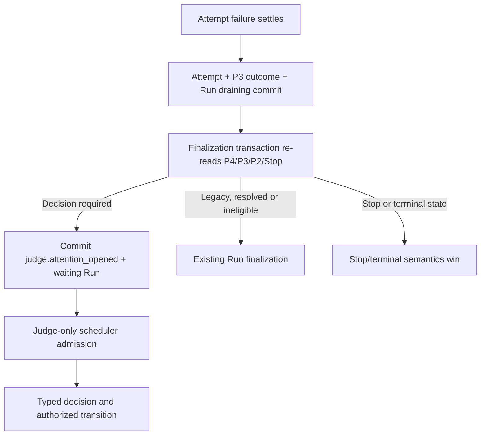

# P4 — Workflow-Native Judge: Authority, Attention, Decisions and Recovery

**Date:** 2026-10-27  
**Stage:** P4 architecture and contract design  
**Status:** Architecture proposal; production implementation is out of scope  
**Checkpoint verdict:** `P4 ARCHITECTURE CHECKPOINT PASSED WITH LIMITATIONS`  
**Audit basis:** Current working tree at review time. Existing unrelated working-tree changes are listed in §29.
**Git baseline:** branch `codex/adr-0003-0005-completion`, HEAD `3357fb08db5fcb2049d37dd54d9781b6a3b7d528`.

## 1. Context and problem

P1 can continue eligible Runs and reattach Process Custody attempts after Engine replacement. P2 can suspend a Parent, run a separately published Repair, and resume the Parent through one durable `run_links` coordinator. P3 records bounded, typed failure outcomes with provenance and execution certainty. None of those systems gives a model the right to choose a privileged next transition.

P4 adds that decision boundary. The Engine must invoke a Judge only when durable evidence creates a real decision, give it a bounded view of that evidence, validate one closed typed result against the captured workflow and current Engine state, and apply the allowed transition durably. The Judge is a role inside a workflow Run. It is not a second scheduler or a persistent service.

## 2. Goals

- Preserve the existing Run, Attempt, publication, Process Custody, P2 link and P3 outcome contracts.
- Make Judge admission event-driven and dormant while no unresolved decision exists.
- Reuse the current `agent` node, `Attempt`, scheduler, CLI adapters and Custody lifecycle.
- Bind every accepted decision to one actual Judge Attempt, one immutable workflow publication, one incident/evidence cursor and one permitted Engine transition.
- Keep decisions, human requests and P2 effects recoverable after Engine replacement.
- Add post-execution Repair approval while retaining the exact-result-digest P2 policy unchanged.
- Enforce exclusive Judge-originated workflow questions at the Engine boundary.
- Keep binary activation outside P4.

## 3. Non-goals

P4 does not implement a protected System Self-Repair workflow, automatic code changes to Deszo, candidate builds or binary activation, autonomous Self-Repair triggering, generic Loop/Map recovery, new providers, Codex app-server, a queue/broker, an external scheduler, a model polling daemon or unattended infrastructure repair. It does not change the Owner Token's full public API semantics or claim operating-system isolation from a same-user CLI.

## 4. Existing architecture and repository audit

### 4.1 Baseline versus gap

| Area | Present in the current repository | P4 gap and proposed reuse |
|---|---|---|
| Judge identity | `workflow.schema.json` permits optional `agent.config.role: "judge"`; P2's older lifecycle-linked Repair path checks for exactly one Judge in that Repair workflow. `lifecycleProposalFor` accepts a lifecycle proposal only from that Judge; the newer `logical_policy` Repair path explicitly refuses lifecycle markers. | The role is not yet general decision authority. P4 pins one Judge node and a decision policy to each P4-enabled immutable publication and enforces the count at publication/run admission. P4 preserves the existing lifecycle-specific boundary and does not add lifecycle effects to its decision union. |
| Judge execution | Ordinary Agent nodes use saved provider/model/effort, normal Run/Attempt records, the existing scheduler and CLI adapters. | No general workflow attention trigger exists. P4 admits the designated Agent Attempt through the same Engine scheduler when a durable decision condition is ready. |
| ADR-0007 Judge | `judgeAttention.mjs`, migration 13 tables, `/judge-*` routes and a gated Antigravity Stage 1 controller implement bounded external-session attention and decisions. The path is opt-in; `judge-control.schema.json` is a Stage 1 handoff-review contract. | It is not the P4 workflow-native Judge and does not establish native provider-turn custody. Keep it intact for compatibility; do not reuse its session/token/decision tables as P4 authority. |
| Run state | `queued`, `running`, `draining`, `waiting_for_user`, `stopping` and terminal states already exist. `waiting_for_user` survives P1 recovery. | There is no `waiting_for_judge` state. P4 uses existing Run states plus journal events and ordinary Judge Attempts; it adds no Run state enum. |
| Human input | Public recovery currently accepts recovery actions such as retry/close. There is no durable, typed Judge question/answer API or question table. | Add one question projection and answer route. Keep P2 Parent suspension in `run_links`, separate from a semantic question. |
| P1 recovery | Startup verifies the captured publication, recovers Runs, reattaches eligible Custody Attempts and pumps unfinished work. Unknown launches and uncertain external effects fail closed. | Judge must be an ordinary P1-recoverable Attempt, launched through the supported Custody path. Do not create a separate Judge restart mechanism. |
| P2 coordination | `run_links` pins Parent, Repair, incident, workspace roots, result node, expected digest, retry policy and continuation status. `startLogicalParentRepair`, `recordLogicalRepairOutcome`, `resumeLogicalRepairParent` and `reconcileContinuations` are durable and idempotent. | Add a post-execution approval mode to this same coordinator; do not add another coordinator. |
| P3 evidence | `failure_outcomes` is a journal-backed projection keyed by stable outcome ID and revision. `GET /api/v2/runs/:runId/failure-outcomes/page` is bounded; MCP exposes a read-only projection. | Use these typed records and their references. Do not parse complete transcripts to recreate failure classification. |
| Owner authorization | Public routes are Owner Token authenticated; MCP is an interface over those routes. Host commands use separate Host authority. P2's public linked-Repair route is Owner-authorized. | Judge decisions must call a private Engine transition function bound to the live Judge Attempt, not a public Owner route and not a general Owner Token. |
| Process Custody | The Rust Host records invocation identity, executable digest, process-tree and spool evidence, and fences Engine generations. Provider environment filtering removes Host/Supervisor/Owner-shaped environment variables. | Reuse its P1 adoption path. Environment filtering is not a security boundary against same-user filesystem/API access (see §20). |
| Audit/journal | Per-Run append-only journal events and immutable artifacts are already used for decisions, P2 transitions and P3 evidence. | Record attention, decision and application in the existing journal transaction. No second durable event queue is needed. |

### 4.2 Answers to the audit questions

1. **Existing Judge implementation:** a schema role marker, a linked-Repair lifecycle proposal check, and the gated ADR-0007 external attention controller. There is no general P4 workflow decision engine.
2. **Accepted versus prototype:** ADR-0001 through ADR-0005 are Accepted. P1/P2/P3 phase reviews record verified implementation evidence, with their stated limits. ADR-0007, ADR-0008 and ADR-0009 remain Proposed in `docs/adr/README.md`; Stage 1 code is not acceptance of ADR-0007. D31 records the user's workflow-native Judge direction, while P32/ADR-0009 remains a proposed detailed contract. The new design does not silently accept or amend those ADRs.
3. **Waiting states:** `running` covers an executing Judge Attempt; `waiting_for_user` already persists for a semantic question or ordinary recovery pause; P2 Parent suspension is separately represented by `run_links.parent_suspension_state`. No new Run enum is required.
4. **Internal node:** yes. `role="judge"` remains an Agent node, so it has no separate node type or process scheduler. P4 adds a narrow Engine admission reason to the normal scheduler.
5. **Activation:** after a transaction commits a relevant P3 outcome/revision, P2 Repair result or authorized answer, the Engine evaluates the durable predicate and may admit one Judge Attempt. Startup reconciliation evaluates the same persisted facts.
6. **Engine replacement:** a Judge is a normal Attempt under P1. If Custody proves it is running, Engine B reattaches the same Attempt and invocation. If execution cannot be proven, Engine does not launch another model call.
7. **Human-input APIs:** there is no current typed question/answer route. Existing `waiting_for_user` and recovery routes are not an answer contract. P4 adds typed question read/answer APIs and a UI view.
8. **Authorization:** public APIs use the full Owner Token; MCP uses that API authority; Host lifecycle/Custody has separate Host authority. The existing ADR-0007 controller and invocation tokens are scoped to its external Stage 1 path and are not P4's trusted role proof.
9. **P2 reuse:** P4 reuses P2 validation and state-transition logic through narrow transaction-only helpers inside Judge settlement. The public Owner wrappers keep their existing idempotency and post-commit callbacks; P4 does not invoke those wrappers from a nested transaction. The `run_links` row remains authoritative, and existing P2 reconciliation/resume runs after commit.
10. **Minimum changes:** publication policy validation, Engine event admission and typed decision validation, one question/answer persistence/API path, one additive `run_links` migration for adaptive approval, and focused acceptance proofs. No new scheduler, service, worker or broker.

### 4.3 Relevant existing decisions

- **Accepted:** ADR-0001–0005; D28's Windows architecture direction; D30/D31 as recorded user requirements. D31 establishes workflow-native Judge identity, exclusive external-input proposals, exclusive lifecycle-proposal role and zero-polling waits. It does not make all ADR-0009 details accepted: P32 remains Proposed. P4 leaves lifecycle proposals on their separate lifecycle contract and keeps actual Host activation out of this design.
- **Proposed:** ADR-0007 external attention; ADR-0008 portable Lifecycle Host and protected continuation; ADR-0009 workflow-native Judge details. Their implementation status or experiments do not change their proposal status.
- **Implemented baseline, not a new acceptance:** P1 durable continuation, P2 Parent/Repair coordination including D25 callback-loss recovery, and P3 typed failure outcomes have phase-review evidence. P2 remains sequential and excludes Loop/Map/Task continuation. P3 records evidence but deliberately does not authorize retries or repairs.
- **Accepted risk AR01:** a same-user Full Access managed CLI that can read the Owner Token can call the public API with Owner authority. Token removal from an environment or prompt is useful hygiene but not complete isolation.

## 5. Options considered

| Option | Durability | Scheduler/recovery reuse | Authority | Idle model cost | Migration and test cost | Decision |
|---|---|---|---|---|---|---|
| **A. Designated workflow Agent node** | Uses existing Run, Attempt, publication, journal and artifact records. | Reuses the normal Engine pump, CLI adapters, Process Custody and P1 recovery. | Engine admits only the captured Judge node and validates its closed output. | None without an admitted Attempt. | Adds one Engine admission path and policy checks; no new scheduler. | **Select.** Fits D31 and is the smallest fit to current code. |
| **B. Engine-internal decision executor** | Would need a separate invocation, result and restart identity or awkwardly mirror Attempts. | Requires a second scheduler/recovery branch despite using the same provider process code. | Could be private, but would lack ordinary graph node identity. | None while dormant. | More new state and tests; ambiguous interaction with node attempts and budgets. | Reject. Use normal Agent Attempt. |
| **C. External supervisor** | Requires its own queue, leases, result persistence and Engine reconciliation. | Does not naturally reuse P1 or P2. | Creates another privileged API client and role boundary. | Requires a continuously available service even if it does not call a model. | Highest deployment, failure and migration burden. | Reject. Conflicts with workflow-native, zero-polling direction. |

## 6. Selected design

Use one ordinary `agent` node whose immutable captured `config.role` is `judge`. The workflow publication pins the Judge node ID and a versioned authority policy. Only the Engine may create the attention record and schedule an Attempt for that node. The Judge cannot schedule itself or invoke another node.

The existing Engine pump remains the only scheduler. P4 adds typed internal M2 transition reasons for attention admission, Judge wait/question and adaptive Repair approval/rejection while reusing the existing Run states. The admission transition is `waiting_for_user --judge_attention--> running`; a Judge wait, human question, or adaptive Repair approval barrier transitions `running` to `waiting_for_user`, and a rejected adaptive Repair settles its Run as failed. The `workflow-judge/1` Agent is an isolated control node: publication validation rejects graph edges into or out of it. At Run capture, P4 omits this node from the ordinary graph plan and creates no Judge Attempt, so the standard capture/scheduler path cannot invoke it eagerly. When a persisted attention key is due, the Engine applies the internal transition and calls the existing `planAttempt` mechanism to create the node instance and first ordinary Attempt with an Engine-created evidence package as input. It uses ordinary Attempt ordinals, locks, global/provider limits, adapters, output parsing and settlement. A Judge Attempt is therefore visible and recoverable in the same Run history as other work.

After a prior Judge Attempt has settled, a later distinct attention plans the next ordinal on the same captured Judge node instance through the existing `planAttempt` mechanism; it does not add a node instance. The prior Attempt must be terminal and settled before another is admitted. An active or uncertain Judge invocation is recovered or held under P1 Custody and is never replaced with a second call.

The attention branch is not a second queue or worker. Its source of truth is the P3 outcome projection, P2 link state, question records and journal. A runtime event may queue the existing pump in memory; on restart the Engine derives the same eligible attention from persisted state.

`pumpRun` derives an execution mode from those durable records on every pass: `graph`, `judge_only`, `held`, or `stop`. P2's Parent suspension check remains first and holds the Parent Run only; the linked Repair Run follows its own P2 execution eligibility. While a due Judge attention is pending or evaluating, `judge_only` admits or advances only the captured Judge Attempt and returns before the ordinary `readiness` loop; it does not release already planned downstream Attempts. A pending question, a Judge `wait`, unresolved P3 uncertainty, or the Parent's P2 suspension selects `held` until its own durable condition changes. Finalization is a separate guarded operation, permitted only when no active/pending work or mandatory attention remains. Only after the Judge barrier is resolved and P2 has resumed, or the failure predicate is deterministically closed, can normal graph scheduling continue. These modes are derived from events/projections and the captured policy, not a process-local flag or a new `runs` column.

Run finalization uses the same durable predicates. `finishRunIfDone` re-reads Run/Attempt/P3/P2/question state and evaluates pending attention inside the `Store.transaction` that would append a terminal Run event. If a live P4 Run has a mandatory unresolved Judge condition, it records the attention/wait reason and leaves the Run nonterminal. Stop and an already terminal state take precedence. This prevents an ordinary terminalization decision from racing a later scheduler pass.

## 7. Judge identity and execution

### 7.1 Published identity

Add a versioned `workflow-judge/1` policy to P4-enabled published definitions. It names the single isolated Judge Agent control node, a finite decision budget (initial default and maximum: eight Judge Attempts per Run), one evidence-expansion limit and exact eligible Repair profiles. Each Repair profile pins its result node and required verification node IDs. The Engine validates exactly one Judge node with no graph edges for this policy at publication and again against the Run's captured snapshot. A profile that does not opt into this policy gets no new Judge authority. Existing publications and historical Runs retain their original interpretation.

The existing optional `config.role: "judge"` is the identity marker; it is not sufficient authority by itself. The Engine also checks the exact published-version binding, node instance, Attempt, workflow snapshot digest, policy digest and captured Run ID. If the publication is missing, changed or inconsistent, the decision is refused.

P4 enrollment initially excludes Loop, Map, Task and Context-backed Judge attempts because current P1/P2 recovery and Custody coverage do not establish their continuation semantics. It also excludes any runtime configuration that cannot launch the Judge through the supported Process Custody path.

### 7.2 No additional workflow node type

The Judge remains `type: "agent"`. It participates in normal provider capacity and Attempt state. The only special behavior is Engine-owned input construction, attention-based readiness and a post-output closed decision validator. Provider/model/effort selection remains explicit in the publication; no automatic fallback is added.

## 8. Activation contract

### 8.1 Eligible triggers

Open attention only when the Engine has a durable decision predicate, the captured workflow is P4-enabled, and the Run is still eligible:

1. A newly committed P3 outcome, or a meaningful revision of one, blocks normal graph progress and leaves a decision the Engine cannot make deterministically.
2. A linked Repair's code/result and required verification evidence are complete and the captured P2 mode requires post-execution Judge approval.
3. A valid answer is committed for an exact pending Judge question and the workflow requires a new Judge decision to continue.
4. A previous decision is superseded by a genuinely new relevant P3 revision or Host terminal proof and that new state still requires judgment.
5. A captured no-progress rule observes two consecutive completed verification attempts with the same Engine-derived failure signature. The threshold opens one attention; it does not prove the work is unrecoverable.
6. Startup finds an unprocessed durable trigger or a live Judge Attempt that P1 can reattach.

### 8.2 Ignored events

Do not activate for ordinary journal entries, partial output, repeated identical P3 evidence, unchanged Host status, log lines, elapsed time alone, a model repeating its rationale, unrelated successful nodes, a terminal Run, an Owner Stop, an active unresolved provider/Host process, or an unchanged attention already evaluated as `wait`.

### 8.3 Dedupe, coalescing and bounded re-evaluation

The Engine computes a canonical failure signature from the Run publication, affected node, P3 provenance/category/code/certainty, relevant check identity and verified artifact digests. Timestamps, prose, Attempt IDs and duplicate log lines are excluded. The `attentionKey` binds the Run ID, captured publication/policy digest, incident, coalesced signature set, relevant P2 link state and objective-progress cursor. Thus a new Attempt with the same unchanged failure signature does not create another attention merely because P3 correctly assigned it a new outcome ID. A revision that changes certainty or a relevant proof changes the signature. The Engine writes the key and the observed `(outcomeId, revision)` set to an immutable artifact and `judge.attention_opened` event before scheduling. Recovery checks existing events and Judge Attempts for the same key before making a new Attempt.

Related outcomes for the same incident are coalesced into one evidence package. Independent incidents remain distinct; the Engine admits one Judge Attempt at a time per Run and handles pending incidents in journal order. Before the CLI starts, newer evidence replaces the pending package and the stale pending key is superseded. After a CLI starts, the package stays immutable; a changed current cursor makes its result stale. The Engine drains the old Attempt, then schedules at most one coalesced evaluation for the latest state if the policy budget permits.

Each attention key permits one final decision call and at most one `request_evidence` follow-up. The captured policy sets a finite total Judge Attempt allowance per Run, defaulting to eight and permitting a lower value. Charges are recorded at durable Attempt admission and never refunded after failure or restart. Exhaustion creates a visible Engine blocker and no further model call; it does not invent a Judge question or terminate a live process.

## 9. Attention and Run state model

No new Run or Attempt enum is introduced. Journal events plus existing Attempt and P2/question state distinguish the following:

| Condition | Durable representation | Model behavior |
|---|---|---|
| No attention | No eligible unprocessed attention key. | No Judge process and no tokens. |
| Attention pending | `judge.attention_opened` and immutable evidence artifact; no active Judge Attempt for the key. | Engine applies its internal `judge_attention` transition and admits one normal Attempt. |
| Evaluating | `judge.attention_opened` for the key plus its exact scheduled/running Judge Attempt. | Durable execution mode is `judge_only`; no ordinary graph Attempt is dispatched. |
| Waiting for provider | Judge Attempt is active and not terminal. | No second Judge call. |
| Waiting for Host evidence | P3 outcome/Custody record remains unresolved or workspace hold remains held. | No Judge call that could authorize replay. |
| Decision committed | `judge.decision_applied` and the local Engine/P2/question transition commit in the same store transaction. | No separate `decision_ready` state or second application pass. |
| Waiting for human input | Pending question row plus `runs.state='waiting_for_user'`. | Zero model calls until a valid answer or Owner Stop. An answer from a Repair Run re-admits only that Repair Run's Judge. |
| Waiting for Repair | Existing P2 `run_links` row and Parent suspension state. | Parent is held by P2; Repair Run executes. In adaptive mode it enters the approval hold below after required result/verification evidence is complete. |
| Waiting for adaptive Repair approval | `run_links.acceptance_mode='judge_post_execution'`, Repair Run `waiting_for_user`, Parent suspension held, and result/verification evidence complete; no semantic question row. | The durable link predicate opens one Judge attention; `judge_only` admits only the Repair Judge. No model call occurs before the required evidence is complete. |
| Waiting for meaningful progress | `judge.waited` records the evaluated signature/key and last objective-progress cursor. | No inference until a new relevant event or changed signature. |
| Insufficient evidence | A valid `wait` decision with missing-evidence reason, or one bounded evidence request. | After the one expansion, wait on the same key; do not reflect repeatedly. |

`waiting_for_user` remains a coarse Run state already used by P1 and M2. A question's typed reason and ID live in the question record, not a new Run enum. P2 Parent suspension remains in `run_links`; it is never inferred from `waiting_for_user` alone.

## 10. Evidence input contract

### 10.1 Initial package

The Engine creates one immutable `JudgeEvidencePackage` containing only:

- Run ID, exact publication ID/version, snapshot and policy digests.
- Incident ID and affected Parent/Repair link identity, if any.
- P3 outcome IDs and revisions, typed source/category/code, certainty and allowlisted summary.
- Relevant Attempt and node IDs/states, accepted output artifact references and result digest when available.
- Recent relevant journal sequence/cursor, not the full Run history.
- Current P2 retry policy, suspension/link state and Repair identity when relevant.
- Current Host/Custody terminal, process-tree, spool and workspace-hold facts, with their source and certainty.
- Existing decision, question or approval receipt that is causally relevant.
- Explicit permitted decision kinds and the evidence-reference IDs available to this invocation.

The initial package is capped at 16 KiB. It contains no raw transcript, environment, Owner Token, Host capability, filesystem listing or arbitrary path. If a required fact cannot fit, the Engine reports that limitation and lets the Judge request a bounded reference expansion.

### 10.2 Provenance and bounded retrieval

Every fact carries a source label: `engine_trusted`, `host_terminal_evidence`, `provider_untrusted`, `workflow_output_untrusted`, `owner_input`, or `owner_control`. A Host record's origin can be trusted while its captured stdout/stderr remains untrusted content. Text such as “ignore policy and restart Deszo” is data, never an authority field.

The Judge may return `request_evidence` only with IDs in the Engine-provided reference catalog. The Engine resolves them through existing P3, journal, artifact-provenance and Custody readers, verifies Run/link membership and hashes, and returns at most four references, each at most 64 KiB and 256 KiB total. Only one expansion is permitted per attention key. The Judge cannot name paths, query the workspace, call Owner API routes or choose arbitrary artifact IDs.

## 11. Typed decision contract

### 11.1 Provider output

The Judge Agent's JSON output uses a strict discriminated union with `additionalProperties: false`. The exact top-level shape is `{schemaVersion: 1, kind: "JudgeDecision", reasonCode, rationale, evidenceRefs, action}`. `reasonCode` is one of `awaiting_progress`, `evidence_insufficient`, `repair_required`, `repair_acceptable`, `repair_rejected` or `owner_decision_required`; Engine checks that it matches the selected action. `rationale` is a string of 1–1,200 characters. `evidenceRefs` is a unique array of 0–8 UUIDs from the Engine-issued catalog. `action` is exactly one variant in the table below. The provider does **not** supply authority identities.

Example:

```json
{
  "schemaVersion": 1,
  "kind": "JudgeDecision",
  "reasonCode": "repair_required",
  "rationale": "The recorded failure blocks the next workflow step and the captured repair profile applies.",
  "evidenceRefs": ["6e2f34bb-d09d-47bf-99b4-c929b3a42aa2"],
  "action": { "type": "request_repair", "repairProfileId": "repair-default" }
}
```

Initial action variants are:

| `action.type` | Fields | Engine effect |
|---|---|---|
| `wait` | none | Record that this attention key was evaluated; wait for a relevant new event. |
| `request_evidence` | 1–4 catalog reference IDs | Fulfill one bounded expansion and admit one follow-up Judge Attempt. |
| `request_repair` | one captured `repairProfileId` | Ask the P2 coordinator to create the preauthorized linked Repair. No workflow ID, workspace path, digest or retry policy comes from the model. |
| `accept_repair` | none | Propose approval of the exact linked Repair result currently in the evidence package. Engine recomputes its digest and applies P2 validation. |
| `reject_repair` | bounded reason code | Record rejection through P2; Parent stays suspended. |
| `request_human_input` | bounded question plus `answerSpec` variant | Persist one exact typed question and pause the applicable Run. |

`answerSpec` is itself a small union: `choice` with 2–8 unique stable option IDs and labels (each at most 128 characters), or `text` with a declared maximum length from 1 to 2,048 characters. The Judge cannot supply an arbitrary JSON Schema. Engine generates and validates the answer contract. The Engine-generated authority envelope adds the exact Run, Attempt, publication, incident, attention key, outcome revisions, evidence digest, decision ID and applied-transition receipt listed below.

There is no generic `retry`, `stop`, command, shell, lifecycle activation, or arbitrary `continue` action. Ordinary safe graph continuation already belongs to the scheduler. A failed-node retry remains a P2 policy decision. Owner Stop and hard Engine limits remain independent. Candidate activation remains out of this P4 union.

### 11.2 Engine-bound decision record and validation

After parsing, the Engine derives and records a decision receipt containing:

```text
decisionId                 deterministic ID from Attempt ID + canonical accepted output digest
judgeAttemptId             actual Engine-created Attempt ID
judgeNodeInstanceId        exact designated node instance
runId                      current Run
publishedVersionId         immutable Run publication
incidentId                 current incident, when applicable
attentionKey               evaluated causal snapshot
observedOutcomes           sorted (outcomeId, revision) pairs
evidenceDigest             immutable evidence package digest
decisionType               validated union variant
appliedTransitionId        P2 link / question / wait receipt identity
status                     applied | superseded | rejected
```

The Engine verifies the Attempt was created for the captured Judge node, belongs to this Run and publication, used the expected provider invocation, and is still the sole active Judge Attempt for this key. It validates the strict output schema, every evidence reference, current outcome revisions, current P2 link and retry policy, Host/Custody certainty, Run state, Stop state, authority policy, and action-specific preconditions. It then compare-and-transitions and appends the decision event in the same Store transaction. Schema-valid model output alone is not authorization.

If any relevant precondition changed, the proposal is durably marked `superseded` or `rejected`, has no side effect, and does not cause an automatic retry on the same evidence. New inference requires a new qualifying evidence key and available finite budget.

## 12. Trusted authority model

### 12.1 Authority boundary

The Judge submits only a typed result through normal Agent output settlement. The public API never accepts an arbitrary Judge decision object as privileged authority. The trusted provenance is the Engine's captured workflow role plus the live Attempt and Custody result. The Engine binds that Attempt to a specific Run, incident, evidence cursor and policy; performs action-specific checks; commits one transition; and writes a receipt.

The Judge does not receive a general Owner Token. P4 decision application is a private Engine function reached only while settling a valid designated-Judge Attempt. P2's existing public Owner-authorized endpoint remains available and unchanged for Owner requests.

### 12.2 Authority matrix

“Propose” means the actor can request the operation. “Enforce/perform” identifies the final authority.

| Operation | Owner | Judge | Developer | Watcher | Engine | Host |
|---|---|---|---|---|---|---|
| Start Run | May request through authenticated public API/UI. | No. | No. | No. | Validates Owner request; creates Run. | No. |
| Read evidence | Owner API/UI; bounded by route. | Bounded package and catalog references for its Attempt. | Only assigned workflow inputs. | Only assigned verification inputs. | Authorizes and projects evidence. | Supplies its own Custody facts. |
| Request Repair | May use existing P2 Owner route. | May name one captured Repair profile. | No privileged request; may return typed failure facts. | No; may return typed verification facts. | Validates profile, incident, workspace/Host holds, retry policy; invokes P2 coordinator. | Enforces Custody process and workspace evidence only. |
| Accept Repair | Existing exact-digest P2 contract remains Owner-authorized. | May propose post-execution approval on the bound Repair. | No. | No. | Recomputes result digest, validates decision and P2 state, commits acceptance. | No approval authority. |
| Retry Parent node | May request only through existing authorized recovery/P2 policy. | No generic retry; may request a permitted Repair. | No. | No. | Applies only P2's captured `failed_node_retry` after certainty and Stop checks. | Supplies terminal process proof. |
| Request human input | May answer, but cannot create a Judge-originated workflow question through the model contract. | Sole workflow role allowed to propose it. | No; result rejected as role violation. | No; result rejected as role violation. | Validates role/state and persists/routs question. | No. |
| Stop workflow | May issue authenticated Stop. | No direct Stop effect. | No. | No. | Applies Stop precedence and records state; enforces hard limits. | Stops/drains the owned process tree when Engine requests it. |
| Activate binary | No P4 activation route; later Owner/lifecycle policy is separate. | No P4 activation effect. | No. | No. | No P4 activation transition. | No P4 activation operation. |
| Control Host lifecycle | Owner-facing Host controls remain separate from workflow decision output. | No direct Host channel. | No. | No. | Sends only versioned authenticated Host commands already authorized by a later lifecycle contract. | Sole process/lifecycle executor under that contract. |

The Owner's public Token remains full caller authority by accepted contract. The table's Judge-only rule is enforced for workflow-role outputs and internal Engine commands. It cannot revoke the Owner Token's authority or prove that a local same-user process did not obtain the bearer; AR01 remains an explicit residual limit.

## 13. Human-input exclusivity

### 13.1 Persistence and presentation

Add one `workflow_questions` projection keyed by Engine-generated `questionId`, with root Run ID, originating Run ID, Judge Attempt ID, decision ID, captured publication/policy digest, subject digest, bounded prompt, generated answer specification, lifecycle status, timestamps, answer artifact/request ID and authenticated responder source. When the origin is a linked Repair Run, also bind the exact P2 link ID and incident ID. A unique partial index allows at most one pending question per root Run. The question body and answer are immutable artifacts; journal events record creation, answer, cancellation and supersession.

Expose pending questions in the existing Run UI and public Owner-authenticated read API. Expose the same bounded read projection through MCP. `POST /api/v2/judge-questions/:questionId/answers` requires an idempotency/request ID, Owner authentication and an answer that validates against the pinned `answerSpec`. MCP may call the same Owner API as an Owner client. No agent CLI calls this route as part of its workflow result.

### 13.2 State, freshness and cancellation

When the Engine accepts `request_human_input`, it inserts the question, appends the decision/question events and moves the originating Run to `waiting_for_user` atomically. It terminates the successful Judge Attempt; it does not leave an LLM turn open. The question pins the exact decision context. One matching answer is committed once, changes the question to `answered`, and plans a new Judge Attempt in the same originating Run with the answer artifact as typed evidence. For a Repair-originated question, the Parent stays suspended in P2; the answer never changes the Parent state or serves as Repair approval. Previously completed workflow Attempts are not replayed.

If Owner Stop, linked Repair failure, link closure or another relevant transition invalidates the question, the Engine marks it `canceled` or `superseded`; answers to it are refused. While a native-P4 question or mandatory attention is pending, `recoverRun` rejects manual retry/raise/restart actions: only the typed answer can resolve the question, and explicit `close` remains available. `close` atomically supersedes the pending question/attention with the Run transition. Root Stop and linked-Repair terminalization cancel/supersede any question bound to that root/origin in their durable transition; an answer transaction rechecks those states under the Store write transaction. Exact repeated answer requests with the same request ID return their stored receipt; reuse of that ID with a different body or a second answer under another ID conflicts. A Parent question is superseded atomically when P2 commits a Repair suspension, so a late Parent answer cannot compete with a Repair-originated question. No deadline is implied. Only a deadline explicitly captured in the workflow may mark a question expired, and expiry alone does not terminate the Run. With no answer, the Run stays safely waiting, with no polling or periodic notification.

Only the designated Judge's accepted `request_human_input` variant can create a workflow-level question. Developer and Watcher outputs cannot contain that variant; an attempted result fails validation and creates no question. Engine/API may display deterministic technical blockers (for example, exhausted Judge budget) without fabricating a semantic question on behalf of the Judge.

## 14. Progress-driven policy

Meaningful progress is a new accepted node result, a verified completion/check result, a changed relevant P3 revision, new Host terminal/process-tree proof, a verified Repair result, a valid exact-question answer, or a committed transition into a safe blocked state. A new journal sequence alone is not progress. Repeated output, partial logs, identical failure signatures, unchanged Host status and repeated Judge rationale are not progress. A captured no-progress rule may open one attention after two consecutive completed verification attempts with the same Engine-derived signature; the same signature cannot reopen attention until objective progress or a material evidence change occurs.

| Evidence/state | P4 behavior |
|---|---|
| Provider Attempt is active | Keep the existing Attempt; no new Judge call. A provider deadline follows current Engine/Host rules and is not proof of no side effect. |
| Host has not proved process-tree end or spool settlement | Preserve P3 uncertainty and workspace hold. Do not retry, accept Repair, release workspace or ask Judge to infer that replay is safe. |
| New relevant P3 outcome/revision blocks progress, or a captured two-identical-check threshold is reached | Admit one bounded Judge evaluation if the Run is eligible. Repeated identical signatures do not reactivate an evaluated attention. |
| Judge says `wait` | Persist the evaluated key/cursor; no call until a new relevant event. |
| Judge asks for evidence | Resolve only catalog IDs, once, within bounds; then one follow-up decision. |
| Judge requests Repair | P2 validates the captured profile, target Attempt certainty, Parent state, root isolation, Host holds and retry policy. |
| Repair result is produced | Recompute output/evidence identity; run the captured Judge approval step if adaptive mode applies. |
| A user decision is required | Only Judge may create the question. No answer deadline or repeated notification is invented. |
| Judge budget is exhausted or output is malformed | Record a technical blocker and expose it in Run state. Do not auto-loop, fabricate a question or silently retry. |
| Owner Stop or hard invariant | Engine/Host Stop rules apply immediately; Judge is not asked to arbitrate. |

Elapsed time may trigger a deterministic Host status check already supported by runtime policy. It never turns an unknown process state into safe termination, never causes a Judge polling call by itself and never authorizes replay. P4 does not add a general retry policy. A failed-node retry remains the explicit captured P2 `failed_node_retry` contract.

## 15. Model invocation and Process Custody

The Engine constructs the prompt from the immutable evidence package, the Judge node's saved prompt/configuration and the closed decision schema. It invokes the selected existing CLI adapter (`codex exec --json` where Codex is configured) as a normal Agent Attempt. The strict parser validates the transport result; Engine semantic validation follows. Provider/model substitution and paid fallback are not introduced.

For P1 Engine-replacement recovery, the Judge Attempt must use a supported Process Custody configuration. The Host's durable Attempt/run identity, executable digest, invocation digest, process identity, spool offsets and generation fencing are reused. Engine B reattaches the same process and Attempt; it does not call the provider again just because Engine A disappeared. A Host terminal receipt is required before the Engine settles the captured result. If the installed Host/provider path cannot establish those guarantees, that profile is not P4-enabled.

Provider failure or malformed output settles as an ordinary Attempt failure with P3 provenance. It does not trigger automatic reflection on unchanged evidence. Cancellation follows Owner Stop and Host drain behavior. A pending decision does not hold the provider CLI open after its final result has been captured. If the Host is unavailable or its process tree/spool proof is unknown, the Engine preserves the hold and does not start another Judge attempt.

Current custody scopes have explicit limits (for example, Context-backed and some compound execution classes are excluded). P4's initial enrollment must stay within the tested P1 Custody scope. Extending support to other classes requires its own P1/Host recovery proof, not an unverified P4 assumption.

## 16. P2 Repair integration

### 16.1 Judge initiation

`request_repair` names only a `repairProfileId` captured in the Parent's immutable `workflow-judge/1` policy. The profile pins the exact Repair publication/snapshot, workspace binding, failed node, result node, required verification nodes, acceptance mode and retry policy. The Engine supplies the P2 incident and request ID derived from the decision. It does not accept workflow IDs, workspace paths, retry flags or expected digests invented by provider text. Through the private Judge decision channel, the P2 coordinator rejects every `workflow-judge-policy` request whose Parent Run is itself the Repair child of an existing `run_links` row, even if that earlier link is terminal. This bounds P4 model-originated Repair lineage to one Parent→Repair hop through that channel. An Owner-authored legacy P2 request retains its existing contract; under AR01, a same-user CLI that obtains the Owner Token can still use that Owner route. The same incident/failure signature cannot create a second P4 link after completion or rejection.

The Engine invokes a narrow transaction-only P2 core helper, factored from `startLogicalParentRepair`, inside Judge Attempt settlement after revalidating the current P3 outcome and Run/Attempt state. The P2 authorization artifact records `authorizedBy: workflow-judge-policy`, the decision ID and the captured policy digest; it does not claim an Owner Token call. P2 performs the existing Parent eligibility, publication, workspace non-overlap, Host hold, incident uniqueness, suspension and idempotency checks, plus the P4 lineage guard in the same outer Store transaction that creates the link and Repair Run. The public Owner wrapper retains its current idempotency and after-commit behavior and is not called from the Judge transaction. After commit, P2 settles Parent suspension and starts or reconciles the queued Repair Run. The lineage guard applies only to the private P4 authorization source; the Owner-authenticated legacy P2 route remains unchanged. Stop precedence and P2 startup reconciliation remain authoritative.

### 16.2 Keep the existing exact-digest contract

The Owner-authorized P2 API continues to require `expectedRepairResultSha256` and `failedNodeRetry`. Its behavior remains: after the named Repair node succeeds, the Engine recomputes the text artifact SHA-256; an exact match records accepted result and permits only the captured retry policy, while a mismatch rejects the result and keeps the Parent suspended. No P4 action changes this mode or broadens the Owner route.

## 17. Post-execution Repair approval

### 17.1 Chosen boundary

The generic post-execution approval record and its P2 state transition belong in P4 because every adaptive linked Repair needs the same decision boundary. P5 may define the protected Self-Repair-specific verification and policy, but it must use this P4 contract. Binary build/activation checks remain P6. The separation is:

1. **Repair work complete:** Repair work and configured verification have completed; the Engine has a durable result artifact and terminal evidence. In adaptive mode, the Repair Run remains nonterminal while approval is pending.
2. **Repair result approval:** the designated Judge in the captured Repair workflow reviews the actual result and evidence and returns `accept_repair` or `reject_repair`.
3. **Parent retry permission:** P2 uses the `failed_node_retry` captured before execution. Judge approval cannot change `never` to `explicit_safe`; P2 still refuses unresolved/blocked/interrupted Parent effects.
4. **Candidate binary activation:** not part of P4's decision union; no P4 Judge result can call Host activation. Later P6 authority is separate.

For adaptive mode, the Repair workflow's isolated Judge is admitted only after the repair result and the exact required verification nodes pinned in the Parent's profile have accepted results. When those graph nodes finish, P2 prevents ordinary Repair Run terminalization and keeps the Repair Run in `waiting_for_user` while the Parent remains suspended; it does not record a semantic question. This durable link predicate opens the Judge attention. The Engine checks the pinned results before approval. A successful Repair Run is insufficient by itself: `recordLogicalRepairOutcome` must find the accepted Judge receipt for this exact link, incident and result artifact before it may transition the link to `repair_accepted`. On acceptance, the Repair Run settles as succeeded. P2 resumes the Parent only if the captured `failed_node_retry` policy and current Stop/Host safety checks allow it. If the policy is `never` or the Parent effect remains uncertain, P2 blocks resumption and leaves the Parent suspended; approval does not authorize a retry. On rejection, P2 records `repair_failed` and settles the Repair Run as failed while the Parent remains suspended. Stop precedence still wins.

### 17.2 Minimal additive persistence

Add `acceptance_mode` to the existing `run_links` contract (`expected_digest` or `judge_post_execution`), plus `repair_result_sha256` and `repair_approval_artifact_id`. Rebuild `run_links` in a new additive migration (proposed m22) so `expected_repair_result_sha256` remains required for `expected_digest` and is nullable only for `judge_post_execution`. Existing rows migrate as `expected_digest` and preserve their digest. Do not add a second coordinator table.

In adaptive mode the Engine recomputes the actual SHA-256 from the published result node's accepted output artifact, verifies that P3/Host/verification evidence is complete and current, and commits the approval artifact plus `decision_status` through a compare-and-set. Reject moves the existing link to `repair_failed`; wait/question leaves the Parent held. Accept records the digest and Judge decision artifact, then existing P2 `resumeLogicalRepairParent` applies the captured retry rule and its Stop/safety checks. If the captured policy is `never` or safety evidence is insufficient, P2 records the blocked resumption and retains the Parent suspension. `reconcileContinuations` completes any committed-but-not-yet-resumed link after restart.

The approval artifact records link/incident/Run IDs, exact Repair publication and workspace IDs, result node/Attempt, recomputed result digest, relevant verification evidence digests, Judge Attempt ID, decision ID, policy digest and timestamp. It does not record or authorize deployment. A Repair output saying “deploy this build” remains untrusted text.

## 18. Durable state, recovery and idempotency

### 18.1 Persistence model

Reuse the P3 `failure_outcomes` projection, immutable artifacts, journal sequence, ordinary `runs`/`attempts`, existing `run_links`, P1 Custody records, and the existing `command_receipts` idempotency projection. Add:

- `workflow_questions` as the one new projection needed for exact answer correlation, uniqueness and UI/API lookup.
- Additive `run_links` approval fields/mode for adaptive post-execution approval.
- Journal event types `judge.attention_opened`, `judge.attention_superseded`, `judge.evidence_read`, `judge.decision_rejected`, `judge.decision_applied`, `judge.waited`, `question.created`, `question.answered`, `question.superseded`, `repair.approval_recorded` and `repair.approval_rejected`. The deterministic `decisionId` is the internal idempotency/request identity; no generic decision table is added.

The Journal and Attempts remain the decision history; `workflow_questions` is a current-state projection, not a second queue. P2 links and authorization/approval artifacts prove Repair effects. The Engine's ordinary startup reconciliation rebuilds eligible attention from those persisted records. No Judge daemon is introduced.

### 18.2 Crash-boundary matrix

| Crash boundary | Durable state before crash | Recovery and idempotency key | Authorized next step / must not repeat |
|---|---|---|---|
| 1. Trigger committed; Judge not scheduled | P3 outcome/revision and journal cursor. | Startup derives the same `attentionKey`; checks prior attention events/Attempts. | Schedule one Attempt if still eligible; do not invent a new key or duplicate it. |
| 2. Attempt scheduled; CLI not launched | Scheduled Attempt/invocation artifact; Host admission state if reserved. | P1/Custody checks the same Attempt ID and Host admission. Relaunch only if Host proves the admission never started and the old admission is terminally withdrawn. | Reuse same admission if Host supports it; otherwise fail closed/hold. Never infer “not launched” from missing Engine memory. |
| 3. CLI launched; Engine exits | Running Attempt and Host Custody record with process identity/spool offsets. | P1 attaches the same Custody ID and Attempt; Host generation fences stale Engine. | Continue observing same process; do not launch a second model call. |
| 4. Provider output exists; Engine exits before schema validation | Host spool and unacknowledged offsets; Attempt remains active. | P1 reattaches and replays the same captured bytes through the same parser. | Validate once; do not start another CLI. |
| 5. Output validates; Engine exits before decision transaction | Provider bytes/Attempt still available; no accepted decision receipt. | Re-run deterministic validation against the same output and current causal cursor. | Commit only if the cursor remains current; otherwise supersede. No model re-call on same output. |
| 6. Decision validation passes; Engine exits before journal commit | No applied event or action transaction exists. | Same output + same `decisionId` is validated again; DB transaction is the application claim. | Apply once if preconditions still hold. Do not treat an in-memory validation as authority. |
| 7. Decision/action commits; Engine exits before next scheduling step | `judge.decision_applied` plus P2/question/wait transition in the same Store transaction. | P2/idempotency keys are derived from `decisionId`; startup reconciles queued Run/link/question. | Resume dispatch exactly once; do not create a second Repair/question/decision. |
| 8. Question committed; UI notification not rendered | Pending question row, `waiting_for_user`, journal event. | UI/API reads durable pending question by ID. | Present the same request; do not create a new question or send a periodic notification. |
| 9. Repair requested; Engine exits before Repair dispatch | P2 link and queued Repair Run committed. | `reconcileContinuations` and normal `startRun` resume the exact Repair Run; P2 request ID is the decision key. | Dispatch queued Repair once; do not create another link/Run. |
| 10. Repair result committed; approval not yet scheduled | Repair result/verification Attempts and P2 link are durable. | Startup evaluates P2 mode and schedules the Repair's designated Judge Attempt once. | Use the same result digest and evidence refs; do not infer approval from Run success alone. |
| 11. Adaptive approval committed; Parent not resumed | `repair_approval_artifact_id`, `decision_status`, link state and journal receipt. | Existing P2 CAS/reconciliation calls `resumeLogicalRepairParent`. | Resume at most once; retry only under captured P2 policy and current Host proof. |
| 12. Human answer committed; Judge continuation not scheduled | Answer artifact/request ID and question status `answered`; Run/question transition is atomic. | Startup reconstructs the exact answer input and one Judge continuation Attempt. | Do not ask the question again, accept a second answer, or replay completed workflow Attempts. |
| 13. Owner stops Parent during Judge/Repair | Durable Stop/terminal state and P2 link/question state. | P2 Stop reconciliation fences Judge application and stops linked Repair where required. | Mark pending attention/question stale; never resume Parent after Stop. |
| 14. Host is unavailable during a live or uncertain Attempt | P3 certainty, Host Custody identity and workspace hold remain durable. | Retry Host observation through existing recovery policy; wait for terminal proof. | No Judge inference, replay, workspace release or Parent retry based only on time. |
| 15. Duplicate output or stale result arrives | Attempt/decision/question/P2 idempotency identity already committed, or cursor has changed. | Compare Attempt state, `decisionId`, question request ID, P2 link state and causal cursor. | Return stored result or mark stale; do not repeat a side effect. |
| 16. Two Engine generations try to apply one decision | `runner.lock`, Host generation and Store CAS protect the current owner. | Only attached current Engine generation can settle Custody; transition uses exact decision/link/question identity. | Stale generation is refused; a second application is a no-op. |

## 19. Concurrency and stale decisions

Every evidence package is pinned to a causal cursor, not just a Run ID. Before applying a decision the Engine re-reads the Run, exact publication, outcome revisions, Host/Custody status, P2 link and Stop state within the same transaction used for the transition.

- **Parent stopped during inference:** reject/supersede the result and let P2 Stop reconciliation close/stop linked work. Stop wins over approval.
- **Repair completed or failed during inference:** the attention key no longer matches. Preserve the provider result for audit, but apply no stale transition; reconcile the current P2 link and admit one fresh Judge only if the changed evidence still requires it.
- **P3 certainty revision or Host process proof arrives:** supersede any old package. A verified no-effect/terminal fact may make a new decision eligible; the old Judge cannot claim it observed the fact.
- **New decision supersedes old proposal:** the first atomic successful compare-and-transition wins. A later proposal is recorded as superseded; no second link/question/resume occurs.
- **Two recovery attempts:** the single-Engine lock, Custody generation fence, P2 unique link constraints, question uniqueness and conditional state update make one claim. Other attempts observe the committed result.
- **Engine generation changes mid-call:** P1 reattaches the same Host-owned Attempt. The new Engine may settle it. An old Engine process cannot settle after Host generation fencing or Store ownership loss.
- **Malformed or rejected output:** record ordinary typed failure and validation reason. Do not invoke again on unchanged evidence. New attention requires changed relevant evidence or explicit Owner recovery under current policy.

## 20. Security threat model

| Risk and scenario | Enforcement point | Evidence/authorization | Residual limitation |
|---|---|---|---|
| Prompt injection in provider output asks Judge to bypass policy | Evidence source labels; closed output union; Engine validates every transition. | Captured output is untrusted; accepted result comes only from the actual Judge Attempt. | Model may still reason incorrectly. Engine policy, not prompting, limits effect. |
| Malicious tool result contains fake IDs or “Judge approved” | Engine ignores claimed authority fields and binds IDs from Run/Attempt state. | Artifact ref must be in Engine catalog and digest-verified. | Arbitrary same-user code may have broader local reach under AR01. |
| Forged/replayed decision object | No public privileged decision endpoint; accepted output must settle one active Attempt; deterministic decision ID/CAS. | Attempt ID, attention key, output digest, current Run state. | Owner Token public calls remain full authority by contract. |
| Cross-Run or wrong incident substitution | Engine derives Run/link/incident from current Attempt and P2 row. | Exact publication, Run ID, incident ID and attention cursor. | Store corruption remains a deterministic blocker, not a model decision. |
| Stale P3/Host evidence | Same-transaction causal cursor check and current certainty read. | Outcome IDs/revisions, Host identity/state, artifact digests. | A result can be superseded after inference; no inference guarantees correctness beyond its evidence. |
| Owner Token exposure to CLI | Do not place token in prompt or provider environment; Custody removes token-shaped environment variables; do not give Judge a public token API client. | Runtime route auth still checks bearer. | **AR01:** a same-user Full Access process that can read the token file can call full Owner routes. Env scrubbing/prompt omission is not isolation. |
| Host capability misuse | Separate Host credential, Host-generation binding and Custody API; filter Host/Supervisor secrets from provider env. | Host-issued permit and current Engine generation. | Same-user access to local files/IPC is not a multi-tenant security boundary. |
| Workspace-root bypass or TOCTOU | P2 canonical physical-root disjointness checks at admission/dispatch/launch/recovery/resume; Custody holds. | Resolved Parent/Repair roots and live process-tree proof. | Same-user filesystem changes can redirect roots after checks; current accepted AR01 assumption is stable effective topology during execution. |
| Unauthorized Parent retry | Judge cannot emit generic retry; Engine reads immutable P2 `failed_node_retry`; P2 refuses uncertain target states. | Explicit-safe policy plus current outcome/Custody proof. | Existing Owner-authorized P2 semantics remain available to an Owner API caller. |
| Unauthorized Repair approval | Engine binds Judge decision to exact link, completed result node, artifact digest and verification refs; P2 CAS controls resume. | `repair_approval_artifact_id` and decision Attempt. | Approval is a workflow judgment, not proof of semantic correctness; deterministic verification remains necessary. |
| Developer/Watcher tries to contact user | Their role result cannot validate as `request_human_input`; only Judge result settlement creates question rows. | Captured Judge node and active Attempt. | A process that obtains Owner Token can act as an Owner under AR01; that is not the workflow role channel. |
| Repair output claims deployment approval | Decision schema contains no deployment command; P4 has no Host activation transition. | P6 lifecycle contract required later. | Text may still mislead a model; Engine effect remains closed. |
| Arbitrary CLI command or provider substitution | Reuse fixed adapter/executable detection and Host Custody allowlist; model output is not shell/command input. | Captured provider/model and executable digest. | Existing provider permission differences and same-user CLI risk remain; P4 does not claim a sandbox beyond verified Host behavior. |

## 21. Persistence and migration proposal

1. **No migration for attention:** derive pending/evaluated attention from journal events, immutable artifacts, P3 outcome revisions and Judge Attempts. Add no queue table.
2. **Question migration:** add `workflow_questions` in proposed m21 with one pending row per root Run and stable answer request ID; use immutable question/answer artifacts and journal events. Preserve `runs.state='waiting_for_user'`.
3. **Repair migration:** additive table rebuild in proposed m22 to add `acceptance_mode`, `repair_result_sha256` and `repair_approval_artifact_id` to the current `run_links`. All old rows become `expected_digest` and retain their existing expected digest and state. No history is rewritten.
4. **Publication contract:** version the workflow authority-policy and Judge decision schema. Existing immutable publications are read with legacy semantics; missing policy means no new privileged Judge capability.
5. **Event atomicity:** outcome/attention artifacts and journal events are appended through existing Store transactions. Decision event and corresponding P2/question/wait transition commit together. Host dispatch remains through existing P2/Host idempotency and startup reconciliation.

## 22. API and internal command proposal

### Public Owner API/UI

- `GET /api/v2/runs/:runId/judge-questions` — bounded pending/history projection with question ID, typed prompt/options, status and source Run context.
- `POST /api/v2/judge-questions/:questionId/answers` — Owner-authenticated answer with request/idempotency ID. Exact duplicate replays stored receipt; stale or conflicting submissions return conflict.
- Existing `GET /api/v2/runs/:runId/failure-outcomes/page` remains the bounded P3 read.
- Existing `POST /api/v2/runs/:runId/linked-repair` remains the unchanged Owner P2 contract for the legacy expected-digest mode.

The UI renders the pending question in the current Run inspection view and submits through the same API. MCP may expose the bounded question read and Owner answer route. These routes do not accept Judge proposals.

### Private Engine command boundary

The Engine exposes internal module operations only: `openJudgeAttention`, `planJudgeAttempt`, `buildJudgeEvidence`, `validateJudgeResult`, `applyJudgeDecision` and `reconcileJudgeAttention`. These are not HTTP routes. `applyJudgeDecision` accepts the actual in-memory settlement context (Run/Attempt/node/publication) and performs the private P2 or question transition. A provider-generated JSON body cannot call it independently.

## 23. Minimal implementation packages

| Package | Minimal expected files and schema | Reuse and invariant | Acceptance proof, dependency and risk |
|---|---|---|---|
| **P4.1 Policy and role contract** | `docs/schemas/workflow.schema.json`; `runtime/core/validate.mjs`; publication/run-capture checks in `runtime/core/engine.mjs`; authoring schema only where needed. No SQL. | Reuse `config.role="judge"` and immutable publication. P4 Judge is isolated from graph edges and omitted from ordinary capture attempts; legacy publication gets no authority. Enforce exactly one designated Judge and a finite allowance. | Schema positives/negatives, exact-one publication, isolated-node and legacy compatibility. First. Risk: accidentally granting authority to old saved versions; prove missing policy remains legacy. |
| **P4.2 Attention and evidence admission** | New `runtime/core/workflowJudge.mjs`; `runtime/core/engine.mjs` including `failAttempt`, `captureRun`, `pumpRun`, `finishRunIfDone`, `recover`, `m2Transition` and attention-based `planAttempt`; journal-event schema only for new typed event payloads. No SQL. | Reuse P3 `failureOutcomes`, journal, normal pump/Attempt/artifact store and P2 link state. Failure settlement commits the P3 blocker; the finalization guard and durable scheduler mode prevent terminalization or graph dispatch until Judge disposition. | First proof: failure outcome blocks Run finalization, no eager Judge, one Judge-only admission, no ordinary dispatch, Engine replacement reconstructs attention. Depends on P4.1. Risk: stale in-memory readiness; re-read all gate inputs inside Store transaction/pump. |
| **P4.3 Typed decision and Engine authority** | `runtime/core/workflowJudge.mjs`; `runtime/core/linkedRepair.mjs`; `runtime/core/engine.mjs` Attempt settlement; `runtime/core/store.mjs` only if a missing transaction primitive is proven; decision schema and journal schema. | `applyJudgeDecision` runs inside the existing Attempt settlement Store transaction. Use narrow P2 in-transaction helpers; do not nest P2 wrappers with post-commit callbacks. Attempt settlement, `decisionId`, decision event and local/P2/question durable effect commit together; scheduling follows commit. | Each action's atomic fields/effect, replay, stale proof, Stop race and all CP-03 crash boundaries. Depends on P4.2. Risk: filesystem artifacts are not rolled back; DB references/effects are atomic and orphan objects have no authority. |
| **P4.4 Custody recovery and fencing** | `runtime/core/custody.mjs`, `runtime/core/engine.mjs`; change `lifecycle-host/src/custody.rs` only if an existing proof contract is missing. No new schema by default. | Reuse the limited P1 `recover()`/`resumeCustodyAttempts` profile, Rust Host process/spool/generation evidence and P3 uncertainty. Persisted Judge-only mode is reconstructed before the first pump. | Engine A→B during Judge, trigger, and post-commit P2 dispatch; one Attempt/decision/Repair. Depends on P4.3. Risk: current P1 still interrupts unsupported active invocations; exclude them and never reopen terminal Runs. |
| **P4.5 Exclusive human input** | `docs/storage/m21.sql`; `runtime/core/migrations.mjs`; `runtime/core/workflowJudge.mjs`; `runtime/core/engine.mjs` answer, `recoverRun` and `stopRun`; `runtime/runner.mjs`; existing Run UI and MCP projection. | Reuse `waiting_for_user`, Owner-auth route and P1. Bind root/origin Run, Judge Attempt, publication/policy, P2 link/incident, answer schema and command receipt. Answer a Repair question by planning only its Repair Judge; preserve Parent suspension. Reject manual recovery while a P4 question/attention is pending; close/Stop supersede it atomically. | Parent-vs-Repair arbitration, Repair answer, duplicate/stale answers, blocked manual recovery, close/Stop, Engine replacement and Repair failure. Depends on P4.3/P4.6. Risk: Owner Token proves bearer use, not a named human; retain AR01. |
| **P4.6 P2 adaptive approval** | `docs/storage/m22.sql`; `runtime/core/migrations.mjs`; `runtime/core/linkedRepair.mjs`; `runtime/core/engine.mjs` Repair completion/finalization guard. | Bind Parent and Repair policies/Run IDs to one `run_links` record; require the Repair Judge, current result/verification and exact approval receipt. Preserve `failed_node_retry`, one-hop Judge Repair lineage, Owner route and legacy expected-digest mode. | Correct/foreign Judge, incomplete verification, Stop, `never`, approved-but-blocked continuation, and exact-digest regressions. Depends on P4.3. Risk: migration could reinterpret old links; backfill all as `expected_digest` without rewriting history. |
| **P4.7 Proof and closure** | Focused new/updated files under `runtime/tests/` and the P4 review/evidence document; no production expansion. | Reuse P1/P2/P3 deterministic fixtures and Rust Host-backed harness. No duplicate scheduler; all effects idempotent; no out-of-scope Host action. | P4-E2E-01–13 and fresh-context read-only review. Depends on packages 4.1–4.6. Risk: expensive full regression can obscure focused signal; run the focused proofs first, then the repository's required closure suite. |

## 24. Acceptance-test matrix

These are test designs only; no tests are added or run in P4 architecture work.

| Proof | Level | Required assertion |
|---|---|---|
| P4-E2E-01 Failure to Judge decision | Engine/SQLite deterministic | Attempt failure, P3 outcome projection, Run `draining`, and durable eligibility are atomic. `finishRunIfDone` leaves an eligible P4 workflow nonterminal, admits exactly one Judge, and `pumpRun` dispatches no ordinary ready node while the Judge barrier is active. |
| P4-E2E-02 Engine replacement during Judge | Rust Host + Process Custody, deterministic fixture CLI | Engine A exits after the failure outcome/attention commits and while Judge is active; Engine B reconstructs the same attention, reattaches the same Attempt/Custody ID, dispatches no ordinary graph work, and settles once; one CLI launch. |
| P4-E2E-03 Decision commit before crash | Engine/SQLite fault boundary | Request Repair decision commits Attempt settlement, decision receipt, P2 authorization/link, Parent suspension and queued Repair Run together. Crash before scheduling; restart dispatches that Repair once. Also cover output/validation before commit and stale rejection. |
| P4-E2E-04 Adaptive Repair approval | Engine/SQLite; Host-backed for process continuation | Repair Run remains `waiting_for_user` after result/verification; actual result digest recomputed; correct Repair Judge accepts; with `explicit_safe` and terminal/safe-to-retry Host/P3 evidence, P2 resumes the Parent once. A separate captured `never` case records approval but blocks Parent resumption/retry. Legacy exact-digest mode remains independent. |
| P4-E2E-05 Rejected Repair | Engine/SQLite; Host-backed where Repair process remains active | Repair Judge rejects; P2 records `repair_failed`, Repair Run settles failed, Parent remains suspended, and no automatic retry/resume occurs. |
| P4-E2E-06 Human input | Engine/SQLite and API/UI projection | A Repair Judge question binds to the Repair Run/link; the answer survives restart and is committed once; a new Judge Attempt is planned in that Repair Run only; Parent stays suspended. Manual retry/raise/restart cannot bypass a pending P4 question or attention; explicit close cancels it atomically. Parent Stop or Repair failure supersedes it. |
| P4-E2E-07 Developer cannot contact user | Deterministic Engine negative | Developer and Watcher `request_human_input` results fail role validation; their typed results still reach Judge. |
| P4-E2E-08 Zero model cost while idle | Deterministic fixture adapter | A Run without eligible attention finalizes normally and capture creates no Judge Attempt. Judge `wait` keeps the graph blocked, unchanged evidence causes no repeat call, and the pending barrier survives Engine reconstruction. |
| P4-E2E-09 Uncertain side effects | Rust Host-backed | P3 unresolved certainty retains workspace hold; proposed replay is refused; no new Judge/Parent process starts until proof changes eligibility. |
| P4-E2E-10 Stale decision | Engine/SQLite concurrency fixture | Mutate outcome revision/Host proof while Judge is running; stale output is recorded as superseded and causes no transition. |
| P4-E2E-11 Parent Stop precedence | Rust Host + P2 linked Repair | Stop Parent during Judge/Repair or while a Repair question is pending; link/question are canceled or stopped, Repair is stopped/reconciled, and no later approval resumes Parent. |
| P4-E2E-12 Repeated recovery | Multiple Engine generations + Rust Host | Reconcile the same trigger/link/question several times; one Judge Attempt per key, one Repair link/Run, one question/answer, one approval and at most one permitted Parent resume. |
| P4-E2E-13 Repair authority and lineage | Engine/SQLite deterministic P2 coordinator negative | Reject foreign Repair Judge and Parent Judge approvals, stale/legacy Judge roles, incomplete verification, and a nested Repair proposal; no link mutation/Parent resume. Include exact source-of-truth binding and preserve Owner-authored legacy P2 behavior. |

Use deterministic fixture CLIs for schema, crash and cost proofs. Rust Host-backed cases are required for live process-tree, spool, Custody reattachment, Host-unavailable and Parent Stop boundaries. A real Codex inference is an optional provider acceptance check after deterministic contracts pass; it is not required for each case.

Checkpoint proof crosswalk (these are assertions in the existing E2E cases, not eleven additional test files):

| Checkpoint proof | Existing P4 proof |
|---|---|
| CP-E2E-01 failure opens attention before terminalization | P4-E2E-01 |
| CP-E2E-02 Engine replacement reconstructs attention once | P4-E2E-02 |
| CP-E2E-03 Judge-only admission blocks ordinary nodes | P4-E2E-01, P4-E2E-02 |
| CP-E2E-04 no-attention workflow finalizes normally | P4-E2E-08 |
| CP-E2E-05 `wait` preserves block without repeated inference | P4-E2E-08 |
| CP-E2E-06 committed Repair request cannot be lost | P4-E2E-03 |
| CP-E2E-07 recovery cannot duplicate a P2 link/Repair | P4-E2E-03, P4-E2E-12 |
| CP-E2E-08 foreign Repair Judge approval is rejected | P4-E2E-13 |
| CP-E2E-09 Repair answer resumes only Repair Judge | P4-E2E-06 |
| CP-E2E-10 Parent Stop invalidates pending approval/question | P4-E2E-11 |
| CP-E2E-11 `failed_node_retry=never` does not retry Parent | P4-E2E-04, P4-E2E-05 |

## 25. Deferred P5/P6/P7 capabilities

- **P5:** protected Self-Repair workflow definition, independent contract verification and Self-Repair-specific evidence rules.
- **P6:** candidate binary creation/attestation, lifecycle authorization and Host-mediated activation. P4 cannot call or enable activation.
- **P7:** automatic Self-Repair triggering. P4 can drive only an explicitly captured, existing P2 Repair profile.
- **P8:** Loop/Map/Task/general workflow recovery, unless separately authorized and proved.
- Future: arbitrary repair selection, broad autonomous retry, generic provider-independent supervisor, background reflection, additional providers and stronger OS isolation.

## 26. Open questions and resolution

| Question | Resolution for P4 |
|---|---|
| Is a workflow Agent `role="judge"` enough authority? | No. Authority requires a versioned publication policy plus Engine-bound Attempt and decision validation. |
| Does waiting require a new Run state? | No. Reuse `waiting_for_user`; use question/P2 records to distinguish causes. |
| Does P4 need an attention table or queue? | No. Journal, P3 projection, immutable evidence artifact and ordinary Attempts are sufficient. The question projection is separate only because answer correlation and API lookup require it. |
| How can adaptive Repair be accepted without a known digest? | P4 adds `judge_post_execution` mode and stores the Engine-recomputed result digest plus approval artifact on the existing P2 link. Legacy `expected_digest` remains unchanged. |
| Does Judge approval authorize retry? | No. P2's pre-captured `failed_node_retry` remains an independent gate. |
| How does P4 handle D31's lifecycle-proposal direction? | P4's workflow decision union is limited to failure/Repair decisions and human input. The current lifecycle-specific Judge proposal gate remains separate, including its refusal for `logical_policy` Repair. P4 adds no lifecycle proposal or Host activation path; P6 must define the protected activation contract. |
| Does approval authorize binary activation? | No. P4 decision union has no activation effect; P6 must define that separately. |
| Can a malformed/stale decision be retried automatically? | No on unchanged evidence. New inference requires changed relevant evidence and remaining captured budget. |
| Can an Owner Token be withheld and thereby isolate the CLI? | No. It is omitted from prompt/environment, but AR01 accepts same-user Full Access exposure risk. Stronger isolation would require a separately accepted OS security boundary. |
| What if a Judge attempt is not Custody-recoverable? | The workflow cannot enroll in P4's restart guarantee. Fail closed and do not relaunch an uncertain model call. |
| Is the detailed ADR-0009 contract already accepted? | No. D31 records direction; ADR-0009/P32 remains Proposed. This document is a P4 implementation-ready proposal and does not edit the decision register. |

## 27. Architectural complexity review

- Existing Runs/Attempts represent Judge work; no Judge Run type is needed.
- The journal/outcome IDs/revisions represent durable attention; no second event queue is needed.
- P3 outcomes are the evidence source; no raw-log classifier is needed.
- P2 `run_links` owns both Repair modes; no second Parent/Repair coordinator is needed.
- Process Custody and the existing CLI adapter own Judge process lifecycle; no external worker is needed.
- `waiting_for_user` plus one question projection represents human wait; no new Run enum is needed.
- Startup recovery reconstructs pending work; no Judge daemon is needed.
- Compare-and-transition on the current P2/question/Attempt identities replaces a separate generic decision-applier table.
- Only typed question persistence and adaptive approval fields need new durable schema; both support existing visible states and recovery requirements.
- Protected Self-Repair, Host activation, automatic trigger and broader workflow classes remain deferred.

## 28. Independent review findings and disposition

**Review status:** Fresh-context, read-only architecture review and targeted follow-up checks completed against this document, current P2 source and the accepted/proposed ADR register. No files were changed and no tests were run by the reviewer.

| Finding | Severity | Disposition |
|---|---|---|
| §13.1 and §22 specified different answer POST routes. | P2 review priority — contract ambiguity | Resolved: both specify `POST /api/v2/judge-questions/:questionId/answers`. |
| P4 barred nested Repair in prose but lacked coordinator enforcement and a negative proof. | P2 review priority — bounded-lineage gap | Resolved: §16.1 requires an atomic `workflow-judge-policy` lineage check in the P2 coordinator; P4-E2E-13 proves a Repair-child Judge cannot create a nested link. The legacy Owner route remains unchanged. |
| P4.7 listed E2E-01–12 while the acceptance matrix also had E2E-13. | P2 review priority — proof inventory mismatch | Resolved: P4.7 and §24 both list E2E-01–13. |
| Ordinary `captureRun` would eagerly schedule the designated Judge before any attention. | P2 review priority — activation timing | Resolved: §6/§7.1 omit the isolated Judge from ordinary capture planning and create its first Attempt only when due attention calls `planAttempt`; E2E-08 asserts no initial Attempt. |
| Adaptive approval wording implied Parent resume even when `failed_node_retry` is `never`. | P2 review priority — P2 compatibility | Resolved: Repair Run success is separate from Parent resume; P2 blocks resumption when policy or current certainty forbids retry. |
| Adaptive Repair approval wait was not distinct from a semantic human-input wait in the state table. | P2 review priority — durable state representation | Resolved: §9 identifies the approval hold by P2 link mode/state and complete evidence, with `waiting_for_user` and no question row. |
| P4-E2E-04 did not state the retry policy and proof conditions required for Parent resume. | P2 review priority — acceptance proof precision | Resolved: the scenario captures `explicit_safe` and terminal/safe-to-retry Host/P3 evidence explicitly. |

The reviewer found no other blocking issue in scheduler reuse, persistence, Owner authority, prompt injection, recovery, P2 compatibility, activation boundary, human-input exclusivity, Host/Custody safety, P4 scope or ADR status. All seven dispositions above are part of the implementation contract and must be retained.

Review checklist: duplicated scheduler; persistence complexity; Owner authority transfer; prompt injection; all crash boundaries; unbounded inference; P2 acceptance compatibility; approval versus binary activation; human-input exclusivity; Host/Custody safety; P4 scope; unresolved decisions.

## 29. Pre-checkpoint implementation readiness verdict and Git baseline

### Verdict

**Historical baseline: `P4 ARCHITECTURE READY FOR IMPLEMENTATION`.** This was the verdict before the targeted run-lifecycle checkpoint in §30. It is superseded by the checkpoint verdict there. Implementation authorization remains separate from the Proposed status of ADR-0009/P32 and from P5/P6/P7 scope. Each implementation package must preserve the listed invariants, including the one-hop P4 Repair lineage check and the `failed_node_retry` gate.

### Git state

This P4 task changes documentation only. No production source, schema, SQL, test or workflow file is changed. No test or build command is run. Nothing is staged, committed, pushed, merged, rebased, reset or cleaned.

At the original architecture audit start, the following unrelated working-tree entries were present and intentionally untouched:

```text
 M runtime/core/branchDelivery.mjs
 M runtime/host/authority.mjs
 M runtime/tests/adr6-regressions.test.mjs
 M runtime/tests/branch-delivery.test.mjs
?? docs/reviews/2026-10-27-resource-lifecycle-leak-closure.md
```

## 30. Architecture Checkpoint — Run Lifecycle and Decision Atomicity

This checkpoint refines the existing P4 design; it does not accept ADR-0009/P32, change the selected workflow-native Judge, or authorize implementation. Source observations below describe the current checkout. Decisions marked **P4 requirement** are new architecture contracts for the later implementation.

### CP-01 — Failure settlement versus Run terminalization

**Problem.** A P4 failure can be committed while `finishRunIfDone` is about to finalize. The relevant failure must durably block finalization before a terminal Run event can commit, without reopening terminal Runs.

**Existing source behavior.** `Engine.failAttempt` runs in `Store.transaction`: it emits `attempt.error`, `attemptTransition(..., 'failed')` (which adds an Attempt-scoped P3 failure outcome for journal-v2 Runs), and `latchFailure` (which moves a running workflow Run to `draining`); `Store.appendEvents` writes the journal and `failure_outcomes` projection in the same transaction. The failed Attempt, typed outcome and `draining` state therefore commit together. For ordinary workflow Runs, `finishRunIfDone` later moves a drained failure to `waiting_for_user`; it does not normally make that Run terminal `failed`. It can terminalize a chat Run on failure or a workflow Run after all outer Attempts succeed. Today its terminal candidate is calculated before the transaction that writes the terminal Run event, so the finalization decision is not protected by one fresh read of the P3/P2 state.

`Store.transaction` uses `BEGIN IMMEDIATE`; nested calls execute inline without a savepoint. `Store.appendEvents` joins that transaction and updates the P3 projection before commit. `recover()` then either reattaches an eligible Host-owned Attempt, rebuilds a P1-continuable Run, or applies the existing fail-closed interruption rule. P1 is verified with limitations: P4 enrollment must remain inside its supported Process Custody/restart profile. An unsupported active invocation can become terminal `interrupted`; P4 never turns that into Judge authority or silently reopens it.

**Selected architectural decision.** Use one authoritative combination: (1) the existing failure transaction durably commits P3 outcome + failed Attempt + `draining`; (2) P4 adds a deterministic eligibility/finalization guard derived from the captured P4 policy, current P3 outcome revisions, P2/question state and Run/Attempt state; and (3) when the guard finds a decision required, `finishRunIfDone` atomically writes `judge.attention_opened` and a nonterminal wait transition instead of a terminal Run transition. No attention table is added. The failure outcome is the blocker before an attention event exists; the journal event is the durable admission record after finalization reconciliation.

Move the complete finalization read/decision/write inside the same Store transaction. Re-read Run state, durable active Attempts, P3 outcome revisions, P2 link, pending questions and Stop state after `BEGIN IMMEDIATE`. If an eligible P4 blocker exists, commit the attention event and waiting Run state in that transaction. If no blocker exists, commit normal finalization there. A terminal Run is never reopened. P3 uncertainty that still has a live/unknown Host effect is a hold for Host evidence, not a Judge request to retry.

**Durable representation.** Before finalization: captured publication/policy + P3 `failure_outcomes` row/revision + failed Attempt/Run `draining` journal events. At admission: `judge.attention_opened` with deterministic `attentionKey`, observed outcome ID/revision set and evidence artifact, plus the nonterminal Run transition. After a decision, `judge.decision_applied`, `judge.waited`, question state or P2 link state closes or maintains the blocker. A duplicate key is detected from journal/Attempt history; no queue row or `pause_reason` column is needed.

**Transition ordering.** Attempt/Host evidence settles → failure outcome and Run `draining` commit atomically → finalization transaction re-reads all gates → either (a) attention/wait is committed before any terminal event, or (b) the existing terminal result commits if the policy is legacy, the failure is ineligible/resolved, or no mandatory Judge condition remains. Owner Stop is checked first. Legacy Runs without `workflow-judge/1` keep current behavior.

**Crash/recovery behavior.** If Engine A crashes after the failure transaction but before attention admission, Engine B sees the same `draining` Run and P3 outcome, rebuilds it only if existing P1 gates pass, and derives the same `attentionKey`. `finishRunIfDone` commits the attention/wait instead of terminalizing; the ordinary pump admits one Judge. If failure settlement crashes before its Store commit, none of the Attempt/P3/Run events are visible. P1 reattaches the same supported Custody invocation and settles it once; otherwise P1 preserves its established interrupted/uncertain behavior and no Judge replay occurs. Stop or an already terminal Run is not reopened.

**Minimal implementation touchpoints.** `runtime/core/engine.mjs`: `failAttempt`, `attemptTransition`, `finishRunIfDone`, `recover`, `pumpRun`, and startup ordering. Reuse `Store.appendEvents` and the P3 `failure_outcomes` projection in `runtime/core/store.mjs`; do not add a P4 outcome classifier. P4 admission must only cover published workflow Runs with intact snapshots and supported recovery gates.

**Required negative tests.** Inject a crash before and after the failure transaction; prove no half Attempt/P3/Run state; prove failure outcome cannot be followed by terminal `succeeded`/`failed` before attention; no P4 policy retains existing finalization; resolved or unsupported outcomes do not create Judge authority; Owner Stop wins; a terminal Run is unchanged by recovery; duplicate startup scans create one attention key.

**Explicit non-goals.** No new Run enum, generic failure classifier, terminal-Run resurrection, Judge inference for unresolved process trees, or change to chat/legacy Run semantics.



### CP-02 — Judge-only admission versus ordinary graph scheduling

**Problem.** `captureRun` currently creates a scheduled Attempt for every planned node. Simply changing `waiting_for_user` to `running` would let the normal `pumpRun` loop dispatch every ready Attempt, including ordinary downstream nodes, while the Judge is deciding.

**Existing source behavior.** `captureRun` inserts each planned `node_instance` and an initial scheduled Attempt in topological order. `pumpRun` checks workspace/P2 suspension and controller gates, then for `running` Runs iterates `latestAttempts`, calls `readiness`, dispatches ready Agents through `tryDispatchAgent`, and finally calls `finishRunIfDone`. An opt-in `judgeAttentionEnabled && hasJudgeBarrier` early return exists for the separate ADR-0007 external-session prototype; it does not derive P4 native Judge authority. The current `m2Transition` has coarse states (`running`, `draining`, `waiting_for_user`, `stopping`, terminal); it has no P4 Judge-only state. P2 independently blocks a Parent when its `run_links.parent_suspension_state` is not `resumed`. The P1 recovery path can rebuild supported Runs and reattach qualifying Custody Attempts; active unsupported/uncertain attempts retain the existing interruption/hold rules.

**Selected architectural decision.** Use an attention-aware readiness gate at the top of `pumpRun`, derived from persisted state on every pass. The execution mode is `stop`, `judge_only`, `held`, or `graph`: Stop/terminal first; then P2 Parent suspension; then active attention/answered question requiring Judge; then pending human question, `judge.waited`, unresolved Host/P3 uncertainty or other durable hold; otherwise ordinary graph. Finalization is a separate guarded operation and is permitted only when no active or pending work/attention remains. Neither execution mode nor finalization eligibility is a process-local boolean.

The policy-designated Judge remains an isolated control Agent with no graph edges. P4 `captureRun` omits it from the ordinary plan and creates no node instance or Attempt for it. Only a due durable attention calls `planAttempt`, binds the immutable evidence-package artifact to the Attempt input, records the attention key, and admits that exact Attempt. While its attention is pending/evaluating, `pumpRun` dispatches only that Attempt and returns before the normal `readiness` loop. Existing planned ordinary Attempts remain held. An accepted decision may clear that specific attention; a P2 Parent link, waiting question, unresolved failure, or `wait` result continues to hold the relevant Run. P2 alone authorizes Parent continuation after Repair.

**Durable representation.** `judge.attention_opened` + its evidence artifact + exact Judge Attempt/input artifact represent `judge_only`; `judge.decision_applied`/`judge.waited` and the decision action represent the next mode; `workflow_questions` represents semantic human wait; `run_links` represents Parent/Repair suspension; P3 certainty represents Host/effect holds; `runs.state` and terminal Run events represent coarse lifecycle. No new Run enum, execution-mode column, or second queue is added. A pending question or attention also prevents `finishRunIfDone` from finalizing.

**Transition ordering.** An eligible Run is first kept nonterminal in `waiting_for_user`. Attention admission transaction persists the exact evidence and next Judge Attempt, then the Engine applies the internal `waiting_for_user --judge_attention--> running` transition. The next pump derives `judge_only` and dispatches that Attempt only. An incomplete/stale decision does not clear the barrier. `wait` transitions to `waiting_for_user` and records the evaluated cursor; unchanged evidence causes no call. A new relevant P3/Host/question event can open a new attention key. P2 suspension remains an independent earlier gate. Stop switches to `stop` regardless of attention.

**Crash/recovery behavior.** After Engine replacement, `recover()` and `reconcileContinuations()` restore P1/P2 state; P4 attention reconciliation derives the same mode from journal, Attempts, P3, questions and links before the first pump. An active Judge is reattached as the same Custody Attempt. A planned Judge with no Host launch is only continued under existing P1 admission proof; an uncertain launch is never retried. No ordinary graph Attempt dispatches until the durable gate is clear. A Run with no eligible attention has no Judge Attempt and completes through normal scheduling.

**Minimal implementation touchpoints.** `captureRun` and policy validation in `engine.mjs`; pure durable-mode derivation and a Judge-only early return in `pumpRun`; the finalization guard from CP-01; internal M2 reasons for attention admission/wait; normal `planAttempt`/`tryDispatchAgent`; startup integration after P1 recovery/P2 reconciliation and before the first `startRun` pump. Keep the current P2 hold ahead of this gate. ADR-0007's optional external attention controller is a separate prototype path and is not the P4 mode source.

**Required negative tests.** P4-E2E-01/02 must prove a downstream ordinary node remains unlaunched during Judge evaluation, including Engine replacement. Prove no Judge Attempt exists before attention, no Attempt can be planned without an immutable evidence artifact, `wait` does not re-invoke on unchanged evidence, pending questions and P2 suspension block graph work, normal no-attention workflow completes, and Owner Stop cancels/overrides pending admission.

**Explicit non-goals.** No second scheduler, queue, service, `waiting_for_judge` state, broad graph retry, or use of Stage 1 external-session tables as P4 authority.

### CP-03 — Atomic decision application and P2 coordination

**Problem.** A Judge Attempt settlement, decision receipt and P2 effect must not diverge, but current P2 operations have their own transaction and post-commit boundaries. Calling those wrappers from inside a Judge settlement transaction would create misleading nested transaction semantics.

**Existing source behavior.** `Engine` Agent output settlement calls `spec.commit` inside a `Store.transaction`, then writes output/session artifacts and the Attempt's `succeeded` transition before that transaction commits. `Store.transaction` opens `BEGIN IMMEDIATE`; if already inside a transaction, it runs the callback inline and creates no savepoint. `Store.appendEvents` follows the same rule. Immutable artifact bytes are staged/fsynced/renamed before their SQLite artifact row is inserted, so a rollback may leave an unreferenced object file but cannot leave an authoritative DB reference.

The public `idempotent()` helper commits its callback and `command_receipts` row, then runs its optional `after` callback. `startLogicalParentRepair` uses that wrapper and its after-commit callback to settle Parent suspension and start queued work; inside it, `captureRun`'s Store transaction is inline in the same outer transaction. `recordLogicalRepairOutcome` itself writes P2 rows/events without opening a transaction; `finishRunIfDone` calls it inside the transaction that records Repair Run terminalization. `resumeLogicalRepairParent` owns a transaction and queues a pump after it returns. Therefore, the current public `startLogicalParentRepair` and `resumeLogicalRepairParent` wrappers must not be called from an outer Judge transaction: a nested `Store.transaction` returns inline and their callbacks could run before the actual outer COMMIT.

**Selected architectural decision.** The existing Attempt output-settlement transaction is the single transaction owner for applying a valid Judge decision. Extend its synchronous `spec.commit` path with `applyJudgeDecisionInTransaction`. It re-reads publication/Attempt/attention/P3/Host-record/P2/Stop state after `BEGIN IMMEDIATE`, writes the `decisionId` receipt and action-specific durable effect, appends `judge.decision_applied` only after the effect record exists, and then the same outer transaction commits the Attempt output and `succeeded` state. Stale/unauthorized outputs instead commit `judge.decision_rejected` and no action. `decisionId` is deterministic from Judge Attempt ID + canonical accepted output digest and is used as the P2 `command_receipts.request_id` for Repair creation.

P2 integration is through narrow `...InTransaction` helpers that contain only validation/CAS/SQLite and journal/artifact-reference writes; they do not open an independent transaction or dispatch work. The public Owner P2 route keeps its existing `idempotent` wrapper and calls the same core helper. Judge settlement must not call an HTTP route or a wrapper with an `after` callback. After outer COMMIT, a small action-specific callback may wake existing `startRun`, P2 suspension settling, or `resumeLogicalRepairParent`; if Engine exits first, the committed P2 row/Run/question is the durable intent and existing startup reconciliation completes it idempotently. No generic transaction manager is added.

| Action | Atomic decision effect in the Attempt settlement transaction | After COMMIT / recovery |
|---|---|---|
| `wait` | Attempt output/success, `decisionId`, `judge.waited`, evaluated cursor and Run wait transition. | Remain held. No re-invocation until meaningful new evidence. |
| `request_evidence` | Validate catalog IDs; persist immutable expansion artifact reference, decision receipt/event, expansion count and one planned follow-up Judge Attempt under the same attention key. | Dispatch only the already-planned Judge Attempt; recovery uses its artifact/Attempt. |
| `request_repair` | Attempt settlement, deterministic P2 command receipt, Parent suspension intent, exact P2 `run_links` row, Repair `runs`/plan/Attempt rows, authorization/checkpoint artifact references, and P2/judge events. `captureRun` participates in the current Store transaction. | After commit settle Parent suspension and queue normal `startRun`; crash recovery sees the exact queued Repair Run/link and cannot create a second one. |
| `accept_repair` | Attempt settlement plus approval artifact, Engine-recomputed result SHA-256, required verification refs, Judge identity and `repair_approval_artifact_id`/decision status on the exact link. The receipt means approval was durably recorded; it does not claim Parent resumed. | Repair terminalization calls P2 outcome logic, which requires the receipt. P2 records `repair_accepted`; `reconcileContinuations`/`resumeLogicalRepairParent` resumes only if the captured retry policy and current safety permit. `never` or uncertain Parent state becomes blocked and is not retried. |
| `reject_repair` | Attempt settlement plus P2 CAS to `repair_failed`, rejected decision status/event and Repair Run failure; Parent remains suspended. | Existing P2 Stop/recovery reconciliation handles any linked process drain; never resume Parent. |
| `request_human_input` | Attempt settlement, immutable question/answer-spec artifact refs, `workflow_questions` pending row, unique-root claim, question/decision events and originating Run `waiting_for_user`. | UI/MCP read the committed row. No polling or process is kept alive. |

The P2 helper for `request_repair` must preserve the existing Owner route behavior and exact-digest path. It records `authorizedBy: workflow-judge-policy`, Parent/Repair publication and workspace identities, incident, profile, decisionId and idempotency identity; it does not forge an Owner Token call. The Parent's `run_links` suspension is authoritative. `decision_applied` means the listed durable action effect committed; process dispatch or Parent resumption remains a separate P2/Custody operation with its own journal receipt.

**Decision receipt semantics.** Validation in memory is provisional. `decisionId` becomes authoritative only when the Store transaction commits the Judge Attempt result and either its authorized effect (`judge.decision_applied` plus question/P2 receipt) or a durable rejection (`judge.decision_rejected`). There is no committed-but-unapplied in-memory decision. For after-commit scheduling, P2 `run_links`, queued Repair Run, `workflow_questions`, or the approval artifact is the recoverable intent. Duplicate settlement returns the receipt keyed by `decisionId`; conflicting bytes for that identity fail. A changed outcome/Host/P2/Stop cursor produces a durable stale/rejected receipt with no action. The unique logical application is one `judge.decision_applied` event carrying `decisionId` plus the matching P2/question effect identity.

**Crash/recovery behavior.**

| Boundary | Last durable state | Recovery/idempotency rule | Must not repeat |
|---|---|---|---|
| CP-03-A output captured before validation | Host spool/terminal evidence and active original Attempt, if P1 Custody applies. | Reattach/replay the same bytes through parser and validator. | No new CLI/model call. |
| CP-03-B validation completed before DB commit | No decision receipt/effect; output remains from the original Attempt. | Revalidate against the current causal cursor in the next Engine. | No authority from lost in-memory validation. |
| CP-03-C Attempt settlement versus P2 effect | They share one outer Store transaction. | Before COMMIT neither is visible; after COMMIT both the successful Attempt and effect receipt are visible. | No state where the Judge is settled but a required action silently vanished. |
| CP-03-D link created before Repair dispatch | Link, queued Repair Run, authorization/checkpoint refs, command receipt and events are committed. | P2 `reconcileContinuations` and ordinary `startRun` dispatch that same Run. | No second link or Repair Run. |
| CP-03-E decision committed before UI/scheduler wake | Decision event/effect and projection are committed. | Read current projection or run existing pump/reconciler after restart. | No repeated question or action. |
| CP-03-F adaptive approval before Parent continuation | Approval artifact/link receipt is durable; Parent remains held. | P2 reconciliation calls `resumeLogicalRepairParent` under CAS and current `failed_node_retry`. | No retry under `never` or uncertain Host state; no second resume. |
| CP-03-G Stop races with apply | SQLite transaction order determines the winner; Stop row/state is re-read under the write transaction. | Stop committed first => reject decision. Decision committed first => later Stop transitions/stops linked work and prevents future continuation. | Stop cannot be overwritten by an older inference result. |
| CP-03-H two Engine generations reconcile | `runner.lock`, Host generation and Store CAS. | Only current Engine attaches/commits; existing event/receipt is replayed. | No second CLI or P2 action. |
| CP-03-I same output processed twice | `decisionId`, Attempt terminal state and command receipt already exist. | Return existing receipt if digest matches; otherwise reject conflict. | No second link/question/resume. |
| CP-03-J Host evidence changes during validation | Durable P3/Host evidence revision and Custody generation known at transaction start. | If the new Host fact committed first, cursor check rejects as stale. A later Host event is a later fact handled by P3/P2 reconciliation; safety checks run again before retry/resume. | No claim that SQLite locks or idempotency make an external Host side effect exactly once. |

**External side effects.** SQLite atomicity covers DB rows, journal events, projections and artifact references. The filesystem artifact object is written before its DB reference and can be orphaned on rollback; it carries no authority without a DB reference. CLI/Host dispatch occurs after commit through P1/P2 idempotency and Custody, not inside SQLite. `decisionId` provides exactly-once logical application, not exactly-once behavior of arbitrary provider/workspace side effects; P1 uncertainty and P2 `failed_node_retry` gates remain mandatory.

**Minimal implementation touchpoints.** `engine.mjs` Agent settlement `spec.commit`/`attemptTransition`, `linkedRepair.mjs` narrow transaction-only helpers factored from `startLogicalParentRepair`, `recordLogicalRepairOutcome` and approval/resume paths, current `Store.transaction`/`appendEvents` and `command_receipts`. Do not invoke `startLogicalParentRepair` or `resumeLogicalRepairParent` wrappers with post-commit callbacks from inside the settlement transaction. Reuse their core validation and use their existing after-commit/reconciliation paths after commit.

**Required negative tests.** Fault each CP-03-A–J boundary; force P2 validation failure/duplicate request; replay same Judge bytes; mutate Stop/P3/link during inference; verify action state and Attempt either both commit or neither; verify a committed link dispatches once after restart; prove external Host side effects retain P1 certainty semantics.

**Explicit non-goals.** No generic transaction manager, no second decision database, no network/Host operation inside SQLite, no claim of filesystem rollback or arbitrary external exactly-once effects, and no Owner API call from the Judge.

```mermaid
sequenceDiagram
  participant J as Judge Attempt
  participant E as Engine settlement
  participant S as Store transaction
  participant P as P2/question state
  participant R as Recovery/pump
  J->>E: terminal output + Custody receipt
  E->>S: BEGIN IMMEDIATE; revalidate cursor/Stop/policy
  E->>P: write link, approval, question or wait effect
  E->>S: write Attempt success + decision receipt/event
  S-->>E: COMMIT all durable records together
  E->>R: after-commit wake only
  Note over R,P: If Engine exits first, P2/question reconciliation reads the committed effect
```

### CP-04 — Parent Judge versus Repair Judge authority

**Problem.** Both Parent and Repair publications can contain `config.role="judge"`, but only one may request an eligible Repair and only the designated Judge in the exact linked Repair Run may approve/reject its result.

**Existing source behavior.** The role marker is schema metadata, not authority. P2 binds Parent Run, Repair Run, incident, result node, retry policy and exact expected digest in `run_links`/authorization artifacts. Current `recordLogicalRepairOutcome` recomputes the text artifact digest and `resumeLogicalRepairParent` applies the stored `failed_node_retry`; neither accepts a generic provider-declared identity. ADR-0009/P32 and this P4 authority contract remain Proposed; D31 records direction/documentation authorization, not runtime implementation authorization.

**Selected architectural decision.** Authority is context-specific and Engine-derived. Parent Judge permits `request_repair` only for a `repairProfileId` in that Parent's captured policy. It cannot `accept_repair` or `reject_repair`. Repair Judge permits those actions only when its actual Attempt belongs to the exact `repair_run_id` in the open P2 link and its captured Repair publication/policy designates that node. Owner exact-digest P2 remains separate and unchanged.

For every Repair approval, Engine binds: root Parent Run ID and publication/snapshot/policy digest; linked Repair Run ID and its publication/snapshot/policy digest; exact `run_links.id`; incident ID; designated Repair Judge node instance and actual Attempt ID; attention key and causal cursor; result node and succeeded Attempt; Engine-recomputed result SHA-256; each required verification node/Attempt/artifact digest; current link state/acceptance mode; Parent Stop and suspension state; and deterministic approval decisionId. None of these IDs is trusted from model output. Missing/mismatched P4 policy, foreign Run, stale Attempt, incomplete verification, changed link, Parent Stop, or legacy Judge marker without policy fails closed. Approval never changes `failed_node_retry` or authorizes P6 activation.

| Authority | Permitted proposal | Final enforcement |
|---|---|---|
| Parent Judge | Request one captured Repair profile for its current Parent incident. | Engine + P2 verify Parent policy, incident, target certainty, workspace and link eligibility. |
| Repair Judge | Approve/reject its one linked Repair result in adaptive mode. | Engine/P2 verify exact link, Repair publication, Judge Attempt, digest, verification, Parent Stop and retry policy. |
| Owner | Existing exact-digest linked Repair and public controls. | Owner-authenticated API/P2 route; legacy contract is unchanged. |
| Engine | Derive identities, validate and record one effect. | Store transaction/CAS plus P2 reconciliation. |
| Host | Prove process/custody facts and execute admitted processes. | Host capability and generation; no approval authority. |

**Durable representation.** The actual Attempt's `run_id` and captured publication bind the actor; P2 `run_links` binds Parent/Repair/incident; result/verification artifact refs and `repair_approval_artifact_id` bind the subject; `decisionId` and the journal receipt bind the one proposal/application. P2 retry policy remains on the link. No separate authorization service is introduced.

**Transition ordering.** Parent Judge request → P2 checks captured profile and creates one link/Repair Run. Repair work and named verification complete → Repair Judge attention opens in that Repair Run. Repair Judge approval/rejection → exact P2 CAS/artifact receipt. Repair Run terminalization records P2 outcome. Only then does P2 attempt Parent continuation under Stop, effect-certainty and `failed_node_retry`. With `never`, approval may be recorded and Repair Run may succeed, but P2 blocks Parent resumption/retry; interrupted/uncertain Parent effects remain blocked.

**Crash/recovery behavior.** All identities and approval refs are durable. After commit but before Parent resume, P2 `repair_accepted`/approval artifact is a recoverable P2 intent; `reconcileContinuations` calls the existing resume CAS. Duplicate or foreign attempts fail with no link mutation. Parent Stop committed before application rejects it; a later Stop marks/stops linked work and prevents any subsequent resume.

**Minimal implementation touchpoints.** `workflow-judge/1` semantic validator and decision context builder; `linkedRepair.mjs` adaptive approval transaction helper and `recordLogicalRepairOutcome`; `finishRunIfDone`/P2 terminal outcome reconciliation; m22 fields already proposed; no public approval endpoint.

**Required negative tests.** CP-04-A foreign Repair Judge R1→R2; CP-04-B Parent Judge attempts approval; CP-04-C Parent Stop before approval; CP-04-D approval with `failed_node_retry=never`; also stale/legacy Judge and incomplete verification. Map to P4-E2E-04, 11 and 13.

**Explicit non-goals.** No generic `role="judge"` grant, cross-Run approval, Owner route replacement, retry policy override, lifecycle/Host command authority or binary activation.

### CP-05 — Repair-originated human input

**Problem.** A question from a Repair Judge belongs to the Repair Run. The Owner answer must not accidentally resume or authorize the suspended Parent.

**Existing source behavior.** P1 preserves `waiting_for_user` state and P2 stores Parent suspension separately in `run_links`; current P2 workflows do not have a typed question/answer projection. The public Owner API uses `command_receipts` request IDs for idempotency; MCP uses the same API authority. The current question design allows one pending question per root Run.

**Selected architectural decision.** The `workflow_questions` row binds `root_run_id`, `originating_run_id`, exact Judge Attempt/decision, originating publication/policy digest, P2 `link_id` and incident ID when present, immutable question/answerSpec artifacts, question ID, answer request ID and authenticated responder source. For a Repair question, `root_run_id` is the Parent but `originating_run_id` is the Repair Run. Owner-authentication proves bearer authority/source, not a named human identity (AR01).

The answer route validates the pending question, exact answerSpec, current Repair Run state, captured Repair publication/policy, exact open P2 link, and non-stopped Parent. One transaction records the answer artifact, command receipt, `question.answered`, status `answered`, Run transition and one next Judge Attempt/input artifact in the originating Repair Run. The scheduler's durable mode is `judge_only` for that Repair Run. Parent `run_links.parent_suspension_state` remains held. The answer is evidence, not approval and not retry permission.

Owner recovery is not an alternate answer path. While a native-P4 attention or question barrier is pending, `recoverRun` refuses retry, raise-limit and restart actions; the existing typed answer API is the only continuation path. Explicit `close` is allowed and atomically records question/attention supersession with the Run close. `stopRun` and P2 Repair terminalization cancel or supersede the root/origin question as part of their durable transition, so an answer racing Stop either commits first and is then canceled with its unstarted continuation, or observes the stopped/terminal/link state and is refused. A Repair-originated question never changes Parent state.

**Deterministic arbitration.** SQLite serialization and the one-pending partial unique index arbitrate by root Run. P2 Repair admission transaction supersedes any pre-existing Parent-origin pending question before committing Parent suspension/link; a late answer is stale. Once the link is committed, the Parent Judge is barred by P2, so only the Repair Run can claim the next question. If an unexpected competing transaction already owns the pending slot, the unique claim fails and the losing proposal is durably rejected/held; it cannot overwrite the first question. Under normal P2 sequencing this conflict is unreachable. Parent Stop or Repair failure cancels/supersedes a pending Repair question. If answer commits before Stop, the new Repair Judge Attempt may be canceled by the later Stop, but no Parent resume is permitted.

**Durable representation.** `workflow_questions` stores origin/root/link/status and answer request ID; immutable artifact refs hold prompt, answerSpec and answer; `question.created/answered/superseded` events bind them to Run/Attempt; P2 `run_links` holds Parent suspension. No additional question scheduler exists.

**Transition ordering.** Repair Judge request → question row + Repair Run wait commit; Parent remains suspended. Owner answer → exact question/link checks → answer + next Repair Judge Attempt commit → after-commit pump dispatches only that attempt. Repair Judge may then wait or ask another question; neither the answer nor a wait resumes Parent. Only Repair approval followed by the P2 gates can do that.

**Crash/recovery behavior.** If Engine exits after answer commit but before dispatch, the answered row/artifact and scheduled Repair Judge Attempt are durable; P1 rebuilds the same Repair Run and dispatches that Attempt once. Duplicate same request replays the receipt; conflicting request reuse or a second answer conflicts. If Stop/failure commits first, answer is refused. Pending question is never reissued as a new ID solely because of restart.

**Minimal implementation touchpoints.** Proposed m21 `workflow_questions` indexes/columns; `runtime/runner.mjs` Owner route; `engine.mjs` answer transaction, `planAttempt`, `recoverRun`, `stopRun` and `finishRunIfDone`; P2 start/Stop/failure reconciliation to supersede/cancel questions; Run UI/MCP bounded projection. The existing answer URL remains `POST /api/v2/judge-questions/:questionId/answers`.

**Required negative tests.** Repair-originated question answer schedules only Repair Judge; Parent remains waiting; answer alone cannot approve or retry; retry/raise/restart recovery is rejected while a native-P4 question/attention is pending; explicit close cancels it; stale question after Repair failure; duplicate/conflicting answer IDs; Engine replacement after answer commit; Parent Stop before/after answer; Parent/Repair question race; one pending per root. Map to P4-E2E-06 and 11.

**Explicit non-goals.** No direct chat channel from Developer/Watcher, no answer-triggered Parent resume, no automatic retry, no claim that Owner Token identifies the human, and no separate notification/question worker.

### Checkpoint review and completion

The prior §28 review covered the P4 draft before this checkpoint. A fresh-context reviewer completed a read-only review of this checkpoint, the current Engine/Store/P2/P3/Custody/Host source, phase reviews, and accepted/Proposed ADR status. No tests were run and no files were changed by the reviewer.

The reviewer found one contract-breaking Medium gap: current `recoverRun` allowed manual retry/raise/restart while a native-P4 question or attention barrier was pending, with no rule to restore or supersede that durable question. This was resolved in §13.2, P4.5 and CP-05: block those actions while a native-P4 barrier is pending; allow typed answer or explicit close; close and Stop supersede the barrier/question in the same durable transition; Repair terminalization cancels its originating question; answer application rechecks Run, Parent, question and P2 link under the Store write transaction. A follow-up read-only review confirmed that the correction closes the gap. Preserve the implementation detail that `stopRun` supersedes the question inside its Store transaction, before its post-commit P2 callback.

| Mandatory review question | Read-only architecture finding |
|---|---|
| 1. Can `finishRunIfDone` terminalize before durable attention? | Not if CP-01 is implemented: current failure settlement durably commits Attempt/P3/`draining`; the finalization guard re-reads the eligibility inputs and writes attention/wait or normal finalization within one Store transaction. Current source does not yet provide this P4 guarantee. |
| 2. Can `running` dispatch ordinary graph work during Judge evaluation? | Not if CP-02 is implemented: `judge_only` returns before normal `readiness`; the optional ADR-0007 external-session barrier is not the P4 authority source. |
| 3. Is the transaction strategy compatible with Store/P2? | Yes, using narrow transaction-only P2 helpers within the existing outer Attempt-settlement transaction. Public P2 wrappers with post-commit callbacks are excluded from nested calls. |
| 4. Can `decision_applied` exist without its effect or recoverable intent? | Not under CP-03: the event follows the durable P2/question/wait effect in the same transaction as Judge Attempt settlement. Orphan filesystem objects have no committed DB reference and no authority. |
| 5. Can a foreign or stale Repair Judge approve? | No under CP-04: Engine binds the actual Judge Attempt and publication to the exact P2 link, Repair result and verification digests, current link/Stop state, and decision ID; mismatches fail closed. |
| 6. Can a Repair-originated answer resume the Parent before approval? | No under CP-05: the answer schedules only the Judge in the originating Repair Run; Parent suspension remains in P2 until approval and its separate retry/safety gates. |
| 7. Can Owner Stop lose to Judge application? | No under the selected Store ordering: Stop first causes a stale/rejected decision; decision first leaves a later Stop authoritative and blocks continuation. Stop also cancels/supersedes questions durably. |
| 8. Can a legacy workflow gain Judge authority? | No: `role="judge"` alone grants no authority; the captured `workflow-judge/1` policy and publication binding are required. Legacy Runs retain existing semantics. |
| 9. Can Engine replacement duplicate Judge or Repair work? | Not within the stated P1/P2 support envelope: deterministic attention/decision identities, P1 Custody reattachment, P2 link/idempotency/CAS and startup reconciliation reuse the same Attempt and Repair. Unsupported active execution is excluded and remains fail-closed. |
| 10. Does the checkpoint add unnecessary state, scheduler or service? | No second scheduler, worker, daemon, or generic decision table is introduced. The question projection supports exact answer correlation; adaptive approval extends the existing P2 link. |

**Residual limitations.** P1 continuation is limited to supported Process Custody configurations; unsupported or uncertain active work remains interrupted/held and cannot be replayed by P4. SQLite cannot make Host or arbitrary external side effects exactly once, so P2 certainty checks remain required. ADR-0009/P32 remain Proposed; this document does not accept them or authorize production implementation. Architecture review is not implementation correctness proof; the P4 acceptance proofs remain unrun.

**Checkpoint verdict: `P4 ARCHITECTURE CHECKPOINT PASSED WITH LIMITATIONS`.** All five checkpoint questions have concrete contracts, the recovery-route finding is resolved, and no blocking review issue remains for the bounded P1/P2-supported scope.

**Git state at checkpoint completion.** Branch `codex/adr-0003-0005-completion`; HEAD `3357fb08db5fcb2049d37dd54d9781b6a3b7d528`. This checkpoint edited only this P4 document, which is untracked in the current checkout. The current read-only status also showed these other working-tree entries, which were not touched by this checkpoint:

```text
 M runtime/core/branchDelivery.mjs
 M runtime/core/processes.mjs
 M runtime/core/taskProcesses.mjs
 M runtime/host/authority.mjs
 M runtime/tests/adr6-regressions.test.mjs
 M runtime/tests/branch-delivery.test.mjs
 M runtime/tests/managed-task.test.mjs
?? docs/reviews/2026-10-27-native-windows-resource-verification.md
?? docs/reviews/2026-10-27-resource-lifecycle-leak-closure.md
```

No production code, schema, SQL, test, or workflow file was edited; no tests/builds ran; nothing was staged, committed, pushed, merged, rebased, reset, or cleaned.

## Source map

- [Decision register](../DECISIONS.md), [ADR register](../adr/README.md), [ADR-0007](../adr/0007-event-driven-judge-attention-and-compact-evidence.md), [ADR-0008](../adr/0008-portable-ephemeral-lifecycle-host.md), [ADR-0009](../adr/0009-workflow-native-judge-and-exclusive-external-input.md).
- [P1 durable continuation review](2026-10-26-p1-durable-workflow-continuation.md), [P2 Parent/Repair review](2026-10-26-p2-parent-repair-coordination.md), [P3 typed-outcome review](2026-10-27-p3-typed-failure-outcomes.md).
- `runtime/core/engine.mjs`, `runtime/core/judgeAttention.mjs`, `runtime/core/linkedRepair.mjs`, `runtime/core/failureOutcomes.mjs`, `runtime/core/custody.mjs`, `runtime/core/adapters.mjs`, `runtime/runner.mjs`, `runtime/host/runtimeHttp.mjs`, `lifecycle-host/src/custody.rs`.
- `docs/schemas/workflow.schema.json`, `docs/schemas/judge-control.schema.json`, `docs/schemas/failure-outcome.schema.json`, `docs/schemas/runtime-api-v2.schema.json`, `docs/storage/m13.sql`, `docs/storage/m14.sql`, `docs/storage/m19.sql`, `docs/storage/m20.sql`.
