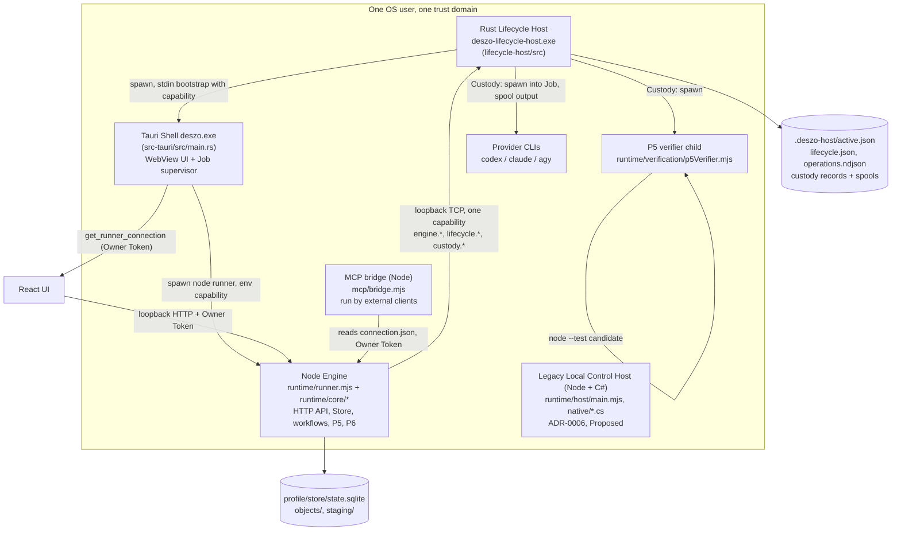

# 01. Current architecture and module inventory

- **Task:** DESZO-RUST-MIGRATION-SD
- **Date:** 2026-11-06
- **Baseline:** branch `codex/adr-0003-0005-completion`, HEAD `1f54c47`, uncommitted working tree as found (42 modified tracked paths, the P6/ADR-0010/ADR-0011 files untracked). Nothing in this document changes source.
- **Method:** call sites and dependencies were read in the source. File names alone were not used to infer responsibilities. Line references are to the working tree on 2026-11-06.

## 1. Process topology today

Facts behind the diagram:

- The Host spawns the Shell (`lifecycle-host/src/lib.rs:1526-1734`) and writes a bootstrap containing the Host capability to its stdin (`lib.rs:1690`). The Shell starts the Node runner and passes the same capability by environment (`src-tauri/src/main.rs:528`). A non-desktop bootstrap starts Node directly with the capability in the environment (`lib.rs:1628`).
- The Host listens on loopback TCP (`lib.rs:668`) and authorizes every command with one capability compared in constant time (`lib.rs:1786`). Dispatch (`lib.rs:1814-1910`) has no notion of principal.
- The Engine creates and owns the Owner Token (`runtime/runner.mjs:118-121`), serves the public HTTP API (`runner.mjs:227-452`, 103 classified routes), and writes the connection descriptor with the token into the profile (`runner.mjs:601-608`).
- The UI obtains the connection through the Tauri command `get_runner_connection` (`src-tauri/src/main.rs:434-441`, `src/transport.ts:8-14`) and calls the Engine over loopback with the Owner Token.
- External authoring clients run the Node MCP bridge, which reads the same descriptor and its token (`mcp/runtime-client.mjs:12-39`).

## 2. Subsystem inventory and Rust destination

Trust levels: **Trusted** = must not change through Self-Repair and must hold authority; **Repairable** = may change through P5/P6; **Untrusted** = candidate- or provider-controlled execution; **Retire** = not carried into the target.

| Module / subsystem | Current language and location | Responsibilities (from call sites) | Dependencies | Trust level today | Rust destination |
|---|---|---|---|---|---|
| Lifecycle Host | Rust, `lifecycle-host/src/lib.rs` (3,221 lines) | Installation lock, release verification (`verify_build` `:1297`), spawn and Job containment (`:1526`), readiness (`accept_ready` `:2172`), durable `active.json`/`lifecycle.json`, journal, legacy activation | `serde`, `sha2`, `windows-sys` | Trusted | `deszo-host` binary; kept and extended |
| Engine switch (G0) | Rust, `lifecycle-host/src/engine_switch.rs` (1,236) | `stage` (`:277`), `switch` (`:424`), fence, preflight on guarded Store copy, atomic commit (`:824`), pre-commit fallback (`:887`), restart reconciliation (`:1051`) | `store_guard.rs`, custody fence | Trusted, but reachable from Engine code (see 03) | `deszo-host::lifecycle`; triggered only by Host Admission |
| Process Custody | Rust, `lifecycle-host/src/custody.rs` (2,408) | Executable allowlist by path and digest (`:1157`), reserve/launch/stop/status/read/ack, spool capture, Job per process, native source and tool identity scans (`:174-452`), explicit handle list spawn (`:1701`, `:1770`) | Win32 Job, pipes | Trusted; epoch-only checks (`:820`) | `deszo-host::custody`; scoped by principal |
| Store guard | Rust, `lifecycle-host/src/store_guard.rs` (331) | Read-share guards over production SQLite files during switch | Win32 file API | Trusted | Kept unchanged |
| Tauri Shell | Rust, `src-tauri/src/main.rs` (915), `supervisor.rs` (476), `foreground_handoff.rs`, `bin/launch_shim.rs` (306) | Window, native dialog, bootstrap validation, Node runner spawn, Windows Job, ADR-0002 supervisor pipe and launch shim, token handed to the window | `tauri`, `windows-sys` | Trusted (not updated by P6) | Thin Shell: window and dialogs only. Engine spawn and supervisor move to the Host; launch shim retired (02 §2) |
| Frontend UI | TS/React, `src/*.tsx` (2,917 lines) | Editor, inspector, replay, supervision, autonomy views; HTTP client | React Flow, Vite | Owner surface | Unchanged JS/TS, retargeted to the Host gateway (05 §6) |
| Runner / HTTP API | JS, `runtime/runner.mjs` (676) | Loopback HTTP server, Owner Token create/rotate, caller classification (`:195-202`), route table, SSE streams, P6 builder binding (`:154-156`), test-only switch routes (`:360-375`), P6 maintenance preflight entry (`:659-667`) | Engine, bridges, lock | Repairable but holds Owner authority | Split: authentication, Owner Token and listener to `deszo-host::gateway`; route semantics to `deszo-engine::api` |
| Engine core | JS, `runtime/core/engine.mjs` (4,577) + 9 mixins installed on one class (`engine.mjs:4567-4576`) | Workflow validation, drafts and publications, run capture and pinning (`captureRun` `:2712`), scheduler (`pump` `:3009`), attempts, agent execution (`executeAgent` `:3700`), recovery (`recover` `:1490`), settings, workspaces, receipts | Store, adapters, schemas | Repairable | `deszo-engine` (scheduler, runs, API handlers) |
| Store | JS, `runtime/core/store.mjs` (342), `migrations.mjs`, `docs/storage/m1.sql`–`m22.sql` | `node:sqlite` WAL, content-addressed objects, transactional journal, migrations with backup (`store.mjs:41-71`), ref verification | `node:sqlite` | Repairable (Engine-owned) | `deszo-store` (rusqlite), same files and schema |
| Canonical JSON and schemas | JS, `canonical.mjs` (111), `schemas.mjs` (137) + 34 JSON Schemas in `docs/schemas` | Canonical bytes and hashes for every artifact; Ajv validation compiled at run time (`schemas.mjs:79-134`) | Ajv | Repairable, protected by P6 list | `deszo-protocol` (canonical JSON, protected record kinds) and `deszo-workflow` (workflow types, schema validation at boundaries) |
| Workflow model and planning | JS, `validate.mjs` (467), `planning.mjs`, `gate.mjs` (445), `map.mjs`, `mapRuntime.mjs` (1,043), `taskAssessment.mjs`, `taskRuntime.mjs` (646), `taskProcesses.mjs`, `contextPackage.mjs` (491), `branchDelivery.mjs` (671) | Structural/semantic validation, Loop/Map/Task expansion, review Gate, assessment, context packages, verified branch delivery | Store, schemas | Repairable | `deszo-workflow` |
| Provider adapters | JS, `adapters.mjs` (357), `antigravityJudgeAdapter.mjs`, `transport.mjs`, `managed-isolation.mjs` (301) | CLI discovery, account checks, invocation construction per provider, stream parsers, failure classification, managed-run bridge exclusion | Provider CLIs | Repairable | `deszo-providers` |
| Engine-side Custody client | JS, `custody.mjs` (897) | Attach epoch (`:514`), reserve/launch/settle, hold reconciler, terminal settlement | Host custody | Repairable | `deszo-engine::custody_client` (no attach) |
| Supervision, incidents, judge attention | JS, `supervision.mjs` (829), `supervisor-client.mjs`, `streams.mjs`, `judgeAttention.mjs` (302), `failureOutcomes.mjs`, `hostAutonomy.mjs` (219) | ADR-0002 controller sessions, grants, stop-and-report, incidents, audit bundles; ADR-0007 attention; typed failure outcomes | Store | Repairable | `deszo-engine::supervision`; `hostAutonomy` retires with the legacy Control Host |
| Workflow Judge | JS, `workflowJudge.mjs` (1,283) | Mandatory Judge node: attention, evidence, decision application (`:825`), questions to the Owner (`:1080`), answers (`:1121`) | Store, providers | Repairable | `deszo-engine::judge`; acceptance invocation moves to Host Admission (04 §4) |
| P2 linked Repair | JS, `linkedRepair.mjs` (1,517) | Parent/Repair links, suspension and resumption, slot reservation, P5 handoff recording (`:478-570`), legacy lifecycle requests (`:1289`) | Store, Judge | Repairable | `deszo-engine::repair`; slot claims move to Host |
| P5 enrollment and records | JS, `protectedSelfRepair.mjs` (2,753), `p5Support.mjs`, `p5Provisioning.mjs`, `workspaceIsolation.mjs`, `p5HostBoundary.mjs` | Enrollment load and Host-identity binding, candidate sealing, verification inputs, alias walk, protected path policy (`P6_PROTECTED_CONTROL_PATHS`) | Store, Host reads | Repairable process, trusted role | Root enrollment, path policy and slot pool move to Host Admission; record shapes move to `deszo-protocol` |
| P5 Gate | JS, `p5Gate.mjs` (1,571), installed as an Engine mixin (`:751`) | Gate authorization (`:754`), subject import resolver (`importSpecifiers` `:376`), verifier plan (`:1060-1096`), receipt construction in the Engine (`settle` `:1140`) | Engine state (`this.store`, `this.custodyHost`, `this.lifecycleClient`) | Repairable process, trusted role | Host Admission: plan from enrolled policy, contained verifier, result capture |
| P5 verifier | JS, `runtime/verification/p5Verifier.mjs` (591) | Trusted launcher of candidate checks with `node --test`, JUnit parsing, environment scrubbing | Node | Trusted launcher, candidate code inside | Contained verification job launched by the Host; Cargo instead of Node |
| P5 Git candidate | JS, `p5GitCandidate.mjs` (1,530) | Managed clone, commit intent, optional Owner-requested publication (the only `push`) | Git CLI | Repairable | `deszo-git` (Engine side) for repository work; identity recomputation in Host Admission |
| P6 consumer | JS, `p6Consumer.mjs` (667) | Activation entry (`executeP6Activation` `:332`), P5 eligibility from the caller's Store (`:171`), stage/switch requests | Builder, Store, bridge | Repairable process, trusted role | Host Admission; the Engine keeps no activation code |
| P6 builder | JS, `p6Builder.mjs` (617) | esbuild bundle from Store-reconstructed source, two builds, `build.json` schema 2, `P6BuildReceipt/1` | esbuild, Node | Repairable process, trusted role | Host-launched contained Cargo build; Host computes the receipt |
| P6 reconstruction, Git object source, scope, successor, continuation | JS, `p6Reconstruction.mjs`, `p6GitObjectSource.mjs`, `p6Scope.mjs`, `p6Successor.mjs`, `p6Continuation.mjs` (410) | Git object identity recomputation, allowed-path classifier, successor profile, continuation chain reader | Store | Repairable process, trusted role | Git identity and scope in Host Admission; successor and continuation become Host state (no Engine reader chain) |
| P6 switch requester, maintenance | JS, `runtime/host/p6Switch.mjs`, `p6Maintenance.mjs` | Quiescence, switch request, candidate preflight handshake | Bridge | Repairable | Quiescence stays in the Engine; requests move inside the Host; preflight handshake becomes a typed own-generation message |
| Lifecycle bridge | JS, `runtime/host/lifecycleBridge.mjs` (124) | Holds the capability in a closure; `p6Call` allowlist (`:104`), `custody(command)` pass-through (`:102`), `activateCandidate` (`:87`) | Host TCP | Repairable | Replaced by typed pipe client in `deszo-protocol` with no privileged verbs |
| Runtime lock | JS, `runtime/lock.mjs` | Exclusive SQLite lock for one Engine per root | `node:sqlite` | Repairable | Host-enforced single Engine per profile plus Engine-side lock kept (`deszo-store`) |
| Test fault policy and probes | JS, `testFaultPolicy.mjs`, `testEngineProbe.mjs` | Test-only routes and seams gated by package marker | Package files | Repairable | Rust `cfg(feature = "test-seams")` compile-time feature; release builds cannot contain them |
| MCP bridge | JS, `mcp/*.mjs` (885) | Stdio MCP tools for external authoring clients, forwarding to the API | `@modelcontextprotocol/server`, zod | Owner-run external client | `deszo-mcp` Rust binary (stdio JSON-RPC) |
| Legacy Local Control Host | JS + C#, `runtime/host/{main,authority,ipc,...}.mjs`, `runtime/host/native/*.cs`, `docs/storage/host-h1.sql`–`h5.sql` | ADR-0006 time-bounded permits, WebAuthn consent, budget ledger, service wrapper. Production assurance refuses to start while capabilities are unverified (`authority.mjs:1-11`) | `node:sqlite`, .NET | Proposed, superseded by ADR-0008 if accepted | Retire (open decision OD-5); its database is archived read-only |
| Build and packaging | JS, `scripts/bundle-runtime.mjs`, `runtime-bundle.mjs`, `desktop-release.mjs`, `tauri-build.mjs`, `build-shim.mjs` | esbuild bundle, bundled Node runtime, build manifests, desktop release | Node, esbuild, Tauri CLI | Maintainer tools | `xtask` Rust crate; Tauri CLI remains a frontend build tool |
| Tests | JS, `runtime/tests/*.test.mjs` (113 files, 783 top-level cases, 37,311 lines), `scripts/run-tests.mjs` tiers; Rust 66 `#[test]` | Unit, integration, packaged E2E (`p6-genuine-e2e`, `p6-build-e2e`, G0) | Node test runner | Maintainer | Rust unit, integration and system tests (07) |

Totals measured with `wc -l`: Engine core and P5/P6 JS 25,499 lines; JS host-side modules 4,082; runner and lock 786; MCP 885; Rust Host 7,760; Shell 1,802.

## 3. Mechanisms that exist because of Node.js

For each mechanism: (1) is the requirement still needed; (2) does Rust remove the mechanism; (3) what replaces it; (4) can it be deleted; (5) what is lost.

| Mechanism (source) | Underlying requirement | Rust effect | Replacement requirement | Delete? | Loss |
|---|---|---|---|---|---|
| ESM import-closure resolver `importSpecifiers` (`p5Gate.mjs:376`) and `PROTECTED_IMPORT_BASENAMES` | Executed code equals reviewed code; candidate cannot reach control modules | No dynamic module loading in a statically linked binary. But a candidate is arbitrary Rust and can call any OS API | OS containment of the Engine and its builds; protected paths checked on the Git tree | Yes | None, because the resolver never was a boundary (ADR-0011 §1) |
| Reflection and computed-key audit (ADR-0011 §1, 230 sites) | Same | Not applicable: Rust has no run-time reflection to a module registry | Same as above | Yes | None |
| `--disallow-code-generation-from-strings`, Ajv precompilation (ADR-0011 C1) | Same | Not applicable | Schema validation compiled into the binary (typed `serde` records; JSON Schema check at external boundaries only) | Yes | None |
| `createRequire` / `require(esm)` / `vm` restrictions (R10 report §3.3) | Same | Not applicable | None beyond containment | Yes | None |
| Entry-point builder injection `bindTrustedP6Builder` (`p6Consumer.mjs:317`, `runner.mjs:154`) | Builder authority must not be callable by repairable code | The builder is no longer in the Engine at all | Host Admission owns builds | Yes | None |
| `P6_PROTECTED_CONTROL_PATHS` list of JS files (ADR-0011 §1) | Candidate may not change trusted logic | Trusted logic leaves the Engine source tree | A shorter protected-path policy over Engine-tree paths that still matter (protocol crate, migrations, Cargo files, build scripts) — 04 §3 | Replace | None |
| Bundled Node runtime, esbuild bundle, `node_modules` closure, `.deszo-source-inventory.json` of JS files | Exact runtime dependency set | One executable plus vendored crate sources at build time | Cargo.lock + vendored sources + pinned toolchain identity in the receipt (04 §7) | Replace | None |
| Test-fault module policy (`testFaultPolicy.mjs`), `NODE_TEST_CONTEXT` check in `verify_build` (`lib.rs:1317-1325`) | Test seams must not exist in production | Cargo features are compile-time | Release builds built without the `test-seams` feature; Host refuses a manifest that declares the feature | Replace | None |
| Node-specific process bridging: Shell starts Node, stdin `contained` handshake (`runner.mjs:653-655`), `--preserve-symlinks` need under AppContainer (Decision C §5.2) | Engine is in a Job before it starts work | Host spawns the Engine directly into Job and containment | Typed bootstrap on an inherited pipe | Replace | None |
| `--p6-maintenance` env handshake (`runner.mjs:659-667`) | Candidate preflight before commit | Same requirement | Engine binary mode `--maintenance` with a typed pipe message | Replace | None |
| Store `node:sqlite` single-writer assumptions, `runner.lock` SQLite exclusive lock | One Engine per profile | Same requirement | Host refuses a second Engine; Engine keeps an exclusive file lock | Keep (port) | None |

Mechanisms that are **not** Node-specific and survive in any language: OS principal separation; loopback replacement for contained processes; Owner Token placement; acceptance evidence created by trusted code; Judge decision provenance; containment of candidate test execution; G0 switch, fence, preflight and recovery; workspace slot pool; Store compatibility.

A mechanism **added** by Rust: Cargo executes candidate code at build time (`build.rs`, procedural macros). The JS P6 builder ran esbuild, which does not execute candidate code. Rust builds therefore need the same containment as candidate tests (04 §7).

## 4. Status of the evidence carried forward

| Finding | Class | Source |
|---|---|---|
| Engine code staged and switched the real Host to an unmodified Engine B through `p6Call('engine.stage')` and `engine.switch`, with no P5 or Judge event | Experimentally demonstrated | [Decision C design §2](../../reviews/2026-11-06-p6-decision-c-design.md) step 4 |
| `custody(command)` forwards any command, so the bridge allowlist is not a boundary | Demonstrated | same, step 1b; `lifecycleBridge.mjs:102` |
| One Host capability authorizes every command family | Source-established | `lib.rs:1786`, dispatch `:1814-1910` |
| A same-user child of the Engine could open the Store for writing and read the Owner Token from the descriptor | Demonstrated | Decision C §2 step 2; `runner.mjs:601-608` |
| A same-user process could recover the Host capability and authenticate a read-only command | Demonstrated | Decision C §2 steps 3 and 5 |
| Reflection and `vm`/`require(esm)` reach protected module instances | Demonstrated (R10-2) | [R10 report §3](../../reviews/2026-11-05-p6-r10-close.md) |
| P6 consumer reads acceptance from the caller's Store; `resumed` branch skips acceptance | Source-established | `p6Consumer.mjs:171-187`, `:392-397` |
| AppContainer denies a contained child: parent process open, parent memory read, ungranted folders, loopback connect | Demonstrated on Windows 11 Home, non-admin | Decision C §5.1 |
| Node needs `--preserve-symlinks` under AppContainer; ESM not shown | Demonstrated (CommonJS only) | Decision C §5.2 |
| Explicit handle lists keep contained children to their own channel | Demonstrated, with a confounded leak result | Decision C §5.3 |
| Children of a contained process stay contained; cross-container open and handle duplication are denied | **Unresolved assumption** | Decision C §9 items 4-5 |
| Provider CLIs (codex, claude, agy) run inside an AppContainer | **Unresolved assumption, never tested** | none |
| Developer agents run with the user's full access; Developer confinement not verified | Accepted residual R3 | [P6 final security review §17](../../reviews/2026-11-04-p6-final-security-review.md) |
| Live-Store read-only preflight is unsafe; guarded disposable copy is required | Demonstrated | ADR-0010 §5, G0 feasibility evidence |
| Workspace alias walk cost and the 250,000-entry cap | Owner-accepted limitation D-2 | P6 final security review §14 |

The previous passing Node regressions (995/995 on the G0 snapshot) are evidence about the Node implementation only. They prove nothing about a future Rust implementation; they define the behavior the Rust tests must reproduce (07).
