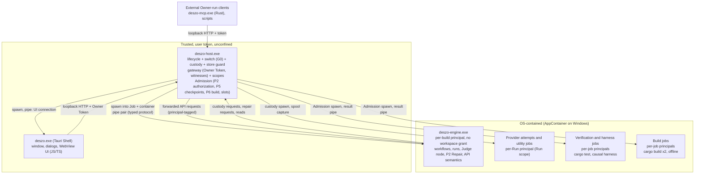
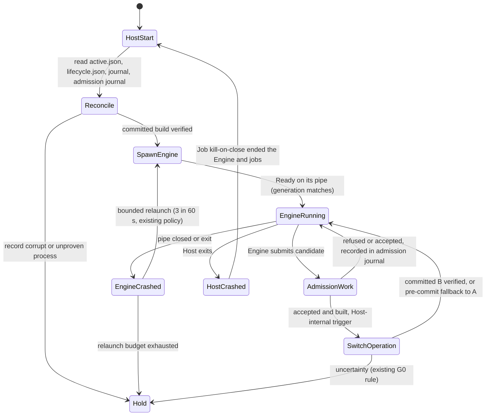

# 02. Target architecture

- **Recommendation:** Option A, two Rust backend processes: a trusted **Lifecycle Host** that contains a small **Admission** component, and a repairable **Engine** that runs inside an OS containment profile. The Tauri Shell remains the only JS/TS runtime (its WebView UI).
- **Comparison and rejected options:** [08-alternatives-and-tradeoffs.md](08-alternatives-and-tradeoffs.md).
- **Security model:** [03-trust-boundaries.md](03-trust-boundaries.md). **Self-Repair:** [04-self-repair.md](04-self-repair.md). **Store and API:** [05-store-and-api.md](05-store-and-api.md).

## 1. Design rules

1. **Authority by OS principal, not by code structure.** Every process that can execute candidate- or provider-controlled code runs in an OS containment profile that has no access to Host state, Host memory or the Owner Token. Crates, visibility and memory safety organize code; they do not separate authority (03 §1).
2. **The Engine holds no privileged verb.** Stage, switch, fence, custody attach, acceptance and build do not exist on the Engine's channel. The only route to an Engine switch is a Host-internal acceptance record that the Host created from evidence it produced or observed itself.
3. **The channel is the principal.** The Host gives each child an inherited anonymous pipe pair through an explicit handle list. The Host knows which principal is on which pipe. No bearer capability that a child could leak or a same-user process could replay authorizes anything on these channels. The public loopback API keeps its Owner Token, which only the Host and the Owner's own processes hold (05 §7).
4. **Resources come from the Owner, not from the Engine.** Every Run executes under a Host-issued scope derived from Owner-authenticated resource bindings and publication policy, in its own principal. The long-lived Engine holds no workspace grant ([13](13-workflow-resource-scopes.md)).
5. **Protected facts are witnessed, not reported.** P2 authorization, Gate, acceptance, build and switch depend only on facts the Host observed at the gateway, in custody or in its own jobs ([04](04-self-repair.md)).

## 2. Processes



| Process | Binary | Principal | Lifetime | Updated by |
|---|---|---|---|---|
| Lifecycle Host | `deszo-host.exe` | the user, unconfined | installation session | maintainer release only |
| Shell | `deszo.exe` | the user, unconfined | while the UI is open | maintainer release only |
| Engine | `deszo-engine.exe` | per-build AppContainer `DeszoEngine-<engineBuildId>`; no workspace grant; no network capability | per generation; maintenance mode before a commit | P6 (autonomous) |
| Provider attempt or utility job | allowlisted executable | per-Run AppContainer with the Run scope's capabilities ([13](13-workflow-resource-scopes.md)) | per Attempt or job | not applicable |
| Verification job | pinned `git` (snapshot export), `cargo` and test binaries | per-job AppContainer, verification policy | per Gate checkpoint | not applicable |
| Harness job | `deszo-harness.exe` (maintainer-released) and the Engine under test in separate principals | two per-job AppContainers joined by Host pipes | per causal run | not applicable |
| Build job | pinned `cargo`/`rustc` | per-job AppContainer; the two reproducibility builds never share a principal or a work root | per build | not applicable |
| MCP bridge | `deszo-mcp.exe` | the user (Owner-run external client) | per client session | maintainer release only |

Only the Host and the Engine are primary backend processes. The Shell is the frontend. Provider, verification and build jobs are short-lived executions under Host custody.

Changes to the process chain:

- The Host spawns the Engine directly. Today the Shell spawns Node (`src-tauri/src/main.rs:502-560`). The Shell's Engine supervisor, its ADR-0002 supervisor pipe and the launch shim (`src-tauri/src/bin/launch_shim.rs`) are folded into Host custody, which already spawns into a Job with an explicit handle list (`lifecycle-host/src/custody.rs:1701`, `:1770`).
- The public API listener moves from the Engine (`runtime/runner.mjs:591`) to the Host gateway, because a contained Engine cannot accept loopback connections (Decision C §5.1) and because the Owner Token must not enter the Engine.

## 3. Host responsibilities, bounded

The Host is trusted. Its responsibilities are a closed list; anything not on it belongs to the Engine.

| Host module | Responsibility | Exists today | Approximate size |
|---|---|---|---|
| `lifecycle` | Installation lock, release verification, Engine spawn into Job and containment, readiness, relaunch policy, `active.json`, journal | yes (`lib.rs`) | kept, about 3,000 lines |
| `switch` | G0 stage, fence, stop, guarded preflight, atomic commit, pre-commit fallback, recovery | yes (`engine_switch.rs`, `store_guard.rs`) | kept, trigger changed, about 1,500 lines |
| `custody` | Allowlisted provider and job launches, spool capture, stop proofs, principal scoping | yes (`custody.rs`) | kept, scoping added, about 2,600 lines |
| `sandbox` | Containment profiles (per build, per Run, per job), capability grants, explicit handle lists, Job limits, fail-closed launch | partly (handle list, Job) | new, about 1,200 lines |
| `scope` | Resource bindings, publication resource policy, Run scopes, overlap and identity checks (13) | no | new, about 900 lines |
| `gateway` | Loopback listener, Owner Token, origin and size checks, forwarding with wire parity, Host-owned routes, Parent registration, protected questions and Stop (05 §6) | no | new, about 1,500 lines |
| `admission` | Root enrollment, Parent Judge and authorization, slot claims, snapshot identity and policy, Gate and acceptance checkpoints, causal harness runs, admission journal, successor seeding, build intent and receipt, switch trigger and final eligibility (04) | no (logic exists in JS inside the Engine) | new, about 4,500 lines |

Estimated trusted Rust after migration: about 15,000-17,000 lines, against 7,760 today (01 §2), plus the maintainer-released harness. This is a sizing hypothesis to be revised after M1. It is the price of moving authority out of the repairable process; Option B would not reduce it (08 §2).

The Host does **not**: schedule workflows, interpret Runs, run the workflow Judge except the two protected invocations (the designated Parent Judge of a registered Parent and the acceptance Judge, 04 §2.3, §5.3), parse provider stream formats for ordinary Attempts, own the ordinary Store, migrate data, or implement API route semantics other than its own routes (05 §6).

Fault containment inside the Host is specified in §10; it is bounded and does not claim that a worker thread isolates every failure.

## 4. Engine responsibilities

The Engine owns the ordinary orchestration system and remains fully repairable:

- Workflow loading and validation, drafts, immutable publications and Run pinning (today `engine.mjs:2019-2157`, `captureRun` `:2712`).
- Run creation, scheduling, node execution, Loop/Map/Task expansion, review Gates, context packages, verified branch delivery.
- Developer, Watcher and Judge roles. The Judge stays a mandatory workflow node and the only role that creates Owner questions; Developer and Watcher route problems and results to the Judge (ADR-0009, preserved).
- Provider invocation construction, result parsing and failure classification; launches go through Host custody.
- Journal events, projections, SSE stream content, Stop and cancel, restart recovery, incidents, supervision, audit bundles.
- P2 Repair coordination: incident, Parent suspension, Repair Run, Developer candidate in the claimed slot, submission to Admission, Parent resumption on the Host's acceptance result.
- All ordinary API semantics, received as principal-tagged requests from the gateway.

Long execution or silence alone still never terminates a Run: the Engine keeps the progress-driven rules. The Host terminates workflow or provider work only on an explicit Stop, on a hard deadline admitted with the custody reservation, on capture failure (both existing custody behavior, `lifecycle-host/src/custody.rs:1341`, `:1395`), or after a switch fence the Engine has already settled (ADR-0010 §5, preserved).

## 5. Cargo workspace

Crates are organized by stable responsibility. A crate boundary is not a security boundary; the **protected** column says which source paths a Self-Repair candidate may not change, which the Host enforces on the candidate's Git tree (04 §3).

| Crate | Kind | Purpose | Owner process | Repairable | Protected paths | Key dependencies | Tests |
|---|---|---|---|---|---|---|---|
| `deszo-protocol` | lib | Host-Engine message types, protocol version, canonical JSON and hashing, protected record kinds (enrollment, acceptance, build receipt) | Host, Engine, MCP | no | whole crate | `serde`, `serde_json`, `sha2` | golden vectors against the JS canonicalizer; round-trip and refusal tests |
| `deszo-host` | bin + lib | Section 3 modules | Host | no | whole crate | `deszo-protocol`, `serde_json`, `sha2`, `windows-sys` (no database, 05 §3) | unit, integration with a fixture Engine, packaged G0 and Admission tests |
| `deszo-engine` | bin | Scheduler, Runs, API handlers, supervision, Judge node, Repair client, custody client, recovery | Engine | yes | none beyond policy (04 §3) | all repairable crates, `deszo-protocol` | unit, Engine-against-fake-Host integration, differential |
| `deszo-workflow` | lib | Workflow model, structural and semantic validation, planning, Loop/Map/Task, review Gate, context packages | Engine | yes | none | `deszo-protocol` (canonical), `jsonschema` | unit, fixture-based contract tests from `docs/fixtures` |
| `deszo-store` | lib | SQLite access, objects, journal, receipts, migrations runner | Engine | yes, code only | `migrations/`, the migration runner and catalog modules (04 §3.2) | `rusqlite` (bundled SQLite) | schema compatibility on real profile copies |
| `deszo-providers` | lib | Discovery, invocation construction, stream parsers, failure classification | Engine | yes | none | none heavy | recorded-stream parser tests |
| `deszo-git` | lib | Engine-side repository work: managed clone, commit, branch delivery | Engine | yes | none | pinned `git` executable via custody | fixture repositories |
| `deszo-mcp` | bin | Stdio MCP server for Owner-run external clients | external client | no (maintainer) | whole crate | `deszo-protocol` | MCP contract tests |
| `src-tauri` (`deszo`) | bin | Shell window, dialogs | Shell | no | whole crate and `src/` UI | `tauri` | existing Shell tests |
| `deszo-harness` | bin | Enrolled causal harness: drives an Engine binary over the protocol with fixture providers and evaluates named assertions (04 §6) | harness job | no (maintainer) | whole crate | `deszo-protocol` | scenario tests against the baseline Engine |
| `deszo-testkit` | lib (dev) | Fixture providers, fake Host, test harness utilities | tests | no | whole crate | | |
| `xtask` | bin (dev) | Release packaging, manifests | maintainer | no | whole crate | | |

`deszo-providers` and `deszo-git` may start as modules of `deszo-engine`; they become crates only if a second consumer or a dependency boundary appears. The Host's Git identity code is written in `deszo-host::admission` and is not shared with `deszo-git`. A candidate can change `deszo-git` freely, and a shared crate would make the Host's identity computation look repairable even though the Host binary is never rebuilt by P6. Two independent implementations also give a differential check in tests.

## 6. Engine artifact and package

```text
<installation>/versions/<engineBuildId>/
  deszo-engine.exe
  build.json            schema 3 (supersedes the schema 2 used by Node packages)
```

`build.json` (schema 3) records: `engineBuildId`, `protocolVersion`, `shellBuildId` binding, `storeSchemaVersion` and migration catalog digest, source commit, tree and object format, toolchain identity (`rustc -vV` digest, Cargo version, target triple, toolchain directory digest), Cargo.lock digest, vendored dependency set digest, build profile and flags, the file inventory with digests, and `features` (must not contain `test-seams` in a release). The Host computes the whole-package digest separately, as ADR-0010 §7 already requires.

`engineBuildId` is derived from the Host's `BuildIntent/1` before compilation (04 §7.2), so the identity embedded in the binary never depends on the binary.

The Host refuses a package when the protocol version is unsupported, the Shell binding differs, the Store schema or migration catalog digest differs from the active build's, a declared feature is not allowed, any file digest differs, or the package is neither the `BaselineInstallation/1` package written by the maintainer installer nor covered by a Host-written `BuildReceipt/2` for that exact digest (04 §7.3). The Host binary and Shell are never part of an Engine package.

## 7. Platform layout

```text
<installation>/                       Host-owned, user-only ACL; nothing granted to containers except read on versions/<active>/
  deszo-host.exe, shell/deszo.exe
  versions/<engineBuildId>/           read grant to that build's Engine principal
  toolchain/<id>/, vendor/<lock>/     read grant to build and verification job principals
  harness/                            deszo-harness, read grant to harness job principals
  .deszo-host/active.json, operations.ndjson
  .deszo-host/profiles/<profile>/     lifecycle.json, enrollment/, admission/, scopes/, projections/, custody/, gateway/
<profile>/
  store/state.sqlite, objects/, staging/, runtime/runner.lock.db
                                           read-write grant to the selected build's Engine principal only (existing paths kept)
  workdirs/engine/                         Engine scratch, Engine principal
  workdirs/runs/<scopeId>/                 per-Run scratch and caches, that Run's principal
Owner workspaces and repositories          one-time capability entries per binding (13 §2); never granted to the Engine
```

The existing Store path stays where it is, so history needs no copy (05 §2). What moves is everything that carries authority: the Owner Token and descriptor (today `profile/runtime/owner-token`, `connection.json`), the P5 enrollment (today `profile/p5/enrollment.json`), and slot claims.

## 8. Crash and recovery



Rules:

- **Host crash.** The Host holds the Engine's Job with kill-on-close, so the Engine and every contained job end with it. This is the current custody behavior: on Host restart a running custody record becomes `host_lost` and is never relaunched (`lifecycle-host/src/custody.rs:1192-1204`). On restart the existing G0 reconciliation applies (`engine_switch.rs:1051`); `active.json` stays the only commit authority (ADR-0010 §7). An in-flight verification or build job is recorded as `abandoned` in the admission journal and is never resumed from partial output; the Engine may submit the candidate again.
- **Engine crash.** It holds no authority. The Host relaunches under the existing bounded policy (`lib.rs:48`). Provider processes under custody survive an Engine crash (only a Host crash ends them); the new Engine generation lists its lineage's outstanding custody records and settles them without redispatch (04 §9); the Engine's existing recovery rules decide Run state.
- **Pipe break.** A broken pipe is a refusal, never a retry with a different principal. The Engine exits when its Host pipe closes.
- **No post-commit rollback.** Unchanged from ADR-0010 §8. An Owner-initiated selection of an earlier committed build is open decision OD-4.

## 9. What stays exactly as it is

Published versions immutable; Runs pinned to them; drafts separate from publications; Judge mandatory and sole external-input role; supported CLI invocations for providers; progress-driven execution; Host custody authority; UI and API as entry points; one atomic `active.json` commit; durable switch journal; custody fence; pre-commit fallback; no automatic post-commit rollback; Host and Shell immutability; no per-update Owner approval; no Git push required for Self-Repair.

## 10. Host reliability and fault limits

Admission parses candidate-controlled bytes and runs long jobs inside the trusted process. The design bounds that work instead of claiming a thread isolates it:

- **Bounded parsing.** Git object streams, job reports, provider captures and protocol frames have byte, count and depth limits checked before allocation; a limit hit refuses the work item.
- **Quotas.** One nonterminal admission per installation; per-job time, memory and process limits through Job objects; spool and object-store quotas per admission.
- **Concurrency.** Admission runs on a bounded worker pool. Lifecycle, switch, custody control and gateway authentication have their own threads and never wait on an Admission worker.
- **Critical sections.** Protected state changes happen under one short admission lock that covers a journal append and in-memory projection update only; no I/O on candidate data and no job wait happens while it is held.
- **Stop responsiveness.** Stop, custody stop and drain use the control lane of the Engine protocol (05 §5) and the Host's control threads; a stalled job reader or a saturated bulk lane cannot delay them.
- **Panics.** Admission code runs with unwinding enabled; a panic in a worker refuses the admission and is journaled. The Host binary is not built with `panic = "abort"`.
- **What this does not cover:** process-wide memory exhaustion, an abort in native code, a deadlock in shared state, or corrupted shared memory. These end or hang the Host as a whole; recovery is the existing restart reconciliation. If tests (07 §5) show such a failure caused by untrusted input, a separately constrained Admission process becomes the response (08 §2).
