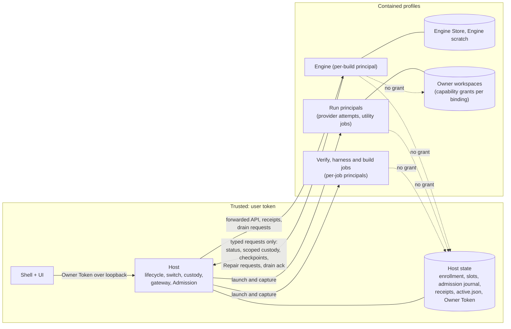

# 03. Trust boundaries, principals and enforcement

## 1. What enforces the boundary

Rust is not a sandbox. A repairable Rust executable can perform any filesystem, network and process operation its OS token allows. The following are **not** enforcement mechanisms in this design and are used only for code organization: private modules, `pub(crate)`, crate boundaries, ownership and borrowing, memory safety, static linking, obfuscated identifiers.

The enforcement mechanisms are:

| Mechanism | What it enforces | Platform status |
|---|---|---|
| **OS containment profile** for every process that can run candidate- or provider-controlled code (AppContainer on Windows) | No access to Host files, Host memory, the Owner Token, ungranted folders or loopback listeners | Windows: demonstrated for a contained child against an uncontained parent (Decision C §5.1); prerequisites PR-1, PR-2 cover the rest. Linux and macOS: design only (§6) |
| **Filesystem ACLs** on Host state | Integrity and confidentiality of enrollment, admission journal, receipts, Owner Token | Windows: per-SID grants; ungranted access denied by AppContainer (demonstrated) |
| **Inherited anonymous pipes with explicit handle lists** | Channel identity equals principal identity; no capability secret | Windows: shown for contained children (Decision C §5.3); clean rerun is PR-5 |
| **Job objects with kill-on-close** | Process-tree lifetime and termination proof | Windows: exists in Host and custody |
| **Host-side computation of every admission fact** | Acceptance cannot be asserted by the Engine | Design (04) |

The previous architecture's failure was that all of these were absent between the Engine and the Host: one OS user, one loopback capability, and acceptance evidence in a Store the Engine writes (01 §4).

## 2. Principals

| ID | Principal | Process and token | Trust |
|---|---|---|---|
| O | Owner and trusted UI | Owner's own processes, Shell WebView | Root of authority |
| H | Lifecycle Host with Admission | `deszo-host.exe`, user token | Trusted |
| E | Repairable Engine | `deszo-engine.exe`, per-build AppContainer, no workspace grant | Repairable, untrusted for authority |
| R | Run execution: provider attempts and utility jobs of one Run | per-Run AppContainer with the Run scope's capabilities ([13](13-workflow-resource-scopes.md)) | Untrusted; bounded by the Owner-authorized scope |
| D | Developer-controlled candidate | candidate source; its code runs in V and B jobs, under the harness as the Engine under test, and later as E | Untrusted |
| V | Gate verification execution | per-job AppContainer | Untrusted (runs candidate tests) |
| K | Causal harness | `deszo-harness`, per-job AppContainer, separate from the Engine under test | Trusted code, contained; its report is the causal observation (04 §6) |
| B | Build execution | per-job AppContainer | Untrusted (runs vendored build scripts and procedural macros, compiles candidate code) |
| J | Designated Parent and acceptance Judges | pinned provider CLI in a per-invocation AppContainer with its own configuration copy | Output trusted only as the enrolled Judge's decision, under OD-10 |
| X | External CLI processes run by the Owner (MCP bridge, scripts) | user token | Owner's own processes (A4 below) |

## 3. Capability matrix

Solid lines are the only channels. Dotted lines are denied by the containment profile. Authority to accept, build and switch exists only inside the trusted box.

| Principal | Owned data | Reads | Writes | Credentials | IPC operations | Filesystem | Launch | P5 acceptance | P6 build | G0 switch |
|---|---|---|---|---|---|---|---|---|---|---|
| O / Shell | UI state | API via gateway | API via gateway | Owner Token (from Host pipe) | gateway HTTP | user | none from Deszo | none (one-time enrollment install only) | none | none (OD-4 manual selection only) |
| H | installation, `active.json`, journals, enrollment, slot registry, admission journal, receipts, Owner Token | everything it needs | its own state; grants | Owner Token, per-run Judge and controller credentials it issues | all channels | user | everything, into containment | **decides** | **runs and records** | **decides and executes** |
| E | ordinary Store, Engine scratch | own Store, its build's release files, data returned by Run jobs | own Store, Engine scratch | none with Host authority; Engine-domain controller and Judge tokens | E channel: §4 | `store/`, `workdirs/engine/`; **no workspace** | none outside its container; all Run work through custody under a Host-issued scope | checkpoint requests only | none | none (drain acknowledgement only) |
| R | its Run's scratch | the Run scope's roots and tools | the Run scope's writable roots | the provider's own configuration as scoped in 13 §3 | none; output spooled by H | Run scope only | children inherit the Run token | none | none | none |
| D (as source) | none | none | none | none | none | none | none | none | none | none |
| V | its scratch | sealed snapshot copy, toolchain, vendor | scratch | none | result pipe to H | granted job directories only | children inherit containment | none (observations only) | none | none |
| K | its scratch | scenario inputs from H, Store copy of the Engine under test | its report | none | pipes to the Engine under test and to H | granted job directories only | none | none (its report is an observation H records) | none | none |
| B | its scratch | sealed snapshot copy, toolchain, vendor | output dir | none | result pipe to H | granted job directories only | children inherit containment | none | output bytes only | none |
| J | none | its dossier (stdin), its configuration copy | its configuration copy | provider account session in its copy | none; stdout and stderr spooled by H | per invocation | children inherit containment | output captured by H | none | none |
| X | none | API | API | token from Host descriptor (05 §7) | gateway HTTP | user | user | none beyond API | none | none |

The key rows: **E has no column with authority**, and the three right-hand columns are owned by H alone.

## 4. The Engine channel

The complete catalog is in [05 §5](05-store-and-api.md#5-host-engine-protocol). Its properties:

- Custody requests reference a Host-issued Run scope and are limited to the Engine's lineage; `Attach` does not exist; Host-owned jobs (verification, harness, build, protected Judges, seed and export) are not reachable.
- Protected requests are checkpoint delegations and reports (04 §4). None of them advances a protected stage without the Host's own observation; `ReportInvalidation` and the absence of `ReportRepairCompleted` can only stop one.
- Possession of the Engine's endpoint is Engine-domain authority. Anything the Engine relays on behalf of another process carries no more than that.
- A maintenance-mode Engine may send only maintenance messages; a normal Engine may not send them.

Not on E's channel, by construction (no message type exists): stage, switch, fence, attach, legacy activation, acceptance writes, build, enrollment or policy change, resource binding, Owner Token rotation, custody of Host-owned jobs. Every other child-reachable entry point is removed or re-authorized in M4, including the standalone `custody-serve` mode (`lifecycle-host/src/main.rs:37`) and the loopback listener (`lifecycle-host/src/lib.rs:668`).

## 5. Threat model

Adversaries:

- **A1** repairable code in E (an accepted but faulty or malicious candidate, or a compromised dependency).
- **A2** candidate code in V and B (tests, build scripts, procedural macros).
- **A3** any process started by E, R, V, K, B or J.
- **A4** an unconfined process of the Owner's own user (the Owner's own trust domain).
- **A5** a provider CLI or model output steered by untrusted content (prompt injection), including the Judge.

| Adversary | Goal | Control | Residual |
|---|---|---|---|
| A1 | Stage or switch without acceptance | No such message on E's channel; the switch trigger is Host-internal (04 §7) | none known |
| A1 | Start an unauthorized protected Repair | Slot claims require a Host-issued `RepairAuthorization` from a Host-launched Parent Judge on a gateway-registered Parent (04 §2) | Incident classification is an Engine label; causal reproduction from Host-held inputs is the trusted observation (04 §2.2) |
| A1 | Run Gate or acceptance early | Checkpoints accepted only at the enrolled nodes and new Attempts (04 §5.1) | none known |
| A1, R | Reach another Run's resources, or obtain a scope for a Run the Owner did not start | Engine holds no workspace grant; scopes are issued only for gateway-witnessed Run starts or Host-recorded derivations, never on the Engine's request alone (13 §1.1); Run principals carry only their scope's capabilities | PR-8 |
| A1 | Override a recorded rejection or failed Gate | Terminal outcomes are journaled and refuse later checkpoints (04 §5.1) | none known |
| J | Emit a false decision from a compromised enrolled Judge executable | Pinned executable, isolated configuration, sealed capture, nonce and dossier binding (04 §5.3) | Trust in the pinned executable is an Owner decision (OD-10), not an accepted gap |
| A1 | Mislabel a protected question to the Owner | Host-rendered protected questions and subject-digest-bound answers (05 §6.3) | none known |
| A1 | Forge acceptance evidence | Evidence is created by H from H-produced or H-observed data and stored in H-only files (05 §3) | Engine-supplied incident narrative is data for the Judge, not evidence (§7) |
| A1 | Read the Owner Token or Host memory | E is contained; the token lives in H and the Shell; the descriptor is in an H-only directory | PR-1 must show the denials for these exact paths and processes |
| A1, A3 | Reach Host state through a child | Children inherit the container token | PR-1 must show it; Decision C left it unshown |
| A1 | Widen enrollment, scope, budgets or slots | Root enrollment and slot registry are H state; successor enrollment is derived by H (04 §8) | none known |
| A2 | Escape the build or test job | V and B are contained, offline, time and memory bounded | PR-3 |
| A2 | Fake test results | Regression checks are candidate-linked signals only; the causal observation comes from the out-of-process harness in a separate principal (04 §6) | Semantic limit beyond the enrolled assertions (§7) |
| A3 | Inherit privileged handles | Explicit handle list for every Host spawn; server ends non-inheritable | PR-5 |
| A5 | Approve a bad candidate through the Judge | Host builds the dossier from verified evidence and enforces the enrolled Judge profile; containment bounds the damage of a wrong approval (§7) | Semantic limit, accepted as today (P6 final security review S5-7) |
| A4 | Anything the user can do | Out of scope: the Owner's own processes are the trust domain | Recorded. The Owner's own external clients may hold the Owner Token (05 §7) |

## 6. Cross-platform isolation

| Platform | Mechanism for E, V, B, J | Supported | Implemented | Demonstrated | Remaining work |
|---|---|---|---|---|---|
| Windows 11 (each supported release proven separately; Windows 10 only after its own run) | AppContainer (or LPAC) profiles, custom capability grants, Job objects with no breakaway, explicit handle lists, no loopback for contained processes | target | no | partial (Decision C §5) | PR-1, PR-2, PR-3, PR-5, PR-8, PR-9 |
| Linux | Unprivileged user and mount namespaces (bind-mount only granted paths), Landlock for filesystem rules, seccomp for `ptrace`/`process_vm_readv`, `PR_SET_NO_NEW_PRIVS`, cgroup or process-group supervision | design | no | no | Separate spike; Landlock availability depends on the kernel version; `ptrace` scope must deny the Host |
| macOS | Seatbelt profiles (`sandbox_init` or `sandbox-exec`, deprecated but functional) for path rules; App Sandbox entitlements apply to the signed app, not to arbitrary child processes | design | no | no | Highest uncertainty; provider CLIs may not run under a restrictive profile |

The platform adapter is one `sandbox` module in the Host with one function per platform that turns a profile description (granted paths with modes, network yes or no, limits) into a launch. No generic policy engine is built. Linux and macOS are **supported design, not implemented and not demonstrated**; release on them requires their own prerequisite runs.

**Fail closed.** Every launch sets the token, capabilities, network restriction, handle list and Job before the process runs untrusted instructions (created suspended, resumed only after every setup call succeeded). Any failed setup call terminates the process and refuses the work. Protected admission stays closed on every operating system and version without passing evidence, and whenever a launch policy cannot be applied.

## 7. Limits that no mechanism removes

- **Semantic verification.** Candidate code is part of every test binary that links it, so regression checks are signals, not proof. The causal observation comes from the enrolled harness outside the candidate's process (04 §6): it establishes that the enrolled assertions failed on the baseline and passed on the candidate; it cannot establish correctness beyond them. The Judge reads a Host-built dossier; a model can be wrong or steered (A5).
- **What bounds the damage.** An accepted wrong candidate becomes an Engine with exactly the Engine's contained authority. It cannot change the Host, the Shell, the enrollment, the policy, the slot pool or the Owner Token, and it cannot activate its successor without passing the same Host-run Admission. That is the property the previous architecture lacked: there, an accepted Engine held the switch.
- **Same-user unconfined processes (A4)** can read and write anything the user can. This includes the Host's memory. The design protects against candidate-controlled and provider-controlled processes, not against the Owner's own software.
- **No unconfined managed runs.** Under the Owner's definition of Full Access (13), every managed provider run is contained. An unconfined managed run would hold A4 authority over Host state, so it is not offered as a mode, and a window of unconfined runs cannot be followed by protected admission on the same installation without the cutover trust steps of OD-11 (re-pinned provider and Judge installations, freshly seeded slots, or a fresh profile).
- **Engine-domain damage.** A hostile Engine can schedule badly, misreport ordinary history and damage its own Store; containment does not make ordinary behavior honest. It bounds the Engine's effect on protected state to what the Host witnesses (04 §11).
