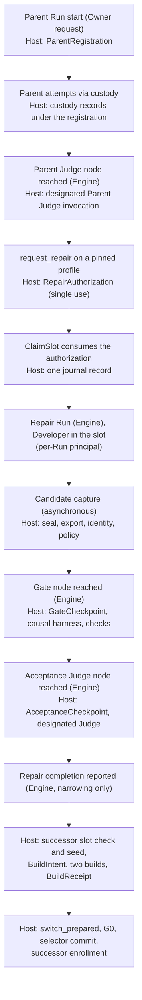
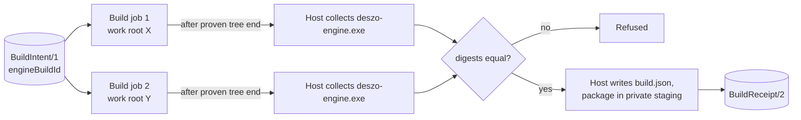
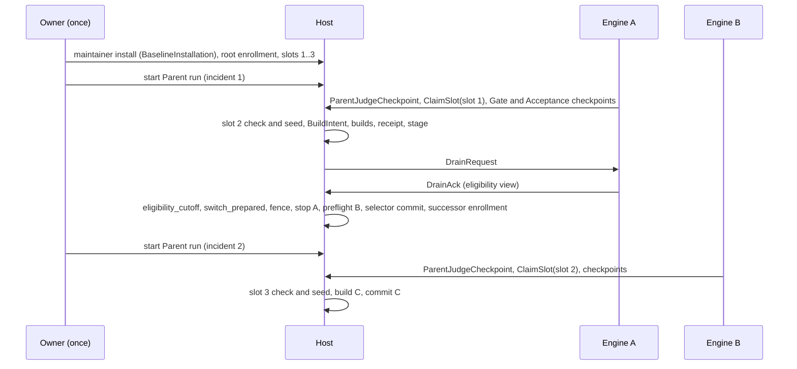

# 04. Rust Self-Repair: protected authorization, acceptance, build and activation

Revised 2026-11-06 after the independent reviews ([finding register](12-finding-register.md)).

> **Pending revision.** [14](14-self-repair-scope-reconsideration.md) proposes, under Variant 3, returning P2, the Gate classification and acceptance (§2, §4-6) to a protected Engine Core with repairable code in a contained worker, replacing the policy of §3.2, writing the `BuildIntent` at seal time (§7.2) and changing the journal records (§9). This document stays the design of record until the Owner decides OD-12. P2 authorization and P5 acceptance are two separate mandatory stages. The Engine schedules every workflow node as today; the Host witnesses the few facts that decide an installation and refuses everything it did not witness.

## 1. Pipeline and placement

| Step | Engine does | Host does | Authority record |
|---|---|---|---|
| Parent start | Creates the Run | Witnesses the Owner request and the returned publication digest | `ParentRegistration/1` |
| Parent attempts | Schedules and builds invocations | Launches through custody, records each attempt under the registration | custody records |
| Parent Judge | Reaches the node, requests delegation | Launches the designated Parent Judge, captures and parses its decision | `ParentJudgement/1` |
| Authorization | Applies the decision to its workflow | Issues the single-use authorization for `request_repair` | `RepairAuthorization/1` |
| Incident reproduction | nothing | Runs the enrolled harness scenario on the baseline before authorizing | baseline report in `RepairAuthorization/1` |
| Slot claim | Requests the claim | Consumes the authorization and claims the generation's slot in one record | `SlotClaim/1` |
| Developer | Schedules attempts | Launches them in the Repair's per-Run principal | custody records |
| Capture | Requests capture after Developer success | Quiesces the slot, exports, recomputes identity, applies policy | `CandidateSnapshot/1` |
| Gate | Reaches the enrolled Gate node | Runs the enrolled verification plan | `VerificationRecord/1` |
| Acceptance | Reaches the enrolled Judge node | Launches the designated acceptance Judge | `AcceptanceRecord/1` |
| Build and switch | Drains when asked | Builds, stages, switches, commits, derives the successor | `BuildIntent/1`, `BuildReceipt/2`, selector |

## 2. Protected Repair authorization (P2)

### 2.1 What today's contract requires

`startWorkflowJudgeRepairInTransaction` (`runtime/core/linkedRepair.mjs:968-1023`) accepts a protected Repair only when: the Judge context is a Parent failure; the Parent's Judge policy is `workflow-judge/1` with the captured digest; the Parent still matches its publication; no nested Repair or supervision grant; the profile is pinned in the captured Parent policy; the incident and the exact failed node match the Judge attention; the target attempt is a settled, P3-verified failure; the P5 admission names the same outcome id and revision; the enrolled slot is not claimed. The protected Gate then binds the exact authorization (`runtime/core/p5Gate.mjs:754-790`). Each check keeps its effect; what changes is who establishes it. The supervision-grant, nested-Repair and execution-class checks remain Engine checks of the Parent's own state: they only refuse, so an Engine that skips them gains nothing it could not get by never asking. The checks that grant something are witnessed by the Host (§2.2-2.4).

### 2.2 Witnessed facts

| Fact | Trusted observation | How |
|---|---|---|
| Installation, profile, root enrollment | Host state | Root enrollment installed by the Owner (05 §3) |
| Active Engine generation and source | Host state | Selector and the running build's receipt or baseline record |
| Parent Run and publication | Gateway | The Owner-authenticated `POST /api/v2/runs` for the enrolled Parent workflow and version. The gateway records the request and the Engine's response (Run id, publication snapshot digest) and checks the digest against the root enrollment's pinned Parent publication. One registration per request id; a Run not created this way is not a protected Parent |
| Failed attempt | Host custody | Every attempt of a registered Parent is launched under the registration; the Host holds its launch identity, exit status and spool digests |
| Captured failure outcome | **Not independently witnessable as a P3 classification** | The P3 category and revision are computed by the Engine; the Host records them as an unverified label. The trusted observation that stands in for a settled, P3-verified failure is a **baseline reproduction before authorization**: after the Parent Judge returns `request_repair`, the Host runs the enrolled harness scenario (§6) on the active baseline with Host-held inputs (the failed attempt's custody spool and the pinned publication) and issues the authorization only if the result is `reproduced`. No slot is consumed for an incident the Host has not seen reproduce. The Gate later repeats the baseline run beside the candidate run |
| Designated Parent Judge invocation and decision | Host custody | §2.3 |
| Authorized Repair publication and scope | Host state | The profile pinned in the enrolled Parent publication's Judge policy names the Repair publication, version and digest; the Host holds the publication bytes from the enrollment |
| Single use and consumption | Host journal | §2.4 |
| Invalidation and Stop | Gateway and Host journal | 05 §6; any Owner Stop of the Parent or Repair Run, and any Engine `ReportInvalidation` |

### 2.3 Parent Judge delegation

When the Engine's scheduler reaches the Judge node of a registered Parent with a failure context, it sends `Protected::ParentJudgeCheckpoint { registrationId, nodeId, attemptId, failedCustodyId, incidentId, profileId, outcomeLabel, attentionContext }`. The Host checks, before launching anything:

1. the registration is open and not stopped, and has no live or consumed authorization (one per registration, mirroring "one active linked Repair per Parent" and `repair_incident_already_used`, `runtime/core/linkedRepair.mjs:996-1006`);
2. `nodeId` is the Parent publication's Judge node and `attemptId` is new for this registration;
3. `failedCustodyId` is a terminal custody record of a **node attempt** of this registration (custody records carry the node and role labels the Engine gave at reservation, recorded before the failure), and its node label equals the `failedNodeInstanceId` of the pinned profile named by `profileId` (mirroring `repair_incident_mismatch`); utility jobs and Judge invocations never qualify;
4. the enrolled Parent Judge budget is not exhausted; every checkpoint is charged to it.

The Host then builds the invocation from the enrolled Parent Judge profile and a dossier made from Host-held bytes (pinned publication, the failed attempt's spool) plus the Engine's context, labeled unverified, launches it in an isolated Judge principal (§5.3), captures and parses the decision, and returns it through `Protected::CheckpointResult` (05 §5).

`wait` and `request_evidence` return to the Engine, which schedules a later Judge Attempt as today. `request_human_input` creates a **Host protected question** (05 §6.3), so the question behind a decision that can authorize a Repair is rendered by the Host. `request_repair` proceeds to §2.4.

### 2.4 RepairAuthorization

`request_repair` naming a profile pinned in the enrolled Parent policy, followed by a `reproduced` baseline run (§2.2), produces `RepairAuthorization/1`: installation, profile, root enrollment digest, active generation and build, registration, Parent publication, failed custody record and its node, the Engine's outcome label, the `ParentJudgement` record, the baseline reproduction report, profile id, Repair publication and digest, Repair scope, a Host nonce, state `issued`. A baseline run that does not reproduce refuses with `p5_incident_not_reproduced`; the Engine's Parent then follows its captured rules, as for any refused Repair request today.

- `Repair::ClaimSlot { authorizationId, repairRunId }` consumes it and claims **the slot assigned to the current generation** (the root's first slot, or the slot the Host seeded for this build, §8), not any free slot. Consumption, the slot claim and the budget charge are one journal record (§9). A second claim, or a claim for another slot, is refused (`p5_workspace_claimed`, `p5_authorization_consumed`).
- The Repair Run's scope is derived from the authorization (13 §1.1). The Repair registers itself with `Protected::RegisterRepairRun { authorizationId, runId, publicationDigest }`, accepted once, digest equal to the authorized Repair publication.
- An authorization is invalidated by a run-level Owner Stop of the Parent or Repair Run, by the Owner's Stop of the admission in the Host's protected view (05 §6.4), by the Engine's `ReportInvalidation`, by a generation change before consumption, or by budget exhaustion. Invalidation is journaled and checked at every later checkpoint and at the eligibility cutoff (§9).
- **Engine reporting duties.** The Engine must send `ReportInvalidation`, in the same step that commits the state, whenever the conditions of today's `p5Eligibility` (`runtime/core/p6Consumer.mjs:171-189`) stop holding: the Parent is failed, canceled, stopping or stopped; the link decision is not accepted; the Parent suspension is stopped; the candidate or retention is invalidated. These reports can only narrow; a parity test compares them with the current function's results.
- The Engine still suspends the Parent, records its own link and resumes the Parent after the Repair. Those records are history; the Host never reads them.

## 3. Candidate source identity and protected paths

### 3.1 Slot preparation and sealing

1. At claim, the Host records the slot's repository identity (physical root identity, `.git` location, object format) and its **seed**: the accepted commit of the active build, which the Host materialized into the slot (§8). A slot whose recorded seed differs from the active build's accepted commit is refused.
2. `Protected::SealCandidate { authorizationId, commit }` after the Developer node succeeds. The Host requires zero active custody jobs in the Repair principal (the slot has no writer), then starts a contained export job that reads the slot repository and emits the raw objects reachable from `commit`.
3. The Host recomputes every object id in the recorded object format and requires: the commit's parent is exactly the seed commit (the managed Git ancestry rule, `runtime/core/p5GitCandidate.mjs:1290-1304`); the tree is complete; no replacement objects, grafts or alternates are honored (the export job runs Git with replacement refs disabled and no alternates; the Host checks only object bytes).
4. The Host stores the snapshot as content-addressed objects and computes a canonical snapshot digest over the sorted path, mode and blob-id list. Every later job receives a read-only materialization of these bytes, never the slot.

### 3.2 Protected-path and scope policy

The Host diffs the candidate tree against the seed tree. The policy file is part of the root enrollment.

| Rule | Paths | Reason |
|---|---|---|
| Allowed | sources and tests of `crates/deszo-engine`, `deszo-workflow`, `deszo-providers`, `deszo-git`, and `crates/deszo-store/src/` except the paths below | Repairable crates |
| Refused: trusted | `crates/deszo-protocol/**`, `crates/deszo-host/**`, `crates/deszo-mcp/**`, `crates/deszo-harness/**`, `src-tauri/**`, `src/**`, `crates/deszo-testkit/**`, `xtask/**` | Maintainer releases |
| Refused: data format | `crates/deszo-store/migrations/**` and the migration runner and catalog modules (`crates/deszo-store/src/migrate.rs`, `catalog.rs`), mirroring the current refusal of `runtime/core/migrations.mjs` (`runtime/core/p6Scope.mjs:168`) | No migration in P6 v1 |
| Refused: build inputs | every `Cargo.toml`, `Cargo.lock`, `vendor/**`, `rust-toolchain*`, `.cargo/**`, any `build.rs` and any file a manifest names as a build script, `deny.toml` | No dependency, feature, profile, toolchain or build-script change |
| Refused: enrolled checks | the causal harness scenarios and the required test files named by the enrolled policy | A candidate cannot weaken the checks that judge it |
| Refused: tree shape | symbolic links, submodules, modes other than regular, executable and directory; non-UTF-8 names; case-insensitive collisions; Windows reserved names; trailing dots or spaces; length and size bounds | Unambiguous path identity |
| New test targets | Allowed under `tests/` of an allowed crate; Cargo auto-discovers them, so the metadata check of §5.2 compares workspace members, dependencies, features and build-script targets, not the list of test targets | Fixes the contradiction noted in AR-05 |

## 4. Engine requests on the protected path

All on the Engine's pipe (05 §5). Each carries a durable `requestId`; an exact repeat returns the recorded answer, a different payload under the same id is a conflict. No request advances a protected stage without the Host's own observation; `ReportInvalidation` and the absence of `ReportRepairCompleted` can only stop one.

| Request | Precondition checked by the Host | Effect |
|---|---|---|
| `Repair::EnrollmentStatus` | none | Enrollment summary, admission open or refusal reasons, slot projection |
| `Protected::ParentJudgeCheckpoint` | §2.3 | Parent Judge decision; `RepairAuthorization` on `request_repair` |
| `Repair::ClaimSlot` | issued authorization, admission open (§4.1) | Slot claim, Repair principal |
| `Protected::RegisterRepairRun` | consumed authorization | Repair registration |
| `Protected::SealCandidate` | registered Repair, no active slot job | Snapshot, identity, policy |
| `Protected::GateCheckpoint` | §5.1 | Verification record |
| `Protected::AcceptanceCheckpoint` | §5.1 and a passed verification record | Acceptance Judge decision |
| `Repair::ReportRepairCompleted` | acceptance recorded | Allows the P6 operation to start |
| `Repair::ReportInvalidation` | none | Invalidates the chain |
| `Repair::AdmissionStatus` | none | Phase and refusal codes, for the Engine's history and UI |

Checkpoint requests are asynchronous: the Host answers with a checkpoint id at once and delivers the outcome later in `Protected::CheckpointResult`. Their duration is bounded by the enrolled budgets, not by the protocol's request timeouts.

### 4.1 Admission open

The Host opens protected admission only when: a valid root enrollment exists; the selected build is the `BaselineInstallation/1` package or has a `BuildReceipt/2`; managed provider runs are contained (13); the enrolled policy has a causal harness scenario; the toolchain, vendor and lockfile digests of the build match the installed ones; the platform passed its prerequisites (03 §6); no nonterminal admission or switch exists.

## 5. Gate and acceptance Judge checkpoints

### 5.1 Sequencing contract

- Capture (§3.1) may happen as soon as the Developer node succeeds. It produces no verification or acceptance.
- `GateCheckpoint { authorizationId, repairRunId, publicationDigest, nodeId, attemptId, snapshotDigest, generation }` is accepted only when `nodeId` is the enrolled verification node of the authorized Repair publication (the enrollment profile names it, as `profile.verificationNodeId` does today), the attempt id is new, the snapshot is the sealed one, and the generation is current. The Host runs §6 and records the result against this attempt.
- `AcceptanceCheckpoint` with the same fields for the enrolled Judge node is accepted only after a passed verification record for the same snapshot and authorization. The Engine cannot obtain an acceptance by submitting a candidate: without the two checkpoints at the bound nodes, nothing is recorded.
- The Engine reports each checkpoint's outcome to its workflow as the node's result, so the graph, journal and UI behave as today.
- **Terminal outcomes.** A failed Gate for a snapshot and a `reject_repair` decision are journaled as terminal for that authorization: every later Gate or acceptance checkpoint under it is refused, and the eligibility cutoff requires their absence. Today a `reject_repair` fails the Repair Run (`runtime/core/workflowJudge.mjs:906-908`) and a Repair has exactly one captured candidate (`runtime/core/p5Gate.mjs:782-784`); both stay true.

### 5.2 Gate check order

| Step | Job | Pass condition |
|---|---|---|
| Metadata | verification job | `cargo metadata --offline --locked`: workspace members, dependency graph, features and build-script targets equal the seed's; lockfile digest equal |
| Build | verification job | `cargo build --offline --locked -p deszo-engine --bin deszo-engine` with Host flags succeeds |
| Required regression checks | verification job, one process per check | Named tests from the enrolled policy, each run as `cargo test --offline --locked -p <crate> --test <target> -- --exact <name>`; pass only if the test is listed, reported `ok`, and the process exits 0. These are regression signals from candidate-linked code, not causal evidence |
| Causal reproduction | harness and candidate jobs | §6 |

### 5.3 Judge invocation (both protected Judges)

- Executable pinned by path and digest; configuration in a per-invocation directory seeded read-only from the enrolled Judge profile; its own principal with no grant to other jobs' spools or configurations; no network beyond the provider capability.
- Dossier built by the Host: snapshot diff, policy result, verification outcomes, the incident inputs, and the Engine's narrative labeled unverified; a Host nonce; the dossier digest is part of the invocation.
- **Complete review delivery (acceptance).** The acceptance Judge must receive the complete required review set, as today: the set's digest is fixed in the dossier, one expansion delivers it, and its size is bounded (256 KiB today, `runtime/core/workflowJudge.mjs:988-1000`). If the required set does not fit the bound, or the expansion was not delivered, an `accept_repair` is refused rather than recorded.
- The Host seals the complete capture before parsing; a partial capture is never parsed. The decision must quote the nonce and the dossier digest.
- Decisions: `accept_repair`, `reject_repair`, `wait`, `request_evidence`, `request_human_input` (acceptance); `request_repair`, `wait`, `request_evidence`, `request_human_input` and the other workflow-native Parent actions (Parent). `wait` and `request_evidence` return to the Engine, which schedules a later Judge Attempt within the enrolled budget; `request_evidence` can expand the dossier only from Host-held records. `request_human_input` creates a protected question (05 §6).
- The trust placed in the enrolled Judge executable itself is an explicit Owner decision (OD-10): the Host proves which pinned executable produced the decision on which dossier; it cannot prove the executable is honest.

## 6. Causal verification

The P5-CLOSURE A2 standard is kept: an enrolled check whose **harness assertions** must pass and **defect assertions** must fail with an assertion failure on the enrolled baseline, and all must pass on the candidate, using the same command, environment and incident inputs. A load, build or runtime error, a timeout or a missing case is never reproduction.

Rust form:

- **Enrolled harness.** `deszo-harness` is a maintainer-released, protected binary installed with the Host. It drives an Engine binary as a black box over the Host-Engine protocol and fixture providers, replays a scenario, and evaluates named assertions on what it observes (protocol traffic, API responses, the Store copy it is given). It is never compiled with candidate code.
- **Incident-bound scenario.** The enrolled policy names the scenario, its harness and defect assertion lists, and the expected failure class of each defect assertion. The scenario's inputs come from Host-held bytes: the failed attempt's custody spool and the pinned Parent publication (§2.2). Their digests are part of the verification record.
- **Two runs.** The Host builds the seed tree (baseline) and the candidate tree, then runs the harness against each. The Engine under test runs in its own candidate principal; the harness runs in a separate harness principal; they talk only through pipes the Host creates. The candidate process cannot reach the harness process or its output channel.
- **Classification by the harness:** `reproduced` only when the scenario completed, every harness assertion passed and every defect assertion failed with its expected class on the baseline; `corrected` only when every assertion passed on the candidate. The Host refuses on incomplete scenarios, skipped or missing assertions, crashes, timeouts, wrong failure class, build failure of either tree, or harness exit without a complete report.
- **Record.** `VerificationRecord/1` binds the seed and candidate snapshot digests, harness binary digest, scenario id, input digests, both observation reports, the required regression check outcomes, toolchain and vendor identity, and the Gate checkpoint (node, attempt).
- **Limit.** The harness observes the candidate from outside; it cannot prove the candidate is correct beyond the enrolled assertions.

## 7. Cargo build pipeline and package identity

### 7.1 Sealed inputs

| Input | Rule |
|---|---|
| Work root | Host-created per job, with no writable ancestor and no Cargo configuration in any ancestor; snapshot materialized read-only |
| Toolchain | Pinned `rust-toolchain.toml` (protected); toolchain directory with a Host-recorded digest manifest, verified before each job; absolute paths to `cargo`, `rustc`, the linker and SDK tools; no wrapper variables (`RUSTC_WRAPPER`, `RUSTC_WORKSPACE_WRAPPER` and similar are removed) |
| Native inputs | MSVC linker and Windows SDK libraries in the toolchain identity, or a self-contained target (OD-8) |
| Dependencies | Vendored set per lockfile digest, read-only; source replacement to it only; `net.offline = true` |
| Environment | Allowlist only; `CARGO_HOME`, home and temporary variables point into the job's scratch; `SOURCE_DATE_EPOCH` fixed |
| Selection | Explicit `-p deszo-engine --bin deszo-engine`, fixed features, release profile from the protected manifest; the Shell, Host, tooling and test kits are never built in Admission jobs |
| Flags | Host-set: `--remap-path-prefix` for work root, `CARGO_HOME`, vendor and toolchain; `/Brepro` with MSVC; no candidate-controlled `RUSTFLAGS` |
| What build scripts and macros read | Vendored build scripts and procedural macros may read snapshot files, including allowed paths a candidate changed. Their behavior is not a boundary: the output is candidate-controlled bytes in any case; the boundary is the job's containment and the Host's collection rule (§7.3) |

### 7.2 BuildIntent and the build ID

- Before compiling, the Host writes `BuildIntent/1`: authorization, acceptance and verification record ids; commit, tree, object format and snapshot digest; policy digest; toolchain, native input, vendor and lockfile digests; flags and environment digest; target; protocol version; Shell binding; successor slot (§8).
- `engineBuildId` is derived from the `BuildIntent` digest and passed to the compiler through a Host-set environment variable. The environment digest inside the intent covers every other variable and excludes this one. The ID exists before compilation and does not depend on any output, which removes the cycle.

### 7.3 Two builds, collection and receipt

- **Collection rule.** Only after the job's Job object is empty, the Host opens exactly `target/release/deszo-engine.exe` relative to the job's output directory without following reparse points, requires a regular file with one link and a bounded size, and copies it into Host-private staging while hashing the copied bytes. Any other name, a missing file, a reparse point, a link count above one or a size outside bounds refuses. The job directory is then deleted. The digest that matters is the digest of the bytes the Host copied and later launches.
- **Reproducibility.** The two copies must be byte-identical (PR-4). If PR-4 forces the same-path fallback, the receipt records `reproducibility: same-path` (OD-8).
- **`BuildReceipt/2`** binds the `BuildIntent` digest, both job ids and output digests, the package file inventory, the `build.json` digest, the whole-package digest and the Engine/Host compatibility facts (protocol version, Shell build, Store catalog digest).
- **Baseline.** The first Rust Engine has no receipt. The maintainer installer writes `BaselineInstallation/1` (package digest, source commit and tree, toolchain identity, installer version) into Host state before the Owner enrolls the root against it (06 §5).

## 8. Successor continuity

- **Slot order.** Slots are single-use, claims permanent, no recycling; a chain of N Repairs needs N+1 slots (existing rule).
- **Before `BuildIntent`** the Host requires the ordered next slot after the claimed one to be unclaimed, registered, physically eligible (identity equal to the enrollment, no overlap) and seedable. It then runs a contained seed job that materializes the accepted commit from the Host's snapshot objects into that slot's repository and verifies the result by recomputing the identity. This mirrors the current pre-stage source continuity proof (`runtime/core/p6Consumer.mjs:536-542`) and the successor-slot check before any P6 intent (`:443`). If the next slot is missing or the seed fails, the operation refuses with `p6_successor_workspace_exhausted` or `p6_successor_seed_failed` before any build, stage or switch. Claiming the last free slot remains possible, as today; its acceptance then stays recorded without activation.
- **Successor enrollment** is derived by the Host at commit (§9): baseline commit and package advance; policy, Judge profiles, harness scenario, scope, budgets, repository identity, publication references and slot pool are copied from the root.
- **Each hop needs its own authorization.** B's Repair needs a fresh Parent registration, Parent Judge decision and authorization under B's generation. No Owner approval and no Git push are needed between activations.

## 9. Protected journal, final eligibility and recovery

- **One authority.** The admission journal (05 §3) is the only protected authority besides the selector. `slots.json`, successor enrollments and indexes are projections rebuilt from it. Each record carries the request kind, principal, installation, profile, generation, payload fingerprint and outcome. Referenced objects are written and flushed before the journal record that names them.
- **Atomic transitions.** Authorization consumption, slot claim and budget charge are one record. Each checkpoint's start and result are records; a result without its start is invalid.
- **Idempotency and retry.** An exact repeat returns the recorded outcome. A retry is allowed only after an **abandoned** job (a Host restart, or a job infrastructure failure the Host observes itself, such as a failed launch setup; a timeout, crash or hang of any job that runs candidate code (baseline reproduction, Gate, harness, build) is a refusal, never an abandonment): a new attempt record under the same authorization, slot and snapshot, with fresh invocation ids, charged against the enrolled budget, after revalidating that the authorization is not invalidated. A refusal, a failed Gate or a `reject_repair` is never retried (§5.1). Abandoned checks, Judge captures and builds yield no reusable evidence.
- **Eligibility cutoff (unchanged from ADR-0010 §5).** Today a Parent Stop or invalidation committed before Engine A's final transaction blocks the switch. The equivalent point is A's drain acknowledgement: A closes new mutation and dispatch and includes its final eligibility view (the `p5Eligibility` conditions) in `DrainAck`. Under the admission lock the Host then journals `eligibility_cutoff` after checking: authorization not invalidated; no run-level Owner Stop or admission Stop journaled for the Parent or Repair; no terminal Gate failure or rejection; A's view eligible; acceptance and receipt for the exact package; successor seed present. A Stop journaled before `eligibility_cutoff` blocks; one after it does not, as today.
- **Commit check.** Immediately before the selector write the Host checks only that the selector and the staged package are unchanged since `switch_prepared`.
- **Record order.** Build, receipt and stage happen while A runs; then `DrainRequest`, `DrainAck` and `eligibility_cutoff`; then: (1) `switch_prepared` record with the successor enrollment content; (2) atomic replace of `active.json` with `committedOperationId` (the commit); (3) `switch_committed` record. On restart: `active.json` naming the operation without a `switch_committed` record appends it from `switch_prepared`; a `switch_prepared` without a matching selector follows G0 pre-commit reconciliation and ends in `switch_abandoned`. A blocked cutoff, or any pre-commit failure, records `switch_abandoned`; the Host then sends `Lifecycle::Resume` to A if A is still running, or restarts exact A under the G0 fallback rule if A was stopped. Torn or ambiguous records hold.
- **Restart during work.** `verifying`, `judging`, `seeding` and `building` become `abandoned`; pending protected questions persist (05 §6).
- **Custody across Engine generations.** Custody records belong to registrations and Run scopes, not to an Engine process. After an Engine restart the new generation lists the outstanding records of its lineage with `Custody::Status` and never redispatches them. A P6 switch requires zero active jobs, so nothing crosses a switch.

## 10. G0 integration and preflight B

- **Per-build Engine principal.** Each Engine build runs under its own principal (`DeszoEngine-<engineBuildId>`). The production Store's access control grants only the selected build's principal.
- **Sequence.** Drain A (`DrainRequest`, `DrainAck` with A's eligibility view; `eligibility_cutoff`, §9; the Host independently requires zero active custody jobs and fences launches); stop A and prove its tree ended; guard the Store files; copy them; start B under its principal in maintenance mode with a grant on the copy and the package only; B's channel accepts only maintenance messages; B sends `MaintenanceReady` and then `Lifecycle::PreflightResult`.
- **Host-independent checks.** The Host checks B's identity (pipe, process, generation), the copy's digest before and after, and that B's `build.json` migration catalog digest equals the active build's, which it holds in its own records. B's own schema report is recorded as candidate evidence, not authority.
- **Commit and grant transition.** After `eligibility_cutoff`, `switch_prepared` and the selector write, the Host replaces A's principal with B's on the production Store's access control, releases the guards, then sends `Lifecycle::Proceed`, which switches the channel's role from maintenance to normal; from then on B's channel accepts the normal catalog and no maintenance messages. B starts normal operation in the same process, preserving ADR-0010 §8. If the grant transition fails, B stays selected and the Host holds, as for any post-commit startup failure.
- **Feasibility.** The time to change the Store's access control on a large profile is measured in PR-1. If it cannot be bounded, OD-9 decides between accepting the measured window and restarting B as a fresh process from the same verified bytes after commit (a change to the same-process rule).
- Pre-commit fallback to A and no automatic post-commit rollback are unchanged.

## 11. Limits

- The harness and the Judge establish what was observed and who decided, not that the code is correct.
- An accepted wrong candidate runs with the contained authority of an Engine; it can damage the Engine's own Store and history, and it cannot reach Host authority (03 §7).
- The Engine can still schedule badly or misreport ordinary history; it cannot fabricate a protected record.

## 12. Mapping from the current P5/P6 records

| Current record (Engine Store) | Target record (Host) |
|---|---|
| `ParentRepairAuthorization`, P2 link | `ParentRegistration/1`, `ParentJudgement/1`, `RepairAuthorization/1`, `SlotClaim/1` (the Engine keeps its link as history) |
| Root enrollment file `profile/p5/enrollment.json` | `RootEnrollment/1` |
| Candidate manifest, verification inputs | `CandidateSnapshot/1` |
| Verification receipt, causal reproduction record | `VerificationRecord/1` |
| Judge decision, `P5Acceptance` | `AcceptanceRecord/1` |
| Handoff, P2 outcome, retention | Engine history only |
| `P6Operation/1`, `P6BuildReceipt/1` | `BuildIntent/1`, `BuildReceipt/2`, `switch_prepared` and `switch_committed` |
| Continuation receipts, successor profile | `SuccessorEnrollment/1` (projection of `switch_prepared`) |

## First-version section map

The independent reviews link to section titles of the first version. Each title below names where that content is now.

### 2. Engine requests to Admission

Now §4 (Engine requests on the protected path) and §2 (protected Repair authorization).

### 2.1 When admission is open

Now §4.1.

### 2.2 What the P2 coordination keeps

Now §2: P2 authorization is now Host-witnessed; the Engine keeps scheduling, Parent suspension and resumption.

### 3. Candidate source identity and protected-path policy

Now §3.

### 4. Judge architecture for acceptance

Now §5.3.

### 4.2 Selected: Host-owned acceptance invocation

Now §5.1 (checkpoint sequencing) and §5.3 (invocation).

### 4.3 Owner input stays with the Judge

Now §5.3 and 05 §6.3.

### 5. Gate verification

Now §5.2 and §6.

### 6. Cargo build pipeline

Now §7.

### 6.1 Inputs and pinning

Now §7.1 and §7.2.

### 7. Build receipt, stage and switch

Now §7.3, §9 and §10.

### 8. Successor enrollment and A → B → C

Now §8.

### 10. Mapping from the current P5/P6 records

Now §12.
