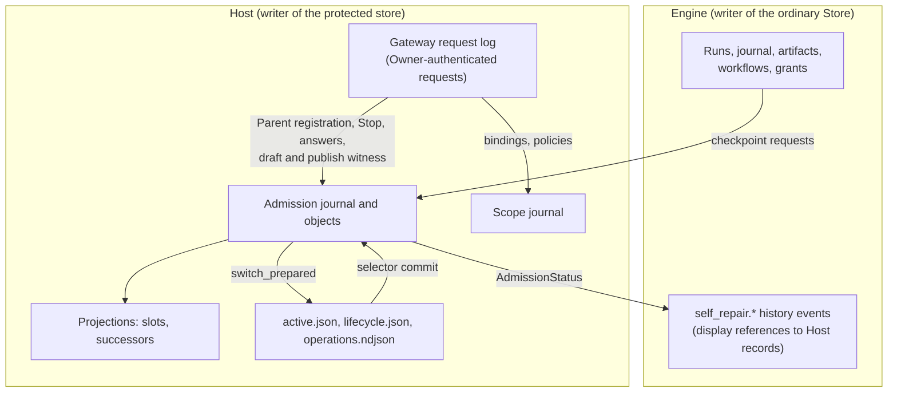

# 05. Store, Host-Engine protocol, API and Owner Token

Revised 2026-11-06 after the independent reviews (AR-08 to AR-13, SR-08, SR-10; [register](12-finding-register.md)).

> **Pending revision.** [14](14-self-repair-scope-reconsideration.md) proposes, under Variant 3, replacing the protected checkpoint messages of §5 with `ClaimSlot`, `SealCandidate` and `RequestActivation` and moving protected questions (§6.3) to the protected Engine Core; the gateway witnesses and the Stop journal (§6.2, §6.4) stay. This document stays the design of record until the Owner decides OD-12.

## 1. The ordinary Store today

- `runtime/core/store.mjs` opens `<profile>/store/state.sqlite` with `node:sqlite`, applies 22 migrations from `docs/storage/m1.sql`-`m22.sql` through the catalog in `runtime/core/migrations.mjs`, then sets `foreign_keys = ON`, `journal_mode = WAL` and `synchronous = FULL` (`store.mjs:41-71`).
- Each migration is one transaction together with its `schema_migrations` row, which records the SHA-256 of the script text. A store newer than the runtime is refused; an older one is backed up beside itself before migration (`store.mjs:47-54`).
- Immutable objects live under `store/objects/<first-two>/<sha256>`, staged under `store/staging/`, published by digest, then referenced from SQLite in one transaction ([STORAGE.md](../../STORAGE.md)). Objects are raw bytes (`putBytes`, `store.mjs:135`); JSON objects are canonical bytes (`putJson`, `:158`); text objects are UTF-8 (`putText`, `:159`).
- About 60 tables, among them `workflows`, `workflow_drafts`, `workflow_publications`, `runs`, `node_instances`, `attempts`, `journal_events`, `artifacts`, `artifact_references`, `command_receipts`, `run_links`, `judge_decisions`, `workflow_questions`, `incidents`, `control_grants`, `controller_sessions`, `attempt_custody`, `custody_workspace_holds`, `failure_outcomes`, `map_executions`, `managed_tasks`, `branch_deliveries`, `acceptance_records`.
- Startup also performs application-level work: legacy publication import (`migrateLegacyWorkflowPublications`, `runtime/core/engine.mjs:1442`) and the artifact reference backfill, which tolerates unreadable objects (`store.mjs:102-116`).
- One writer: the Engine, guarded by the exclusive SQLite lock on `runtime/runner.lock.db` (`runtime/lock.mjs:38`).
- Separately, the Host keeps `.deszo-host/active.json`, `profiles/<profile>/lifecycle.json`, `operations.ndjson` and custody records and spools. The legacy Local Control Host has its own database (`docs/storage/host-h1.sql`-`h5.sql`).

## 2. Rust Store access layer

| Concern | Design |
|---|---|
| Driver | `rusqlite` with the bundled SQLite build, version pinned in `Cargo.lock`; the pragmas above set identically. The exact SQLite versions on both sides are recorded by PR-7 |
| Location | Unchanged: `<profile>/store/state.sqlite`, `objects/`, `staging/` |
| Migrations | The same 22 SQL files, embedded byte-for-byte with `include_str!`. The recorded digests include the line-ending variants the current runner accepts; the Rust runner accepts exactly the same set |
| Semantic imports | The legacy publication import and the reference backfill are ported as startup steps with the same idempotency and the same tolerance of unreadable objects. Supported upgrade origins are listed in M0 (the current schema and each older schema the Node runtime still upgrades); an interrupted import resumes as today |
| Objects | Every object is verified by its raw byte digest on read, as today. Only objects stored as canonical JSON are additionally checked for canonical form, and only where the current code checks it. The per-read corruption behavior (`CorruptionError` on a digest mismatch) is preserved |
| New migrations | Maintainer releases only; P6 v1 refuses candidates that touch the migration files, runner or catalog (04 §3.2) |
| Transactions | One `BEGIN IMMEDIATE` per command commit covering events, projections and receipts; no wait on the Host or a provider inside a transaction; events published after commit |
| Writer ownership | The Engine is the only writer. The Host never opens the ordinary Store, except the G0 guarded read-share handles and the disposable preflight copy |
| Profile exclusion | The Rust Engine acquires the **same** `runtime/runner.lock.db` exclusive lock with the same protocol as `runtime/lock.mjs`, so a Node runner and a Rust Engine exclude each other on every launch path and alias of the profile during the compatibility window. The Host's single-Engine rule is in addition, not instead |
| Recovery | The current rules, ported |

### 2.1 Canonical JSON compatibility

Every canonical JSON artifact identity in history is the SHA-256 of bytes produced by `runtime/core/canonical.mjs`. The Rust implementation in `deszo-protocol` must produce identical bytes:

- Object keys sorted by UTF-16 code units (`compareText`, `canonical.mjs:4`), not by Rust's default UTF-8 byte order.
- Numbers serialized exactly as ECMAScript `Number.prototype.toString` does.
- Strict parsing: duplicate keys, lone surrogates, control characters and non-finite numbers rejected; a leading byte-order mark skipped (`parseStrictJson`, `canonical.mjs:12-60`).
- Existing objects are never rewritten.

PR-7 checks every object of real and older-origin profile copies: raw digest for all, canonical round-trip for canonical JSON objects.

## 3. Ordinary and protected state

**Decision:** two stores with two owners. The Engine owns the ordinary Store. The Host owns a small protected store. Records that decide an installation are written only by the Host, from facts the Host established itself (04). No ordinary Store row is ever read as authority; Host record ids that appear in Engine events are display references.

Alternatives considered:

| Approach | Why not selected |
|---|---|
| One shared Store with signed or keyed protected rows | Answers who wrote a row, not whether the decision was made on real evidence; mixes two writers in one SQLite file |
| A generic Host storage API for Engine-authored protected transitions | The Engine would still author the evidence |
| A third trusted process owning the store (Option B) | Same records, one more process and protocol ([08 §2](08-alternatives-and-tradeoffs.md)) |

Protected store layout (Host-only directory, protected access control, 02 §7):

```text
.deszo-host/profiles/<profile>/
  enrollment/root.json             RootEnrollment/1, installed once by the Owner
  enrollment/baseline.json         BaselineInstallation/1, written by the maintainer installer
  admission/journal.ndjson         the protected authority: one record per transition (04 §9), flushed per record
  admission/objects/<sha256>       snapshots, dossiers, spools, reports, build outputs
  scopes/journal.ndjson            ResourceBinding, PublicationResourcePolicy, RunScope records (13)
  projections/                     slots.json, successors.json, indexes: rebuilt from the journals, never authoritative
  gateway/owner-token, gateway/descriptor.json, gateway/requests.ndjson
```



Arrows into the Host are requests or Owner-authenticated observations; the Host decides and writes. The selector (`active.json`) remains the only activation commit; the admission journal records the prepared and committed operation around it (04 §9).

Enforcement: the directory is granted to no containment profile and is created with a protected access control list (03 §1). Integrity of the stored data comes from the operating system; authenticity of each decision comes from the fact that only Host code creates these records. PR-1 shows the denial for these exact paths.

## 4. Data preservation

| Data | Where it lives after migration | Compatibility proof |
|---|---|---|
| Published workflows, drafts, publication state | Engine Store, unchanged | Snapshot raw digests (PR-7); legacy publication import parity; differential API reads |
| Historical Runs, node instances, attempts, events | Engine Store, unchanged | Replay projections identical between Node and Rust readers |
| Artifacts and objects | Engine Store objects, unchanged | Raw digest for all; canonical check for canonical JSON (§2) |
| Command receipts, idempotency | Engine Store, unchanged | Recorded requests replay to recorded responses |
| Node-era P5/P6 records (handoffs, receipts, P6 operations, continuation) | Engine Store, read-only history | Shown as history; never evidence for a new authorization, acceptance or build |
| Host operation history | `.deszo-host/active.json`, `lifecycle.json`, `operations.ndjson`, read by a versioned reader that accepts the existing shapes | Reader tests on the current files |
| Slot claims | Admission journal. When the Owner enrolls at cutover, every slot with any recorded claim in the Engine Store is imported as consumed after validation against the new enrollment's pool; Node-era claims never authorize anything | With fewer than two free slots, admission stays closed until the pool is extended (06 §5) |
| Workspaces and legacy publications | Host `ResourceBinding` records and legacy marks, created only for what the Owner confirms in the cutover inventory (13 §6) | Unconfirmed workspaces and publications get no scope |
| Owner permissions and grants (`control_grants`, `controller_sessions`) | Engine Store, unchanged | Differential API tests of the grant routes |
| Owner Token | New value at cutover (§7) | Old value refused; UI and clients rediscover |
| Legacy Local Control Host database | Archived read-only (OD-5) | Archive digest recorded in the cutover journal |

## 5. Host-Engine protocol

| Property | Design |
|---|---|
| Transport | One pair of anonymous pipes per Engine process, inherited through an explicit handle list. No loopback |
| Framing | Length-prefixed frames (u32 little-endian length, then canonical JSON); maximum frame 1 MiB; bodies above it are chunked; the decoder rejects oversize, malformed or unknown frames without allocating their declared length |
| Envelope | `{ v, id, dir, kind, body }`; request ids are namespaced by direction, so a response can only answer a request of the other side |
| Principal | The pipe: the Host binds it to the process, role (normal or maintenance), generation and build at spawn. Ids in a body are lookup data, never authority |
| Phases | A maintenance-mode Engine may send only `MaintenanceReady` and the preflight result; a normal Engine may not send them |
| Replay | `id` unique per process; state-changing requests carry a durable `requestId` with a payload fingerprint (04 §4) |
| Priority | Three lanes with separate queues: control (Stop, cancel, drain, custody stop and status), protected requests, bulk (forwarded API bodies, SSE events, artifact chunks, job output). Control frames are never queued behind bulk frames; bulk lanes have credit-based backpressure |
| Timeouts | Reads and status 10 s; custody calls 30 s; forwarded API requests per route; streams without deadline but with keepalives. Protected checkpoints are asynchronous: the request is answered with a checkpoint id at once and the outcome arrives later, bounded by the enrolled budgets |
| Errors | `{ code, message, retryable }`, existing refusal codes kept |
| Versioning | `protocolVersion` in `build.json`, checked before spawn and in `Ready` |

Message catalog:

| Direction | Kinds |
|---|---|
| Host to Engine | `Bootstrap`, `Api::Request`, `Api::Cancel`, `Lifecycle::{DrainRequest, Resume, Proceed, Receipt, Shutdown}`, `Custody::Event`, `Scope::Ready` (a pending scope was issued), `Protected::CheckpointResult` (outcome of a Parent Judge, Gate or acceptance checkpoint), `Protected::AnswerArrived` (a protected question was answered, so the waiting Judge node can schedule its next Attempt), `Protected::Invalidated` (an Owner Stop or admission Stop was journaled) |
| Engine to Host | `Ready`, `ReceiptAck`, `Status`, `RunningRelease`, `RunningInventory`, `Scope::Issue`, `Custody::{Reserve, Launch, Status, Read, Ack, Cancel, Stop}` (scoped to the Engine's lineage and Run scopes), `Repair::{EnrollmentStatus, ClaimSlot, AdmissionStatus, ReportRepairCompleted, ReportInvalidation}`, `Protected::{ParentJudgeCheckpoint, RegisterRepairRun, SealCandidate, GateCheckpoint, AcceptanceCheckpoint}`, `Lifecycle::{DrainAck, MaintenanceReady, PreflightResult}`, `Api::{Response, Event, Chunk, End}` |

No stage, switch, fence, attach, legacy activation, acceptance write, build, enrollment or policy change exists on this channel. A `DrainAck` is a report (it carries the Engine's eligibility view, which can only narrow); the Host still proves termination itself. `MaintenanceReady` and `PreflightResult` are liveness, identity and candidate evidence, not a switch authorization. The channel's role is bound at spawn; `Proceed` is the only transition from maintenance to normal, and there is none in the other direction.

## 6. API gateway

The public API keeps its routes (v2, v3 and v4; 103 classified routes in `runtime/runner.mjs:227-452`). The listener, authentication and a closed set of protected operations move to the Host.

### 6.1 Forwarding and wire parity

- The Host binds `127.0.0.1`, applies the current origin allowlist (`runner.mjs:27`), CORS headers, request body bound (`runner.mjs:28`) and bearer check (`runner.mjs:195-202`). The caller identity it forwards is its own classification; the bearer is never forwarded or logged.
- Forwarded requests carry the headers the API uses today, per route: `If-Match`, `If-None-Match`, `Last-Event-ID`, `Idempotency-Key`, `X-Deszo-Client-Label`, `X-Deszo-Controller-Token`, and `X-Deszo-Judge-Token` on the routes that read it (`runner.mjs:419-422`) for as long as those routes survive (OD-5).
- **Response bounds per route:** JSON responses keep the 4 MiB result bound (`runner.mjs:29`, `result_too_large`); raw artifact bodies (`GET /api/v2/artifacts/{id}`) are streamed in `Api::Chunk` frames and bounded only by the client's `maxBytes`, as today (`runner.mjs:558-567`), with the same headers (`ETag`, immutable caching).
- **SSE:** the gateway holds the HTTP stream, writes `Api::Event` frames in sequence, honors `Last-Event-ID` and `afterSequence` exactly as the Engine validates them, and sends keepalives.
- **Freeze:** M0 records a per-route inventory of method, path, classification, status codes, error envelope, ETag behavior, idempotency, headers and streaming. Differential tests compare it (07 §3).

### 6.2 Host-owned and Host-witnessed routes

| Route | Host behavior |
|---|---|
| `POST /api/v2/owner-token/rotate` | Host rotates, rewrites the descriptor, informs the Shell |
| `GET /api/v2/installation/source-release` | Answered by the Host |
| Run-creating routes (`POST /api/v2/runs`, `POST /api/v2/context-bindings/{id}/messages`, `POST /api/v2/runs/{id}/linked-repair`; the list is frozen in M0) | The gateway writes a pending `RunStart` before forwarding and binds it from the response (13 §1.1); when the body names the enrolled Parent workflow, the same record is the `ParentRegistration` (04 §2.2) |
| `PUT /api/v2/workspaces/{id}` and resource routes | Forwarded; the Host records the `ResourceBinding` (13) |
| `PUT /api/v4/workflows/{id}/draft`, `POST .../draft/from/{n}`, `POST .../publish` | Forwarded; the gateway records the `resources` section, takes a derived draft's section from publication n, and binds it at publish (13 §1) |
| Protected question view `GET /api/v5/protected-questions` | Host-rendered protected questions (§6.3) |
| `POST /api/v2/judge-questions/{id}/answers` | Protected question ids are validated and consumed by the Host (§6.3); others are forwarded |
| `POST /api/v2/runs/{id}/stop`, `POST /api/v2/runs/{id}/stop-and-report` | Validated by the Host for every Run; the validated Stop ends the Run's scope and its derived scopes (13 §5); for a protected subject it is also journaled as `ProtectedStop` (§6.4); then forwarded |
| `POST /api/v2/runs/{id}/nodes/{node}/stop` | Forwarded unchanged; a node Stop does not invalidate the protected chain, as today (`runtime/core/engine.mjs:4354`) |
| `POST /api/v5/protected/admissions/{id}/stop` | Host-owned Stop of an authorization or admission from the Host-rendered protected view, keyed by Host ids (§6.4) |
| `POST /api/v2/runs/{id}/self-repair/publication` | The Host checks the exact repository, remote and ref against the accepted snapshot and the Owner's registered Git binding before the utility job is launched (13 §7) |
| Enrollment and admission reads `GET /api/v5/protected/...` | Owner reads of Host records |
| `/api/v2/autonomy/*` | With OD-5 retirement: `GET` keeps today's `200 { available: false, ... }`, the `POST` routes keep today's error status and code (`autonomy_unavailable`), as `runner.mjs:249-256` returns them when no Control Host is bound |

Retired with OD-5: the `internal-host` routes and the `hostToken` credential (`runner.mjs:122`, `:416-430`) and the ADR-0007 Judge attention routes, which depend on the legacy Control Host's authority (`runtime/core/judgeAttention.mjs:200-203`). Retired routes answer `410` with `operation_retired`, as other retired routes do today (`runner.mjs:387`). History stays readable.

### 6.3 Protected Owner questions

- Only the designated protected Judges create protected questions (04 §5.3). Each record holds: question id, admission or authorization, invocation and dossier digests, the typed answer schema from the enrolled Judge profile, the question text and subject rendered by the Host, the subject digest, budget, state (`pending`, `answered`, `superseded`), and timestamps.
- The trusted Shell renders protected questions from the Host view, not from the Engine's projection (today `src/App.tsx:886-896` reads `/runs/{id}/judge-questions` from the Engine). The Engine's question list shows a reference to the Host question.
- An answer is accepted only if: Owner-authenticated; the question is `pending`; the body includes the displayed subject digest; the value validates against the typed schema; the `requestId` is new or an exact replay. The Host consumes it once, records an answer receipt, and returns it; `GET /api/v5/protected-questions/{id}` returns the durable result after restart.
- Stale, superseded, malformed or duplicate-with-different-payload answers are refused without effect. A pending question survives a Host restart; the next Judge Attempt, with a fresh invocation, receives the answer.

### 6.4 Protected Stop

- For a Run that is a registered Parent, an authorized Repair, or part of a nonterminal admission, a run-level Stop or stop-and-report is validated by the Host against the same schema the Engine applies (`engine.mjs:4309`), the Owner authentication and the `requestId`, then journaled as `ProtectedStop` in the admission journal **before** forwarding.
- Because the Repair Run id is registered by the Engine, the Host also renders a protected view of every live authorization and admission with the Parent and Repair Run ids it holds; the Owner can stop an admission there directly (`POST /api/v5/protected/admissions/{id}/stop`), independent of what the Engine displays.
- A valid protected Stop invalidates the protected chain whether or not the Engine later accepts the Stop (for example because the Run already ended): the Owner's intent to stop is sufficient to block installation. A malformed Stop has no effect.
- Ordering: protected Stops and invalidations are serialized with the eligibility cutoff (04 §9). The response carries the Host receipt id in `X-Deszo-Protected-Receipt` and its state in `X-Deszo-Protected-Effect`: `blocks_installation` when it was journaled before the cutoff, `after_cutoff` when the switch had already passed the cutoff and continues; the protected view shows the same state. The body is the Engine's, unchanged.

## 7. Owner Token, discovery and clients

| Question | Answer |
|---|---|
| Storage | The Host gateway directory |
| Authentication | Gateway; the Engine receives `principal: owner` only |
| Authority | Unchanged: full public API authority (ADR-0001 amendment) |
| Cutover | **Rotated.** The Node-era value was readable by Engine children in the old topology (Decision C §2), so the cutover generates a new value, removes the old `profile/runtime/owner-token` and `connection.json`, closes old listeners, and the old bearer is refused from then on |
| Tauri UI | The Host passes port, token and descriptor version to the Shell over its inherited pipe at spawn and on rotation; the WebView gets it through `get_runner_connection` as today |
| External clients | Owner-run clients read the descriptor from the Host gateway directory (user-readable, granted to no container). Descriptor version 2 names the Host gateway, the `deszo-mcp` executable and the descriptor path; it drops `nodeExecutable` and `bridgeScript` |
| MCP bridge | `deszo-mcp` (Rust) keeps the tool contract, validates descriptor version 2, and keeps the reconnect rule of `mcp/runtime-client.mjs:62-90`: same store identity, retry on a changed port or token |
| Client setup | The UI's configuration generator (`src/App.tsx:1146-1152`, today Node and bridge paths) emits the `deszo-mcp` command and descriptor path. At cutover the UI shows the regenerated configuration; existing registrations that point at the Node bridge stop working and are listed for the Owner to replace |
| Controller and Judge tokens | Engine-domain credentials, forwarded in their headers; they authorize Engine-domain operations only |
| Exclusion | Old and new token and descriptor paths are outside every grant; credentials never appear in child environments or inherited handles |

## First-version section map

The independent reviews link to section titles of the first version. Each title below names where that content is now.

### 7. Owner Token model

Now §7.
