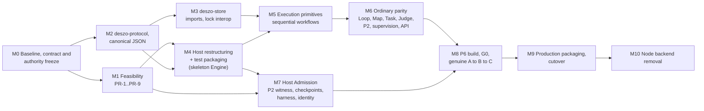

# 06. Migration plan

Revised 2026-11-06 after the independent reviews (AR-10, AR-11, AR-15; [register](12-finding-register.md)).

## 1. Principles

- Incremental, with a testable result and an explicit compatibility boundary at every stage.
- Each stage's acceptance gate uses only functionality delivered by that stage or earlier.
- Authority contracts (protocol catalog, protected records, resource manifest) are written and frozen before any implementation depends on them.
- Feasibility of a mechanism is shown before a stage relies on it.
- Vertical slices measured against recorded behavior, not file-by-file translation of JavaScript.
- The Node Engine is not deleted until its replacement is verified and the cutover is complete (M10).
- No configuration that ships to an installation mixes a Node Engine with the new Host authority model (§4). The final state has no JavaScript backend.

## 2. Stages and dependencies

| Stage | Content | Depends on | Exit criterion (only delivered functionality) |
|---|---|---|---|
| M0 | Behavioral baseline: route, wire and discovery inventory (05 §6.1); the 34 schemas; recorded fixture scenarios and provider streams; golden canonical-JSON and Git vectors; profile copies of the current and older supported origins; contract map (07 §2). **Authority freeze:** protocol catalog (05 §5), protected record kinds (04 §12), resource manifest and scope records (13 §1), protected question and Stop commands (05 §6.3-6.4) | none | Archive with digests; contract documents reviewed; every contract family has a recorded scenario |
| M1 | Prerequisites PR-1 to PR-9, and PR-10 when Variant 3 of 14 is pursued, as isolated spikes with evidence, including the PR-7a Store driver prototype | M0 | Each passed, or failed with its Owner decision recorded and the design amended |
| M2 | `deszo-protocol`: frames, catalog, canonical JSON, record kinds | M0 | Golden vectors equal; codec refusal tests pass |
| M3 | `deszo-store`: migrations, semantic imports, raw and canonical object reads, write path, `runner.lock.db` interop | M2, PR-7a | Profile-copy projections equal Node's; older-origin copies import identically; a Node runner and a Rust Store process exclude each other |
| M4 | Host maintainer change against a skeleton Engine: gateway with Owner Token and Host-owned routes, Shell connection over a pipe, direct Engine spawn, `sandbox` and `scope` modules, fail-closed launch, explicit handle lists, typed channel with lanes, custody principal scoping, removal of every child-reachable legacy entry point. **Test packaging:** `xtask test-package` produces packaged Host, Shell, harness and Engine builds for system tests, and writes a test `BaselineInstallation/1` record marked as test-only, which a release Host refuses | M1 (PR-1, PR-5, PR-8), M2 | Host integration tests; channel, token, grant and scope refusal tests (07 §5); packaged skeleton starts and stops under the Host |
| M5 | Store integration, sequential scheduler, Run capture and pinning, attempts, custody client with Run scopes, provider adapters for the providers that passed PR-2, Stop and cancel, recovery | M3, M4, PR-2 per provider | Differential journals equal for recorded **sequential** scenarios, Stop and restart recovery |
| M6 | Loop, Map, Task, review Gate, context packages, branch delivery, supervision, incidents, audit, workflow Judge with Owner questions, ordinary P2 linked Repair, all API routes, SSE, raw artifact streaming | M5 | Compatibility rows for these subsystems (§3) done; route inventory equal; UI works against the gateway |
| M7 | Admission with a fixture Engine: root enrollment, Parent registration, Parent Judge delegation, authorization and slot claims, sealing and identity, policy, Gate and acceptance checkpoints, causal harness runs, protected questions and Stop, admission journal | M4, PR-2 (Judge provider), PR-3, PR-6, PR-9 | Fixture chain accepted; every refusal of 07 §5 for M7 passes; restart during `verifying` and `judging` gives `abandoned` and clean retry |
| M8 | Build jobs, `BuildIntent`, reproducibility, collection, `BuildReceipt/2`, successor slot seeding, `eligibility_cutoff`, `switch_prepared`, Host-internal stage and switch, per-build principal and grant transition, successor enrollment | M6, M7, PR-1 (grant transition), PR-4 | Build and seeding crash tests; packaged genuine A → B → C and exhaustion with the M4 test packaging applied to the M6 Engine and its test baseline record (07 §6) |
| M9 | Production installer, baseline installation record, token rotation, descriptor version 2, `deszo-mcp`, UI configuration generator, cutover tooling (§5) | M8 | Full Rust regression on one frozen snapshot; cutover rehearsal with restart at every step |
| M10 | Removal list (§6) | M9 and completed cutover | No JavaScript outside the frontend tree and its build tooling; full regression passes |

Joins: M2 → M3 and M4 → M5; M6 and M7 and PR-4 → M8; M9 → M10. M5-M6 and M7 run in parallel once M4 exists.

## 3. Compatibility matrix

| Subsystem | Old implementation | Rust replacement | Phase | Compatibility proof |
|---|---|---|---|---|
| Canonical JSON and hashing | `canonical.mjs` | `deszo-protocol::canonical` | M2 | Golden vectors; canonical re-hash of JSON objects |
| SQLite Store | `store.mjs`, `migrations.mjs`, `m1`-`m22` | `deszo-store` | M3 | Migration digests; projection equality; semantic import parity; raw digests |
| Profile lock | `runtime/lock.mjs` | Same `runner.lock.db` protocol in Rust, plus the Host single-Engine rule | M3, M4 | Mutual exclusion test with both runtimes |
| Workflow validation and planning | `validate.mjs`, `planning.mjs` | `deszo-workflow` | M5 | `docs/fixtures` cases; differential `validateWorkflow` |
| Drafts, publications, Run pinning | `engine.mjs:2019-2157`, `captureRun` | `deszo-engine` | M5, M6 | Differential API v4 lifecycle; immutability refusals |
| Scheduler (sequential) | `engine.mjs` `pump`, `pumpRun`, `readiness` | `deszo-engine::scheduler` | M5 | Differential journals |
| Loop, Map, Task, review Gate | `mapRuntime.mjs`, `taskRuntime.mjs`, `gate.mjs` | `deszo-workflow` + scheduler | M6 | Recorded loop, map, managed-task and revisions scenarios |
| Provider adapters | `adapters.mjs`, `transport.mjs`, `antigravityJudgeAdapter.mjs` | `deszo-providers` | M5 | Recorded native streams; invocation equality under the Run scope |
| Resource scopes | one primary workspace, Full Access | Host `scope` module (13) | M4, M5 | Legacy scope equals today's access for old publications; cross-Run denial |
| Custody | `custody.mjs` + `custody.rs` | Engine client + Host module with scopes | M4, M5 | Existing Rust custody tests; custody E2E scenarios |
| Judge (ordinary) | `workflowJudge.mjs` | `deszo-engine::judge` | M6 | Judge policy, runtime and scenario recordings |
| P2 linked Repair | `linkedRepair.mjs` | `deszo-engine::repair` (ordinary); Host Parent witness and authorization (protected) | M6, M7 | Parent-repair scenarios; forged-authorization refusals |
| P5 Gate and causal check | `p5Gate.mjs`, `p5Verifier.mjs` | Host checkpoints, verification jobs, `deszo-harness` | M7 | Re-expressed Gate negatives; causal outcome-class refusals |
| P5 enrollment, slots | `protectedSelfRepair.mjs`, `workspaceIsolation.mjs`, `linkedRepair.mjs` slot functions | Host enrollment and slot journal; Engine keeps ordinary-run reservation checks | M7 | Pool, alias and reserved-run scenarios |
| P6 Builder and Consumer | `p6Builder.mjs`, `p6Consumer.mjs`, `p6Reconstruction.mjs`, `p6Scope.mjs` | Host build and policy | M8 | Reproducibility; scope refusals; genuine E2E |
| P6 continuation | `p6Continuation.mjs`, `p6Successor.mjs` | Host successor enrollment and seeding | M8 | Successor identity cases against the Host |
| G0 switch | `engine_switch.rs`, `store_guard.rs` | Kept; trigger and principals changed | M4, M8 | G0 tests re-pointed to the Host-internal trigger |
| API | `runner.mjs` | Host gateway + `deszo-engine::api` | M4, M6 | Per-route wire inventory equality |
| Owner Token | `runner.mjs:68-79`, `:228-248` | Host gateway | M4, M9 | Rotation, UI refresh, old bearer refused after cutover |
| MCP bridge and client setup | `mcp/*.mjs`, `src/App.tsx:1146` | `deszo-mcp`, descriptor version 2, regenerated configuration | M9 | Tool contract tests; reconnect and rediscovery |
| Shell supervisor and launch shim | `src-tauri/src/main.rs`, `supervisor.rs`, `bin/launch_shim.rs` | Host spawn and custody | M4 | Job containment and Stop proof tests in the Host |
| Test fault seams | `testFaultPolicy.mjs`, `testEngineProbe.mjs` | Cargo feature `test-seams`, refused in release manifests | M4 | Manifest refusal test |
| Legacy Local Control Host | `runtime/host/*.mjs`, `native/*.cs` | None (retire, OD-5) | M10 | Archive; autonomy routes answer as today when no Control Host is bound |
| ADR-0007 Judge attention | `judgeAttention.mjs` | None (retire with OD-5) | M10 | Routes answer `410 operation_retired` |
| Build and release scripts | `scripts/*.mjs` | `xtask` | M4 (test), M9 (release) | Manifest equality for unchanged inputs |

## 4. Coexistence and its restrictions

- No Node configuration with P6 activation is released: the ADR-0011 release block stays in force until the Rust cutover. There is no interim release with a Node Engine under the new Host (OD-7 closed by default).
- The restructured Host runs only with Rust Engine builds and only in development and test profiles until M9. It never spawns a Node Engine.
- **One writer per profile on every launch path.** The Rust Engine takes the same exclusive `runtime/runner.lock.db` lock as `runtime/lock.mjs`, so a standalone Node runner, a Shell-launched Node runner and a Host-launched Rust Engine exclude each other on the same profile and on any alias that resolves to it. The Host's single-Engine rule is in addition.
- Differential tests run the two Engines against separate copies of a profile, never one live Store.

## 5. Cutover and downgrade

Cutover is a maintainer release driven by a **cutover journal** in the new Host state. Every step is idempotent and recorded; on restart the installer resumes from the last recorded step.

| Step | Action | Recovery if interrupted |
|---|---|---|
| 1. Preconditions | Node release quiescent: no nonterminal P6 operation, no active custody job, Runs settled under the existing Stop and recovery rules, Node Engine stopped | Abort; nothing changed |
| 2. Exclusion | The installer takes the installation lock and the profile's `runner.lock.db` lock and holds them to step 9 | Locks end with the process |
| 3. Checkpoint | A coherent copy of `state.sqlite` through the SQLite backup interface (including WAL contents), the object inventory with digests (objects are immutable and stay in place), Host state files, descriptor, token file and legacy Control Host database, into a checkpoint directory; journal `checkpoint_taken` with its digest | Redo the checkpoint |
| 4. Install | New Host, Shell, harness, toolchain and vendor set from the maintainer release; the first Rust Engine package built from a clean maintainer source; `BaselineInstallation/1` | Redo; the old release is still selected |
| 5. Credentials | Generate a new Owner Token; write descriptor version 2; remove `profile/runtime/owner-token` and `connection.json`; the old listener is gone with the Node release | Redo; the old token is already invalid for the new gateway |
| 6. Inventory confirmation | The installer shows the Owner the existing workspaces and publications (the cutover inventory, 13 §6). Confirmed workspaces become `ResourceBinding` records; their capability entries are applied and each access-control change is journaled with the previous state; confirmed publications are marked legacy | Redo from the journal; partially applied entries are reapplied or removed from the recorded previous state |
| 7. Optional enrollment | Only if the Owner enrolls protected Self-Repair now: provider and Judge executables are re-pinned from installation sources the Owner confirms (cutover trust, OD-11); the root enrollment is installed against the baseline record; slots are freshly seeded from the Host's baseline objects, never reused from Node-era slot contents; Node-era slot claims are imported as consumed after validation against this enrollment's pool. Without enrollment, protected admission simply stays closed; a later enrollment repeats the re-pinning and fresh seeding (OD-11) | Redo |
| 8. Legacy archive | The legacy Control Host database is archived read-only | Redo |
| 9. Ownership commit | Journal `cutover_committed`; the selector names the baseline Rust build | Before `cutover_committed`: resume, or restore the checkpoint, remove the journaled access-control entries and reselect the Node release. After it: the new release owns the profile |
| 10. Start | The Host starts the Rust Engine; UI and clients rediscover with the new descriptor | Ordinary Engine recovery |

If the imported pool leaves fewer than two free slots, admission stays closed until the Owner extends the pool; the cutover itself is not refused.

Downgrade:

- **Before `cutover_committed`:** reselect the Node release; the checkpoint restores any changed file and the journal reverses the access-control entries.
- **After the Rust Engine has written the Store:** only to the pre-divergence checkpoint, which discards Rust-era work and is an explicit Owner action. A longer downgrade window (Node reading and writing Rust-era data) is offered only if M3 and M9 prove semantic round-trip compatibility with representative Rust-era records, including Host record references in events, versioned envelopes and consumed slots; OD-2 decides whether to pursue that proof.
- No data is restored automatically.

## 6. What M10 removes

`runtime/` (Engine, host-side JS, verification, and tests after their Rust counterparts pass), `mcp/*.mjs`, `shared/*.mjs` as backend code (the UI imports `shared/effort.mjs`, `shared/replay.mjs` and `shared/task-config.mjs` directly, for example `src/model.ts:3-4` and `src/Replay.tsx:4`; those modules move into the frontend tree, and the Engine's effort policy becomes a Rust port checked against the same golden cases so the two cannot drift), `scripts/bundle-runtime.mjs` and the bundled Node, the esbuild-based P6 builder, the import-closure resolver, `P6_PROTECTED_CONTROL_PATHS`, the test-fault module policy, the C# native helpers of the legacy Control Host, and the launch shim. Historical ADRs and reviews are kept.

## First-version section map

The independent reviews link to section titles of the first version. Each title below names where that content is now.

### 5. Cutover and rollback

Now §5.
