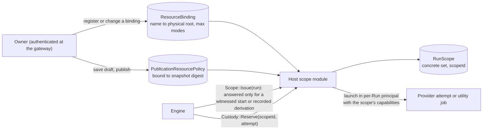

# 13. Workflow-scoped Full Access

- **Owner definition (confirmed):** Full Access means full operational access to the explicitly authorized resources of a Workflow, not unrestricted access to the whole machine.
- **Findings addressed:** AR-03, SR-02 ([register](12-finding-register.md)).
- **Self-Repair scope reconsideration:** [14](14-self-repair-scope-reconsideration.md) keeps this document unchanged under both variants, except that under Variant 3 the protected Repair scope of §1.1 is derived from the Host claim record; Workflow-scoped Full Access does not depend on OD-12.
- **Today:** a Run selects one primary `workspaceId` (`runtime/core/engine.mjs:2509`); providers run with Full Access in that directory and the UI says locks "are not a sandbox" (`src/App.tsx:803`, `:1058`); Custody accepts an Engine-supplied cwd (`lifecycle-host/src/custody.rs:835`). The target keeps practical development work (several repositories, compilers, scripts, dependency downloads where granted, provider sign-in and resume) while making the grant set an Owner-authorized, Host-enforced fact.

## 1. Authority chain

| Record | Created by | Content | Mutability |
|---|---|---|---|
| `ResourceBinding/1` | Host, from an Owner-authenticated workspace or resource route witnessed by the gateway (today `PUT /api/v2/workspaces/{id}`) | Binding name; physical identity of the root (volume and file identity plus canonical path); maximum modes; kind (directory, repository) | Versioned. A change creates a new version; widening needs an Owner request |
| `PublicationResourcePolicy/1` | Host, from the Owner-authenticated draft save and publish requests it forwarded | Symbolic requirements: binding names with modes (`read`, `write`, `execute`), approved tool ids, network (`none` or `provider`), provider configuration ids, scratch and cache quotas, bound to the publication snapshot digest | Immutable with the publication |
| `RunStart/1` | Host gateway, from an Owner-authenticated Run-creating request (§1.1) | Request id, workflow and version or chat binding, `workspaceId` from the Owner's body; bound to the Engine's response (Run id, publication digest, workspace) | Immutable |
| `RunScope/1` | Host, only for a `RunStart` or a Host-recorded derivation (§1.1) | Concrete set = policy ∩ Owner-confirmed bindings, after the overlap checks of §4; the Run's capability identities; lifetime | Immutable; can only be narrowed or ended |
| `AttemptGrant/1` | Host custody, per launch | Scope id, attempt id, executable identity, cwd inside the scope, environment allowlist | Ends when custody proves the attempt's tree drained |

The Engine never authors these records and never chooses a scope. An Engine-written publication, Run row or UUID cannot extend an OS permission.

### 1.1 Which Runs get a scope

- **Witnessed starts.** M0 freezes the list of Owner-authenticated routes that create Runs (today `POST /api/v2/runs`, the chat route `POST /api/v2/context-bindings/{id}/messages`, and the manual linked Repair `POST /api/v2/runs/{id}/linked-repair`). The gateway writes a pending `RunStart` before forwarding, then binds the Run id, publication digest and workspace from the Engine's response; a response that names a different workflow, version or workspace than the Owner's body is refused and gets no scope.
- **Derived Runs.** A Run the Engine starts on its own gets a scope only by a derivation the Host records, of three kinds. (1) A protected Repair from its `RepairAuthorization` (04 §2.4). (2) An ordinary Judge-requested Repair from the Repair profile pinned in the Parent's witnessed publication: the binding named by the profile's `repairWorkspaceId`, intersected with the Repair publication's recorded policy (or the legacy scope on that binding for a legacy Repair publication). The Engine names the Parent Run and the profile id; the Host checks that the profile is pinned in the Parent's publication record, that the Repair Run's publication digest equals the pinned one, and that the Repair binding does not physically overlap any root of the Parent's scope, which keeps today's linked-Repair isolation rule (`runtime/core/linkedRepair.mjs:204-216`). A kind-2 derivation is refused once the Parent's scope has ended. (3) Any other child Run from its parent's `RunScope`, intersected with the child publication's policy, so such a child is never wider than its parent.
- **Everything else is refused.** Until a Run's `RunStart` is bound or its derivation recorded, `Scope::Issue` answers `pending` and custody refuses launches for it; the Engine's scheduler waits, as it waits for any unavailable resource today.

**Gateway witness of the policy.** The gateway already authenticates and forwards the draft save (`PUT /api/v4/workflows/{id}/draft`) and publish (`POST /api/v4/workflows/{id}/publish`) requests. It records the canonical `resources` section of each Owner-authenticated draft body it forwards. At publish it binds the section recorded for the published draft's ETag to the snapshot digest returned by the Engine, after checking that the snapshot's `resources` section is byte-identical to the recorded one. A draft derived from a publication (`POST /api/v4/workflows/{id}/draft/from/{n}`, `runtime/runner.mjs:314`) starts from that publication's recorded section. A mismatch refuses the policy record, and Runs of that publication get **no scope** until the Owner republishes; there is no fallback. The same witness records the Repair profiles pinned in the draft's Judge policy (Repair workflow, version and snapshot digest, `repairWorkspaceId`), so derived Repair scopes rest on Owner-authenticated data.

## 2. Enforcement: per-Run principals with capability grants

- Each binding has two capability identities (read, write) derived by name. When the Owner registers a binding, the Host adds one inheritable entry per capability to the root's access control list. This happens once per binding, not per Run, so large repositories are not rewritten at every Run start.
- Each Run gets its own containment profile. Its tokens carry exactly the capabilities of its `RunScope`. Two concurrent Runs with different scopes cannot reach each other's roots; two Runs authorized for the same binding share it, because the Owner authorized both.
- Every process of a Run's attempts (provider CLI, its compilers, scripts and tools) inherits the token and runs in a no-breakaway Job. A Host allowlist governs the first executable; descendants are bounded by the token, not by the allowlist.
- **The Engine holds no workspace capability.** Engine operations that need a Run's files (output capture, candidate capture, `git status`, branch delivery) run as short **utility jobs** under the same Run principal through custody, and return bounded results. Data the Engine receives this way is visible to the Engine; confidentiality of returned data between Runs is not provided, and the design does not claim it.
- No new process type is introduced: utility jobs are custody jobs.

## 3. What a scope contains

| Resource | Rule |
|---|---|
| Multiple roots and repositories | Any number of bindings; Git metadata inside a granted repository is part of it; a worktree or alternate object directory outside the granted roots is not reachable |
| Modes | `read`, `write`; `execute` means the tool may run binaries from that root; a root without `execute` is still readable as data |
| Approved CLI tools | Tool ids map to Host-verified executables (path and digest, as the custody allowlist does today, `custody.rs:1157`); the tool's installation directory is granted read and execute |
| Network | `none` or `provider` (the AppContainer client capability). Destination allowlists are not expressible by the capability and are not offered in v1; a policy that requests one is refused, not widened |
| Provider configuration and credentials | Only the provider's own configuration directory. Where the CLI supports a relocated configuration home, the Run receives a per-Run writable copy seeded read-only from the Owner's configuration; otherwise the shared directory is granted and the provider is excluded from protected roles (Developer and Judge of protected Repairs) until PR-2 shows isolation (04 §2) |
| Temporary directories and caches | A per-Run scratch and cache directory created by the Host; shared caches only read-only |
| Lifetime | Grants exist for the attempt; the Run principal is retired when the Run is terminal and custody proves drain, or when an Owner Stop ends the scope (§5) |

## 4. Overlaps, aliases and links

- **Object-based enforcement.** Access checks apply to the target object's own access control list, so a junction, symbolic link or hard link inside a granted root that points at Host state reaches an object that denies the container. Path tricks do not widen access; the checks below prevent the Host from granting too much in the first place.
- **Refused bindings and scopes:** a root that contains, or is contained in, the installation, the Host state directories, the Engine Store, an enrolled or claimed protected slot, or another root of the same scope with a different mode; a root whose path resolves through a reparse point to any of those; a root on a volume whose identity cannot be read.
- **Host-private directories** are created with protected (non-inheriting) access control lists, so an ancestor grant cannot propagate into them.
- **Re-validation:** physical identity is checked at binding registration, at scope issue and at each launch. A changed identity ends the scope with a refusal; the Run follows its existing failure rules.
- The existing alias walk (`workspaceAliasOverlap`, `runtime/core/workspaceIsolation.mjs`) remains the Engine's ordinary-run reservation check; protected-slot exclusion is enforced by the Host here.

## 5. Narrowing, revocation and widening

- **Narrowing and revocation** take effect at the next launch: the Host stops issuing the revoked capability, and removes the access control entries when a binding is deleted. Running attempts are not terminated by revocation alone, which preserves the rule that silence or long execution never ends a Run.
- **Owner Stop ends the scope.** A validated run-level Owner Stop (05 §6.2) is journaled by the Host and ends that Run's scope and every scope derived from it, whatever the Engine does: custody refuses new launches at once, and jobs the Engine has not settled within the Stop grace bound are stopped by the Host. The bound is a named custody parameter frozen in M0 with the authority contracts; no such bound exists in the current source, which only grants a grace beyond a custody deadline (`runtime/core/engine.mjs:4167`). A Parent Stop also ends the scopes of its kind-2 Repairs (§1.1), whose scopes come from the pinned profile rather than from the Parent's scope. This is the Owner's explicit Stop, not a silence rule.
- **Widening** requires an authenticated Owner action: a binding change within the publication's declared names, or a new publication. A historical Run keeps its captured `RunScope` for audit after revocation.

## 6. Legacy publications

Publications created before the cutover have no recorded resource policy. The cutover (06 §5) records a **cutover inventory**: the existing publications with their snapshot digests and the existing workspaces with their paths, shown to the Owner. Only what the Owner confirms becomes Host state: each confirmed workspace becomes a `ResourceBinding` (with its capability entries applied and journaled), and each confirmed publication is marked legacy, together with the Repair profiles its Judge policy pins.

A Run of a legacy publication receives the **legacy scope**: the binding named by the `workspaceId` in the Owner's witnessed Run request (read, write, execute), provider configuration as in §3, per-Run scratch, and `provider` network. Publications not in the confirmed inventory, and workspaces the Owner did not confirm, get no scope. Anything beyond the legacy scope requires the Owner to publish a new version with a resources section. For confirmed workspaces this narrows nothing that runs today, because today's Runs have one primary workspace; the confirmation step itself is part of OD-1.

## 7. Network-using Engine operations

The Owner-requested branch publication (`runtime/core/p5GitCandidate.mjs`, the only `push`) runs as a utility job with the repository binding, the `provider` network capability and the Git credential configuration the Owner registered for that repository. The Host checks the exact repository, remote and ref named in the Owner request before launch.

## 8. Feasibility

These rules depend on AppContainer custom capabilities and per-Run profiles behaving as described, including that a contained process cannot start a child with a capability or AppContainer identity it does not hold, even though capability names are derived from binding names the Engine can know. PR-8 ([09 §1](09-open-decisions.md#1-prerequisites)) tests them before any milestone relies on them; PR-2 tests each provider CLI inside such a scope.
