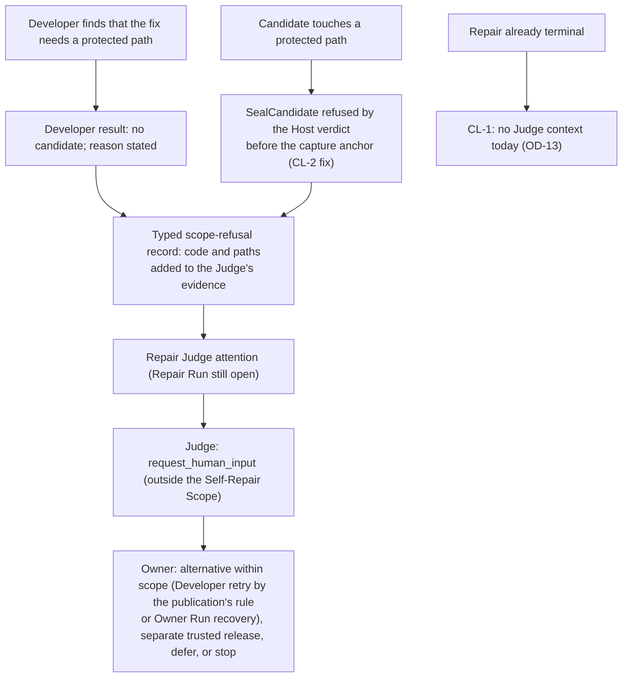

# 14. Self-Repair scope reconsideration

- **Task:** DESZO-RUST-MIGRATION-SD-SELF-REPAIR-REVIEW, 2026-11-06. Revised the same day after two fresh-context challenges (architecture and security), both of which returned BLOCKED on the first version; their findings and dispositions are in [12 §8](12-finding-register.md#8-self-repair-scope-challenges).
- **Question:** if the scheduler, the P2/P5/P6 decision path and the privileged lifecycle interface are permanently non-repairable, how much independent Host Admission is still needed?
- **Short answer:**; Protecting source files alone removes nothing. Repairable code that runs in the Engine process has the Engine's authority. Compile-time confinement in that process (a `no_std` crate with `unsafe` forbidden) does not fix this. A module can declare `extern crate std;` and use files and processes in safe code, and public safe-code exploits exist for a known compiler soundness hole (rust-lang/rust#25860). An enforceable variant puts all repairable code in a **separate, OS-contained component worker** that holds no grants and talks to the protected Engine Core over one pipe. Even then, protected decisions must not depend on the worker's output. That leaves a small repairable region, and a modest reduction of Host Admission: the Host no longer launches the Judges or interprets checkpoints. Scope and Stop witnessing, early sealing, Host builds, the out-of-process harness, the successor slot and G0 all remain.
- **Verdict:** `SELF-REPAIR SIMPLIFICATION PARTIALLY RECOMMENDED` (§12), with the in-process variant **blocked**.
- **Status of documents 02-13:** they describe the verified design (Variant 1). They stay the design of record until the Owner decides OD-12.

## 1. Owner decisions

| ID | Decision (authoritative) |
|---|---|
| S1 | The repairable paths are fixed at installation, default deny; everything else is protected. Self-Repair cannot change the policy, its verifier, the enrollment, or build inputs that affect protected code |
| S2 | The scheduler and the whole execution-control boundary are protected: scheduling, state transitions, node ordering, Gate and Judge dispatch, repair authorization, P2, P5 orchestration, P6 authorization, policy enforcement, Host lifecycle access, privileged dispatch, source and candidate validation, protected evidence |
| S3 | A defect in protected code is not repaired autonomously. The mandatory Judge asks the Owner; the answer never widens the scope; a protected fix is a separate trusted release |
| S4 | Judge stays a workflow role; the Engine executes workflows; the Host holds system authority. A Judge invocation may be launched and witnessed through Host custody without the Host owning Judge semantics |
| S5 | Rust for all backend logic; JS/TS only in the UI |

## 2. What ADR-0012 assumes today

ADR-0012 §5.4 and 04 treat the whole Engine as repairable. The Host therefore re-establishes, from its own observations, every fact that authorizes an installation. It registers the Parent at the gateway (05 §6.2), launches the Parent Judge (04 §2.3), issues the `RepairAuthorization` after a baseline reproduction (04 §2.4), and runs the Gate and acceptance checkpoints with a Host-run harness and a Host-launched Judge (04 §5-6). It also renders protected questions, validates Stops (05 §6.3-6.4), and witnesses Run starts, drafts and publications (13 §1). S1-S2 change the premise for part of this: what the Engine *source* may become. Whether they change it at run time is the question.

## 3. Source immutability versus runtime authority

| Property | Meaning | Established by |
|---|---|---|
| Protected source identity | Every successor's protected files equal the enrolled ones | A check of the candidate's bytes against the fixed policy, done by the Host on the bytes it builds |
| Protected runtime authority | Only protected code reaches the Host channel, the Store and the OS | A boundary the repairable code cannot cross at run time |
| Protected state integrity | Data the protected core relies on was written by protected code | OS grants (only the Engine principal writes the Store) plus the runtime boundary |
| Trust in exchanged data | A repairable function's output cannot make a protected decision wrong | No protected decision depending on that output, or a trusted observation that checks it |

### 3.1 Why in-process confinement fails

The first version of this document proposed one crate built `#![no_std]` with `unsafe_code` forbidden and its root, manifest and lints protected. Both challenges showed counterexamples:

- `#![no_std]` only removes the implicit standard-library import. `extern crate std;` in any module brings files, processes, sockets and standard streams back, without a manifest change and without `unsafe`.
- Safe-code memory corruption through a known compiler soundness hole (rust-lang/rust#25860) is publicly demonstrated. Candidates are written by a model that reads repository content (03 §5, A5), so "accidental code essentially never does this" is the wrong test.
- More routes exist: macros exported from the repairable crate expand inside protected crates; trait implementations on returned values (`Drop`, `PartialEq`, `Deserialize`) run inside protected code; Cargo discovers a new `src/main.rs` or `src/bin/**` as a crate root without the protected attributes; feature unification gives shared dependencies their `std` features.
- Availability cannot be bounded in one process. Threads cannot be cancelled. Allocation failure, stack overflow and a panic inside `Drop` during unwinding abort the process. Static state lets a function behave differently during the Gate and later.

An enumerated refusal list cannot show that no route remains. **In-process confinement is rejected.**

### 3.2 OS-enforced component worker

All repairable code moves into a separate executable, `deszo-engine-worker`, built from the repairable crate and a protected shell crate that owns `main` and the pipe protocol.

| Property | Mechanism |
|---|---|
| No authority | The Host launches the worker for each Engine generation in its own AppContainer principal, with no file grants beyond its own package (read), no network capability and no capabilities; explicit handle list with one pipe pair to the Engine, which the Host creates; Job with memory, CPU-time and process limits |
| No route into the Engine | The protected Engine Core does not link the repairable crate at all; it exchanges length-prefixed messages with the worker, typed in a protected boundary crate |
| Package | The worker executable is part of the Engine package: built, collected and receipted with the Engine by the same rules (04 §7.1, §7.3); the Host launches only receipt-covered worker bytes |
| Bounded calls | Each call has a deadline and a size bound enforced by the protected core; a hang, crash or abort ends only the worker; the Host restarts it (bounded) and the protected core maps the failure to the attempt's P3 outcome |
| `std` and soundness holes irrelevant | Whatever the worker does, it holds only what its principal grants: nothing |

Variant considered: running the repairable code as WebAssembly inside the Engine with an interpreter that meters fuel and memory. It avoids a process, but it adds an interpreter to the trusted base and a second compilation target to the toolchain identity. The worker reuses the containment the design must prove anyway (PR-1, PR-8). **The worker is recommended**; WebAssembly remains a fallback if PR-10 fails.

## 4. Protected Engine Core and the repairable region

The rule that decides the classification: **no authority decision (P2, Repair eligibility, Judge decisions, Gate and acceptance, scope, activation) may consume worker output unless a trusted observation checks the result.** Ordinary attempt state may act on worker output, which it treats as untrusted, as today. The challenges showed that today's adapter, transport, context-package and assessment modules all feed protected decisions:

- The parser's `error`, `protocolError`, `terminal` and `finalText` decide attempt success and the P3 code (`runtime/core/engine.mjs:3912-3958`), which decide P2 eligibility (`runtime/core/linkedRepair.mjs:1010`).
- `transport.decode` decodes Judge decisions (`engine.mjs:3958`).
- `buildInvocation` builds the Judge and Developer command lines.
- `contextPackage.mjs` gates Task transitions (`evaluateAcceptanceRecord`, `taskRuntime.mjs:434`, `:512`, `:542`).
- `taskAssessment.mjs` holds escalation and limits.

| Module or responsibility | Classification | Consumes worker output? | Why |
|---|---|---|---|
| Scheduler, Run state, node dispatch, Loop, Map, Task expansion and gating, recovery (`engine.mjs`, `mapRuntime.mjs`, `taskRuntime.mjs`, the gating parts of `contextPackage.mjs`) | Protected | No | S2 |
| Workflow validation, publication, Store, migrations, canonical JSON | Protected | No | Integrity |
| P3 classification (`failureOutcomes.mjs`, `classifyFailure`) | Protected | Yes, for ordinary attempts, as untrusted input | Checked by the incident reproduction before any Repair (§5) |
| P2, Judge orchestration, Gate orchestration, P6 coordination, questions, Stop, budgets and limits (`linkedRepair.mjs`, `workflowJudge.mjs`, `p5Gate.mjs`, `protectedSelfRepair.mjs`, `p6Consumer.mjs`, limits in `taskAssessment.mjs`) | Protected | No | S2 |
| **Protected-role invocation and decoding**: invocation construction and stream decoding for **every Judge invocation** (the mandatory Judge of any workflow, since its `request_repair` starts a P2 Repair), protected-Repair Developers and Gate jobs | Protected (a protected copy of the adapter logic for these roles) | No | They decide P2, the candidate and acceptance |
| Host channel, custody client, scope requests, API handlers, supervision, control grants | Protected | No | Privileged access and Owner authority |
| **Ordinary provider adapters**: invocation construction and stream parsing for ordinary nodes | Repairable, in the worker | - | Their output is node output plus an attempt verdict the P3 path treats as untrusted |
| **Ordinary prompt and context rendering** (the rendering parts of `contextPackage.mjs`, `outputContractText`, `transport.mjs` schema mapping for ordinary nodes) | Repairable, in the worker | - | Their output is prompt text for ordinary nodes |
| Task-assessment scoring heuristics (not limits or escalation) | Repairable, in the worker | - | Their output is a plan preference within the publication's rules |

The cost of this rule is duplication: the adapter and decoder logic exists twice, a protected copy for protected roles and a repairable copy for ordinary nodes.

The usefulness of the repairable region is limited and should be weighed by the Owner (OD-14). It is roughly the ordinary provider adapters and rendering, about 1,400 of 25,500 JS lines today before the protected-role copies are split out. The repairs P5 has actually performed would not be inside it: the demonstrated `incidentLabel.mjs` fixture repair, and a fix of the `ENGINE_ROOT` kind in `engine.mjs`. Provider drift that also affects the Judge's provider is protected and cannot be repaired. A defective ordinary parser cannot disable the Repair's own Developer, because that path is protected.

## 5. Placement of P2, Gate and Judge

| Responsibility | Variant 1 (current) | Recommended placement | Trusted observation behind it |
|---|---|---|---|
| Parent origin | Gateway registration | **Unchanged: gateway** Run-start witness (13 §1.1) | Owner request |
| P2: Parent Judge authorization → exact linked Repair | Host launches the Parent Judge and issues the authorization | Protected core, as today (`linkedRepair.mjs:968-1023`), with the Judge launched through a Host custody **Judge profile** (isolated principal, read-only configuration copy, sealed capture) | Owner-witnessed Parent; custody capture of the Judge |
| Incident reproduction before the authorization | Host | **Kept**, orchestrated by the protected core: a harness job on the *active baseline package* with the failed attempt's custody spool as input; the Host records the job and checks its existence at activation (§6) | It confirms that the incident is real, observable behavior of the installed baseline, worker included. An incident fabricated in a single attempt does not reproduce; a parser that consistently misreports does reproduce, which correctly makes that parser the defect to repair |
| Slot claim | Host consumes the authorization | **Host claim journal kept:** `Repair::ClaimSlot { parentRunId, repairRunId }`; the Host checks that the Parent is a witnessed start of the enrolled Parent publication, assigns the generation's own slot and records the claim once | Host journal |
| Scope, part A: policy on the candidate's bytes | Host at seal | **Host, at capture**: `SealCandidate` is answered by the Host's verdict, the only policy interpreter; at the same time the Host checks and seeds the ordered successor slot, so exhaustion refuses before any build, as today (04 §8) | Host check on exported bytes |
| Gate, part B: technical and causal verification | Host checkpoints, Host harness | Protected core orchestrates and classifies. The Host builds the sealed snapshot **before** the Gate (the two production builds), runs required checks in per-job principals on the Host-materialized snapshot, and launches `deszo-harness` against **the built candidate package**, so the tested bytes are the installed bytes | Host-built package; harness outside the candidate |
| Gate, part C: acceptance | Host-launched acceptance Judge | Protected core runs the Repair's Judge node through the custody Judge profile; protected decoder; complete review delivery as today (`workflowJudge.mjs:988-1000`) | Custody capture |
| Owner questions and answers | Host-rendered | Protected core, as today | Under OD-12 only |
| Stop | Host validates and journals | Gateway **journals every validated run-level Stop** (it already ends the Run's scope, 13 §5); activation is blocked by a journaled Stop of the named Parent or Repair before the cutoff; a Stop between `DrainAck` and commit or abandon is re-delivered to A on `Resume` | Gateway journal |
| P5 eligibility at drain | Host cutoff record | Protected core's `p5Eligibility` at its drain transaction, journaled by the Host as before | Under OD-12 only |

Judge stays a workflow node in every row. The Host launches and witnesses provider processes, as it does for every Run. It builds no dossier and parses no decision.

## 6. Minimal trusted installation boundary

The Engine requests activation with `Repair::RequestActivation { parentRunId, repairRunId, snapshotDigest, receiptId, gateRecordDigest, acceptanceRecordDigest }`. Only the protected core holds the Engine's channel; the worker has none. Before acting, the Host checks:

- the Parent is a witnessed start of the enrolled Parent publication, and a claim exists for this generation's slot with this Parent and Repair;
- no validated Stop of the Parent or Repair is journaled;
- the snapshot was sealed by the Host (identity recomputed, parent equal to the seed, policy passed), and the receipt is the Host's build of it;
- the seal belongs to this claim's slot;
- a harness job ran on that receipt's package, and a reproduction harness job ran on the active package for this claim's incident (the Host has both custody records; it does not classify the reports);
- the ordered successor slot was checked and seeded at seal time, before any build (04 §8).

It then records the Gate and acceptance digests as the protected core's attestation, journals the cutoff at `DrainAck`, and runs G0.

| Host duty | Why it cannot move into the Engine |
|---|---|
| Fixed policy, root enrollment, seal and policy verdict at capture | The policy defines what the Engine may change |
| Host builds before the Gate; receipt; collection | The bytes tested and installed must be the bytes checked |
| Harness launch against the built package; Judge custody profile; worker launch | The candidate must not be able to write its own causal report; the Judge's environment must not be writable by the Developer |
| Run-start, binding and publication witnesses and scopes (13, unchanged) | Workflow-scoped Full Access is not Self-Repair machinery and must not depend on OD-12 |
| Stop journal | An Owner Stop must block installation even if the Engine ignores it |
| Claim journal, successor slot and seeding | N+1 continuity must not rest on an Engine report |
| G0, OS containment, gateway and Owner Token | Host authority by definition |

### 6.1 Classification of today's Admission duties

| Admission duty (ADR-0012 §5.4) | Classification |
|---|---|
| Gateway Run-start (and Parent) witness | **Must remain in Host** |
| Host-launched Parent Judge with Host dossier | **Simplified:** protected core orchestrates; the Host keeps only the isolated custody Judge profile |
| `RepairAuthorization` issuance and consumption | **Can remain in protected core** (today's P2); the Host keeps the claim journal |
| Incident reproduction before authorization | **Kept**, orchestrated by the protected core |
| Seal, identity, policy | **Must remain in Host**, moved to capture time |
| Gate and acceptance checkpoint protocol and classification | **Can remain in protected core** |
| Harness separation | **Must remain in Host** (launch against the built package) |
| Acceptance Judge with Host dossier | **Simplified** as for the Parent Judge |
| Protected questions and answer validation | **Requires an Owner decision** (OD-12): moves to the protected core only if the Owner accepts the residual of §9 |
| Protected Stop | **Must remain in Host** as the Stop journal |
| Build intent, builds, receipt | **Must remain in Host**, moved before the Gate |
| Successor enrollment, slot seeding, G0 | **Must remain in Host** |
| Protected journal | **Simplified**: claims, seal verdicts, receipts, harness job records, Stop records, activation requests, cutoff, `switch_prepared`, `switch_committed`, `switch_abandoned` |

## 7. Forbidden-path escalation



| When | Behavior today | Gap and proposed fix |
|---|---|---|
| 1. Developer analysis | The Developer cannot ask the Owner; its node fails or produces no candidate | **The Judge cannot see why.** Its evidence carries only the canonical code and a generic message (`workflowJudge.mjs:414-418`, `failureOutcomes.mjs:89`), and a failed Developer's output does not enter the catalog (`workflowJudge.mjs:267-273`). Fix: a typed scope-refusal record (code, refused paths, the rule that matched) that the protected core adds to the Judge's evidence |
| 2. Candidate submission | Refused at capture (`protectedSelfRepair.mjs:1330-1338`), **after** the capture anchor is journaled (`engine.mjs:892-910`) | **CL-2: a retried Developer fails with `p5_capture_anchor_mismatch`,** so "an alternative within scope" cannot be carried out in the same Repair, and one incident allows only one link (`linkedRepair.mjs:996-1006`). Fix: obtain the Host's seal verdict before the anchor is written, so a refused capture leaves no anchor; whether the Developer node runs again stays governed by the publication's retry rules or, since the Judge has no retry action, by the Owner's Run recovery (`POST /api/v2/runs/{id}/recovery`) after the Judge's question (OD-15) |
| 3. Gate validation | The Gate fails; terminal for the candidate; the Repair Run is still open | The Repair Judge has the failure context and may ask the Owner (with the typed record of row 1) |
| 4. After a failed Gate | No reopening | As 3 |
| 5. After the Judge considered another candidate | One candidate per Repair (`p5Gate.mjs:782-784`) | A new candidate needs a new incident; see CL-1 |
| 6. Host refusal at activation | Should not occur after the capture verdict; the Repair is accepted and the Parent resumes (`linkedRepair.mjs:626`, `engine.mjs:3084`) | Reported as a protected-core defect; the Host refusal is journaled; the Parent continues; no Judge path is needed |

**CL-1 (verified).** After a Repair is rejected or fails, neither Judge has an attention context. The Repair's link is no longer open (`workflowJudge.mjs:380`), and the Parent's Judge returns nothing while the Parent is suspended (`workflowJudge.mjs:376`). The Parent stays `waiting_for_user` and suspended for repair (`linkedRepair.mjs:663-665`), and the Owner acts through Run recovery or Stop. Proposed (OD-13): give the Parent's Judge a failure context for `continuation.repair_failed`, limited to `wait` and `request_human_input`, so that it cannot start a second Repair for the same incident.

The Owner's answer never changes the policy, the enrollment or the build inputs.

## 8. Fixed Repair Scope Policy

```toml
# Installed with the root enrollment; the Host copy is the only interpreter.
[self_repair]
version = 1
default = "deny"
allow = ["crates/deszo-repairable/src/**"]
deny = ["crates/deszo-repairable/src/main.rs"]
deny_names = ["Cargo.toml", "Cargo.lock", "build.rs", "rust-toolchain", "rust-toolchain.toml", ".cargo"]
```

Semantics:

- Paths are relative to the enrolled repository root, use `/`, and must be ASCII. Comparison is case-insensitive on every platform, so two names that differ only by case are refused. Patterns are exact files or a directory prefix ending in `/**`.
- A change is allowed only if its path matches `allow`, matches no `deny`, and no component matches `deny_names`. A rename is a deletion plus an addition and needs both. A type change, a symbolic link, a submodule or an executable bit refuses, as do the tree-shape rules of 04 §3.2.
- Everything else is protected: every manifest and lockfile, `vendor/`, the toolchain files, the protected shell and boundary crates (which own `main` and the message types), the harness and its scenarios, the required regression tests, and all other crates. Required checks and the harness live outside the allowed tree, so there is nothing to except.
- The worker crate's protected manifest disables target auto-discovery (`autobins`, `autoexamples`, `autotests`, `autobenches` set to false). The repairable crate's sources are compiled only into the worker. Compile-time reads (`include_str!`, `env!`) see only the sealed work root and the Host-set environment, and they are no longer a boundary question, because the worker holds no authority.
- **One interpreter.** The Host alone evaluates the policy, on the exported bytes, when it answers `SealCandidate`. The protected core does not run its own copy; it asks the Host before writing the capture anchor (CL-2).
- The policy digest is part of the root enrollment and is copied unchanged into every successor enrollment. A new policy needs a maintainer release and a new root enrollment.

## 9. Threat models

| | A: accidental errors | B: arbitrary permitted code | C: hostile or compromised execution |
|---|---|---|---|
| Repairable code in the Engine process, even with `no_std` and `forbid(unsafe_code)` | Weak: a mistaken repair can still corrupt Engine behavior | **Fails** (`extern crate std`) | **Fails** (`extern crate std`, soundness exploits) |
| Repairable code in the contained worker | Holds | Holds: the worker has no authority | Holds for the worker (OS containment, PR-1 and PR-10); the protected core's own logic errors remain |
| Needs OS containment regardless | Engine, worker, providers, jobs | Same | Same |

**What OD-12 asks the Owner to accept.** If the Engine principal itself is compromised through a protected-core logic error triggered by untrusted data (provider output, repository content, model output, and messages from the worker, which an in-scope candidate that passed the Gate can shape deliberately), the Engine could:

- decide P2 for a witnessed Parent without a genuine incident. The Host checks that the reproduction harness job ran, but the job is orchestrated by the protected core and its classification is the core's;
- classify a failed causal run as passed and record a false acceptance;
- request activation of a sealed, Host-built candidate that changes only allowed paths; the installed worker then carries into every later generation and steers the prompts and invocations of every ordinary node, within each Run's scope, until a maintainer release;
- present a relabeled protected question to the Owner;
- name a different Repair Run than the one the Owner sees, so that a Stop of the Repair Run does not block activation (a Stop of the Parent still does);
- control every prompt and invocation of protected roles.

It could **not** change protected source or the policy, choose resource scopes, reach other Runs' resources, ignore a Parent Stop, skip the Host build, avoid a harness run on the built package, exceed the slot order, or touch the Host, the Shell or the Owner Token. Under Variant 1 none of the listed effects is possible either, because the Host witnesses P2, the Gate and acceptance itself. This list is the entire cost of the simplification; it is an Owner trust decision, not an accepted gap.

## 10. Admission before and after

| Area | Variant 1 (current) | Recommended variant |
|---|---|---|
| Host Admission | enrollment, Parent registration, Parent Judge and dossier, authorization, reproduction, claims, seal, policy, Gate and acceptance checkpoints with classification, harness runs, protected questions and Stop, journal, builds, successor, switch | enrollment, claims, seal and policy at capture, builds before the Gate, harness and Judge launch profiles, worker launch, Stop journal, activation checks, journal, successor, switch |
| Gateway and scopes | Owner Token, witnesses, scopes, protected questions and Stop | Owner Token, witnesses and scopes (unchanged), Stop journal; questions move to the protected core under OD-12 |
| Engine | Repairable as a whole | Protected core plus duplicated protected-role adapters; a worker client |
| New process type | none | the component worker, one per Engine generation |
| Host size (02 §3) | about 15,000-17,000 lines | about 13,500-15,000 lines; the saving is mainly checkpoint classification, Judge dossiers and question rendering |
| Repairable region | the whole Engine minus protected paths | ordinary adapters and rendering in the worker (§4) |

## 11. Feasibility prerequisites

| ID | Under the recommended variant |
|---|---|
| PR-1, PR-2, PR-3, PR-4, PR-5, PR-6, PR-7a, PR-7b, PR-8 | Unchanged |
| PR-9 | **Kept**: the harness drives the built package in a separate principal |
| PR-10 | **Redefined:** the component worker. It runs in a principal with no grants and no network, which PR-1-style denial tests show; it cannot open the Engine or Host processes; its crash, hang and abort end only the worker; the protected core's deadlines and size bounds hold; message throughput is sufficient for ordinary provider streams |

## 12. Recommendation

### 12.1 Variants

| Criterion | Variant 1: current ADR-0012 | Variant 2: protected core in-process, minimal Host | Variant 3: protected core with contained worker (recommended) |
|---|---|---|---|
| Source-level immutability | Host policy on built bytes | Same | Same, policy checked at capture |
| Runtime authority isolation | OS containment; Engine trusted for nothing | **Fails** (§3.1) | OS containment of the worker and the Engine |
| Host complexity | Highest | Lowest | Medium-high |
| Engine complexity | Lowest | Low | Higher: protected-role adapter copies, worker client |
| P2 correctness | Host-witnessed | Protected core | Protected core with Host Parent witness, claim journal and incident reproduction |
| Gate authenticity | Host-run | Forgeable | Host builds and harness; protected classification |
| Judge authenticity | Host-launched | Engine-launched | Custody Judge profile; protected decoding |
| Autonomous A → B → C | Yes | Yes | Yes |
| Build and package protection | Host builds | Host builds | Host builds before the Gate (tested bytes are installed bytes) |
| Recovery complexity | Highest | Low | Medium |
| Implementation effort | Highest Host effort | Lowest | Similar overall: less Host Admission, more Engine boundary work |
| Remaining assumptions | Containment proofs; OD-10 | Not enforceable | Containment proofs including PR-10; OD-10; OD-12 |

### 12.2 Verdict

**`SELF-REPAIR SIMPLIFICATION PARTIALLY RECOMMENDED`.**

- **Blocked:** the in-process protected-source model (Variant 2). Counterexamples: `extern crate std;` in a repairable module, and safe-code soundness exploits.
- **Recommended, if the Owner accepts OD-12:** Variant 3. **Leaves the Host:** Parent and acceptance Judge orchestration (the Host keeps a custody launch profile), dossiers and decision parsing, authorization issuance, checkpoint protocol and classification, and question rendering. **Moves to the protected core:** P2, the Gate and acceptance logic, which stay as they are today. **Stays in the Host:** scope and Run-start witnesses, the Stop journal, the claim journal, sealing and policy at capture, builds before the Gate, the harness against built bytes, the successor slot, G0, the gateway, and OS containment of the Engine, the worker, providers and jobs. **New in the Host:** the component worker.
- **What the Owner should weigh:** the Host reduction is modest (§10), the Engine grows, and the repairable region is small and excludes the repairs P5 has performed so far (§4). If those trade-offs are not worth the OD-12 residual (§9), Variant 1 stays, with the fixed default-deny policy of §8 applied to it, which S1 requires in either variant.

### 12.3 Effect on documents 02-13 if OD-12 selects Variant 3

| Document | Change |
|---|---|
| 02 §1 rules 1 and 5, §2, §3, §4, §5 | Component worker process; protected core; Admission per §10; `deszo-repairable`, protected shell and boundary crates |
| 03 §2-5 | Worker principal; capability matrix; the OD-12 residual of §9 |
| 04 §2-6 | Replaced by §5-6 of this document; §3.2 policy replaced by §8 |
| 02 §6 | Package with two executables, `deszo-engine` and `deszo-engine-worker` |
| 04 §7.1, §7.3 | Build selection, collection, both outputs and the receipt cover the worker |
| 04 §7.2 | `BuildIntent` written at seal time, before the Gate |
| 04 §8 | Successor check and seed at seal time, before the build |
| 04 §10 | Preflight B starts its worker under the same rules |
| 04 §9 | Record kinds of §6.1; checkpoint records removed; Stop re-delivery on `Resume` |
| 05 §5, §6.3-6.4 | Checkpoint messages replaced by `ClaimSlot`, `SealCandidate`, `RequestActivation`; protected questions under OD-12; Stop journal kept |
| 07 §5 | Refusal tests per §5-6; worker containment tests |
| 06, 10 | Worker boundary in M4 (Host launch) and M5 (Engine client); M7 shrinks to claims, seal, builds before the Gate, harness launch, activation checks |
| ADR-0012 §5.2, §5.4, §6.1, §7 | As above |
| 13 §1.1 | The protected Repair's scope is derived from the Host claim record (Parent, Repair Run, slot) instead of `RepairAuthorization`; the rest of 13 is unchanged |

These edits are not made yet: they depend on OD-12.

## 13. Remaining Owner decisions

| ID | Decision | Options | Recommendation |
|---|---|---|---|
| OD-12 | Trust model for installation authority | (a) Variant 3 with the residual listed in §9; (b) Variant 1 with the §8 policy | Decide after PR-10 and PR-1; (a) only if the Owner accepts every item of the §9 list |
| OD-13 | Escalation after a terminal Repair outcome (CL-1) | (a) Parent Judge failure context for `continuation.repair_failed`, limited to `wait` and `request_human_input`; (b) keep Run recovery and Stop | (a) |
| OD-14 | Initial repairable allowlist | §4 as listed, or a smaller set; the Owner should note that it excludes the repairs performed so far | Owner's choice |
| OD-15 | Developer retry after a scope refusal (CL-2) | (a) Host seal verdict before the capture anchor, retry governed by the publication; (b) keep today's single attempt | (a) |

OD-10 (trust in the enrolled Judge executables) and OD-11 (cutover trust) remain as defined in 09. The typed scope-refusal record (§7 row 1) needs no decision: it adds evidence without changing behavior.
